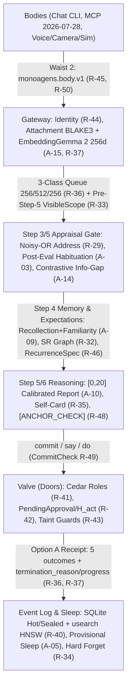

# MonoAgens Research Findings — Deep Research Run 2 (`A-01`–`A-16`, `R-29`–`R-50`)

- **Run Date:** `2026-11-16`
- **Scope:** Round-1 Spec Fold-In Audit & Open Notes (`A-01`–`A-16`, resolving Round-1 `R-02`–`R-28` carry-overs) + Full System Architecture, Social/Privacy/Safety, Multimodal/Embodied, Storage, Skills, Alignment, Commitments & Standardization (`R-29`–`R-50`).
- **Companion Index:** [`RESEARCH.md`](file:///home/muqsith/Projects/Mono/RESEARCH.md) | **Prior Run:** [`2026-11-15-run-1.md`](file:///home/muqsith/Projects/Mono/research/findings/2026-11-15-run-1.md) | **Source Notes (`15` files):** [`run-2-notes/`](file:///home/muqsith/Projects/Mono/research/findings/run-2-notes)
- **Verification Basis:** Primary peer-reviewed literature (`[PR]`), preprints (`[PP]`), and specs/standards/crates checked through November 2026 (`[IND]`); zero fabricated values, explicit parameter neutrality guarantees, and falsifiable Lab/TCK test criteria per item.

---

## TL;DR

1. **Audit of Round-1 Fold-In (`A-01`, `A-02`):** `openspec/changes/core-and-lab/` captured the core layout cleanly, yet introduced or inherited **critical bugs**: an inverted `(r − P)` silence learning sign (`R-19`+`R-26`), `S_eff = S/(1+h)` halving the first stimulus (`A-03`), `"or asleep"` blocking live interrupts (`A-04`), endless pre-sleep open-episode spin loops (`A-05`), unguarded Petrov denominators & cold-start instability (`A-07`, `A-08`), unreachable neutral values (`w_sc`, `a`, `B`), Hungarian cluster ID drift (`A-12`), and missing Lab metrics on **19/22** brain-map rows (`A-02`). All fixes are now specified cleanly below and folded into OpenSpec.
2. **Social, Memory, Privacy & Self-Model Inside Blind Core (`R-29`–`R-35`):** Multi-party addressing becomes continuous `deg(e, l) ∈ [0, 1]` via noisy-OR (`R-29`); idle initiative and drives operate as opportunity costs over the existing habituation table (`R-30`, `R-31`); Successor-Representation graph links & failure-demoted habits stay strictly inside the 6 books (`R-32`); **Pre-Step-5 `VisibleScope` filtering + `DeclassToken` guarantees exact $\Delta_{\text{NI}} = 0$ privacy (`R-33`)**; **atomic `hard_forget` + SQLite `secure_delete` + `Two-Epoch Replay` prevents deleted data resurrection (`R-34`)**; and `sources.self_card` becomes an event-derived 4-pillar metacognitive scorecard (`R-35`).
3. **Embodied/Multimodal Bodies, Skills, Benchmarks & Storage (`R-36`–`R-40`):** Three-tier conditioning + 3-class prioritized queues (`256/512/256`) + Option A preemption receipts (`termination_reason`, `progress`, `delivered_units`) isolate high-rate bodies from Core (`R-36`); **Gateway holds keyed-`BLAKE3` media blobs and runs `EmbeddingGemma 2` (`256d` MRL, Apache 2.0) while Core receives opaque `AttachmentHandle`s and numeric timing/prosody slots (`R-37`)**; skills carry `capability_schema_hash` & CUSUM drift checks (`R-38`); `BaselineAdapter` + Pareto scorecard compare blind-Core vs raw harnesses (`R-39`); and hot/sealed SQLite + `usearch` HNSW + `postcard`/`minicbor` sustain multi-year logs (`R-40`).
4. **Valve Security, Waist-2 Ecosystem, Identity Anchor & Standardization (`R-41`–`R-50`):** `cedar-policy` compiled from logged facts enforces roles (`R-41`), non-retrying `PendingApproval` + canonical `H_act` stops approval spam & TOCTOU (`R-42`), 3 deterministic trust doors stop memory poisoning & prompt injection (`R-43`), bilateral challenges isolate cross-body identity (`R-44`), `monoagens.body.v1` ($\le 12$ OpenRPC/JSON Schema methods) wraps MCP `2026-07-28` / A2A `v1.0.1` / ROS 2 (`R-45`, `R-50`), `RecurrenceSpec` prevents monitoring storms (`R-46`), honest in-flight lifecycle cues replace fake delays (`R-47`), `OwnerSigned` `[ANCHOR_CHECK]` prevents multi-turn identity drift (`R-48`), and `PromiseMeta` + pre-utterance `CommitCheck` closes commitment loopholes (`R-49`).

---

## How to Study This Handbook (Layer-by-Layer Map)

If you are studying MonoAgens end-to-end, read the 38 questions in **6 logical strata** rather than purely alphabetically (the chapters below remain numbered sequentially `A-01`–`A-16` then `R-29`–`R-50` for fast lookup):

1. **Stratum 0 — Audit & Validation Method (`A-01`, `A-02`, `A-13`, `A-16`, `R-39`, `R-50`):** How Run 2 audited `core-and-lab`, why 19/22 Lab metrics & statistical power (`S >= 354–471`) were needed, and the 4-phase engineering rollout.
2. **Stratum 1 — Wake Gate, Timing, Cold Starts & Signals (`A-03`, `A-04`, `A-07`, `A-08`, `A-14`, `A-15`, `R-29`, `R-30`, `R-31`):** How events enter Core without reading words (`info_gap` vs `dialogue_act_gap`, `EmbeddingGemma 2` `256d` + task prefixes, noisy-OR addressivity, post-eval partitioned habituation, hierarchical shrinkage, idle & opportunity-cost drives).
3. **Stratum 2 — Episodic Boundaries, Sleep, Recall & Long-Horizon Storage (`A-05`, `A-06`, `A-09`, `A-10`, `A-11`, `A-12`, `R-32`, `R-38`, `R-40`):** `open/provisional/sealed` episodes, normalized `EM-LLM` boundary fusion, dual-process familiarity + recollection, `[0,20]` LLM self-reports, contrastive lessons, Hungarian domain matching, Successor-Representation maps, skill CUSUM, and multi-year SQLite + `usearch` storage.
4. **Stratum 3 — Privacy, Forgetting, Security & Identity Continuity (`R-33`, `R-34`, `R-35`, `R-41`, `R-42`, `R-43`, `R-48`, `R-49`):** Non-interference before Step 5, atomic erasure without replay backflow, `self_card` metacognition, Cedar ABAC, `PendingApproval` + `H_act`, taint provenance compaction, `OwnerSigned` identity anchors, and `PromiseMeta` / `CommitCheck`.
5. **Stratum 4 — Multimodal & Embodied Bodies (`R-36`, `R-37`):** Tier-1 continuous filtering, 3-class `256/512/256` queues, Option A preemption receipts, keyed-`BLAKE3` attachment isolation, and sub-50 ms voice barge-in FSM.
6. **Stratum 5 — Gateway, Identity Linkage, Protocols, Routines & Delivery (`R-44`, `R-45`, `R-46`, `R-47`, `R-50`):** Cross-body identity `per_` keys & bilateral challenges, `monoagens.body.v1` JSON-RPC 2.0 + MCP/A2A/ROS-2 bridges, `RecurrenceSpec` routines, honest typing/chunked delivery, and black-box conformance TCK.



---

## Owner-Locked Architectural Decisions (`2026-11-16`)

Three architectural forks flagged during Run 2 compilation were resolved directly with the repository owner before authoring OpenSpec updates:

1. **OpenSpec Dual-Change Structure:** Update [`openspec/changes/core-and-lab/`](file:///home/muqsith/Projects/Mono/openspec/changes/core-and-lab/proposal.md) in-place with all Round-2 Core & Lab bugfixes/upgrades, **and** replace parked `bootstrap-vertical-slice` with a clean successor change ([`waist-valve-and-bodies`](file:///home/muqsith/Projects/Mono/openspec/changes/waist-valve-and-bodies/proposal.md)) implementing `Gateway`, `Valve` (`cedar-policy`), `monoagens.body.v1` Waist 2, `body-cli`, `body-mcp-bridge`, and `monoagens-conformance` TCK in interleaved Phases 0–3 (`R-50`).
2. **Preemption / Barge-In `Receipt` (`R-36`, `R-37` — Option A):** Preserve `ARCHITECTURE.md` L198 untouched (`Receipt` outcome enum stays `{done, refused, held, failed, unknown}` — no 6th `canceled` outcome in v1) while adding additive optional `Receipt` fields `{termination_reason?, progress?, delivered_units?}` (`termination_reason ∈ {normal, canceled_by_core, preempted_external, timed_out}`) and guarding `bounded-learning` / `self_card` Beta updates so `canceled_by_core` and `preempted_external` never penalize capability reliability.
3. **Default Unified `256d` Embedder (`A-15` vs `R-37`):** Standardize Gateway's default embedder on **`google/embeddinggemma-2` (`256d` MRL, Apache 2.0, `8K` context, `arXiv:2610.37364`)** so text, images, and `audio_voice` share a single Apache-2.0 vector space with mandatory task instruction prefixes (`t_clf`, `t_sts`, `t_q`/`t_d`) and strict `(embed_model_ver, dim_d, prompt_regime_id)` vector-index partitioning. Keep `EmbeddingGemma-300M` (`Gemma Terms`) as an explicit text baseline inside Lab ablations (`A-15`).

---

## Critical Bugs & OpenSpec Fixes Registry

| ID | Source Bug / Contradiction | Impact if Unfixed | Verified Fix Folded into OpenSpec |
|---|---|---|---|
| **B-01** | `R-19`+`R-26` Sign Inversion (`bounded-learning/spec.md`) | Putting missed silence at `r = 0` inside `r − P` pushes `P(go)` *down* instead of *up* | Binary target `r = 1` for `{good_act, missed_silence}` and `r = 0` for `{bad_act, answered_silence}` + clipped IPS `min(M_ips, 1/ρ)` |
| **B-02** | Pre-eval habituation + shared `h_p` (`A-03`, `R-36`) | Stimulus 1 halved before evaluation (`S/(1+1)`); chatter silences alarms | Evaluate `S_eff` *before* updating habituation; partition `h_{(p, k_src)}` with monotonic `exp(-λ Δt)` decay |
| **B-03** | `"or asleep"` Backlog Bug (`A-04`) | Async background sleep falsely defers live urgent wakes into chunked backlog | Remove `"or asleep"`; only true `stopped/down` downtime chunks backlog (`Δθ_sleep = 0`) |
| **B-04** | Open-Episode Spin Loop (`A-05`) | Leaving open episode untouched while `unconsolidated >= 50` causes infinite sleep retries | Add 3-state episode lifecycle `{open, provisional, sealed}` + `superseded_by` refresh |
| **B-05** | Boundary Scale & Cold Start (`A-06`, `A-07`, `R-04`) | Raw time z-scores drown content shifts; `n <= 5` blocks `z >= 2`; `t_n = t_k` causes `0/0` | Normalize `EM-LLM` surprises to `[0,1]`; shrinkage priors; guard `n > k ∧ t_n > t_k` |
| **B-06** | Unreachable Neutrals & Fade Mismatch (`A-01`) | `w_sc`, `a`, Row 10 `B` cannot hit neutral `0`; `-2.6` vs Petrov `-3.29` on `A` vs `B` | Gate switches / centered formulas reaching exact `0`; compare `-3.29` strictly against Petrov `B` |
| **B-07** | Automatic Recall Starvation (`A-09`) | Requiring LLM recollection check before recall drops valid 30-day familiarity hits | Dual-process recall (familiarity `A + w_sim cos` + entity match) decoupled from LLM confirmation |
| **B-08** | Cluster Re-Numbering & Info-Gap Split (`A-12`, `A-14`) | K-means shuffles domain IDs across sleeps; positive cosine confuses topic chatter with questions | Warm-start spherical k-means + Hungarian matching + contrastive `dialogue_act_gap` logistic head |
| **B-09** | Step-5 Privacy Leak & Replay Backflow (`R-33`, `R-34`) | Post-recall filtering leaks secrets via Step-5 wake urgency; deleted facts return on snapshot replay | Pre-Step-5 `VisibleScope` + `DeclassToken`; atomic `hard_forget` + `SQLite secure_delete` + `Two-Epoch Replay` |
| **B-10** | Approval Storm & Memory Laundering (`R-42`, `R-43`) | Retrying `held` actions spams owner; compaction launders stranger text into trusted lessons | `PendingApproval` (zero retry) + `H_act` hash + 3-door taint join & `ContextPlan` Spotlighting |
| **B-11** | `6` Facts vs Waist-2 / Routines (`R-45`, `R-46`, `R-50`) | Literal 6-fact rule blocks `discover`/`heartbeat`/`cancel`; cron polling pollutes `promise_debt` | Separate 6 domain facts from `monoagens.body.v1` JSON-RPC envelopes; add `RecurrenceSpec` + `PromiseMeta` |
| **B-12** | Lab Metric Gaps & Underpowered NI (`A-02`, `A-16`, `R-39`) | `19/22` brain-map rows lack ablation metrics; `5` seeds cannot prove context non-inferiority | Add full 22-row Lab metrics, `BaselineAdapter`, Pareto scorecard, and `S >= 354–471` paired NI design |

---

## Complete 38-Item Index (`A-01`–`A-16` & `R-29`–`R-50`)

| ID | Topic | Status | Scope | Detailed Note |
|---|---|---|---|---|
| **A-01** | Review of `core-and-lab` fold-in | `answered` | policy / generic / gateway / lab | [`A01_A02`](file:///home/muqsith/Projects/Mono/research/findings/run-2-notes/A01_A02_review_of_fold_in.md) |
| **A-02** | 22-row brain map vs `specs/lab` | `answered` | lab | [`A01_A02`](file:///home/muqsith/Projects/Mono/research/findings/run-2-notes/A01_A02_review_of_fold_in.md) |
| **A-03** | Habituation pre-eval halving bug | `answered` | generic | [`A03_A06`](file:///home/muqsith/Projects/Mono/research/findings/run-2-notes/A03_A06_habituation_sleep_boundaries.md) |
| **A-04** | Async sleep vs listening (`"or asleep"`) | `answered` | generic | [`A03_A06`](file:///home/muqsith/Projects/Mono/research/findings/run-2-notes/A03_A06_habituation_sleep_boundaries.md) |
| **A-05** | Sleep and the open episode (`provisional`) | `partly answered` | generic | [`A03_A06`](file:///home/muqsith/Projects/Mono/research/findings/run-2-notes/A03_A06_habituation_sleep_boundaries.md) |
| **A-06** | Boundary scaling & EM-LLM numbers (`R-23`) | `partly answered` | generic | [`A03_A06`](file:///home/muqsith/Projects/Mono/research/findings/run-2-notes/A03_A06_habituation_sleep_boundaries.md) |
| **A-07** | Cold starts & Samuelson shrinkage | `partly answered` | generic | [`A07_A12`](file:///home/muqsith/Projects/Mono/research/findings/run-2-notes/A07_A12_cold_start_estimators_clustering.md) |
| **A-08** | Patience survival/quantile estimator (`R-08`) | `partly answered` | chat-only / generic | [`A07_A12`](file:///home/muqsith/Projects/Mono/research/findings/run-2-notes/A07_A12_cold_start_estimators_clustering.md) |
| **A-09** | Dual-process automatic recall (`R-16`) | `partly answered` | generic | [`A07_A12`](file:///home/muqsith/Projects/Mono/research/findings/run-2-notes/A07_A12_cold_start_estimators_clustering.md) |
| **A-10** | Model self-report, `[0,20]`, citation lock | `partly answered` | generic / chat-only (`R-15`) | [`A10_A11`](file:///home/muqsith/Projects/Mono/research/findings/run-2-notes/A10_A11_model_self_report_lessons_procedures.md) |
| **A-11** | Lessons & multi-place procedures (`R-12`) | `partly answered` | generic | [`A10_A11`](file:///home/muqsith/Projects/Mono/research/findings/run-2-notes/A10_A11_model_self_report_lessons_procedures.md) |
| **A-12** | Domain clustering & Hungarian stability | `partly answered` | generic | [`A07_A12`](file:///home/muqsith/Projects/Mono/research/findings/run-2-notes/A07_A12_cold_start_estimators_clustering.md) |
| **A-13** | 15 Open Notes of Round 1 (`R-02`–`R-28`) | `partly answered` (2 `answered`, 12 `partly`, 1 `not settled`) | mixed | [`A13`](file:///home/muqsith/Projects/Mono/research/findings/run-2-notes/A13_open_notes_of_round_one.md) |
| **A-14** | `info_gap` (`R-06`) split & logistic head | `partly answered` | generic | [`A14_A16`](file:///home/muqsith/Projects/Mono/research/findings/run-2-notes/A14_A16_info_gap_indonesian_context.md) |
| **A-15** | Indonesian/EN/Gaul & `EmbeddingGemma 2` | `partly answered` | chat-only / gateway / lab | [`A14_A16`](file:///home/muqsith/Projects/Mono/research/findings/run-2-notes/A14_A16_info_gap_indonesian_context.md) |
| **A-16** | Rebuilt context NI power (`R-11`) | `not settled by the literature` | lab / generic | [`A14_A16`](file:///home/muqsith/Projects/Mono/research/findings/run-2-notes/A14_A16_info_gap_indonesian_context.md) |
| **R-29** | Graded multi-party address `deg(e, l)` | `mostly settled` | generic + modal cues | [`R29_R31`](file:///home/muqsith/Projects/Mono/research/findings/run-2-notes/R29_R31_address_initiative_drives.md) |
| **R-30** | Idle initiative & interruption cooldowns | `partly open` | generic + channels | [`R29_R31`](file:///home/muqsith/Projects/Mono/research/findings/run-2-notes/R29_R31_address_initiative_drives.md) |
| **R-31** | Drives as opportunity costs (§24) | `partly open` | generic | [`R29_R31`](file:///home/muqsith/Projects/Mono/research/findings/run-2-notes/R29_R31_address_initiative_drives.md) |
| **R-32** | Cognitive maps, habits & conventions (§25) | `partly answered` | generic (habits embodied-only) | [`R32_R34_R35`](file:///home/muqsith/Projects/Mono/research/findings/run-2-notes/R32_R34_R35_habits_forgetting_self_model.md) |
| **R-33** | Privacy by audience & `Delta_NI = 0` | `answered` | policy / generic | [`R33_R41_R43`](file:///home/muqsith/Projects/Mono/research/findings/run-2-notes/R33_R41_R43_privacy_roles_approvals_poisoning.md) |
| **R-34** | Hard forgetting & `Two-Epoch Replay` | `answered` / `partly open` (adaptive weights) | generic | [`R32_R34_R35`](file:///home/muqsith/Projects/Mono/research/findings/run-2-notes/R32_R34_R35_habits_forgetting_self_model.md) |
| **R-35** | Event-derived `self_card` (4 pillars) | `partly answered` | generic | [`R32_R34_R35`](file:///home/muqsith/Projects/Mono/research/findings/run-2-notes/R32_R34_R35_habits_forgetting_self_model.md) |
| **R-36** | Bodies beyond chat (queues & Option A `Receipt`) | `settled for spec` (Owner ratified; Lab calib.) | generic + embodied | [`R36_R37`](file:///home/muqsith/Projects/Mono/research/findings/run-2-notes/R36_R37_bodies_percepts.md) |
| **R-37** | Percepts beyond text (`EmbeddingGemma 2`, barge-in) | `settled for spec` (Owner ratified; Lab prof.) | generic + embodied | [`R36_R37`](file:///home/muqsith/Projects/Mono/research/findings/run-2-notes/R36_R37_bodies_percepts.md) |
| **R-38** | Skills, schema hash & CUSUM health | `partly answered` | generic | [`R38_R40`](file:///home/muqsith/Projects/Mono/research/findings/run-2-notes/R38_R40_skills_long_log.md) |
| **R-39** | Baselines, `BaselineAdapter` & Pareto | `partly answered` | lab & generic | [`R39_R48`](file:///home/muqsith/Projects/Mono/research/findings/run-2-notes/R39_R48_benchmarks_identity.md) |
| **R-40** | Long-horizon SQLite + `usearch` + `postcard` | `partly answered` | generic | [`R38_R40`](file:///home/muqsith/Projects/Mono/research/findings/run-2-notes/R38_R40_skills_long_log.md) |
| **R-41** | Cedar ABAC roles & SMT proofs | `answered` | policy / generic | [`R33_R41_R43`](file:///home/muqsith/Projects/Mono/research/findings/run-2-notes/R33_R41_R43_privacy_roles_approvals_poisoning.md) |
| **R-42** | Approvals, `PendingApproval` & `H_act` | `partly answered` (`B_hr` Lab calib.) | policy / generic | [`R33_R41_R43`](file:///home/muqsith/Projects/Mono/research/findings/run-2-notes/R33_R41_R43_privacy_roles_approvals_poisoning.md) |
| **R-43** | Memory poisoning & 3-door taint defense | `answered` | policy / generic | [`R33_R41_R43`](file:///home/muqsith/Projects/Mono/research/findings/run-2-notes/R33_R41_R43_privacy_roles_approvals_poisoning.md) |
| **R-44** | Cross-body identity (`per_` + challenge) | `answered` | gateway | [`R44_R45`](file:///home/muqsith/Projects/Mono/research/findings/run-2-notes/R44_R45_identity_plugins.md) |
| **R-45** | Waist-2 (`monoagens.body.v1`) & MCP/A2A/ROS2 | `answered` | gateway | [`R44_R45`](file:///home/muqsith/Projects/Mono/research/findings/run-2-notes/R44_R45_identity_plugins.md) |
| **R-46** | Routines, `RecurrenceSpec` & digests | `partly answered` | generic + policy | [`R46_R47`](file:///home/muqsith/Projects/Mono/research/findings/run-2-notes/R46_R47_routines_delivery.md) |
| **R-47** | Honest in-flight delivery & bubble splitting | `partly answered` | chat-only + gateway | [`R46_R47`](file:///home/muqsith/Projects/Mono/research/findings/run-2-notes/R46_R47_routines_delivery.md) |
| **R-48** | Identity anchor (`OwnerSigned` + `[ANCHOR_CHECK]`) | `partly answered` | generic | [`R39_R48`](file:///home/muqsith/Projects/Mono/research/findings/run-2-notes/R39_R48_benchmarks_identity.md) |
| **R-49** | Commitments, `PromiseMeta`, `CommitCheck` & repair | `answered` | generic | [`R49_R50`](file:///home/muqsith/Projects/Mono/research/findings/run-2-notes/R49_R50_commitments_standards.md) |
| **R-50** | Standardization, `monoagens-conformance` & 4 phases | `answered` | policy / generic / gateway / lab | [`R49_R50`](file:///home/muqsith/Projects/Mono/research/findings/run-2-notes/R49_R50_commitments_standards.md) |

---

# A-01 Review of the fold-in
*Detailed note: [A01_A02_review_of_fold_in.md](file:///home/muqsith/Projects/Mono/research/findings/run-2-notes/A01_A02_review_of_fold_in.md)*

**Status:** answered | **Scope:** policy / generic / gateway / lab

**Plain-language intuition:** This is a line-by-line engineering audit comparing the implemented specification (`openspec/changes/core-and-lab/`) against Round 1 (`R-01`–`R-28`), `RESEARCH.md`, and `ARCHITECTURE.md`. Overall the fold-in tracks Round 1 faithfully, but it introduces or inherits 14 concrete bugs, missing protocol fields, unreachable neutral values, and cross-spec contradictions that must be corrected in a follow-up OpenSpec change.

**Answer & Mechanism:**
Across `proposal.md`, `design.md`, `tasks.md`, and all 14 files in `specs/*/spec.md`, `core-and-lab` faithfully encodes the owner rulings in Decision 1 (per-actor `(α₀, β₀)` and `teacher weight` replacing `"owner"`, text search behind `Store` port passing query event ID, `Doors` called by core at steps 3/6/7 with valve/plugin hooks owned by gateway) plus helpful extensions (`scripted`/`none` embedders, double tagging, `body_state` on self card, `episode_closed`/`sleep_run` resumability, context truncation order, sorted `capabilities` + knowledge cutoff). However, **5 high-impact defects** and **9 additional deviations/contradictions** require correction (+1 transparently documented departure from `ARCHITECTURE.md` Absolute Lines in D13, deferred to `R-33` with leakage baseline logged):

1. **CRITICAL Sign inversion combining `R-19` + `R-26` (`design.md` D12 L337–342; `bounded-learning/spec.md` L11–16, L30–38):** Putting *"a missed judged silence"* into `r = 0` inside `w ← clamp(w + learning_rate·(r − P)·s)` gives `(0 − P) < 0` (e.g., `0 − 0.2 = −0.2`), which *lowers* positive signal weights and drives `P(go)` downward instead of upward, while answered judged silences have no `r = 1` / Good outcome. Fix: for `P = P(go)`, target must be `1` for good acts AND missed silences, and `0` for bad acts AND answered silences. Also `repair` (distinguished from content miss and negative flag in D12 L337–338) is undefined in `D5`/`protocol`/`D9`; teacher weight sits only in prose (`D12` L342); learning step-cap & freeze-days (`bounded-learning/spec.md` L52, L61–62) are missing from `R-03`.
2. **Unreachable neutral values (`R-01`/`R-03`/`D6`/`D18`):** `w_sc = −(0.2 + 0.6·restraint)` (`∈ [−0.8, −0.2]`) and `a = 0.1 + 0.5·restraint` (`∈ [0.1, 0.6]`) cannot reach neutral `0` (`D18` L440, L442) for `restraint ∈ [0, 1]`; Row 10 `A = B + context_weight·cos + importance_weight·importance` (`D7` L201) has no parameter to zero `B` (`d = 0` leaves `B = ln(n) ≠ 0`) to reach `similarity only`; and 10/22 rows (`7, 12, 13, 14, 16, 18, 19, 20, 21, 22`) rely on structural/enum switches rather than numeric parameters despite `ARCHITECTURE.md` L90–91 & `D18` L432. Also Row 6 `τ → 0` (`P = σ((S_eff − θ)/τ)`) requires explicit step-limit handling (`spontaneity` maps to `[0.02, 0.2]`).
3. **Missing protocol / thought-act / enum fields (`D5`, `D8`, `D9`, `D10`, `D11`, `D12`):**
   - `D5` (L156–166), `protocol/spec.md` (L99–110), `tasks.md` 2.1–2.2 omit `continued-attention` (`D8` L223), physical effect `(channel, Δ_obs)` and capability `Δ_pred` (`D8` L225–226), external `domain` id (`D10` L305), and `repair` (`D12` L337–338).
   - `D9` (L259–266) omits `domain?` (`D10`, `beliefs/spec.md` L80) and typed fields for `consolidate` acts (`gist`, `lesson`, `procedure`, while `D9` L288 limits `consolidate` to `think`/`revise`).
   - `expectations/spec.md` L12–13 says singular `place and source` vs `D8` L235/`R-07` plural `places, people`, and `expect` (`D9` L262) lacks `places`/`people`.
   - `sleep-consolidation/spec.md` L104–105 asserts `resolved as reached`, absent from `resolve(id, outcome ∈ {kept, failed, cancelled, answered})` (`D9` L263; `renegotiated` also absent).
4. **Vector fade threshold mismatch (`R-03` vs `D6`/`D11`):** `R-03` L177 sets `fade_threshold = −2.6` from the discarded `RESEARCH.md` §5 formula (`ln(1/(1−0.5)) − 0.5·ln(720) = −2.597`, `n=1, L=30d, d=0.5`), whereas Petrov's hybrid (`D6` L186, `k=1, n=1, t_1=720h, d=0.5`) gives `B = ln(720^(−0.5)) = −3.29`, and `D11` L321 compares `fade_threshold` to total activation `A` (where `context_weight·cos` is undefined during background sleep).
5. **Additional formula, spec & cross-cutting contradictions:**
   - **Pre-calibration / `R-03` gaps:** `w_info = 0` overrides `0.6·helpfulness` (`D19` L471, `tasks.md` 9.7); `calibrate` (`D15` L397–399) clarifies `per model` → `per embedder`, but `R-03` gives no defaults for `fok_threshold`, `fok_scale`, `wake_gate_lo`, `lo bounds` before `calibrate` or under `embed = none`; `lab/spec.md` L132–133 omits the `[0.5, 2.0]` check on `1/n`.
   - **Petrov hybrid denominator guard (`R-04`, `D6` L186):** Missing guard `n > k ∧ t_n > t_k` (causes `0/0` when `n ≤ k` or all uses sit at the 1-minute floor `t_n = t_k`); `appraisal-gate/spec.md` L138–139 prose says "closeness" instead of `B_p` (`D6` L183 uses `B_ctx = (B_P + Σ_{p∈Present} B_p)/(1 + |Present|)`).
   - **Report control (`R-15`, `D9` L284–287):** Missing zero/omitted `(value, cost)` guard (`0/0` unless defaulted to `P_rc = certainty_bar`) and unspecified automatic `memory.recall` query when reasoning answered rather than called recall.
   - **Credence / Sleep / Ledger (`R-20`, `R-22`, `R-25`):** `beliefs/spec.md` L56 omits `told` items while L86 credits `told` via source prior; `sleep-consolidation/spec.md` L13 requires `> N_min` vs `D11` L309/`R-22` `≥ N_min`; verbatim-vs-gist check (`beliefs/spec.md` L35–37) must run in `reason` (`consolidate`), not `core`; `perception-ledger/spec.md` L51 limits cards to trigger event's audience (can omit promisees on `tick` wakes).
   - **Lifecycle, CLI & Lab drift:** `event-log/spec.md` L14–16 requires crash recovery of recorded-but-unprocessed events unaddressed in `D3` (`Core::open`); `reasoning/spec.md` L132, L159 requires `withheld` event with both numbers absent from `D4`'s 26 event kinds (distinct from `receipt(refused)`); `D15` L393–394 omits `baseline` from CLI commands (added in L400–402) and omits fixed non-inferiority margin (`R-11` L502); `tasks.md` 10.5 expects `wakes per event` and `promises kept and kept late` absent from `lab/spec.md` L140–150; `lab/spec.md` L100–102 flags zero-change metrics while 11/22 rows lack metrics; `research/backlog.md` missing on disk (deferred to `tasks.md` 21.1).

| Item (`R-01`–`R-28` + Cross-Cutting) | Primary `core-and-lab` Location | Verdict |
|---|---|---|
| Owner rulings (4+4) | `design.md` D1 (L47–58) | `faithful` (`Store` text search: `acceptable extension`) |
| `R-01` Brain map | `design.md` D18 (L429–463); `cognitive-loop/spec.md` (L87–99) | `deviation needing correction` (Row 10 neutral unreachable) |
| `R-02` `social_cost` | `design.md` D6 (L171–174); `appraisal-gate/spec.md` (L150–165) | `faithful` (see `R-03` for `w_sc = 0`) |
| `R-03` Dispositions | `design.md` D6, D11, D15; `lab/spec.md`; `tasks.md` 3.8, 9.7, 10.10, 20.3 | `deviation needing correction` (`w_sc`/`a` neutral, `fade_threshold`, missing defaults) |
| `R-04` Familiarity & closeness | `design.md` D6 (L179–188); `appraisal-gate/spec.md` (L135–149) | `deviation needing correction` (missing `n > k, t_n > t_k` guard) |
| `R-05` Importance; `R-06` `info_gap` | `design.md` D7, D1, D19; `memory-recall/spec.md`; `tasks.md` 5.2, 9.7, 16.2 | `faithful` (`R-06` staged to A-14) |
| `R-07` Goals, chains, threads | `design.md` D4, D6, D8 (L234–240); `expectations/spec.md` (L11–14, L182–200) | `deviation needing correction` (`expect`/spec record mismatch & `reached`) |
| `R-08` Timing by medium | `design.md` D8 (L218–223), D5; `expectations/spec.md` (L169–181) | `deviation needing correction` (missing `continued-attention` fact) |
| `R-09` Sense of agency | `design.md` D1, D8 (L224–227), D5; `expectations/spec.md` (L71–93) | `deviation needing correction` (missing `channel`, `Δ_obs`, `Δ_pred`) |
| `R-10` Promise failure | `design.md` D8 (L228–233); `expectations/spec.md` (L32–53) | `acceptable extension` (except `resolve`/receipt timing) |
| `R-11` Context rebuild | `design.md` D9, D15 (L393–402); `reasoning/spec.md`; `lab/spec.md` (L223–230) | `acceptable extension` (omits `baseline` in D15 list & margin) |
| `R-12` Core primitives | `design.md` D1, D4, D9 (L257–269); `protocol/spec.md`; `memory-recall/spec.md` | `deviation needing correction` (missing `domain?`, `consolidate` fields, `reached`) |
| `R-13` Embedding; `R-14` Backlog | `design.md` D14, D6; `model-providers/spec.md`; `appraisal-gate/spec.md` | `faithful` / `acceptable extension` (`asleep` reopened in A-04) |
| `R-15` Control of report | `design.md` D9 (L284–287); `reasoning/spec.md` (L138–160) | `deviation needing correction` (missing `0/0` guard & auto-recall query) |
| `R-16` Recollection; `R-17` Source; `R-18` Miss | `design.md` D7, D10, D8; `memory-recall`, `beliefs`, `expectations` | `faithful` / `acceptable extension` (blur/no downgrade kind) |
| `R-19` Silence & `R-26` Learning | `design.md` D8, D12; `expectations/spec.md`; `bounded-learning/spec.md` | `deviation needing correction` (sign inversion bug & undefined `repair`) |
| `R-20` Credit; `R-21` Domains | `design.md` D10, D11; `beliefs/spec.md` (L55–99); `tasks.md` 15.4, 16.6 | `deviation needing correction` (`L56 vs L86` `told`; missing `domain`) |
| `R-22` Sleep; `R-23` Boundaries; `R-24` Merge | `design.md` D9, D11; `sleep-consolidation/spec.md` (L1–110) | `deviation needing correction` (`> N_min`, `reached`, `consolidate` acts) |
| `R-25` Ledger; `R-27` Human-likeness; `R-28` Citations | `design.md` D12, D15, D19; `perception-ledger`, `lab`, `tasks.md` | `faithful` / `acceptable extension` (audience edge case on ticks) |
| Cross-cutting & Invariants | `design.md` D2, D3, D4, D13, D15, D19; `event-log/spec.md`; `tasks.md` | `deviation needing correction` (D15 list, crash-resume gap, `lab` vs `tasks` 10.5) |

**Parameters:** not applicable

**Neutral value & Claim:** not applicable

**Lab test:** not applicable

**Established / inferred / open & Key Sources:**
- *Observed:* All quoted passages, line numbers, missing fields, `fade_threshold` mismatch (`−2.6` vs `−3.29`, `B` vs `A`), unreachable neutral values (`w_sc = 0`, `a = 0`, Row 10), `> N_min` vs `≥ N_min`, `beliefs/spec.md` L56 vs L86, missing `research/backlog.md`, omitted `baseline` in D15 L393–394, crash-recovery gap (`event-log/spec.md` L14–16 vs `D3`), and `(r − P)` sign inversion on missed judged silence.
- *Inferred:* `r = 0` inside `w + learning_rate·(r − P)·s` on missed silence drives `P(go)` down instead of up; `Core::open` must replay/drain trailing unappraised events.
- *Open:* Fixing silence polarity, restoring missing protocol/act fields and neutral parameter reachability, reconciling `fade_threshold`, fixing `sleep-consolidation/spec.md`, and aligning `D15`/`lab/spec.md`/`tasks.md` 10.5.
- *Key Sources:* `ARCHITECTURE.md` (L1–270); `RESEARCH.md` (L1–652); `research/findings/2026-11-15-run-1.md` (L1–1387); `openspec/changes/core-and-lab/{proposal.md, design.md, tasks.md, specs/*/spec.md}`.

---

# A-02 The brain map against the Lab
*Detailed note: [A01_A02_review_of_fold_in.md](file:///home/muqsith/Projects/Mono/research/findings/run-2-notes/A01_A02_review_of_fold_in.md)*

**Status:** answered | **Scope:** lab

**Plain-language intuition:** Every one of the 22 cognitive mechanisms in the brain map makes a concrete claim ("worse without it") that the Lab must be able to measure. Auditing `specs/lab/spec.md` reveals that only 3 rows have clean metrics today, leaving 19 rows unable to pass a complete ablation check without adding new metrics and scenario annotations.

**Answer & Mechanism:**
Comparing all 22 rows of `openspec/changes/core-and-lab/design.md` Decision 18 (L437–461) against `openspec/changes/core-and-lab/specs/lab/spec.md` (L45–55, L90–150, L223–230):
- **3 cleanly covered:** Row 1 (*Salience*), Row 10 (*Activation recall*), Row 19 (*Perception ledger*).
- **8 partially covered / underspecified:** Rows 3, 4, 6, 7, 13, 15, 16, 18.
- **11 completely missing metrics:** Rows 2, 5, 8, 9, 11, 12, 14, 17, 20, 21, 22.
- **Cross-row bugs/gaps:** `lab/spec.md` L90–103 flags mechanisms with no measured metric change, yet 19/22 rows lack full metrics even though `tasks.md` 11.6, 12.4, 13.4, 14.5, 15.6, 16.8, 17.5, 18.7, 20.5 assume per-row ablation diffs. Also `tasks.md` 10.5 (L101) implements `wakes per event` and `promises kept and kept late`, both missing from `lab/spec.md` L140–150; and Rows 2, 9, 12, 16, 17, 18, 21 need scenario annotations beyond `SPEAK/SILENT` (L131) and false-belief questions (L143). (`lab/spec.md` L144–145 also tracks prompt cache share and narrower-to-wider leakage for engineering/policy baselines.)

| # | Function (`D18`) | Claim ("Worse without it") | Spec Status | Current Quote (`lab/spec.md` / `tasks.md`) | Metric Needed Where Missing / Underspecified |
|---|---|---|---|---|---|
| 1 | Salience | when-to-speak recall, missed help | **Covered** | L131–133 `when-to-speak precision and recall, false speaks, missed replies` | Covered (optionally isolate `missed_help_on_unaddressed`). |
| 2 | Floor cost | taking others' floors | **Missing** | None (`false speaks` L132 aggregates all unwanted speaks) | `floor_violations_per_100`: acts on events with `sel_other=1` or `answered=1` per 100 such events (`R-02` L130). |
| 3 | Habituation | wakes per repeated inconsequential stimulus | **Partial** | L96–98 wake count diff in Habituation scenario; L143 `tokens and model calls per event`; `tasks.md` 10.5 `wakes per event` | `wakes_per_repeated_stimulus` (on repeating unaddressed/unrewarded `(place, source)`) + add `wakes_per_event` to `lab/spec.md` L143. |
| 4 | Drive threshold | rate vs `1/n`; budget overruns; overdue promises | **Partial (1/3)** | `1/n`: L132–133 share vs `1/n`; `budget overruns`: missing (L78–80 hard guard only); `overdue promises`: L141 `promises kept on time` only | `daily_budget_overrun_rate` (days `tokens_today > daily_budget` & mean excess without hard cutoff masking); `overdue_promise_rate` (past `due` without attempt/resolution). |
| 5 | Familiarity reserve | false speaks in new places | **Missing** | None (L132 `false speaks` unstratified) | `false_speak_rate_unfamiliar`: false speaks per 100 unallocated events in low-familiarity places vs familiar places. |
| 6 | Stochastic go/no-go | distance to human timing | **Underspec.** | L133–134 `the distribution of its reply delays` (no scalar distance) | `reply_delay_distance`: 1-Wasserstein or two-sample KS statistic vs human baseline reply-delay distribution. |
| 7 | Commitment breaker | unanswered allocated turns | **Partial** | L132 `missed replies`; L46 action in place/time (does not isolate `addressed = true`) | `unanswered_allocated_turn_rate`: fraction of soul-allocated events with no communicative act/wake in window. |
| 8 | Patience | double answers | **Missing** | None | `double_answer_rate`: soul acts on unallocated event after third-party reply in patience window. |
| 9 | Report bar on thought | low-value messages | **Missing** | None | `low_value_message_rate`: share of unallocated acts annotated low-value (needs scenario value annotations). |
| 10 | Activation recall | recall at 7 and 30 days | **Covered** | L141 `recall hits at gaps of one, seven and thirty days` | Covered (`recall@k` + answer accuracy including `R-05` items). |
| 11 | Vector fade | storage and latency | **Missing** | None (`D16` L416 & `tasks.md` 22.2 benchmark `10⁵` events in `docs/testing.md`, absent from `lab/spec.md`) | `active_vector_count` / `vector_storage_bytes` and `recall_latency_ms` / `appraisal_latency_ms` (mean & p95). |
| 12 | Prediction & grounding | unnoticed non-uptake | **Missing** | None (L47 per-scenario state check only) | `unnoticed_non_uptake_rate`: missed/unacknowledged acts, timeouts, misses, repairs, or missed silences where core failed to record error/wake repair. |
| 13 | Prospective memory | promise keeping | **Partial** | L141 `promises kept on time`; `tasks.md` 10.5 `promises kept and kept late` | `promises_kept_on_time_rate`, `promises_kept_late_rate`, `promises_kept_total_rate`, `promises_renegotiated_rate`, `promises_failed_rate` (`R-10` L455). |
| 14 | Credence | calibration | **Missing** | None | `credence_brier_score` & `credence_ece` (`E = α/(α+β)` vs empirical outcome correctness). |
| 15 | Bounded learning | no improvement over weeks | **Underspec.** | L132 `when-to-speak precision and recall` | `when_to_speak_f1` & `when_to_speak_f1_improvement` (`F1_late − F1_early`, `R-26` L1035). |
| 16 | Memory truth | misattribution; confabulation; lures; stale beliefs | **Partial** | L141–142 `assertions of detail made without recollection; superseded beliefs presented as current` | Keep `assertions_without_recollection` (`confabulation`) & `superseded_beliefs_as_current` (`stale beliefs`); add `source_misattribution_rate` & `lure_error_rate` (DRM lures). |
| 17 | Report control | wrong volunteered answers | **Missing** | None | `wrong_volunteered_answer_rate` + `answer_informativeness` (accuracy–informativeness curve, `R-15` L661). |
| 18 | Consolidation & merge | 30-day recall; blended memories | **Partial (1/2)** | `30-day recall`: L141; `blended memories`: missing | `blended_memory_error_rate` (merging distinct-source episodes) + `duplicate_episode_rate` (`R-24` L957). |
| 19 | Perception ledger | false-belief errors | **Covered** | L143 `correct answers on scripted false-belief questions` | Covered (`false_belief_error_rate = 1 − correct_answers_on_false_belief_questions`). |
| 20 | Agency | reactions to own echoes | **Missing** | None | `self_echo_wakes_per_100_acts` + `false_self_attribution_rate` (`R-09` L417). |
| 21 | Event boundaries | boundary F1 | **Missing** | None (L131 `SPEAK/SILENT` only) | `boundary_f1` (precision/recall/F1 of `episode_closed` vs annotated boundaries within tolerance). |
| 22 | Backlog chunking | bursts after downtime | **Missing** | None | `post_downtime_wake_burst` (immediate-recovery wakes/acts per 100 backlogged events or per place). |

**Parameters:** not applicable

**Neutral value & Claim:** not applicable

**Lab test:** not applicable

**Established / inferred / open & Key Sources:**
- *Observed:* Tally of 3 covered, 8 partial/underspecified, 11 missing across `design.md` D18 (L437–461), `specs/lab/spec.md` (L45–55, L78–150, L213–230), and `tasks.md` (L101, L184–185).
- *Inferred:* Operational metric names/definitions derived from `R-01`–`R-27` claims; exact stratification windows/tolerances (Rows 5, 21) are Lab schema choices.
- *Open:* Updating `specs/lab/spec.md`, `lab/src/metrics.rs`, and scenario TOML annotations so all 22 rows report CI-tracked ablation diffs.
- *Key Sources:* `openspec/changes/core-and-lab/design.md` (L381–463); `openspec/changes/core-and-lab/specs/lab/spec.md` (L1–230); `openspec/changes/core-and-lab/tasks.md` (L95–200); `research/findings/2026-11-15-run-1.md` (L51–1080).

---

# A-03 Habituation halves the first stimulus
*Detailed note: [A03_A06_habituation_sleep_boundaries.md](file:///home/muqsith/Projects/Mono/research/findings/run-2-notes/A03_A06_habituation_sleep_boundaries.md)*

**Status:** answered | **Scope:** generic (high-rate sensor/telemetry bodies normalize `Δt` or rate at the body bridge)

**Plain-language intuition:** Habituation should reduce responsiveness to *repeated* stimulation from the same source, never penalize the very first event. Updating the habituation trace *after* evaluating salience fixes the bug where stimulus 1 was mathematically cut in half before it could even cross the wake threshold.

**Answer & Mechanism:**
**Bug fixed (`core-and-lab`):** `design.md` D6 L177 (copied from `RESEARCH.md` §3 and `R-01`) sets `h ← h·γ^Δt + 1; S_eff = S / (1 + κ·h)` *before* evaluating `S_eff`, forcing `h ≥ 1` and `S_eff ≤ S/2 ≤ 0.500` on stimulus 1 (`κ = 1`). Under R-03 defaults (`θ₀ = 0.60` or `RESEARCH.md` `0.50`, `helpfulness = 0.5`), no unaddressed question (`own_name = 0`) can cross threshold (`P ≤ 0.2872` at `θ₀ = 0.60, τ = 0.11`; `0.0614` when `w_info = 0` in `core-and-lab`), and post-pause spontaneous recovery is capped at `S/2`. Evaluating first and incrementing after restores `S_eff = S` on stimulus 1 (`P = 0.7128` for strong unaddressed Q at `θ₀ = 0.60`, `0.1397` at `helpfulness = 0`), attenuates rapid repetitions from turn 2 onward (`S = 0.75, Δt = 0.1 min, γ = 0.9` → `S_eff = [0.750, 0.377, 0.253, 0.190, 0.153]`), and recovers `99.1%` of `S` after a 60-min pause (`0.7435` vs `0.3734 = 49.8%` under pre-increment):

```text
h_prior ← h · γ^Δt
S_eff   = S / (1 + κ · h_prior)
P(wake) = σ((S_eff − θ) / τ)       where θ = θ₀ + a · (1 − familiarity)
h       ← h_prior + 1              (applied once per appraised event or backlog chunk after S_eff)
```
- **Legend:** `h ≥ 0` per-source habituation trace (init `0`); `Δt ≥ 0` elapsed minutes since last appraised event from source; `γ ∈ (0, 1)` per-minute recovery factor; `h_prior` decayed pre-stimulus trace (`0` on stimulus 1, `→ 0` as `Δt → ∞`); `κ ≥ 0` habituation gain (owner primitive); `S = clip_{[0,1]}(0.6·own_name + 0.4·relevance + helpfulness·(0.6·info_gap + 0.4·fok) − 0.5·social_cost)` (with `w_info = 0` in `core-and-lab`); `θ₀ = 0.85 − 0.50·talkativeness`; `a = 0.25 + 0.20·restraint`; `τ = 0.02 + 0.18·spontaneity`.

**Parameters:**

| Name | Start | Range | Note |
|---|---|---|---|
| `κ` | `1.0` | `0.0–2.0` (`0` = off) | Habituation divisiveness gain (`design.md` D1 & D6); tune in Lab |
| `γ` | `0.90 min⁻¹` (`τ_rec ≈ 9.5 min`) | `0.50–0.99 min⁻¹` | Per-minute spontaneous recovery decay rate (`RESEARCH.md` §3); tune in Lab |
| `Δh` (increment step) | `+1` per appraisal unit | `0.5–2.0` | Trace added post-evaluation per event/chunk (subsumed by `κ`); tune `κ` in Lab |

*(R-03 parameters `θ₀`, `a`, `τ`, `w_info`, `w_fok`, `w_rel`, `w_sc`, `w_name` retain R-03 start values.)*

**Neutral value & Claim:**
- **Neutral value:** `κ = 0` (`S_eff = S` for all stimuli; increment order has no effect at `κ = 0`).
- **Claim:** Pre-evaluation increment at `κ = 1` collapses first-stimulus unaddressed recall (`P ≤ 0.287` / `0.500`), forcing false silence unless `κ` is dropped to `0` (breaking repeat suppression); post-evaluation increment preserves first-stimulus helpfulness recall while suppressing repeated nagging at `κ = 1`.

**Lab test:**
Run `N ≥ 50` scenarios (cold-start unaddressed questions, addressed pings, 5-message nag bursts, 30–120 min return turns) sweeping `θ₀ ∈ [0.35, 0.85]`, `κ ∈ {0, 0.5, 1.0, 1.5}`, `γ ∈ [0.6, 0.98]` across 3 arms (`pre-increment`, `post-increment`, `neutral κ = 0`). Pass criterion: `post-increment` beats `pre-increment` on stimulus-1 helpfulness recall at matched burst `false-speak` rate, and beats `κ = 0` on burst `false-speak` rate at matched stimulus-1 recall.

**Established / inferred / open & Key Sources:**
- *Established:* Habituation is response decrement upon *repeated* stimulation (`k ≥ 2`) with spontaneous recovery `[PR Thompson & Spencer 1966; PR Rankin et al. 2009 #1–#2]`; dual-process decremental habituation is separate from baseline arousal `[PR Groves & Thompson 1970]`; leaky-integrator models initialize trace at `0` `[PR Stanley 1976; PR Staddon & Higa 1996]`.
- *Inferred:* Post-evaluation `+1` per backlog chunk keeps offline catch-up from over-habituating a source.
- *Open:* Optimal `γ` per medium (high-rate sensor bridges must normalize `Δt`/rate); whether `h` increments less on overt reply vs silence.
- *Key Sources:* `[PR]` Thompson & Spencer (1966) DOI `10.1037/h0022681`, PMID `5324565`; `[PR]` Groves & Thompson (1970) DOI `10.1037/h0029810`, PMID `4319167`; `[PR]` Stanley (1976) DOI `10.1038/261146a0`; `[PR]` Staddon & Higa (1996) DOI `10.1037/0033-295X.103.4.720`, PMID `8888652`; `[PR]` Rankin et al. (2009) DOI `10.1016/j.nlm.2008.09.012`, PMCID `PMC2754195`, PMID `18854219`.

---

# A-04 Is the soul ever not listening?
*Detailed note: [A03_A06_habituation_sleep_boundaries.md](file:///home/muqsith/Projects/Mono/research/findings/run-2-notes/A03_A06_habituation_sleep_boundaries.md)*

**Status:** answered | **Scope:** generic (quiet hours / DND remain strictly in Body/Valve)

**Plain-language intuition:** Biological sleep raises arousal thresholds only because brains cannot run slow-wave cortical down-states and wake responses simultaneously. In software, background memory consolidation runs asynchronously on an immutable snapshot, so incoming events are always heard immediately with zero sleep penalty.

**Answer & Mechanism:**
**Contradiction fixed (`core-and-lab`):** `design.md` D6 L193–194 and `specs/appraisal-gate/spec.md` L117–118 (inherited from `R-14`) classify events arriving *"while the soul was stopped or asleep"* as chunked backlog, contradicting `design.md` D11 L310 and `specs/sleep-consolidation/spec.md` L14–18 (*"background work whose results return as events, and SHALL never delay the appraisal of an incoming event"*). Fix: delete `"or asleep"` from `R-14`, `design.md` L194, and `appraisal-gate/spec.md` L118; only actual **`stopped`/`down`** downtime (`t_last_heartbeat < t_event < t_startup` or `now − t_event > patience_place`) triggers backlog chunking, while quiet hours / DND stay in Body/Valve (`ARCHITECTURE.md` L120):

```text
Δθ_sleep     = 0                          (canonical: background consolidation never raises θ)
is_backlog   = (now − t_event > patience_place) ∨ (t_event occurred while core was stopped/down)
t_snapshot   = clock.now() when consolidation starts; incoming event at t > t_snapshot:
               - resets global idle timer
               - is appraised immediately with normal θ, Δθ_sleep = 0
               - consolidation commits via idempotent delta events after completion
```
- **Legend:** `Δθ_sleep` sleep threshold offset (`0` canonical; ablated `> 0` in Lab only); `patience_place` place ingest lag threshold (`R-14`); `t_snapshot` read-snapshot cutoff isolating background consolidation from live appraisal.

**Parameters:**

| Name | Start | Range | Note |
|---|---|---|---|
| `Δθ_sleep` | `0.0` (fixed off) | `0.0–0.35` (Lab ablation only) | Optional sleep threshold offset (omit in canonical Core; `[PR]` Blume et al. 2018 / `[PP]` Lin et al. 2025) |
| `T_idle` | `10 min` | `2–60 min` | Global idle duration triggering consolidation (scheduling only; `R-22` / `design.md` D11); tune in Lab |
| `N_min` | `50` | `10–200` | Min unconsolidated events before consolidation runs (`R-22` / `design.md` D11); tune in Lab |

**Neutral value & Claim:**
- **Neutral value:** `Δθ_sleep = 0` (also the recommended production behavior).
- **Claim:** Blocking/chunking events during `"asleep"` or adding `Δθ_sleep > 0` misses urgent mid-consolidation interruptions and adds artificial post-sleep grogginess with no computational upside; snapshot-isolated async consolidation (`Δθ_sleep = 0`) improves recall/latency (`Lin et al. 2025`) with zero regression in live interrupt responsiveness.

**Lab test:**
Inject high-priority interrupts during and `0–300 s` after consolidation across 3 arms (`async-sentinel` `Δθ_sleep = 0` + `"stopped"`-only backlog; `asleep-backlog` chunking events while consolidating; `threshold-elevated` `Δθ_sleep ∈ {0.15, 0.30}` with `[60, 600] s` linear decay). Pass criterion: `async-sentinel` matches baseline live interrupt `missed-help` and response latency (within `10 ms` gate overhead) while retaining full consolidation recall gains.

**Established / inferred / open & Key Sources:**
- *Established:* Sleeping humans maintain a "standing sentinel" evaluating own name/voice familiarity `[PR Oswald et al. 1960; Perrin et al. 1999; Blume et al. 2018]`; elevated arousal thresholds (`Andrillon et al. 2016`), sleep inertia (`Tassi & Muzet 2000; Hilditch & McHill 2019`), and waking local-sleep lapses (`Vyazovskiy et al. 2011; Nir et al. 2017; Andrillon et al. 2019, 2021`) are biological neural-substrate constraints, while Process S (`Borbély 1982`) modulates sleep propensity; software sleep-time compute (`Lin et al. 2025`, Letta) transforms immutable context `S(c) → c'` offline to improve live responses.
- *Inferred:* Snapshot-isolated async consolidation with `Δθ_sleep = 0` captures memory gains without importing biological slow-wave blocking.
- *Open:* Body/Valve backoff policy for rate-limited paid quotas; compare-and-swap / bi-temporal conflict handling when live updates overlap concurrent consolidation commits.
- *Key Sources:* `[PR]` Oswald et al. (1960) DOI `10.1093/brain/83.3.440`, PMID `13731563`; `[PR]` Borbély (1982) PMID `7185792`; `[PR]` Perrin et al. (1999) DOI `10.1016/S1388-2457(99)00177-7`, PMID `10616121`; `[PR]` Tassi & Muzet (2000) DOI `10.1053/smrv.2000.0098`, PMID `12531174`; `[PR]` Vyazovskiy et al. (2011) DOI `10.1038/nature10009`; `[PR]` Andrillon et al. (2016) DOI `10.1523/JNEUROSCI.0902-16.2016`, PMID `27307244`; `[PR]` Nir et al. (2017) DOI `10.1038/nm.4433`; `[PR]` Blume et al. (2018) DOI `10.1016/j.neuroimage.2018.05.056`, PMID `29859261`; `[PR]` Hilditch & McHill (2019) DOI `10.2147/NSS.S188911`, PMID `31692489`; `[PR]` Andrillon et al. (2019) DOI `10.3389/fnins.2019.00949`; `[PR]` Andrillon et al. (2021) DOI `10.1038/s41467-021-23890-7`; `[PP]` Lin et al. (2025) `arXiv:2504.13171v1` (`https://arxiv.org/abs/2504.13171`); `[IND]` Letta `sleep-time-compute` (`https://github.com/letta-ai/sleep-time-compute`).

---

# A-05 Sleep and the open episode
*Detailed note: [A03_A06_habituation_sleep_boundaries.md](file:///home/muqsith/Projects/Mono/research/findings/run-2-notes/A03_A06_habituation_sleep_boundaries.md)*

**Status:** partly answered | **Scope:** generic (high-rate sensor streams aggregate/count state changes at Body bridge)

**Plain-language intuition:** If sleep only consolidates already-closed episodes, the final conversation before bedtime never gets summarized—and if it has `≥ 50` messages, the sleep scheduler spins forever without draining the backlog. A three-state lifecycle (`open`, `provisional`, `sealed`) soft-closes idle tails during sleep so their gist is usable on wake, then transparently reopens if the conversation resumes seamlessly.

**Answer & Mechanism:**
**Bug fixed (`core-and-lab`):** `design.md` D19 L474 (`"consolidation covers closed episodes only"`) strands final pre-sleep sessions and causes an overnight `unconsolidated ≥ N_min` re-trigger spin loop, whereas hard-closing every tail at `T_idle` violates `specs/sleep-consolidation/spec.md` L29 (*"A fixed interval SHALL NOT end an episode"*). Update `design.md` D19 L474 and `specs/sleep-consolidation/spec.md` L45 to cover `sealed` and `provisional` episodes while keeping L29:

```text
Episode states:  E.state ∈ {open, provisional, sealed}

1) On sleep trigger at t_sleep (consolidate all `sealed` episodes first):
   For each place's current E_open = [e_k, ..., e_m] (size L = m − k + 1, Δt_place = t_sleep − t_m):
     soft_close = (L ≥ N_ep_min) ∨ (Δt_place > τ_stale)
       where τ_stale = max(p95_place, k_stale · T_idle)   [if p95 uncalibrated, τ_stale = k_stale · T_idle]
     If soft_close:
       E.state ← provisional; consolidate(E); mark [e_k..e_m] counted as consolidated
     Else:
       keep E.state = open

2) On arrival of next event e_{m+1} when latest episode E is `provisional`:
   Evaluate R-23 boundary predicate B(e_{m+1} | E) against E's stored t_m, centroid, and participants:
     If B(e_{m+1} | E) == true ∨ |E| ≥ N_ep_max:
       E.state ← sealed; start new E_open = [e_{m+1}]
     Else:
       E.state ← open; mark provisional gist dirty/superseded-on-refresh (`superseded_by`);
       count only newly appended / dirty-episode tail toward next consolidation backlog
```
*(Never inject synthetic scores into R-23 window `H_t` on provisional close.)*
- **Legend:** `open` live accumulating episode; `provisional` soft-closed at `t_sleep` for waking recall yet reversible; `sealed` permanently closed by R-23 boundary or `N_ep_max`; `N_ep_min` min events to soft-close immediately; `N_ep_max` hard cap per episode; `τ_stale, k_stale` abandonment timeout closing small (`L < N_ep_min`) tails.

**Parameters:**

| Name | Start | Range | Note |
|---|---|---|---|
| `provisional_close` | `on` (`1`) | `{off (0), on (1)}` | Mode switch (`off` = `sealed` only; `on` = `open → provisional` on sleep); tune in Lab |
| `N_ep_min` | `4` events | `3–12` events | Min events in `E_open` to soft-close at `t_sleep`; inferred from EM-LLM `min_block_size = 8` tokens; tune in Lab |
| `k_stale` | `6` (`60 min` at `T_idle = 10 min`) | `3–24` (`30–240 min`) | Multiplier closing short `L < N_ep_min` orphaned tails (`τ_stale = max(p95, k_stale·T_idle)`); tune in Lab |
| `N_ep_max` | `128` events | `32–256` events | Max events per episode before sealing on arrival; adapted from EM-LLM `max_block_size = 128`; tune in Lab |

**Neutral value & Claim:**
- **Neutral value:** `provisional_close = off` (`N_ep_min = ∞, τ_stale = ∞`, consolidating only `sealed` episodes).
- **Claim:** `provisional-reopen` improves next-session recall on recent pre-sleep conversations and eliminates overnight `N_min` spin loops without degrading human-annotated episode boundary F1 across short mid-task pauses (`10–25 min`) compared to `sealed-only` and `hard-close`.

**Lab test:**
Evaluate annotated multi-session chat logs with `10–25 min` pauses and `6–14 h` overnight gaps, probing pre-sleep-tail facts on wake across 3 arms (`sealed-only`, `hard-close`, `provisional-reopen` sweeping `N_ep_min ∈ [3, 12], k_stale ∈ [3, 24]`). Measure pre-sleep recall accuracy/latency, boundary F1 vs human splits, redundant re-gist rate, and overnight spin-trigger count (`0` required).

**Established / inferred / open & Key Sources:**
- *Established:* Event models persist until prediction errors segment them `[PR Zacks et al. 2007]`; sleep and waking quiet rest consolidate *most recent* waking experience `[PR Diekelmann & Born 2010; Rasch & Born 2013; Wamsley 2019; Tambini & Davachi 2019]`; EM-LLM buffers the active tail and refines bounded blocks `[PR/PP Fountas et al. 2025; IND EM-LLM-model]`; sleep-time compute transforms pre-query context `S(c) → c'` `[PP Lin et al. 2025]`.
- *Inferred:* `open → provisional → sealed` state machine combining recent-experience consolidation with R-23 invariance.
- *Open:* Optimal `(N_ep_min, k_stale)` per medium; whether reopened `provisional` episodes re-gist immediately on next sleep or wait for `≥ ΔL_dirty` new events.
- *Key Sources:* `[PR]` Zacks et al. (2007) DOI `10.1037/0033-2909.133.2.273`, PMID `17338600`; `[PR]` Diekelmann & Born (2010) DOI `10.1038/nrn2762`, PMID `20046194`; `[PR]` Rasch & Born (2013) DOI `10.1152/physrev.00032.2012`, PMID `23589831`; `[PR]` Wamsley (2019) DOI `10.1016/j.tics.2018.12.007`, PMID `30683602`; `[PR]` Tambini & Davachi (2019) DOI `10.1016/j.tics.2019.07.008`, PMID `31445780`; `[PR/PP]` Fountas et al. (2025) `arXiv:2407.09450v3`; `[IND]` `EM-LLM-model`; `[PP]` Lin et al. (2025) `arXiv:2504.13171v1`.

---

# A-06 The numbers in R-23
*Detailed note: [A03_A06_habituation_sleep_boundaries.md](file:///home/muqsith/Projects/Mono/research/findings/run-2-notes/A03_A06_habituation_sleep_boundaries.md)*

**Status:** partly answered | **Scope:** generic

**Plain-language intuition:** To detect episode boundaries online with `s_t = max(PE_time, PE_content, novelty)`, time surprise, content surprise, and embedding novelty must all live on the same `[0, 1]` scale; otherwise large timing z-scores drown out topic shifts, and tiny sample sizes at cold start over-split early messages.

**Answer & Mechanism:**
**Verified EM-LLM baselines & `core-and-lab` fixes:** Direct inspection of EM-LLM (`arXiv:2407.09450v3` Eq. 1, App. D.1 & `em-llm/EM-LLM-model` YAML configs) corrects `2026-11-15-run-1.md` `R-23` L920: **`γ = 1.0` IS EM-LLM's confirmed default** across 4 of 5 models (`Mistral-7B`, `LLaMA-3.1-8B`, `Phi-3-mini`, `Phi-3.5-mini`; `LLaMA-3-8B` uses `2.0`; `10⁻³` was Table 2 PG-19 only), alongside `n_local = 4096` (`1024` Phi-3), `n_init = 128`, `exc_block_size = 512`, `min_block_size = 8`, `max_block_size = 128` tokens. Meanwhile `design.md` D11 L311–314 & `R-23` leave `PE_time`, `PE_content`, and cold-start windowing (`t ≤ w`) undefined and allow `novelty = 1 − cos ∈ [0, 2]` + unbounded `PE_time` z-scores (`~5.7`), which broke semantic boundaries in simulation (`F1 = 0.34–0.41` raw, `0.38–0.61` half-scaled, vs `0.74–0.76` with `[0, 1]` scaling at `ep_min = 4, γ = 1.5`, and `0` vs `4` cold-start false boundaries):

```text
1. Commensurate [0, 1] components (per place):
   novelty_t    = clip_{[0,1]}(1 − cos(v_t, c_ep))          [omit if no v_t; use vectorless fallback]
   PE_content,t = clip_{[0,1]}(1 − max(cos(v_t, act_vec), cos(v_t, expected_vec)))  [1.0 if effect/silence missed; 0.0 if none resolved]
   PE_time,t    = clip_{[0,1]}(z_time,t^+ / z_max)           [0.0 if < 2 prior gaps], where:
                    Δt_t = max(t_t − t_{t−1}, 0) (s),  u_t = ln(Δt_t + ε_t),  ε_t = 1 s
                    z_time,t^+ = max(0, (u_t − μ_{u,prev}) / max(σ_{u,prev}, σ_{u,floor}))
   s_t          = max(PE_time,t, PE_content,t, novelty_t) ∈ [0, 1]

2. Causal Empirical-Bayes cold start (n = |H_t| = min(t − 1, w) prior scores):
   n = 0:  μ_eff = μ₀,  σ_eff = σ₀,  fire = false
   n ≥ 1:  μ_n = mean(H_t),  v_n = sample_var(H_t) if n ≥ 2 else 0
           μ_eff = (n·μ_n + m₀·μ₀) / (n + m₀)
           σ_eff = sqrt(((n − 1)·v_n + n·(μ_n − μ_eff)² + m₀·(σ₀² + (μ₀ − μ_eff)²)) / (n + m₀))
           T_t   = μ_eff + γ · σ_eff

3. Boundary trigger at event t:
   (n ≥ w_min ∧ ep_len ≥ N_ep_min ∧ s_t > T_t) ∨ (ep_len ≥ N_ep_max) ∨ (vectorless: Jaccard < 0.5 ∨ Δt_t > p95_gap)

4. R-05 encoding surprise compatibility:
   z_enc,t = max(0, (s_t − μ_eff) / max(σ_eff, σ_floor)),   i_surprise = clip_{[0,1]}(z_enc,t / z_max)
```
- **Legend:** `c_ep` L2-normalized centroid of `E_open`; `μ_{u,prev}, σ_{u,prev}` causal mean/unbiased std of log-gaps over last `min(count_gaps, w)`; `σ_{u,floor} = 0.35` prevents rapid identical timestamps (`1 s, 1 s, 1 s`) from driving `σ_u → 0`; `(μ₀, σ₀, m₀)` Empirical-Bayes prior; `γ` spike std multiplier; `w_min` warmup events.

**Parameters:**

| Name | Start | Range | Note |
|---|---|---|---|
| `γ` | `1.0` (test `1.5` purely online) | `0.8–2.0` | Threshold std multiplier (`T = μ_eff + γ·σ_eff`); EM-LLM App. D.1/YAML default `1.0`; tune in Lab |
| `w` | `50` events | `20–200` events | Rolling window of prior surprises (`n_local = 4096`/`1024` tokens scaled); tune in Lab |
| `w_min` | `8` events | `5–20` events | Warmup prior events before surprise spike activates (adapted from `min_block_size = 8`); tune in Lab |
| `z_max` | `3.0` | `2.0–4.0` | Cap mapping `PE_time` z-score into `[0, 1]` (reuses R-05); tune in Lab |
| `σ_{u,floor}` | `0.35` | `0.2–0.6` | Minimum std floor on `ln(Δt + ε_t)`; tune in Lab |
| `(μ₀, σ₀, m₀)` | `(0.25, 0.15, 5)` | `μ₀∈[0.15,0.35], σ₀∈[0.10,0.25], m₀∈[3,15]` | Cold-start Empirical-Bayes surprise prior mean, std, and pseudo-count; tune in Lab |

**Neutral value & Claim:**
- **Neutral value:** Fixed-interval / vectorless fallback (`participant Jaccard < 0.5`, gap above `p95`, or prediction miss; or fixed `N_ep_max` for strict non-adaptive ablation, though `specs/sleep-consolidation/spec.md` L29 forbids fixed intervals in production).
- **Claim:** Without `[0, 1]` commensurate scaling and Empirical-Bayes shrinkage, unbounded `PE_time` z-scores or `[0, 2]` cosine outliers mask semantic jumps (`Recall` drops from `1.00` to `0.50–0.55` in simulation) while raw low-`n` variance over-splits early turns (`n < 8`); the proposed rule preserves boundary recall without cold-start fragmentation, improving boundary F1 and episode-retrieval precision.

**Lab test:**
Run annotated chat/embodied logs with timed gaps, expectation misses, topic shifts, and cold starts (`n = 1..50`) across 4 arms: (1) unscaled raw `z_time^+` + `1 − cos ∈ [0, 2]` from `n ≥ 2`, (2) half-scaled `(1−cos)/2 + tanh(z/2)`, (3) proposed `[0, 1]` scaling + EB prior `(μ₀, σ₀, m₀)` + `w_min` sweeping `γ ∈ {1.0, 1.5, 2.0}` and `w ∈ {25, 50, 100}`, (4) fixed-interval reference. Measure boundary F1 (`±1` event), `t ≤ 20` false-boundary rate, recall of post-gap semantic boundaries, and downstream recall F1.

**Established / inferred / open & Key Sources:**
- *Established:* Prediction-error peaks drive event segmentation `[PR Zacks et al. 2007]`; EM-LLM uses `-log P > μ + γ·σ` with verified YAML default `γ = 1.0` (`n_init = 128`, `n_local = 4096`/`1024`, `min_block_size = 8`, `max_block_size = 128`) `[PR/PP Fountas et al. 2025; IND EM-LLM-model]`; `1 − cos ∈ [0, 2]`.
- *Inferred:* Commensurate `[0, 1]` clipping + Empirical-Bayes shrinkage for strict causal event-by-event segmentation.
- *Open:* Optimal `(γ, w_min, z_max, μ₀, σ₀)` per body/embedder (adaptive `z_nov^+ / z_max` vs `clip01(1 − cos)` for anisotropic embedders; whether lightweight sleep-time merge of sub-`N_ep_min` blocks lets `γ = 1.0` match `γ = 1.5` online precision).
- *Key Sources:* `[PR]` Zacks et al. (2007) DOI `10.1037/0033-2909.133.2.273`, PMID `17338600`; `[PR/PP]` Fountas et al. (2025) `arXiv:2407.09450v3`; `[IND]` `EM-LLM-model` (`em_llm.py`, `context_manager.py`, `config/*.yaml`).

---

# A-07 Cold starts
*Detailed note: [A07_A12_cold_start_estimators_clustering.md](file:///home/muqsith/Projects/Mono/research/findings/run-2-notes/A07_A12_cold_start_estimators_clustering.md)*

**Status:** partly answered | **Scope:** generic (R-18 content miss applies only to embedded events; scalar unembedded sensors remain neutral on content miss)

**Plain-language intuition:** At small sample sizes (`n = 0..29`), raw averages, variances, and tail percentiles either divide by zero, hit hard mathematical impossibility bounds (like Samuelson's inequality blocking `z ≥ 2` for `n ≤ 5`), or suffer massive variance. Shrinking every place/soul estimator toward a hierarchical body/embedder prior via pseudo-counts guarantees smooth, `NaN`-free behavior from event 1.

**Answer & Mechanism:**
**Three `core-and-lab` cold-start bugs fixed:**
1. **`R-18` Content-miss z-score (`specs/expectations/spec.md` L138–150; `tasks.md` 14.3):** By **Samuelson's inequality** (`Samuelson 1968`), including $x_n$ in $(\bar{x}_n, s_{n-1})$ forces $|x_n - \bar{x}_n|/s_{n-1} \le (n-1)/\sqrt{n} < 2$ for every $n \le 5$ (`z_miss = 2` impossible); excluding $x_n$ divides by zero at $n \in \{1, 2\}$ and triggers Cauchy spikes at $n = 3$ ($df = 1$, $t^{-1}(\Phi(2), 1) \approx 13.97$).
2. **`typical_latency` location & scalar collapse (`D5` vs `expectations/spec.md` L169–181):** `typical_latency` lives only on capabilities (used on `act`), whereas `patience(P)` runs on incoming percepts before any capability executes; and one scalar cannot simultaneously equal `patience` ($q_p = 0.5$) and `expiry` ($q_e = 0.9$) at $n = 0$. Fix: allow place-level `typical_latency` $L_{\text{typ}}(P)$ (falling back to bound-capability median or $L_{\text{default}}$) with a right-skewed log-normal prior.
3. **`R-03` $B$-drift & underpowered 99.5th pct (`D15`; `lab/spec.md` L213–222; `tasks.md` 10.10):** Petrov's $B$ shifts from $\approx +2.05$ (1 min) to $\approx -3.29$ (30 d, $d=0.5$), so static dev-calibrated `fok_threshold` saturates FOK near `1.0` on new souls, and no fallback exists when `calibrate` hasn't run; meanwhile nonparametric 95% coverage of the 99.5th pct `wake_gate_lo` upper bound requires $m \ge \lceil \ln 0.05/\ln 0.995 \rceil = 598$ independent disjoint pairs ($\ge 1{,}196$ uncorrelated events).

**Four Cold-Start Rules & Formulas (valid for all $n \ge 0$):**
1. **Content-miss z-score (`R-18`):** Track Welford $(\bar{x}_n, M_{2,n})$ over unrepaired replies per `(place, embedder_tag)` and shrink toward hierarchical prior $(\mu_{\text{prior}}, \sigma_{\text{prior}}^2)$ (soul pool sharing `embedder_tag` when $n_{\text{pool}} \ge n_{\min,\text{miss}}$, else $(\mu_{0,\text{miss}}, \sigma_{0,\text{miss}})$) via Normal-Inverse-Gamma predictive standardization (optionally switching to Quesenberry $Q_r = \Phi^{-1}(G_{r-2}(T_r))$ once $r \ge n_{\min,\text{miss}}$, $t^{-1}(\Phi(2), 18) \approx 2.15$):
   $$\hat{\mu}_n = \frac{\nu_{0,\text{miss}}\,\mu_{\text{prior}} + n\,\bar{x}_n}{\nu_{0,\text{miss}} + n}, \quad \hat{\sigma}_n^2 = \frac{\nu_{0,\text{miss}}\,\sigma_{\text{prior}}^2 + M_{2,n} + \frac{\nu_{0,\text{miss}}\,n}{\nu_{0,\text{miss}} + n}(\bar{x}_n - \mu_{\text{prior}})^2}{\nu_{0,\text{miss}} + n}, \quad z_{\text{miss,obs}}(x_{\text{new}}) = \frac{x_{\text{new}} - \hat{\mu}_n}{\sqrt{\hat{\sigma}_n^2\!\left(1 + \frac{1}{\nu_{0,\text{miss}} + n}\right) + \epsilon_{\sigma}^2}}$$
2. **Per-place latency quantiles (`R-08`):** Order-statistic coverage needs $n \ge 6$ (median 95% CI $[X_{(1)}, X_{(6)}]$, $n \ge 25$ for binomial SE $\le 0.10$) and $n \ge \lceil \ln 0.05/\ln 0.90 \rceil = \mathbf{29}$ for $q_{0.90}$ ($65.1\%$ at $n=10$). Blend log-normal prior $F_0(x) = \Phi\!\left(\frac{\ln\max(x, L_{\min}) - \ln L_{\text{typ}}(P)}{\sigma_{0,\ln}}\right)$ with DDSketch bucket weight $W_P$ (`A-08`):
   $$\hat{F}_P(x) = \frac{n_0\,F_0(x) + W_{\le x}}{n_0 + W_P}, \qquad \hat{\xi}_q(P) = \inf\{x : \hat{F}_P(x) \ge q\}$$
   At $n = 0$: $\text{patience}(P) = L_{\text{typ}}(P)$ and $\text{expiry}(P) = L_{\text{typ}}(P)\exp(1.2816\,\sigma_{0,\ln}) \approx 3.60\,L_{\text{typ}}(P)$ ($\sigma_{0,\ln}=1.0$).
3. **Vectorless 95th-pct gap (`R-23`):** Requires $n_{\min,\text{gap}} = \lceil \ln 0.05/\ln 0.95 \rceil = \mathbf{59}$ gaps ($\ge 100$ for 2-sided 95% CI). Scale-normalize gaps $u_{P,j} = \Delta t_{P,j}/\max(L_{\text{typ}}(P), L_{\min})$ into one global ratio DDSketch $\hat{F}_{\text{ratio}}(u)$ anchored by $G_0(u) = \Phi((\ln u)/\sigma_{0,\text{gap}})$ (weight $n_{0,\text{global}}$), then blend per place:
   $$\hat{F}_{\text{gap},P}(\Delta t) = \frac{n_{0,\text{gap}}\,\hat{F}_{\text{ratio}}\!\big(\Delta t / L_{\text{typ}}(P)\big) + W_{\text{gap},P}(\le \Delta t)}{n_{0,\text{gap}} + W_{\text{gap},P}}, \qquad \Delta t_{0.95}(P) = \inf\{\Delta t : \hat{F}_{\text{gap},P}(\Delta t) \ge 0.95\}$$
   bounded below by $T_{\text{idle}}$ or $2\cdot\text{patience}(P)$.
4. **Calibrated `R-03` (`fok_threshold`, `fok_scale`, `wake_gate_lo`):** At $n_{\text{events}} = 0$, $\text{FOK} = 0.0$. For `wake_gate_lo`, 95% coverage of $q_{0.95}$ needs $m \ge 59$ disjoint unrelated pairs ($m \ge 119 \implies \text{SE} \le 0.02$), while 99.5th upper bound needs $m \ge 598$ pairs or normal tail $\hat{\mu}_{\cos} + 2.576\,\hat{\sigma}_{\cos}$; before $m_{\min,\text{cos}} = 120$ pairs or dev calibration, shrink non-adjacent pairs ($\ge 10$ turns/distinct place) toward $(\mu_{0,\cos} = 0.15, \sigma_{0,\cos} = 0.12)$ with $n_{0,\text{cos}} = 30$:
   $$\text{wake\_gate\_lo}_{\text{cold}} = \text{clamp}\!\big(\hat{\mu}_{\cos} + 1.6449\,\hat{\sigma}_{\cos},\; 0.20,\; 0.85\big)$$
   For FOK ($n_{\min,\text{fok}} = 50$ probes), shrink observed $A^*$ probe scores toward $A_0^* = w_{\text{ctx}}(\mu_{0,\cos} + 2\sigma_{0,\cos}) + w_{\text{imp}}\cdot 0.25 + B_{\text{med}}$ ($0.8$) with $n_{0,\text{fok}} = 30$:
   $$\text{fok\_threshold}_{\text{cold}} = \frac{n_{0,\text{fok}}\,A_0^* + \sum_{j=1}^{n_p} A_j^*}{n_{0,\text{fok}} + n_p} \;\;(\text{or shrunk median}), \qquad \text{fok\_scale}_{\text{cold}} = \max\!\left(\frac{\text{IQR}_{\text{shrunk}}(A^*)}{2.7},\; s_{\min}\right)$$
   (Post-`core-and-lab` improvement: calibrate FOK separately for working-age vs long-horizon $B$ or over `(cos, normalized_B)`.)

**Parameters:**

| Name | Start | Range | Note |
|---|---|---|---|
| `ν_{0,miss}` | `10` | `3–30` | Prior pseudo-count for R-18 content miss (Quesenberry 1991 analogue); tune in Lab |
| `n_{min,miss}` | `20` | `10–30` | Unrepaired replies before place stats dominate / Q-chart (`Hillier 1969`; $\chi^2$ CI) |
| `μ_{0,miss}, σ_{0,miss}` | `0.50`, `0.20` | `0.3–0.7`; `0.1–0.35` | Embedder-level fallback mean & SD of `miss`; tune in Lab per embedder |
| `ε_σ` | `0.05` | `0.01–0.15` | Variance floor preventing division by zero in $z_{\text{miss}}$; tune in Lab |
| `L_min, L_default` | `1 ms`, `5 s` | `1–100 ms`; `0.5–60 s` | Latency lower clamp & global default if body omits `typical_latency`; tune in Lab |
| `σ_{0,ln}` | `1.0` | `0.5–2.0` | Prior log-SD for body latency distribution (R-08); tune in Lab |
| `n_{0,global}` | `20` | `10–50` | Prior weight for global ratio DDSketch $\hat{F}_{\text{ratio}}$; tune in Lab |
| `n_{0,gap}` | `30` | `15–60` | Prior weight for per-place 95th-pct gap $\hat{F}_{\text{gap},P}$ (R-23); tune in Lab |
| `n_{min,gap}` | `59` | `45–100` | Gaps per place for 95% coverage of $q_{0.95}$ (`Murphy 1948`) |
| `σ_{0,gap}` | `1.5` | `0.8–2.5` | Log-SD of normalized inter-event gap prior; tune in Lab |
| `m_{min,cos}` | `120` | `59–600` | Disjoint unrelated pairs before empirical `wake_gate_lo` (`Murphy 1948` / binomial SE) |
| `n_{0,cos}` | `30` | `10–100` | Prior weight for online `wake_gate_lo` fallback; tune in Lab |
| `μ_{0,cos}, σ_{0,cos}` | `0.15`, `0.12` | `0.0–0.4`; `0.05–0.25` | Fallback unrelated-pair cosine mean & SD; tune in Lab per embedder |
| `n_{min,fok}` | `50` | `25–100` | Probe count before empirical median/IQR of $A^*$ (`Thompson 1936` / quantile precision) |
| `n_{0,fok}, A_0^*, s_min` | `30`, `0.8`, `0.25` | `10–100`; `0.0–2.0`; `0.1–1.0` | Cold-start prior weight, center, and min FOK scale; tune in Lab |

**Neutral value & Claim:**
- **Neutral value:** `R-18`: $\nu_0 \to \infty, \mu_0 = 1$ disables auto z-score misses (explicit body negative/repair flags only); `R-08`/`R-23`: $n = 0$ equals prior (`F_0`/`G_0`), $n_0 \to \infty$ locks at prior; `R-03`: $n_{\text{events}} = 0 \implies \text{FOK} = 0.0$ (`w_fok = 0` or `wake_gate_lo = 1.0` disables gates).
- **Claim:** Without cold-start shrinkage and $n_{\min}$ guards, `R-18` either never fires (`n ≤ 5`) or false-alarms (`s ≈ 0`), `patience(P)`/`expiry(P)` fail to initialize or collapse to one scalar at $n = 0$, vectorless R-23 over-splits before ~59 gaps, and new souls/embedders saturate FOK near `1.0` or mis-gate `classify`.

**Lab test:**
Run new souls from $t = 0$ across events `1..100` in (a) fast synchronous chat, (b) slow asynchronous messaging, and (c) uncalibrated embedders (`hash`, `openai-compatible`, `EmbeddingGemma-300M`), comparing unguarded vs hierarchical shrinkage on false content-miss rate ($n \le 20$), false episode splits ($n \le 60$), FOK false wakes ($n \le 50$), `classify` volume/missed conditions, and bit-exact deterministic replay.

**Established / inferred / open & Key Sources:**
- *Established:* Samuelson's bound `[PR Samuelson 1968]`; Quesenberry $Q_r$ charts `[PR Quesenberry 1991, 1995]`; Phase-I variance instability (`n < 20–30`) `[PR Hillier 1969]`; Welford online variance `[PR Welford 1962]`; distribution-free quantile coverage `[PR Thompson 1936; Murphy 1948; Meeker et al. 2017]`; heavy-tailed human CMC timing `[PR Barabási 2005; Malmgren et al. 2008]`; embedding anisotropy `[PR Ethayarajh 2019]`; per-model/category cold-start calibration `[PP Owolabi et al. 2026 arXiv:2610.07100; Cao et al. 2026 arXiv:2605.14186; Stabile & Zimuel 2026 arXiv:2606.03463; Zong et al. 2026 arXiv:2610.24955; Choi et al. 2026 arXiv:2605.13880]`.
- *Inferred:* Normal-Inverse-Gamma content-miss shrinkage, scale-normalized global gap pooling, and online `R-03` fallbacks.
- *Open:* Exact prior weights and reformulating `fok_threshold` over age-separated activation rather than raw $A^*$.
- *Key Sources:* `[PR]` Samuelson (1968) `10.1080/01621459.1968.10480944`; Quesenberry (1991) `10.1080/00224065.1991.11979327`, (1995) `10.1080/00224065.1995.11979592`; Hillier (1969) `10.1080/00224065.1969.11980343`; Welford (1962) `10.1080/00401706.1962.10490022`; Thompson (1936) `10.1214/aoms/1177732502`; Murphy (1948) `10.1214/aoms/1177730154`; Meeker et al. (2017) `10.1002/9781118594841`; Ethayarajh (2019) `10.18653/v1/D19-1006` / `arXiv:1909.00512`; Barabási (2005) `10.1038/nature03459`; Malmgren et al. (2008) `10.1073/pnas.0800332105`; `[PP]` `arXiv:2610.07100`, `arXiv:2610.24955`, `arXiv:2605.13880`, `arXiv:2606.03463`, `arXiv:2605.14186`.

---

# A-08 The estimator in R-08
*Detailed note: [A07_A12_cold_start_estimators_clustering.md](file:///home/muqsith/Projects/Mono/research/findings/run-2-notes/A07_A12_cold_start_estimators_clustering.md)*

**Status:** partly answered (estimator and log-latency established; stakes factor **not settled by the literature**) | **Scope:** generic

**Plain-language intuition:** Response latencies span milliseconds to days in heavy-tailed bursts, which breaks order-sensitive estimators like `P²` and unscaled `t-digest`. A fixed array of log-spaced DDSketch buckets uses `< 2 KB` per place, replays bit-for-bit deterministically, guarantees relative value accuracy across all scales, and blends smoothly with a log-normal prior—while the optional stakes multiplier on `expiry` stays parameterized for Lab tuning because the literature does not fix its sign or curve.

**Answer & Mechanism:**
Use **DDSketch** (`Masson et al. 2019`) with exponential decay `ρ_lat` and analytical log-normal prior `F_0` as the shared quantile estimator for `R-08` (`patience`, `expiry`, `silence_window`) and `R-23` (`p95` gap). Why DDSketch beats alternatives: `P²` is order-sensitive, breaks for `n < 5`, and lags heavy-tail shifts; `t-digest` lacks associativity and can suffer unbounded error on skewed multi-scale streams (`Cormode et al. 2021`); `KLL`/`ReqSketch` give rank rather than value error (`ReqSketch` is randomized and grows in space); `Tierney` freezes or fluctuates and is order-sensitive; DDSketch is deterministic, order-invariant, $O(1)$ space (`242` buckets $\approx 1.9\text{ KB}$ for $\alpha_{\text{lat}} = 0.05$ over `[1 ms, 365 d]`), and achieves provable $(1 \pm \alpha_{\text{lat}})$ relative value error (with a `W = 256` circular sliding window as a Lab ablation check):

```text
1. Buckets: γ = (1 + α_lat)/(1 − α_lat) ≈ 1.10526 (at α_lat = 0.05), B = ⌈log_γ(L_max / L_min)⌉ = 242
   Bucket index for L > 0: k = clamp(⌈log_γ(max(L, L_min) / L_min)⌉, 0, B − 1)
   Upper bound: u_k = L_min · γ^k,   midpoint: x̃_k = 2·u_k / (γ + 1)

2. Update on latency L > 0 in place P:
   w_j ← ρ_lat · w_j  (∀j),   w_k ← w_k + 1,   W_P = Σ_{j=0..B-1} w_j

3. Posterior CDF & quantile q ∈ {q_p, q_e, 0.95}:
   F̂_P(u_k) = (n₀ · F₀(u_k) + Σ_{j ≤ k} w_j) / (n₀ + W_P),   F₀(x) = Φ((ln max(x, L_min) − ln L_typ(P)) / σ_{0,ln})
   k* = min{k : F̂_P(u_k) ≥ q},   ξ̂_q(P) = 2·u_{k*} / (γ + 1)

4. Stakes factor on expiry(P) [NOT settled by literature; neutral η_s = 0.0]:
   expiry(P) = ξ̂_{q_e}(P) · f_stakes,   f_stakes = clamp((max(cost, ε_v) / max(value, ε_v))^{η_s}, f_min, f_max)
   (If linked to promise/goal with t_due, cap at max(L_min, t_due − t_now); default omitted cost = value = 1.0.)
```

**Parameters:**

| Name | Start | Range | Note |
|---|---|---|---|
| `α_lat` | `0.05` | `0.01–0.10` | DDSketch relative error tolerance (`Masson et al. 2019`); tune in Lab |
| `L_min, L_max` | `1 ms`, `365 d` | `[1 ms, 1 s]`; `[30 d, 3650 d]` | Bucket floor & ceiling (`Masson et al. 2019`); body-generic |
| `ρ_lat` | `0.995` (`1/(1−ρ)=200`) | `0.98–1.0` (`1.0` = no forgetting) | Per-observation recency decay; tune in Lab |
| `σ_{0,ln}` | `1.0` | `0.5–2.0` | Log-normal spread of body prior `F₀`; tune in Lab |
| `n₀` | `10` (`20` for `q_e`) | `3–50` | Prior pseudo-observation weight (`R-08`); tune in Lab |
| `ε_v` | `0.01` | `1e-4–0.1` | Floor preventing division by zero on `cost`/`value`; tune in Lab |
| `η_s` | `0.0` | `-0.5–+0.5` | Stakes-ratio exponent (**not settled by literature**); tune in Lab |
| `f_min, f_max` | `0.5`, `2.0` | `0.25–1.0`; `1.0–4.0` | Bounds on stakes multiplier `f_stakes` (**not settled**); tune in Lab |

**Neutral value & Claim:**
- **Neutral value:** Estimator `n_0 → ∞` locks durations at prior `F_0`; stakes factor `η_s = 0.0 ⇒ f_stakes = 1.0`.
- **Claim:** (1) Log-spaced DDSketch avoids multi-scale heavy-tail skew and order-dependent drift at `< 2 KB` per place with exact bit-for-bit replay vs `P²` and raw `t-digest`. (2) Whether `η_s > 0` (wait longer on high fault cost) or `η_s < 0` (escalate sooner on critical acts) improves missed-absence vs premature-follow-up rates is empirically testable in Lab.

**Lab test:**
(1) Synthetic heavy-tailed streams (`σ_ln ∈ {0.8, 1.5, 2.2}`, multimodal ms-to-hours, `5 s → 4 h` shift at `t = 200`): compare DDSketch (`ρ_lat ∈ {1.0, 0.995}`), sliding window (`W = 256`), `P²`, `t-digest`, and `Tierney` on relative error at `q ∈ {0.5, 0.9, 0.95}`, shift adaptation lag, memory bytes, and replay determinism. (2) Sweep `η_s ∈ {-0.5, -0.25, 0.0, +0.25, +0.5}` across high-fault-cost vs high-urgency scenarios measuring false absence, recovery delay, and wakes.

**Established / inferred / open & Key Sources:**
- *Established:* DDSketch `(1 ± α)` value guarantees & mergeability `[PR Masson et al. 2019]`; `t-digest` multi-scale failures `[PR Cormode et al. 2021]`; `ReqSketch`/`KLL` rank bounds `[PR Karnin et al. 2016; Cormode et al. 2023]`; `P²` & `Tierney` properties `[PR Jain & Chlamtac 1985; Tierney 1983]`; heavy-tailed CMC timing `[PR Barabási 2005; Malmgren et al. 2008; Avrahami & Hudson 2006; Kalman et al. 2006; Kalman & Rafaeli 2011; Stivers et al. 2009]`; qualitative fault-vs-delay grounding utility `[PR Clark & Brennan 1991; Paek & Horvitz 2000]`.
- *Inferred:* Unifying DDSketch + `F_0` + `ρ_lat` for R-08 and R-23; `cost`/`value` power parameterization of `f_stakes`.
- *Open:* **Not settled by literature:** sign & magnitude of `η_s`, and whether `ρ_lat < 1` or sliding window `W = 256` adapts faster in Lab.
- *Key Sources:* `[PR]` Masson et al. (2019) `10.14778/3352063.3352135` / `arXiv:1908.10693`; Cormode et al. (2021) `10.1145/3447548.3467152` / `arXiv:2102.09299`; Cormode et al. (2023) `10.1145/3617891` / `arXiv:2004.01668`; Dunning & Ertl (2019) `arXiv:1902.04023` `[PP]` / Dunning (2021) `10.1016/j.simpa.2020.100049` `[PR]`; Karnin et al. (2016) `10.1109/focs.2016.17` / `arXiv:1603.05346`; Jain & Chlamtac (1985) `10.1145/4372.4378`; Tierney (1983) `10.1137/0904048`; Robbins & Monro (1951) `10.1214/aoms/1177729586`; Avrahami & Hudson (2006) `10.1145/1124772.1124881`; Kalman et al. (2006) `10.1111/j.1083-6101.2006.00312.x`; Kalman & Rafaeli (2011) `10.1177/0093650210378229`; Stivers et al. (2009) `10.1073/pnas.0903616106`; Clark & Brennan (1991) `10.1037/10096-006`; Paek & Horvitz (2000) `10.48550/arXiv.1301.3883` / `arXiv:1301.3883`.

---

# A-09 Recollection for automatic recall
*Detailed note: [A07_A12_cold_start_estimators_clustering.md](file:///home/muqsith/Projects/Mono/research/findings/run-2-notes/A07_A12_cold_start_estimators_clustering.md)*

**Status:** partly answered | **Scope:** generic

**Plain-language intuition:** At automatic wake time, reasoning hasn't claimed a specific place or date yet—it just needs accurate past memories pulled by the current situation without falsely hiding cross-place memories or scrambling who said what where. Splitting *trace-integrity recollection* ($R_{\text{auto}}$) at wake from *claim-constrained verification* ($R_{\text{claim}}$) during explicit `memory.recall`, while tagging partial cue matches explicitly in context, solves both failures.

**Answer & Mechanism:**
**Bug fixed (`core-and-lab`):** `specs/memory-recall/spec.md` L82–100 enforces `"actor or audience contains the people concerned, whose place matches and whose time falls within the grain claimed"` without distinguishing explicit `memory.recall` from automatic wake recall (`ContextPlan` step 5), which would wrongly mark a 30-day cross-place verbatim memory (`tasks.md` 11.1 `recall-across-places`) as `familiar_only` (`R = 0`).

1. **Wake Cue (`C_wake`, Encoding Specificity + TCM):** At wake on trigger $e_{\text{trig}}$ in place $P_{\text{now}}$ at $t_{\text{now}}$ with present set $A_{\text{present}}$ (and optional active goal $g_{\text{active}}$), $C_{\text{wake}} = (v_{\text{cue}}, P_{\text{now}}, A_{\text{present}}, t_{\text{now}})$ where $v_{\text{cue}} = \text{norm}((1 - \beta_g)v(e_{\text{trig}}) + \beta_g v(g_{\text{active}}))$.
2. **Two-Stage Recollection (`R_auto` vs `R_claim`):**
   $$R_{\text{auto}}(m) = \begin{cases} 1 & \text{if } m \text{ is a non-forgotten, non-superseded verbatim log event, or a gist/lesson/procedure} \\ & \text{whose } \texttt{source\_ids} \text{ resolve to } \ge 1 \text{ non-forgotten verbatim log event with intact } (\text{actor}, \text{audience}, P_m, t_m) \\ 0 & \text{otherwise (unanchored gist/inference with forgotten sources, or similarity-only hit)} \end{cases}$$
   $$F(m) = \max\!\big(\cos(v_{\text{cue}}, v_m),\; \tilde{A}(m)\big), \qquad \tilde{A}(m) = \sigma(A_m - \text{fok\_threshold})$$
   On explicit `memory.recall` supplying non-wildcarded target constraints $(A_{\text{claim}}, P_{\text{claim}}, [t_{\text{lo}}, t_{\text{hi}}])$:
   $$R_{\text{claim}}(m) = \mathbf{1}\!\Big[R_{\text{auto}}(m) = 1 \;\land\; \exists\, e \in \text{sources}(m) : (\text{actor}(e) \cup \text{audience}(e)) \supseteq A_{\text{claim}} \;\land\; P(e) = P_{\text{claim}} \;\land\; t(e) \in [t_{\text{lo}}, t_{\text{hi}}]\Big]$$
3. **Partial Matches (`M_ctx` alignment + conditional `ContextPlan` tags):**
   $$M_{\text{ctx}}(m, C_{\text{wake}}) = w_p\,\mathbf{1}_{P_m = P_{\text{now}}} + w_a\,J(A_m, A_{\text{present}}) + w_\tau\,(1 + \Delta t_{\text{hours}})^{-d}$$
   $$A_{\text{total}}(m) = B_m + w_{\text{ctx}}\cos(v_{\text{cue}}, v_m) + w_{\text{imp}}\,\text{imp}_m + w_{\text{align}}\,M_{\text{ctx}}(m, C_{\text{wake}})$$
   where $w_p + w_a + w_\tau = 1$, $J$ is Jaccard similarity (`0` if both sets empty), and $\Delta t_{\text{hours}} = \max(0, t_{\text{now}} - t_m)$. Render each `R_auto = 1` item with exact structural provenance and tag: `exact` ($P_m = P_{\text{now}} \land J \ge \theta_A \land \Delta t \le T_{\text{recent}}$), `partial(matched=[...], differs=[...])`, `remote(differs=[place, people, age])`, or `familiar_only` ($R_{\text{auto}} = 0$).

**Parameters:**

| Name | Start | Range | Note |
|---|---|---|---|
| `β_g` | `0.3` | `0.0–0.5` | Weight of active goal vector in wake cue $v_{\text{cue}}$ (TCM context blend); tune in Lab |
| `w_p, w_a, w_τ` | `0.35, 0.35, 0.30` | `0.0–1.0` each ($\Sigma = 1$) | Weights on place, actor Jaccard, and time recency in $M_{\text{ctx}}$; tune in Lab |
| `w_align` | `0.2` | `0.0–1.0` | Optional retrieval ranking weight for $M_{\text{ctx}}$; tune in Lab |
| `θ_A` | `0.5` | `0.3–1.0` | Actor Jaccard threshold for `exact` context tag; tune in Lab |
| `T_recent` | `24 h` | `1 h–7 d` | Recency window separating `exact` from `remote`; tune in Lab |

**Neutral value & Claim:**
- **Neutral value:** Treat all recalled items identically without $R_{\text{auto}}$ / `familiar_only` / `partial` tags (R-16 neutral: details asserted without R test), plus $w_{\text{align}} = 0, \beta_g = 0$.
- **Claim:** (1) Separating $R_{\text{auto}}$ from $R_{\text{claim}}$ keeps 30-day cross-place verbatim recall (`tasks.md` 11.1) marked `recollected`. (2) Conditional partial-match labels reduce source-conjunction confabulations (mixing who/where/when across partial matches) vs unlabeled retrieval while preserving `familiar_only` DRM lure rejection.

**Lab test:**
(1) Cross-place 30-day recall (`tasks.md` 11.1 + `familiar-not-recollected`): verify verbatim Place-A memory recalled in Place B carries `recollected + partial(matched=[actor], differs=[place, 30d])`, while unanchored gist carries `familiar_only`. (2) Conjunction-lure scenarios with overlapping people across places/times: measure source-attribution accuracy, cross-place feature mixing, and cross-place recall hits with partial-match labels on vs off and $w_{\text{align}} \in \{0, 0.2, 0.5\}$.

**Established / inferred / open & Key Sources:**
- *Established:* Dual-process recollection vs familiarity `[PR Yonelinas 1994, 2002]`; noncriterial & partial-source recollection `[PR Yonelinas & Jacoby 1996; Dodson et al. 1998]`; source monitoring `[PR Johnson et al. 1993]`; memory-conjunction errors `[PR Reinitz et al. 1992]`; verbatim vs gist dissociation `[PR Brainerd & Reyna 2002]`; encoding specificity `[PR Tulving & Thomson 1973]`; TCM dual retrieval `[PR Howard & Kahana 2002]`.
- *Inferred:* $R_{\text{auto}}$ vs $R_{\text{claim}}$ split, $M_{\text{ctx}}$ formula, and conditional context-tag rendering.
- *Open:* Optimal $\beta_g, w_{\text{align}}, (w_p, w_a, w_\tau)$ and whether LLMs respond better to structured tags (`partial(...)`) vs prose annotations.
- *Key Sources:* `[PR]` Yonelinas (1994) `10.1037/0278-7393.20.6.1341`, (2002) `10.1006/jmla.2002.2864`; Yonelinas & Jacoby (1996) `10.1006/ccog.1996.0008`; Johnson et al. (1993) `10.1037/0033-2909.114.1.3`; Dodson et al. (1998) `10.1037/0278-7393.24.5.1121`; Reinitz et al. (1992) `10.3758/BF03208247`; Tulving & Thomson (1973) `10.1037/h0020071`; Howard & Kahana (2002) `10.1006/jmps.2001.1388`; Brainerd & Reyna (2002) `10.1111/1467-8721.00192`.

---

# A-10 What reasoning must supply
*Detailed note: [A10_A11_model_self_report_lessons_procedures.md](file:///home/muqsith/Projects/Mono/research/findings/run-2-notes/A10_A11_model_self_report_lessons_procedures.md)*

**Status:** partly answered | **Scope:** generic (`motivation` active on unallocated multi-party turns; `expected` only on `expect_response` chat acts; `R-15` coarsening is chat-only—embodied acts withhold/defer)

**Plain-language intuition:** LLMs frequently miscalibrate probabilities, fabricate or drop citations (`55%–57%` post-rationalized), launder untrusted messages into `"observed"` facts (`up to 1.000 ASR`), and break strict JSON schemas when keys are optional. Core must ask reasoning only for small, schema-required nullable judgments (`0–20` confidence, balanced `1–5` motivation, ordinal stakes, concise expected affirmative) while mechanically verifying provenance, citation locks, importance, and domains from immutable log data.

**Answer & Mechanism:**
**Six `core-and-lab` discrepancies found:**
1. `domain` missing from Decision 9 (`design.md` L259–266) yet referenced by D10 L305 & `beliefs/spec.md` L80.
2. `think` vs `act` granularity conflict on `confidence, value, cost`: `reasoning/spec.md` L139 attaches `value, cost` to *"an answer"* (`act`), while `D9` L259 puts them on `think` (ambiguous on multi-act wakes or `act`-without-`think`, plus `value = cost = 0` yields `0/0` `NaN`).
3. `D9` L259 makes `motivation, confidence` unconditional on `think`, vs `reasoning/spec.md` L125 conditional on unallocated turns (and `P_rc` answers).
4. Single `used_ids[]` conflates belief provenance (`basis`, `beliefs/spec.md` L14) with decision attribution (`R-20`, `D10` L298) — split into `rests_on_ids[]` (+ `told_by_actor_id`) vs `used_ids[]`.
5. Non-strict optional syntax (`?`) breaks OpenAI `strict: true` (`Geng et al., 2025`): every key MUST sit in `"required"` with `"anyOf": [<typed_schema>, {"type": "null"}]` and `"additionalProperties": false` (at most `N_reask = 1` retry before neutral fallbacks).
6. `importance` scale mismatch (`D7` L202 `[0, 1]` vs `Park et al. 2023` `1..10`).

**Field Rules & Core Formulas:**
- **`confidence` (`think` & communicative `act`):** Elicit discrete integer `c_raw ∈ {0..S_conf}` (`S_conf = 20`, maximizes `meta-d'`, avoids `0–100` rounding spikes where Top-3 values take `78.2%–92.1%`) + coupled 1-sentence `confidence_reason` (`<= 120` chars):
  $$c_{\text{norm}} = \mathrm{clamp}\!\left(\frac{c_{\text{raw}}}{S_{\text{conf}}},\; 0,\; 1\right), \qquad \hat{c} = f_{\text{cal}, m}\!\left(c_{\text{norm}}\right)$$
  Core detects constant collapse when rolling std over `W_cal = 30` wakes falls below `ε_collapse = 0.05`. `null` fails closed (`0.0` unallocated -> withhold `act`; `< P_rc` on answers -> `recall`/coarsen/withhold).
- **`motivation` (`1..5 | null`):** Required nullable only when `turn_allocated = false`, paired with `motivation_balance` (one positive + one negative factor; prevents positive-only overrating, `Liu et al., 2025`). Gate tests `m ≥ speaking_bar`; `null` fails closed to `1` when `speaking_bar > 1`; `null` when `turn_allocated = true`.
- **`basis` (Zero Self-Trust; verified against immutable `(origin_kind, actor_id, witnessed_by_soul)` + `rests_on_ids[]`):** Model enum restricted to `{observed, told, inferred} | null` (`self` forbidden):
  $$\text{basis}(b) = \begin{cases}
  \texttt{self} & \text{if generated by core } \texttt{R-09} \text{ agency matcher},\\
  \texttt{told} & \text{if } b \text{ rests on } \ge 1 \text{ external message percept } (\text{actor\_id} \neq \text{soul\_id}) \text{ with no ungrounded leap},\\
  \texttt{observed} & \text{iff } \texttt{rests\_on\_ids} \neq \emptyset \land \forall id \in \texttt{rests\_on\_ids}: \text{reaches\_direct\_percept}(id) \land \neg\text{is\_message\_content}(id) \land \text{claimed}=\texttt{observed},\\
  \texttt{inferred} & \text{otherwise (fallback, empty } \texttt{rests\_on\_ids}\text{, consolidation acts, or downgraded } \texttt{observed}\text{).}
  \end{cases}$$
  (*"X said P"* is `observed`, whereas extracted proposition *`P`* MUST be `told` anchored to `told_by_actor_id = X`.)
- **`used_ids[]` (Citation Lock):** Required non-nullable `string[]` referencing short `ContextPlan` handle tokens `[c1], [c2]...`:
  $$\mathcal{U}_{\text{valid}} = \text{map\_tokens}(\texttt{used\_ids}) \cap \mathcal{P}_{\text{ctx}}, \qquad r_{\text{phantom}} = \frac{|\texttt{used\_ids} \setminus \mathcal{P}_{\text{ctx}}|}{\max(1, |\texttt{used\_ids}|)}$$
  Only $\mathcal{U}_{\text{valid}}$ receives `R-20` `(α, β)` updates; default empty `[]` updates nothing (`fallback_credit_mode ∈ {none, uniform_top_k}`).
- **`value` & `cost` (`P_rc` on communicative `act`):** Combine core exogenous `(V_base, C_base)` with ordinal `stakes ∈ {low, medium, high, critical} | null` (`m_stakes ∈ {0.5, 1.0, 2.0, 4.0}`, or integers `1..10 | null` defaulting to `(1.0, 1.0)`):
  $$V_{\text{eff}} = V_{\text{base}}(\text{place}, \text{cap}), \quad C_{\text{eff}} = C_{\text{base}}(\text{place}, \text{cap}) \cdot m_{\text{stakes}}(\text{stakes}) \cdot (1 + \eta_{\text{promise}}\mathbb{I}[\text{linked\_promise}]), \quad P_{\text{rc}} = \max\!\left(\text{certainty\_bar},\; \frac{\max(C_{\text{eff}}, 0)}{\max(V_{\text{eff}} + C_{\text{eff}},\, \epsilon_{\text{rc}})}\right)$$
- **`expected` (`act` with `expect_response = true` only):** Nullable string `<= 160` chars embedded at perimeter (`null` -> `miss = 1 − cos(reply, act)` cleanly).
- **`importance` (`1..10 | null`):** $i_{\text{reason}} = w_{\text{reason}} \cdot \frac{\text{importance} - 1}{S_{\text{imp}} - 1}$ (`0.0` if `null`, $S_{\text{imp}} = 10$), $I = \max(i_{\text{reason}}, i_{\text{commit}}, i_{\text{surprise}})$.
- **`domain`:** Default `null` -> `domain_from_gateway ?? argmin_k (1 − cos(v_item, centroid_k))` (if `allow_llm_domain_override = true`, constrain to `ContextPlan.active_domain_ids[] | null`).

**Parameters:**

| Name | Start | Range | Note |
|---|---|---|---|
| `conf_scale_max` | `20` | `[10, 100]` | Discrete integer ceiling (`0..S_conf`); `[PP]` Dai & Wang (2026) |
| `conf_collapse_std_min` | `0.05` | `[0.01, 0.10]` | Min rolling std across `W_cal` before flagging constant collapse; tune in Lab |
| `W_cal` | `30` | `[15, 100]` | Sliding window for collapse/calibration diagnostics; tune in Lab |
| `mot_scale_max` | `5` | `[3, 7]` | Integer ceiling for unallocated `motivation`; `[PR]` Liu et al. (2025) |
| `fallback_conf_unalloc` | `0.0` (fail-closed) | `[0.0, 0.5]` | Fallback confidence if omitted on unallocated wake; tune in Lab |
| `fallback_mot_unalloc` | `1` (fail-closed) | `[1, 3]` | Fallback motivation if omitted on unallocated wake; tune in Lab |
| `stakes_mult` | `{0.5, 1.0, 2.0, 4.0}` | `[0.25, 10.0]` | Cost multiplier for `{low, medium, high, critical}`; tune in Lab |
| `rc_denom_eps` | `1e-6` | `[1e-9, 1e-3]` | Floor on `value + cost` denominator preventing `0/0` NaN |
| `fallback_value_cost` | `(1.0, 1.0)` (`ratio = 0.5`) | `ratio ∈ [0.3, 0.8]` | Neutral `(V_base, C_base)` when omitted/unconfigured; tune in Lab |
| `importance_scale_max` | `10` | `{5, 10}` | Prompt integer ceiling for `i_reason`; `[PR]` Park et al. (2023) |
| `w_reason_imp` | `1.0` | `{0.0, 1.0}` | Weight on normalized `i_reason` (`0` = deterministic only); tune in Lab |
| `allow_llm_domain_override` | `false` | `{false, true}` | Whether reasoning may select an active `domain_id`; tune in Lab |
| `max_reask_malformed` | `1` | `{0, 1, 2}` | Max retries on omitted/malformed schema field (`model-providers/spec.md`); tune in Lab |

**Neutral value & Claim:**
- **Neutral values:** Mechanism level: `speaking_bar = 1`, `certainty_bar = 0.0`, `P_rc_enabled = false` (`V_base=1, C_base=0 ⇒ P_rc=0`), `f_cal(c)=c`, `credence_update = off`, `w_reason_imp = 0.0`, `expected = null`, `K = 1` global domain. Field omission fallbacks: `confidence → 0.0` (unalloc/`P_rc`) / `0.5` (non-comm), `motivation → 1`, `basis → inferred`, `used_ids → []`, `(value, cost) → (1.0, 1.0)`, `expected → null`, `importance → 0.0`, `domain_id → nearest centroid`.
- **Claim:** Strict nullable schemas, `0–20` coupled confidence + rationale, graph-verified `basis`, citation-locked `used_ids[]`, bounded `P_rc` stakes, and centroid domains drive provenance laundering and phantom-ID corruption to `0`, improve `ECE`/`meta-d'`, eliminate strict-mode drops, and avoid `100%` abstention collapse and `importance` budget bloat.

**Lab test:**
(1) `0–20 + rationale` vs `0–100` vs `0–1` vs constant-collapsed scripted provider (`Brier, ECE, AUROC, meta-d'`, unalloc over-speak, false withholding, isotonic/Platt post-hoc test). (2) Adversarial provenance laundering + out-of-context IDs (`100%` ungrounded `observed` downgrade, `0%` phantom IDs in credence updates). (3) `used_ids ∩ ContextPlan` vs `uniform_top_k` vs unverified self-report on reliability convergence & bystander blame. (4) `stakes_tier` + exogenous `(V_base, C_base)` vs unconstrained floats (zero NaN/Goodhart, AURC). (5) `w_reason_imp ∈ {1.0, 0.0}` (`recall_hit@k`) and `expected` vs `1 - cos(reply, act)` + length/latency features on repair F1. (6) Strict JSON parse/retry/fallback across OpenAI `strict: true` and small open models.

**Established / inferred / open & Key Sources:**
- *Established:* `0–20` maximizes `meta-d'`/`M_ratio` while `0–100` spikes on round numbers (`78.2%–92.1%` Top-3) `[PP Dai & Wang 2026]`; 1-step coupled confidence beats 2-step CoT `[PR Tian et al. 2023; PR Xiong et al. 2024]`; rationales stop constant collapse and per-model post-hoc calibration is often needed `[PP Cao et al. 2026; Gupta 2026; Kotte 2026; Dong & Shinnou 2026]`; classic selective control `[PR Koriat & Goldsmith 1996]`; CoT/citation unfaithfulness (`55%–57%` forged citations, `20.5%–73.6%` ALCE recall, `up to 36%` CoT bias drop, `1.000` provenance-laundering ASR vs `0` with firewall, citation lock `95.60%` LongMemEval) `[PR Gao et al. 2023; Wallat et al. 2025; Turpin et al. 2023; PP Lanham et al. 2023; Xu et al. 2026; Wu & Zhu 2026; Wang et al. 2026]`; positive+negative `motivation` stops overrating `[PR Liu et al. 2025]`; `importance` unablated in `[PR Park et al. 2023]` and retention bloat fixed in `[PP Annapureddy & Thamatani 2026]`; repair annotation subtlety `[PR Ngo et al. 2026]`; optional keys break `strict: true` and syntax `≠` leaf accuracy (`<= 0.830`) `[PP Geng et al. 2025; Yang et al. 2025; Singh et al. 2026; IND OpenAI]`.
- *Inferred:* Splitting `rests_on_ids[]` vs `used_ids[]`, moving answer report control onto communicative `act`s, and combining exogenous `(V_base, C_base)` with `stakes_tier`.
- *Open (not settled by literature):* Whether `i_reason` improves recall over `max(i_commit, i_surprise)`; whether `expected` cosine separates repair from short acknowledgments; whether integer `motivation` without logprobs preserves turn appropriateness across backbones.
- *Key Sources:* `arXiv:2305.14975`, `arXiv:2306.13063`, `arXiv:2603.09309v5`, `arXiv:2605.14186`, `arXiv:2610.31657`, `arXiv:2605.18796`, `arXiv:2607.04430`, `10.1037/0033-295x.103.3.490`, `10.1145/3706598.3713760`, `arXiv:2305.14627`, `10.1145/3731120.3744592`, `arXiv:2305.04388`, `arXiv:2307.13702`, `arXiv:2607.29167`, `arXiv:2608.29606`, `arXiv:2606.04990`, `2026.lrec-1.547`, `10.1145/3586183.3606763`, `arXiv:2609.33013`, `arXiv:2501.10868`, `arXiv:2505.20139`, `arXiv:2604.25359`, OpenAI Structured Outputs `[IND]`.

---

# A-11 Lessons and procedures
*Detailed note: [A10_A11_model_self_report_lessons_procedures.md](file:///home/muqsith/Projects/Mono/research/findings/run-2-notes/A10_A11_model_self_report_lessons_procedures.md)*

**Status:** partly answered | **Scope:** generic (embodied/tool bodies enforce typed JSON slots & `required_cap_ids` gating; chat bodies parameterize communicative intentions)

**Plain-language intuition:** Inside the core, finding repeated mistakes and extracting multi-step workflows cannot read text—so the core matches opaque error IDs/vectors to bundle repeated failures alongside nearby successful episodes for contrastive `lesson` writing, and traces explicit `goal_id`/`caused_by` edges across places to distill slot-parameterized `procedure` templates ranked by Bayesian `(α, β)` credence and retired rather than randomly evicted on failure.

**Answer & Mechanism:**
**Four `core-and-lab` spec bugs found:**
1. `design.md` L288 limits `consolidate` to `{think, revise}`, lacking `record_lesson(situation, action, outcome, source_ids)` and `record_procedure(skill_name, preconditions, steps[], param_slots[], goal_id, source_ids)`.
2. `sleep-consolidation/spec.md` L105 uses goal outcome `"reached"`, missing from `design.md` L263 `resolve(id, {kept, failed, cancelled, answered})`. Fix: unify goal outcomes to `{reached, failed, cancelled}` (`kept -> reached`).
3. `sleep-consolidation/spec.md` L25 splits episodes strictly per place, severing cross-place workflows tested in `lab/spec.md` L154.
4. `design.md` L321 mandates lesson credence without specifying what increments $\alpha_L$ vs $\beta_L$.

**Part 1 — Content-Free Error Clustering & Contrastive Lessons (`R-22`):**
Define opaque error signature $\kappa(e_i) = (\text{error\_kind}_i, \text{expect\_kind}_i, \text{cap\_id}_i, \text{place\_id}_i, \text{actor\_id}_i, z_{\text{err}, i}, \mathbf{v}_{\text{trig}, i}, \mathbf{v}_{\text{err}, i})$ where `error_kind ∈ {effect_unmet, effect_mismatch, response_timeout, response_content_miss, response_silence, promise_failed, goal_failed, goal_expired}`:
- **Hard gate:** $\mathbb{I}_{\text{struct}}(e_i, e_j) = \mathbb{I}[\text{error\_kind}_i = \text{error\_kind}_j \land \text{expect\_kind}_i = \text{expect\_kind}_j \land \text{cap\_id}_i = \text{cap\_id}_j]$.
- **Vector mode (`v_trig` present):** Require $S_{\text{vec}} \ge \theta_{\text{err\_cos}} = 0.68$ and $S_{\text{err}} \ge \tau_{\text{err}} = 0.72$:
  $$S_{\text{vec}}(e_i, e_j) = w_{\text{trig}}\cos(\mathbf{v}_{\text{trig},i}, \mathbf{v}_{\text{trig},j}) + (1 - w_{\text{trig}})\cos_{\text{avail}}(\mathbf{v}_{\text{err},i}, \mathbf{v}_{\text{err},j})$$
  $$S_{\text{err}}(e_i, e_j) = S_{\text{vec}}(e_i, e_j) + \eta_{\text{place}}\mathbb{I}[\text{place}_i=\text{place}_j] + \eta_{\text{actor}}\mathbb{I}[\text{actor}_i=\text{actor}_j] - \eta_z \frac{|z_{\text{err},i} - z_{\text{err},j}|}{\sigma_z}$$
- **Vectorless embodied/sensor fallback (`v = null`):** $\mathbb{I}_{\text{struct}} = 1 \land (\text{place}_i = \text{place}_j \lor \text{actor}_i = \text{actor}_j) \land \exp(-|z_{\text{err},i} - z_{\text{err},j}|/\sigma_z) \ge \theta_{\text{mag}}$.
- **Leader clustering & synthesis:** Sort errors by `(timestamp, log_seq, event_id)`, run deterministic single-pass leader clustering. When $|C_{\text{distinct\_episodes}}| \ge N_{\text{err\_min}} = 2$, run instability gating (`2609.33013` G1) and attach up to $M_{\text{contrast}} = 2$ nearby successful episodes sharing `cap_id` ($\cos \ge 0.65$ or same `place_id`), plus existing lessons on `(cap_id, error_kind)` with centroid $\cos \ge 0.75$. Core strips out-of-bundle IDs, forces `basis = inferred`, assigns nearest `domain_id`, initializes $(\alpha_L, \beta_L) = (2, 1)$ (`(1, 1)` neutral), and updates cited lessons (`L.id ∈ used_ids_valid`): avoided `L.error_kind` $\implies \alpha_L \leftarrow \alpha_L + 1$; repeated `L.error_kind` or `revise` contradiction $\implies \beta_L \leftarrow \beta_L + 1$ (relaxed with `λ_proc`).

**Part 2 — Cross-Place Procedure Extraction, Parameterization & Retirement:**
- **Goal-chain trace:** From `GoalResolved(outcome = reached)`, BFS/DFS backward along `(goal_id, expect_id, caused_by)` bounded by `H_proc = 50` events across wakes/places.
- **Retry/branch filtering (to `≤ L_proc_max = 12` steps):** Rule A strips dead-end retries of same `(cap_id, args_shape)` followed immediately by success; Rule B preserves distinct recovery capabilities (`cap_recover != cap_failed` or repaired param class) as conditional metadata `s.on_fail = {error_kind, recovery_step_ref}`. Non-trivial skeletons (`≥ 2` steps or high-latency/cross-place capability, deduplicated by `cap_seq_hash`) go to `consolidate` for slot parameterization (`{target_actor}`, `{target_place}`, `{query}`, `{resource_id}`), indexed by `(v_goal, v_pre, required_cap_ids[])`.
- **Credence ranking, merge & safe retirement:** Filter `required_cap_ids ⊆ active_caps`, initialize `(α_p, β_p) = (2, 1)` (`(1, 1)` neutral):
  $$\hat{\rho}_p = \frac{\alpha_p}{\alpha_p + \beta_p}, \quad \sigma_p = \sqrt{\frac{\alpha_p \beta_p}{(\alpha_p + \beta_p)^2(\alpha_p + \beta_p + 1)}}, \quad S_{\text{cue}}(p) = \frac{1}{2}\cos(\mathbf{v}_{\text{cue}}, \mathbf{v}_{\text{goal},p}) + \frac{1}{2}\cos(\mathbf{v}_{\text{cue}}, \mathbf{v}_{\text{pre},p})$$
  $$U_{\text{proc}}(p \mid \text{cue}) = S_{\text{cue}}(p)\cdot\Big(\hat{\rho}_p \cdot R_{\text{proc}} - (1 - \hat{\rho}_p)\cdot C_{\text{proc}}\Big) + \lambda_{\text{info}}\cdot \sigma_p + w_{\text{act}} B_p$$
  Updates occur only via citation lock (`p.id ∈ used_ids ∩ ContextPlan.rendered_ids`), relaxed toward prior via `λ_proc = 0.95`. Merge same `cap_seq_hash` with $\cos(\mathbf{v}_{\text{goal}}) \ge \theta_{\text{proc\_dup}} = 0.85$ (`α_p' += 1`); trigger contrastive revision after `n_used ≥ n_proc_min_trials = 3` if $\hat{\rho}_p < \theta_{\text{proc\_revise}} = 0.50$; mark `status = retired` (preserving provenance for G2 rollback, **never** budget-evicted) if $\hat{\rho}_p < \theta_{\text{proc\_retire}} = 0.30$ after $\ge n_{\text{proc\_min\_trials}}$.

**Parameters:**

| Name | Start | Range | Note |
|---|---|---|---|
| `N_err_min` | `2` | `[2, 5]` | Min distinct episodes sharing an error for lesson synthesis (`R-22`); tune in Lab |
| `tau_err` | `0.72` | `[0.55, 0.88]` | Composite shared-error clustering threshold (**not settled**); tune in Lab |
| `theta_err_cos` | `0.68` | `[0.55, 0.85]` | Min vector cosine for error equivalence (cf. `MACLA` `θ_dup = 0.85`); tune in Lab |
| `w_trig` | `0.50` | `[0.25, 0.75]` | Weight on triggering vector vs error/reply vector; tune in Lab |
| `eta_place` | `0.10` | `[0.00, 0.20]` | Boost for matching `place_id`; tune in Lab |
| `eta_actor` | `0.08` | `[0.00, 0.20]` | Boost for matching `actor_id`; tune in Lab |
| `sigma_z, eta_z` | `σ_z = 1.0, η_z = 0.10` | `σ_z ∈ [0.5, 2.0], η_z ∈ [0.0, 0.25]` | Scale and penalty for surprise difference `|Δz|`; tune in Lab |
| `theta_mag` | `0.50` | `[0.30, 0.80]` | Min `exp(−|Δz|/σ_z)` agreement in vectorless bodies; tune in Lab |
| `M_contrast` | `2` | `[0, 3]` | Max nearby successful contrast episodes bundled (`MACLA` / Lab) |
| `H_proc` | `50` | `[20, 100]` | Max causal graph hops backward-tracing reached `goal`; Lab engineering bound |
| `L_proc_max` | `12` | `[5, 25]` | Max retained abstracted steps per procedure; tune in Lab |
| `theta_proc_dup` | `0.85` | `[0.75, 0.92]` | Cosine duplicate-merge threshold with same `cap_seq_hash` (`[PR] MACLA`) |
| `(alpha_0, beta_0)` | `(2.0, 1.0)` | `α₀, β₀ ∈ [1.0, 3.0]` | Prior for procedure/lesson Beta credence (seed `(2,1)` vs neutral `(1,1)`; `ExpeL`/`MACLA`/Lab) |
| `(R_proc, C_proc, lambda_info)` | `(1.0, 0.5, 0.10)` | `C ∈ [0.2, 2.0]`, `λ ∈ [0.0, 0.3]` | Expected-utility reward, penalty & Beta std exploration (`[PR] MACLA` App. D.1.2) |
| `lambda_proc` | `0.95` | `[0.85, 1.00]` | Per-epoch relaxation of procedure/lesson Beta counts (`R-20`); tune in Lab |
| `theta_proc_revise` | `0.50` | `[0.35, 0.65]` | Mean Beta reliability triggering contrastive revision; tune in Lab |
| `theta_proc_retire` | `0.30` | `[0.15, 0.45]` | Mean Beta reliability (after `n_proc_min_trials`) triggering soft retirement; tune in Lab |
| `n_proc_min_trials` | `3` | `[2, 5]` | Min attributed trials before revision/retirement; tune in Lab |

**Neutral value & Claim:**
- **Neutral value:** `N_err_min = ∞` (no lessons; episodic gists only); `H_proc = 0` (no procedure extraction/recall); `theta_proc_retire = 0.0, theta_proc_revise = 0.0, lambda_proc = 1.0, lambda_info = 0.0` (static procedures without revision/decay/exploration bonus).
- **Claim:** (1) Opaque-ID + vector clustering with `M_contrast = 2` reduces `repeat_error_rate` across places/actors with zero text reading or provenance laundering. (2) Cross-place goal-chain tracing with retry-stripping, slots, multi-key indexing, and Beta-credence ranking increases `goal_success_rate` and lowers `steps_to_goal`, while contrastive revision and soft retirement stop stale-skill lock-in and poison-decoy collapse (`0` false rules, `1.0` rollback).

**Lab test:**
(1) Recurring-trap lesson ablation (`full + M_contrast=2` vs failure-only vs `N_err_min = ∞` on `repeat_error_rate`). (2) `τ_err ∈ [0.55, 0.88]` sweep across chat embeddings and vectorless numeric-sensor error pairs (`F1` & error reduction). (3) Multi-place workflow (`lab/spec.md` L154) with 2–3 rejected retries + recovery branch (`goal_success_rate`, `steps_to_goal` vs single-place slicing vs `H_proc = 0`). (4) Drift / poison-decoy flip after `3–4` successes + budget pressure (`retired` activation, recovery, `transfer_retention >= baseline`).

**Established / inferred / open & Key Sources:**
- *Established:* Contrastive success-vs-failure synthesis beats failure-only or naive appending `[PR ExpeL 59.0% vs 40.3%; PR Mem^p Adjustment; PR MACLA 78.1% avg / 90.3% ALFWorld unseen, θ_dup=0.85]`; slot parameterization + retry stripping improves transfer & cuts steps `[PP AWM +51.1% rel., steps 7.9→5.9; PR Mem^p Proceduralization 77.86 vs 56.43, steps 23.76→15.01; PP Voyager; PP SkillWeaver; PP LEGOMem; PP Reflexion]`; budget eviction breaks `74%` load-bearing items (`-15.0 pp`), while instability gating + rollback yields `0` poison rules and `1.0` recovery `[PP Annapureddy & Thamatani 2026; Hu et al. 2025]`; citation lock `[PP Wu & Zhu 2026]` & provenance firewall `[PP Xu et al. 2026]`.
- *Inferred:* Core error clustering via `(error_kind, expect_kind, cap_id)` + cosine/magnitude affinity, cross-place goal-chain BFS/DFS, and symmetric lesson `(α_L, β_L)` update.
- *Open (not settled by literature):* Optimal `τ_err = 0.72` / `θ_err_cos = 0.68` on `EmbeddingGemma-300M` and sensor traces; inline `on_fail` branches vs standalone recovery sub-procedures.
- *Key Sources:* `[PP]` `arXiv:2303.11366`, `[PR]` `arXiv:2308.10144`, `[PP]` `arXiv:2305.16291`, `[PP]` `arXiv:2409.07429`, `[PP]` `arXiv:2504.07079`, `[PR]` `arXiv:2508.06433`, `[PP]` `arXiv:2510.04851`, `[PR]` `arXiv:2512.18950`, `[PP]` `arXiv:2512.13564`, `[PP]` `arXiv:2609.33013`, `[PP]` `arXiv:2607.29167`, `[PP]` `arXiv:2608.29606`.

---

# A-12 Domains
*Detailed note: [A07_A12_cold_start_estimators_clustering.md](file:///home/muqsith/Projects/Mono/research/findings/run-2-notes/A07_A12_cold_start_estimators_clustering.md)*

**Status:** partly answered | **Scope:** generic (embedded bodies use centroids; non-vector bodies use external/reasoning domain IDs or `d_0`)

**Plain-language intuition:** Re-running k-means from scratch during sleep shuffles cluster numbers (`0, 1, 2...`), which silently mismatches each actor's Beta reliability history across topics. Warm-starting spherical k-means from prior centroids, aligning old and new clusters with Hungarian matching, and recording explicit split/merge Beta fusion events inside `domains_updated` keeps domain IDs stable and log replay exact even after old vectors fade.

**Answer & Mechanism:**
**Bug fixed (`core-and-lab`):** `R-21` domain re-clustering (`D10`, `D11`, `specs/beliefs/spec.md` L77–99, `tasks.md` 16.6–16.7) specifies neither cold-start $K_{\text{eff}}$ when $N_{\text{vec}} < K$, stable domain ID preservation across sleeps, nor how `(α, β)` evidence survives splits, merges, retirements, and `vector_released` deletion during log replay.

1. **Cold start & deterministic clustering:** If $N_{\text{vec}} < m_{\min} = 5$, use single `d_0`; else $K_{\text{eff}} = \min(K, \lfloor N_{\text{vec}}/m_{\min} \rfloor)$. Sort active non-faded unit vectors by `event_id`:
   - Initial sleep ($K_{\text{old}} = 0$): seeded **spherical k-means++** (`D^2(x, μ) = 2(1 − cos(x, μ))`, seed `hash(soul_seed, sleep_event_id)`, `max_iter = 25`; empty slots reassigned to lowest-similarity point).
   - Subsequent sleeps ($K_{\text{old}} > 0$): **warm-started evolutionary spherical k-means** (seed $K_{\text{eff}} - K_{\text{old}}$ growth slots or empty slots with residuals having $\max_r \cos < \tau_{\text{birth}}$ via k-means++), iterating up to `max_iter = 25`:
     $$\nu_j \leftarrow \frac{w_{\text{hist}}\,\mu_j^{(t-1)} + \sum_{c(i)=j} x_i}{\left\|w_{\text{hist}}\,\mu_j^{(t-1)} + \sum_{c(i)=j} x_i\right\|_2}$$
2. **Stable opaque IDs via Hungarian matching:** Build $M_{ij} = 1 - \cos(\mu_i^{\text{old}}, \nu_j^{\text{new}})$ and run Kuhn-Munkres in $O(\max(K_{\text{old}}, K_{\text{new}})^3)$ (tie-break by `d_i`, then `j`):
   - **Continuation:** Matched $(d_i, \nu_j)$ with $s_{ij} = \cos(\mu_i^{\text{old}}, \nu_j^{\text{new}}) \ge \tau_{\text{match}}$ keeps `d_i`.
   - **Split / Birth:** Unmatched/low-match $\nu_j$ gets a new never-reused `DomainId` (`hash(soul_seed, sleep_event_id, j)`); let $i^* = \arg\max_i \cos$, if $\ge \tau_{\text{rel}}$ label **split** from `d_{i*}`, else **birth**.
   - **Merge / Retirement:** Uncontinued old `d_i` with $\max_j \cos(\mu_i^{\text{old}}, \nu_j^{\text{new}}) \ge \tau_{\text{merge}}$ at survivor `d_surv` labels **merge** (`d_i → d_surv`), else **retire** `d_i`.
3. **Beta `(α, β)` evidence transfer & replay (`domains_updated`):** For $\Delta\alpha_{a,d} = \max(0, \alpha_{a,d} - \alpha_{0,a})$ and $\Delta\beta_{a,d} = \max(0, \beta_{a,d} - \beta_{0,a})$:
   - **Continuation:** $\Delta\alpha'_{a,d_i} = s_{ij}^{\gamma_{\text{drift}}}\,\Delta\alpha_{a,d_i}$, $\Delta\beta'_{a,d_i} = s_{ij}^{\gamma_{\text{drift}}}\,\Delta\beta_{a,d_i}$.
   - **Split:** Reassign active non-faded `evidence` events by exact nearest new centroid; residual faded evidence either remains on `d_old` ($\rho_{\text{split}} = 0$, clean prior on `d_new`) or transfers conservatively via $f_{\text{split}} = \frac{|C_{\text{new}} \cap \text{prev}(d_{\text{old}})|}{|\text{prev}(d_{\text{old}})|} \cdot s_p^{\gamma_{\text{drift}}} \cdot \rho_{\text{split}}$ (subtracted from `d_old` residual — zero double-counting).
   - **Merge:** Jøsang's cumulative Beta fusion $\Delta\alpha'_{a,d_{\text{surv}}} = \Delta\alpha_{a,d_{\text{surv}}} + s_m^{\gamma_{\text{drift}}}\,\Delta\alpha_{a,d_{\text{dead}}}$ (same for `β`).
   - **Retirement:** Freeze/archive $(a, d_{\text{dead}})$ (relax via $\lambda^\Delta$), never move to unrelated domains.
   - **Replay invariant:** Record `{centroids: [(id, vec)], transitions: [...], credence_rebased: [...]}` in `domains_updated` so `Core::open` replays identically after `vector_released`.

**Parameters:**

| Name | Start | Range | Note |
|---|---|---|---|
| `K` | `16` | `4–64` | Max domain centroids (`R-21`); tune in Lab |
| `m_min` | `5` | `3–10` | Min vectors per active cluster (cold-start $K_{\text{eff}}$); tune in Lab |
| `max_iter` | `25` | `10–50` | Spherical k-means iterations per sleep; tune in Lab |
| `w_hist` | `5.0` | `0.0–20.0` | Evolutionary history pseudo-count weight (`Chakrabarti et al. 2006`); tune in Lab |
| `τ_match` | `0.70` | `0.50–0.85` | Min cosine for Hungarian ID continuation; tune in Lab |
| `τ_rel` | `0.50` | `0.30–0.70` | Min cosine marking unmatched new centroid as a split; tune in Lab |
| `τ_merge` | `0.75` | `0.60–0.90` | Min cosine merging unmatched old centroid into survivor; tune in Lab |
| `τ_birth` | `0.55` | `0.35–0.75` | Max cosine below which dense residuals seed an empty slot; tune in Lab |
| `γ_drift` | `1.0` | `0.0–2.0` | Exponent for cosine drift discounting of `(Δα, Δβ)`; tune in Lab |
| `ρ_split` | `0.0` | `0.0–0.5` | Fraction of residual faded evidence inherited on split (`0` = clean prior); tune in Lab |

**Neutral value & Claim:**
- **Neutral value:** One global domain `d_0` (`K = 1`), or `w_hist = 0, γ_drift = 0, ρ_split = 0`.
- **Claim:** (1) Without Hungarian alignment and evolutionary regularization, re-clustering permutes opaque IDs and corrupts `(actor, domain)` reliability after sleep. (2) Without $K_{\text{eff}}$ capping and split/merge Beta fusion, early clusters degenerate for $N_{\text{vec}} < K$ and reliability leaks across splits or vanishes across merges and `vector_released`.

**Lab test:**
Script an actor with `90%` accuracy on Topic A and `20%` on Topic B across multi-week sleep cycles (later injecting Topic C splits/drift and `vector_released`). Measure Adjusted Rand / domain ID stability across 10 sleeps, `(actor, domain)` Brier/ECE comparing unaligned fresh k-means vs Hungarian k-means vs Hungarian + evolutionary + split/merge Beta transfer, plus exact replay after `vector_released`.

**Established / inferred / open & Key Sources:**
- *Established:* `k-means++` $O(\log K)$ seeding `[PR Arthur & Vassilvitskii 2007]`; spherical k-means `[PR Dhillon & Modha 2001]`; mini-batch order sensitivity `[PR Sculley 2010]`; evolutionary clustering `[PR Chakrabarti et al. 2006; Chi et al. 2009]`; Hungarian assignment `[PR Kuhn 1955; Munkres 1957]`; cluster lifecycle transitions `[PR Spiliopoulou et al. 2006; Palla et al. 2007]`; Beta reputation & cumulative fusion `[PR Ismail & Jøsang 2002; Jøsang 2016]`; concept-drift forgetting `[PR Gama et al. 2014]`.
- *Inferred:* Integrating evolutionary spherical k-means + Hungarian matching + cosine-gated Beta transfer inside `domains_updated` for `vector_released`-safe replay.
- *Open:* Optimal `K, w_hist, (τ_match, τ_rel, τ_merge)` and whether `ρ_split = 0` beats fractional residual transfer on topic splits in Lab.
- *Key Sources:* `[PR]` Arthur & Vassilvitskii (2007) `10.5555/1283383.1283494`; Dhillon & Modha (2001) `10.1023/a:1007612920971`; Sculley (2010) `10.1145/1772690.1772862`; Chakrabarti et al. (2006) `10.1145/1150402.1150467`; Chi et al. (2009) `10.1145/1631162.1631165`; Kuhn (1955) `10.1002/nav.3800020109`; Munkres (1957) `10.1137/0105003`; Spiliopoulou et al. (2006) `10.1145/1150402.1150491`; Palla et al. (2007) `10.1038/nature05670`; Gama et al. (2014) `10.1145/2523813`; Ismail & Jøsang (2002) `https://aisel.aisnet.org/bled2002/41/`; Jøsang (2016) `10.1007/978-3-319-42337-1`.

---

# A-13 Open Notes of Round 1 (R-02 to R-28)
*Detailed note: [A13_open_notes_of_round_one.md](file:///home/muqsith/Projects/Mono/research/findings/run-2-notes/A13_open_notes_of_round_one.md)*

**Status:** partly answered (12 `partly answered`; `R-27`, `R-28` `answered`; `R-24` `not settled by the literature`; `R-14` `max` over `noisy-OR` settled while variant test remains open) | **Scope:** mixed (`generic`: R-04, R-05, R-07, R-10, R-14, R-19, R-20, R-24, R-25, R-26; `chat-only`: R-02, R-08, R-27; `embodied`/hybrid: R-09; `mixed`: R-28)

**Plain-language intuition:** Round 1 left 15 open notes requiring primary-source checks, formal safety proofs, or bug audits against `core-and-lab` and `RESEARCH.md`. Resolving them yields deterministic, content-blind formulas with zero LLM calls in the wake gate, exposes 11 concrete bugs and contradictions, and specifies exact parameter ranges for Lab tuning.

## Answer & Mechanism

Across the 15 open Round-1 notes, all resolved rules remain **content-blind** (operating only on opaque IDs, vector similarities, timestamps, receipts, and body-reported counts), require **zero LLM calls in the gate**, add **no new primitives** beyond `ARCHITECTURE.md`, and separate body-general rules from chat-only (`R-02`, `R-08`, `R-27`) and embodied/sensorimotor (`R-09` physical channel vector rule) mechanisms.

**Eleven `core-and-lab` / `RESEARCH.md` bugs and contradictions flagged across `A-13`:**
1. **R-02 (`specs/appraisal-gate/spec.md` L100–103, `design.md` L171–174):** A `go` on an unallocated backlog event with `answered = 1` still opens a fresh `patience(P)` wait instead of closing immediately; `design.md` also discounts `answered` equally with `sel_other` via a single `closeness(sender)` factor.
2. **R-04 (`design.md` L182–184):** $B_p = \ln(\sum t_k^{-d})$ is undefined ($\ln 0 = -\infty$) when $n_p = 0$ exchanges (collapsing mean into a `min` veto if $-\infty$, or making 100 strangers yield `familiarity = 0.5` if `0`), while unweighted $1/(1+|\text{Present}|)$ lets lurkers drown out $B_P$ and active speakers.
3. **R-07 (`design.md` L273):** `ContextPlan` passes *"commitments and the active goal"* (singular), hiding ancestor goals during subgoal execution.
4. **R-08 (`design.md` L218–223):** Scales `expiry(P)` by stakes while uniformly accepting minimal Tier-1 evidence (`continued-attention` or addressee's next event) for all acts regardless of stakes.
5. **R-10 (`design.md` L229–231, `specs/expectations/spec.md` L33–35):** Uniformly retries `failed`, `refused`, `held`, and `unknown` with exponential backoff `t + b·2^(i-1)`, even though `refused` is deterministic (`0` retries), `held` awaits external release (duplicate spam), and high-stakes retries risk blowing `due` silently.
6. **R-14 (`design.md` L195, `specs/appraisal-gate/spec.md` L118–120):** Independent per-signal `max_i` lets `social_cost = 1.0` from a third-party `sel_other` event suppress an unanswered direct urgent question (`social_cost = 0.0`) in the same place backlog.
7. **R-19 CRITICAL BUG — Sign Inversion (`bounded-learning/spec.md` L11–16, L30–33; `design.md` L341):** Assigns `r = 0` (`Bad`) to missed silences and omits answered silences while updating via `w ← clamp(w + learning_rate·(r − P)·s)`, driving $P(\text{go})$ **down** instead of **up** after false silences.
8. **R-19 CRITICAL BUG — Propensity Bias (`design.md` L249–253, `expectations/spec.md` L151–167, `bounded-learning/spec.md` L30–33):** Combines 100% `note` silences ($p_{\text{eval}} = 1$) with $\rho$-sampled `silent` checks ($\rho = 0.02$) unweighted—undercounting `silent` feedback by $50\times$ (whereas raw $1/\rho$ inflates variance by $(1-\rho)/\rho = 49\times$, requiring clipped IPS/SNIPS + baseline).
9. **R-26 Stability & Identifiability Gap (`design.md` L339–343, `bounded-learning/spec.md` L82–85):** Co-adapting *"salience weights and threshold terms"* freely lets `b, c` erode budget/promise caps and creates `(k w, k θ₀, k τ)` collinearity / performative oscillation; `wake_gate_lo` also tracks a fragile single minimum order statistic instead of a $q_{0.10}$ quantile.
10. **R-26 Contradiction & Unshrunk Teachers (`RESEARCH.md` §8 L163–164 vs `bounded-learning/spec.md` L68–72):** `bounded-learning` linearly scales global updates by host-supplied `teacher_weight` with no clipping, reliability tracking, or shrinkage when non-steward peers get nonzero weight.
11. **R-28 Formula & Citation Nuances (`RESEARCH.md` L93–98, L180; `run-1.md` R-19):** Liu et al.'s $\lambda = 1.02$ exponent $(t - \tau_p)$ counts **discrete conversation turns**, not wall-clock minutes (`1.02^60 ≈ 3.28` runaway if misapplied); CaMeL is now verified `[PR]` (IEEE SaTML 2026); Round-1 `arXiv:1505.07549` does not belong to Swaminathan & Joachims' SNIPS (use NeurIPS 2015 primary URL + `arXiv:1502.02362`).

---

### R-02 `social_cost` vs `patience` & Closeness Discount
- **Status:** `partly answered` (non-redundancy settled; qualitative closeness direction settled; quantitative linear slope open) | **Scope:** `chat-only` (turn-allocated multi-party places; physical rooms deferred to R-29).
- **Plain-language intuition:** `social_cost` decides *before* speaking whether a turn belongs to someone else, while `patience` waits *after* a `go` decision on an open floor—and closeness excuses chiming in on a friend (`sel_other`), not repeating an already-answered thread (`answered`).
- **Answer & Mechanism:**
  $$\text{social\_cost}(e) = \max\Big(\text{sel\_other}(e)\cdot(1 - \lambda_c\,\text{closeness}(\text{sender})),\; \text{answered}(e)\cdot(1 - \lambda_a\,\text{closeness}(\text{sender}))\Big)$$
  where $\text{closeness}(p) = \sigma(B_p)$ if $n_p > 0$ else $0$, and `answered(e) = 1` indicates an actor other than sender and soul acted in `(t(e), now]`. **Why not redundant:** removing `social_cost` causes `sel_other = 1` events to fire `go`, wait `patience(P)` (`q_p` quantile), and falsely interrupt whenever the addressee replies slower than `q_p` ($\approx 50\%$ at $q_p = 0.5$); conversely `patience` stays essential on open-floor turns (`sel_other = 0`).
  - *Fixes (`design.md` L171–174, `specs/appraisal-gate/spec.md` L100–103):* (1) When `answered(e) = 1` prior to wait creation and `commit = 0`, treat as yielded (`silent`) instead of opening a redundant `patience(P)` wait; (2) split closeness discount into $\lambda_c$ (`sel_other`) and $\lambda_a$ (`answered`). *(Caveat: Wolfson's Bulge predicts non-monotonicity across acquaintances vs intimates/strangers.)*
- **Parameters:**

  | Name | Start | Range | Note |
  |---|---|---|---|
  | `λ_c` (`lambda_c`) | `0.35` | `[0.0, 0.7]` | Closeness discount on `sel_other` social cost; tune in Lab |
  | `λ_a` (`lambda_a`) | `0.0` | `[0.0, 0.3]` | Closeness discount on `answered` social cost; tune in Lab |

- **Neutral value & Claim:** Neutral: $\lambda_c = 0, \lambda_a = 0$ removes closeness discounting (`social_cost = max(sel_other, answered)`); `w_sc = 0` disables `social_cost`. Claim: Separating pre-draw `social_cost` (split $\lambda_c, \lambda_a$) from post-`go` `patience`, and short-circuiting `patience` when `answered = 1`, reduces unsolicited `sel_other` interruptions and redundant backlog waits without hurting open-floor helpfulness.
- **Lab test:** Two-branch ablation crossing `sender_closeness ∈ {0.0, 0.5, 0.9}` $\times$ `addressee_state ∈ {sel_other, open_floor, backlog_answered}` $\times$ addressee reply delay (above vs below `q_p`), ablating `λ_c ∈ {0.0, 0.35, 0.5, 0.7}` with `λ_a ∈ {0.0, λ_c}`, `w_sc = 0`, and `answered = 1` short-circuit; measure unsolicited interruption rate, missed close-friend interjections, redundant backlog replies, and aborted wait timers.
- **Established / inferred / open & Key Sources:**
  - *Established:* Speaker selection governs turn ownership (Sacks, Schegloff & Jefferson 1974 `[PR]` `10.1353/lan.1974.0010`; Lerner 2003 `[PR]` `10.1017/S004740450332202X`); cross-linguistic inter-turn gaps cluster ~0–500 ms (Stivers et al. 2009 `[PR]` `10.1073/pnas.0903616106`); smaller social distance lowers face-threat cost (Brown & Levinson 1987 `[PR]` `10.1017/CBO9780511813085`) and relaxes overlap/gap penalties for friends vs strangers (Tannen 2005 `[PR]` `10.1093/oso/9780195221817.001.0001`; Coates 1996 `[PR]` ISBN `978-0631182528`; Bilous & Krauss 1988 `[PR]` `10.1016/0271-5309(88)90016-X`; Kennedy & Camden 1983 `[PR]` `10.1080/10570318309374104`; Templeton et al. 2022 `[PR]` `10.1073/pnas.2116915119`, 2023 `[PR]` `10.1098/rstb.2021.0471`); speech-act effort shows acquaintance bulge non-monotonicity (Wolfson 1988 `[PR]` ISBN `978-0893914134`).
  - *Inferred:* Splitting $\lambda_c, \lambda_a$ and short-circuiting post-`go` `patience` on `answered = 1`.
  - *Open:* Exact numeric slopes $\lambda_c, \lambda_a$.

---

### R-04 ACT-R Context Activation `B_ctx`: Averaging vs `min` and Zero-Exchange Fix
- **Status:** `partly answered` (ACT-R $1/n$ additive weighting settled over `min`; large-group weighting open) | **Scope:** `generic` (body-general).
- **Plain-language intuition:** ACT-R splits a fixed pool of attention equally across focus cues ($1/n$ averaging) rather than letting one stranger veto a trusted room (`min`), provided zero-history participants get a bounded negative floor instead of `ln(0) = −∞` or `0`.
- **Answer & Mechanism:** In ACT-R ($A_i = B_i + \sum_{j \in \text{focus}} W_j S_{ji} + \epsilon$, $W_j = W/n$, $S_{ji} = S_{\max} - \ln(\text{fan}_j)$), total source activation $W$ divides across focus elements (`1 + |Present|`), matching weighted averaging over `min`.
  - *Fixes (`design.md` L182–184):* When `n_x = 0` exchanges, `ln(0) = -∞` silently forces a `min` stranger veto (yielding `familiarity = 0`), whereas substituting `0` makes 100 strangers yield `σ(0) = 0.5`; large channels (`|Present| = 50` lurkers) also dilute $B_P$ and active speakers. Introduce bounded zero-exchange floor $B_{\min}$ and place weight $\alpha_P$ (with optional restriction to recently active speakers when `|Present|` is large without inspecting content):
    $$\tilde{B}_x = \begin{cases} \ln\!\left(\sum_{k=1}^{n_x} t_k^{-d}\right), & n_x > 0 \\ B_{\min}, & n_x = 0 \end{cases}$$
    $$B_{\text{ctx}}(P,\text{Present}) = \begin{cases} \tilde{B}_P, & |\text{Present}| = 0 \\ \alpha_P\,\tilde{B}_P + (1 - \alpha_P)\,\frac{1}{|\text{Present}|}\sum_{p \in \text{Present}}\tilde{B}_p, & |\text{Present}| > 0 \end{cases}$$
    $$\text{familiarity} = \begin{cases} 0, & n_P = 0 \text{ and } \forall p \in \text{Present},\, n_p = 0 \\ \sigma(B_{\text{ctx}}), & \text{otherwise} \end{cases}$$
    and $\text{closeness}(p) = \sigma(B_p)$ if $n_p > 0$ else $0$.
- **Parameters:**

  | Name | Start | Range | Note |
  |---|---|---|---|
  | `B_min` | `-4.0` | `[-6.0, -2.0]` | Zero-exchange activation floor ($\sigma(-4.0)\approx 0.018$); fixes `ln(0)` bug |
  | `α_P` (`alpha_P`) | `0.5` (or `1/(1+\|Present\|)`) | `[1/(1+\|Present\|), 0.7]` | Weight of place $\tilde{B}_P$ vs mean $\tilde{B}_p$ in $B_{\text{ctx}}$; tune in Lab |

- **Neutral value & Claim:** Neutral: $\alpha_P = 1/(1 + |\text{Present}|)$ with $B_{\min} = 0$ recovers naive numeric average; $w_{\text{fam}} = 0$ disables familiarity. Claim: Giving zero-exchange participants an explicit floor $B_{\min} < 0$ eliminates `ln(0)` ambiguity in $B_{\text{ctx}}$, preserving group familiarity without letting one stranger veto a trusted room (`min`) or 100 strangers yield `familiarity = 0.5`.
- **Lab test:** Multi-room scenarios holding `closeness(speaker)` fixed across `known_private_dm`, `familiar_group_with_1_stranger`, `50_member_channel_with_2_friends`, and `all_strangers`; ablate `mean` ($\alpha_P = 1/(1+|\text{Present}|)$ vs $0.5$), `min`, and `B_min ∈ {-2.0, -4.0, -6.0}`; measure gate restraint appropriateness in mixed company and memory recall `precision@k`.
- **Established / inferred / open & Key Sources:**
  - *Established:* ACT-R fixed source activation budget $W/n$ supports additive averaging over `min` (Anderson 1974 `[PR]` `10.1016/0010-0285(74)90021-8`; Anderson et al. 2004 `[PR]` `10.1037/0033-295X.111.4.1036`; Anderson 2007 `[PR]` `10.1093/acprof:oso/9780195324259.001.0001`).
  - *Inferred:* Bounded `B_min` floor and parameterized `α_P`.
  - *Open:* Exact `B_min` and `α_P` values for large channels.

---

### R-05 Calibration of LLM Importance (`i_reason`)
- **Status:** `partly answered` (miscalibration settled; exact post-hoc calibration transform partly settled) | **Scope:** `generic` (body-general).
- **Plain-language intuition:** Raw LLM 1–10 importance scores cluster in the middle, favor round numbers, and inflate under competition—so MonoAgens replaces 1–10 with a 5-tier rubric and rescales ratings through a capped rolling quantile map so LLM scores can never crowd out real commitments (`i_commit = 1`).
- **Answer & Mechanism:** Keep deterministic `i_commit = 1` on expectation links and `i_surprise = clamp(z / z_max, 0, 1)` (`design.md` L202–205). In `reason`, replace the unanchored `1–10` prompt with a **5-tier behaviorally anchored discrete rubric** $\{0.00, 0.25, 0.50, 0.75, 1.00\}$. In `core` (deterministic, zero LLM calls), calibrate raw scores per active model $m$ via empirical CDF rank $Q_m(x) = \hat{F}_m(x)$ over a rolling ring buffer of the last $W_{\text{cal}}$ ratings (identity fallback below $n_{\text{cal}}$ samples):
  $$i_{\text{reason\_cal}} = \min\!\big(i_{\text{reason\_cap}},\; Q_m(i_{\text{reason\_raw}})\big), \qquad \text{importance} = \max\!\big(i_{\text{commit}},\; i_{\text{surprise}},\; i_{\text{reason\_cal}}\big)$$
- **Parameters:**

  | Name | Start | Range | Note |
  |---|---|---|---|
  | `i_reason_cap` | `0.80` | `[0.50, 1.00]` | Upper cap preventing inflated scores tying `i_commit = 1` |
  | `n_cal` | `50` | `[20, 200]` | Min ratings before quantile map $Q_m$ activates |
  | `W_cal` | `500` | — (fixed ring buffer size in note) | Rolling window size for empirical CDF $\hat{F}_m$ |

- **Neutral value & Claim:** Neutral: $i_{\text{reason\_cap}} = 1.0, Q_m = \text{id}$ recovers uncalibrated raw scores; `i_reason = 0` tests pure `max(i_commit, i_surprise)`. Claim: Replacing unanchored 1–10 `i_reason` with a 5-tier anchored rubric + capped rolling quantile normalization preserves `i_commit = 1` retention under LLM central tendency and score inflation.
- **Lab test:** Multi-week longitudinal memory suite (20% routine chatter, 60% medium updates, 10% novel non-commitment anomalies, 10% promises/goals) with candidate `reason` models plus central-tendency/inflated synthetic perturbations; ablate raw `1–10 / 10`, raw 5-tier rubric, rubric + $Q_m$ + `i_reason_cap ∈ {0.6, 0.8, 1.0}`, and `i_reason = 0`; measure `recall@k`, ECE/slope vs oracle labels, and false-eviction rate of `i_commit` episodes.
- **Established / inferred / open & Key Sources:**
  - *Established:* Park et al. (2023 `[PR]` `10.1145/3586183.3606763`, `arXiv:2304.03442`) never validated/ablated 1–10 calibration; LLMs show persistent endpoint compression ($\Delta\hat{\beta} = -0.049$, $p=0.020$; toward-center errors $34.0\%$ vs $25.6\%$) resistant to few-shot full-range exemplars (Zhang et al. 2026 `[PP]` `arXiv:2605.16386`), scale/round-number/prompt instability (Stureborg, Alikaniotis & Suhara 2024 `[PP]` `arXiv:2405.01724`; Wang et al. 2024 `[PR]` `10.18653/v1/2024.acl-long.511`), ordinal shift fixed by streaming quantile matching (Subasic, Rabinovich & Chen 2026 `[PP]` `arXiv:2611.00447`), and strategic inflation under scarce top-$K$ allocation (Zhou et al. 2026 `[PP]` `arXiv:2610.33728`).
  - *Inferred:* 5-tier rubric + rolling $Q_m$ + `i_reason_cap < 1.0`.
  - *Open:* Optimal `i_reason_cap` and whether `i_reason` improves recall over `commit + surprise` alone.

---

### R-07 Hierarchical Goals via `expectations` (Zero New Primitives)
- **Status:** `partly answered` (zero-new-primitive `parent_goal_id` settled; non-LIFO vs strict stack/leaf empirical check open) | **Scope:** `generic` (body-general).
- **Plain-language intuition:** Rather than adding a new goal-stack primitive, goals link optionally to a parent goal inside `expectations` so interrupted subgoals resume by cue (non-LIFO), show their parent reason in context, and cancel cleanly if the parent closes.
- **Answer & Mechanism:**
  1. **Zero new primitives:** Add optional acyclic `parent_goal_id: Option<ExpectationId>` to `expectations` of `kind = goal`, enforcing `depth(g) <= D_max`.
  2. **Non-LIFO DAG/Tree semantics (ACT-R over strict stack):** Multiple concurrent sibling subgoals reactivate when cues fire; **attribution matches leaf-first** (`depth` descending) so step progress does not prematurely resolve a parent.
  3. **Cascade & wake rules:** Closing a parent (`kept`, `cancelled`, `expired`) deterministically cascades `cancelled` to open descendants (preventing post-completion orphan actions); completing a leaf (`kept`) injects a waking `expectation` event referencing `parent_goal_id`.
  4. **Fix (`design.md` L273):** Replace `ContextPlan`'s singular *"active goal"* with the full active goal chain `[g_leaf, parent(g_leaf), ..., g_root]` bounded by $D_{\max}$.
- **Parameters:**

  | Name | Start | Range | Note |
  |---|---|---|---|
  | `D_max` | `3` | `[2, 5]` | Maximum nested `goal` tree depth; bounds ancestor context & recursion |

- **Neutral value & Claim:** Neutral: `parent_goal_id = None` (or $D_{\max} = 1$) reduces to flat single-level goals. Claim: Adding acyclic `parent_goal_id` + ancestor `ContextPlan` + cascade cancellation enables multi-step interrupted goal completion and eliminates post-completion orphan actions with zero new primitives.
- **Lab test:** Multi-step interrupted goal workflows (1 parent with 2–3 sequential/parallel subgoals + unrelated high-urgency chat interruption + mid-flight parent cancellation); ablate flat goals, strict LIFO stack, and non-LIFO tree across $D_{\max} \in \{2, 3, 5\}$; measure completion rate, orphan/post-completion error rate, resumption latency, and spurious parent-goal resolution rate.
- **Established / inferred / open & Key Sources:**
  - *Established:* Soar creates subgoals at impasses (Laird, Newell & Rosenbloom 1987 `[PR]` `10.1016/0004-3702(87)90050-6`; Laird 2012 `[PR]` `10.7551/mitpress/7688.001.0001`); ACT-R replaced strict LIFO stacks with activation-based non-LIFO resumption and post-completion inhibition (Altmann & Trafton 2002 `[PR]` `10.1016/S0364-0213(01)00058-1`; Anderson et al. 2004 `[PR]` `10.1037/0033-295X.111.4.1036`); prefrontal goals bias pathways and WM competes with PM (Miller & Cohen 2001 `[PR]` `10.1146/annurev.neuro.24.1.167`; Marsh & Hicks 1998 `[PR]` `10.1037/0278-7393.24.2.336`); typed deterministic PM stores beat free-text LLM tracking (Liu & Gabriel 2026 `[PP]` `arXiv:2607.12385`, `65.1%` Set-F1 on PM-Bench; Zhao & Wu 2026 `[PP]` `arXiv:2609.01272`; Bei et al. 2026 `[PP]` `arXiv:2611.05731`).
  - *Inferred:* `parent_goal_id` + ancestor `ContextPlan` + cascade cancellation.
  - *Open:* Depth cap `D_max` and empirical non-LIFO vs strict stack gain.

---

### R-08 Stakes-Tiered Grounding Evidence
- **Status:** `partly answered` (stakes-tiered principle settled; numeric boundaries $\theta_{\text{med}}, \theta_{\text{high}}$ open) | **Scope:** `chat-only` (communicative acts; embodied physical acts use R-09 `effect` predictions).
- **Plain-language intuition:** Saying "uh huh" suffices as proof of uptake for casual small talk, whereas critical instructions require explicit confirmation or verified execution—never uniform weakest evidence across all stakes.
- **Answer & Mechanism:** Fixes `design.md` L218–223 contradiction (scaling `expiry(P)` by stakes while accepting uniform weakest evidence for all acts). Define deterministic stakes $\rho_{\text{stakes}} \in [0, 1]$ at expectation open time:
  $$\rho_{\text{stakes}} = \begin{cases} 1.0, & \text{if linked to promise or goal} \\ \dfrac{\text{cost}}{\text{value} + \text{cost}} \in [0, 1], & \text{otherwise (from act/capability descriptor; default } 0.5\text{ if uncalibrated)} \end{cases}$$
  - **Tier 1 ($\rho_{\text{stakes}} < \theta_{\text{med}}$, low-stakes/phatic):** Accept `done` receipt OR body `continued_attention > 0` OR addressee's next event in `P`.
  - **Tier 2 ($\theta_{\text{med}} \le \rho_{\text{stakes}} < \theta_{\text{high}}$, medium-stakes query/coordination):** Reject `continued_attention`-only; require addressee's next event with non-negative `classify` match (`no repair/confusion`) OR `cos >= wake_gate_lo` (`reply` prediction met).
  - **Tier 3 ($\rho_{\text{stakes}} \ge \theta_{\text{high}}$, high-stakes commitment/instruction/handoff):** Require verified `done` receipt from target capability OR demonstration/explicit confirmation (`cos >= wake_gate_hi` or explicit affirmative `classify` without negative/repair cue); if only Tier 1/2 evidence arrives before `expiry(P)`, keep open / raise mismatch error so `reason` verifies.
- **Parameters:**

  | Name | Start | Range | Note |
  |---|---|---|---|
  | `θ_med` (`theta_med`) | `0.40` | `[0.20, 0.60]` | Stakes boundary entering Tier 2 grounding; tune in Lab |
  | `θ_high` (`theta_high`) | `0.75` | `[0.60, 0.90]` | Stakes boundary entering Tier 3 grounding; tune in Lab |

- **Neutral value & Claim:** Neutral: $\theta_{\text{med}} = \theta_{\text{high}} = 1.0$ accepts Tier 1 for all communicative acts (current `core-and-lab` behavior). Claim: Tiering grounding evidence by $\rho_{\text{stakes}}$ cuts silent misunderstanding errors on high-stakes commitments without adding clarification overhead on low-stakes phatic chat.
- **Lab test:** Controlled dialogues spanning low (`<0.4`), medium (`0.4–0.75`), and high (`≥0.75`) stakes where the partner sometimes sends `"uh huh"` (`continued_attention`) or off-topic replies before mis-executing; ablate uniform baseline (`1.0, 1.0`) vs `(0.3, 0.7)`, `(0.4, 0.75)`, `(0.5, 0.85)`; measure premature-grounded silent errors vs unnecessary clarification-check rate.
- **Established / inferred / open & Key Sources:**
  - *Established:* Five ordered grounding evidence tiers (Clark & Schaefer 1989 `[PR]` `10.1207/s15516709cog1302_7`), purpose-dependent Grounding Criterion (Clark & Brennan 1991 `[PR]` `10.1037/10096-006`), stakes-indexed dialogue grounding degrees `Agreed-Signal` to `Agreed-Content+` (Roque & Traum 2008 `[PR]` `https://aclanthology.org/W08-0107/`), and Value-of-Information grounding confirmation (Paek & Horvitz 2000 `[PR]` `arXiv:1301.3883`).
  - *Inferred:* Mapping `ρ_stakes` via `θ_med`/`θ_high` onto `core-and-lab`'s existing receipts/signals.
  - *Open:* Exact numeric thresholds `θ_med`, `θ_high` per task distribution.

---

### R-09 Comparator Tolerance & Temporal Windows for Self-Agency
- **Status:** `partly answered` (human `~150–650 ms` / peak `200–300 ms` bounds settled; universal fixed constants impossible across bodies) | **Scope:** `hybrid` (echo rule `generic`; physical vector rule `embodied`-only or channels with numeric effect deltas).
- **Plain-language intuition:** To tell own echoes and physical effects from other agents' actions without hardcoding human millisecond windows onto slow chat webhooks, the core matches by ID/actor first and otherwise adapts body-declared latency/error windows using online Bayesian shrinkage.
- **Answer & Mechanism:**
  1. **Echo / identity match (body-general):** Match with `basis = self` if `obs.correlation_id == act.correlation_id` OR `obs.actor == self`.
  2. **Comparator spatiotemporal channel match (embodied / numeric effect deltas):** Match if channel equals declared channel AND:
     $$t_{\text{act}} + \widehat{\text{lat}}_{\min}(c) \le t_{\text{obs}} \le t_{\text{act}} + \widehat{\text{lat}}_{\max}(c) \quad\text{AND}\quad \|\Delta_{\text{obs}} - \Delta_{\text{pred}}\|_{\hat{\Sigma}_c^{-1}} \le k \quad (\text{1D scalar: } |\Delta_{\text{obs}} - \Delta_{\text{pred}}| \le k\,\hat{\sigma}_c)$$
  - *Gap fix (`design.md` L224–227):* Static body priors `[lat_min, lat_max]` and `σ_channel` break under jitter/drift. Shrink body priors $(\text{lat}_{\min,0}, \text{lat}_{\max,0}, \sigma_{c,0})$ toward confirmed `correlation_id` matches using $n_0$ pseudo-observations. *(Human biological effector defaults when simulated: `[0.05, 0.30] s` tight / `[0.15, 0.65] s` wide.)*
- **Parameters:**

  | Name | Start | Range | Note |
  |---|---|---|---|
  | `k_agency` | `2.5` | `[1.5, 4.0]` | Comparator normalized error tolerance multiplier; tune in Lab |
  | `n_{0,agency}` | `10` | `[5, 25]` | Shrinkage pseudo-observations for `[lat_min, lat_max, σ]` |

- **Neutral value & Claim:** Neutral: $n_{0,\text{agency}} \to \infty$ keeps static body priors; $k_{\text{agency}} = 0$ accepts `self` only via `correlation_id` or `actor == self`. Claim: Retaining body-declared comparator windows plus `n_0` online shrinkage generalizes self-other attribution across millisecond embodied sensors and multi-second chat APIs.
- **Lab test:** Paired *chat-echo* (`0.2–4 s` injected webhook delays) and *embodied-agent* (two physical agents with sensor noise $\sigma$ and overlapping action windows); ablate $k \in \{1.5, 2.0, 2.5, 3.0, 4.0\}$ and static vs online shrunk (`n_0 ∈ {5, 10, 20, ∞}`); measure self-attribution FP rate vs FN rate (spurious self-surprise).
- **Established / inferred / open & Key Sources:**
  - *Established:* Human intentional binding peaks at `250 ms` and weakens over `450–650 ms` (Haggard, Clark & Kalogeras 2002 `[PR]` `10.1038/nn827`; Arikan et al. 2017 `[PR]` `10.1177/2041669517719297`; Moore & Obhi 2012 `[PR]` `10.1016/j.concog.2011.12.002`); sensory attenuation/visuotactile self-body window spans `~200–300 ms` (threshold `~230 ms`) and widened windows misattribute agency (Blakemore, Frith & Wolpert 1999 `[PR]` `10.1162/089892999563607`; Blakemore, Wolpert & Frith 2000 `[PR]` `10.1097/00001756-200008030-00002`; Shimada 2022 `[PR]` `10.3390/s22135059`; Franck et al. 2001 `[PR]` `10.1176/appi.ajp.158.3.454`); robotics self-other distinction uses covariance-normalized prediction errors + contingency (Gold & Scassellati 2009 `[PR]` `10.1016/j.robot.2008.07.006`; Lanillos & Cheng 2018 `[PR]` `10.1109/iros.2018.8593684`, `arXiv:1805.03104`; Lanillos, Pages & Cheng 2020 `[PP]` `arXiv:2004.05473`; Chen et al. 2026 `[PP]` `arXiv:2606.13222`).
  - *Inferred:* Adding `n_0` empirical-Bayes shrinkage to channel latency/tolerance priors.
  - *Open:* Per-body optimal `k_agency` and `n_0`.

---

### R-10 Receipt-Typed Retry vs Informing/Renegotiating
- **Status:** `partly answered` (qualitative trust-repair rules settled; `n_max`, `margin_inform` open) | **Scope:** `generic` (body-general).
- **Plain-language intuition:** Trust collapses permanently when failures are concealed past deadlines or hard refusals are blindly spammed; therefore `refused` wakes reasoning immediately, `held` waits cleanly without duplicate submissions, and only transient `failed`/`unknown` faults retry briefly if safely clear of the inform margin.
- **Answer & Mechanism:** Fixes `design.md` L229–231 & `specs/expectations/spec.md` L33–35 (uniform backoff across all four non-`done` receipts). Let $i \ge 1$ be retry count, $\rho_{\text{stakes}}$ promise stakes, and `margin_inform` lead buffer before `due`:
  - **`refused`:** `0` auto-retries ($n_{\max} = 0$); fire breaker immediately to wake `reason` (`inform`, `renegotiate`, or alternative capability).
  - **`held`:** Stay open and suppress duplicate retries while awaiting external release; fire breaker to `inform`/`renegotiate` only if `now >= due - margin_inform` (or body cancels hold).
  - **`failed` or `unknown`:** Silently retry at $t_{\text{next}} = \text{now} + b\cdot 2^{i-1}$ iff:
    $$i \le n_{\max}(\rho_{\text{stakes}}) \quad\text{AND}\quad t_{\text{next}} + \widehat{\text{lat}}_{\max} \le \text{due} - \text{margin\_inform}$$
    with $n_{\max} = 2$ for $\rho_{\text{stakes}} < \theta_{\text{high}}$ and $n_{\max} = 1$ for $\rho_{\text{stakes}} \ge \theta_{\text{high}}$; otherwise fire breaker immediately so `reason` informs/renegotiates before `due`.
- **Parameters:**

  | Name | Start | Range | Note |
  |---|---|---|---|
  | `n_max` | `2` (`low/med`) / `1` (`high`) | `1–3` / `0–2` | Max silent retries (Esterwood & Robert 2023b three-strikes) |
  | `b_retry` | `30 s` (body-scaled) | `[10 s, 300 s]` | Base backoff interval for `failed`/`unknown` retry |
  | `margin_inform` | `clamp(0.2·window, 30 s, 900 s)` | `[0 s, 1800 s]` | Lead time before `due` forcing inform/renegotiate (`window = due - t_open`) |

- **Neutral value & Claim:** Neutral: Treating all non-`done` receipts uniformly with $n_{\max} = \text{const}$ and $\text{margin\_inform} = 0$ reproduces current `core-and-lab` behavior. Claim: Differentiating `refused` (0 retries, instant inform) and `held` (wait until lead margin) from transient `failed`/`unknown` reduces late unannounced breaches and eliminates futile retries on hard refusals.
- **Lab test:** Promise-fulfillment tasks crossing receipt type (`transient_failed`, `deterministic_refused`, `external_held`, `timeout_unknown`) $\times$ `due` slack $\times$ counterparty dependency; ablate uniform backoff vs typed routing across `n_max ∈ {1, 2, 3}` and `margin_inform ∈ {0, 0.1·window, 0.2·window}`; measure kept-before-due, informed-before-due, duplicate/spam count on `refused`/`held`, and trust/promise-debt penalty.
- **Established / inferred / open & Key Sources:**
  - *Established:* Concealment/deception blocks trust recovery whereas competence apologies and prompt explanation recover trust (Schweitzer, Hershey & Bradlow 2006 `[PR]` `10.1016/j.obhdp.2006.05.005`; Kim et al. 2004 `[PR]` `10.1037/0021-9010.89.1.104`; Bitner, Booms & Tetreault 1990 `[PR]` `10.1177/002224299005400105`; Smith, Bolton & Wagner 1999 `[PR]` `10.1177/002224379903600305`; Wirtz & Mattila 2004 `[PR]` `10.1108/09564230410532484`); repair timing near failure is critical in HRI (de Visser, Pak & Shaw 2018 `[PR]` `10.1080/00140139.2018.1457725`; Baker et al. 2018 `[PR]` `10.1145/3181671`; Tolmeijer et al. 2020 `[PR]` `10.1145/3319502.3374793`; Robinette, Howard & Wagner 2015 `[PR]` `10.1007/978-3-319-25554-5_57`; Nayyar & Wagner 2018 `[PR]` `10.1007/978-3-030-05204-1_26`); trust collapses after ~3 strikes (Esterwood & Robert 2023a `[PR]` `10.1038/s41598-023-37032-0`, 2023b `[PR]` `10.1016/j.chb.2023.107658`).
  - *Inferred:* Splitting `refused`/`held` vs gated `failed`/`unknown` retries.
  - *Open:* Exact `n_max` by stakes and `margin_inform`.

---

### R-14 Combining Backlog Chunk Signals: `max` vs `noisy-OR`
- **Status:** `settled` (`max` over `noisy-OR` settled; variant comparison between strict peak-$i^*$ and positive-max + `min social_cost` open to Lab) | **Scope:** `generic` (body-general).
- **Plain-language intuition:** Because messages piling up in one room come from one correlated burst, multiplying small probabilities via `noisy-OR` would let 30 boring chats wake the agent (`0.958`), while independent per-signal `max` lets one side greeting's `social_cost = 1` silence an unanswered direct question—so scoring must pick the chunk's peak event $i^*$.
- **Answer & Mechanism:** `noisy-OR` ($1 - \prod_{i=1}^m (1 - s(e_i))$) requires causal independence; 30 routine messages at `s = 0.10` yield `0.958`, breaking volume invariance.
  - *Bug fix (`design.md` L195, `specs/appraisal-gate/spec.md` L118–120):* Independent per-signal `max_k` decouples positive signals (`rel, surp, urg, gap`) from negative `social_cost`, allowing $e_2$ (`sel_other = 1 => social_cost = 1.0`) to suppress $e_1$ (unanswered urgent direct question, `social_cost = 0.0`). **Corrected rule:** Score chunk members first and project signals from the peak decayed event $i^*$ (or equivalently `max_i` over positive signals paired with `min_i [social_cost(e_i)·(1+L_i)^(-d)]`), preserving any `commit(e_i) = 1` breaker and capping handled chunks at $C_{\text{wake}} = 4$ per wake:
    $$i^* = \arg\max_{i \in \text{chunk}} \Big[\big(u_{\text{gate}}(e_i)\big) \cdot (1 + L_i)^{-d}\Big], \qquad \text{chunk\_signals} = \big\{s_k(e_{i^*}) \cdot (1 + L_{i^*})^{-d}\big\}_{k=1..5}$$
- **Parameters:**

  | Name | Start | Range | Note |
  |---|---|---|---|
  | `d_backlog` | `0.5` | `[0.25, 1.0]` | Backlog member age decay exponent (matches ACT-R `d`) |
  | `C_wake` | `4` | `[2, 6]` | Max backlog chunks handled per wake (Cowan 2001 `4 ± 1`) |

- **Neutral value & Claim:** Neutral: For single-event chunks (`|chunk| = 1`), event-level `max` equals per-signal `max` and equals `noisy-OR` for $s \in [0, 1]$. Claim: Event-level decayed `max` across backlog chunks preserves gate false-wake invariance as backlog size scales $5 \to 60$, and closes `core-and-lab`'s cross-event `social_cost` leakage bug.
- **Lab test:** (1) *Flood test*: 5, 15, 30, 60 correlated low-salience messages (`s ≈ 0.08–0.12`) during sleep; (2) *Mixed-signal test*: 1 urgent unaddressed direct question + 5 `sel_other = 1` messages; ablate `noisy-OR`, per-signal `max_k`, and peak-$i^*$ pairing; measure false-wake vs burst length, missed-urgent-question rate, and top-4 chunk ordering F1.
- **Established / inferred / open & Key Sources:**
  - *Established:* `noisy-OR` presupposes independent causal exceptions (Pearl 1988 `[PR]` ISBN `978-0934613736` / `978-1558604797`; Heckerman & Breese 1996 `[PR]` `10.1109/3468.541341`); probability summation over correlated distractors inflates false alarms vs `max` (Pelli 1985 `[PR]` `10.1364/josaa.2.001508`); working-memory chunk limit centers near `4 ± 1` (Cowan 2001 `[PR]` `10.1017/s0140525x01003922`).
  - *Inferred:* Switching from per-signal `max_k` to peak-event $i^*$ pairing.
  - *Open:* Whether `max` per positive signal + `min` `social_cost` beats strict single-event $i^*$ projection.

---

### R-19 Sampling Fraction $\rho$ of `silent` Decisions & IPS Correction
- **Status:** `partly answered` (estimator math and bounds settled; exact $\rho$ open to Lab) | **Scope:** `generic` (`abstain/observe` rule generic; `design.md` L249 `"sender posts again"` trigger is chat-worded and should pair with generic `"same-source repeat or unresolved state flag"`).
- **Plain-language intuition:** Because the gate rarely checks low-salience `silent` skips ($\rho = 0.02$) compared to `note` skips ($1.0$), unweighted updates ignore 98% of silent evidence—and worse, `core-and-lab`'s current delta sign pushes speak probability *down* instead of *up* on missed silences—so learning must use action-reward `(a − P)` polarity and clipped inverse-propensity weighting.
- **Answer & Mechanism:** Fix both critical bugs in `bounded-learning/spec.md` (L11–16, L30–33) and `design.md` (L249–253, L341):
  - **Propensity logging & evaluation indicator:** Let $P_i = \sigma((S_{\text{eff},i} - \theta_i)/\tau)$, $a_i = \mathbb{I}[u_i < P_i]$, $v_i = \mathrm{hash}(\text{seed}_{\text{eval}}, \text{event}_i.\text{id})$:
    $$p_{\text{eval}}(a_i, P_i) = \begin{cases} 1, & a_i = 1 \text{ (`go` prediction)} \\ 1, & a_i = 0,\ P_i \ge \text{note\_band} \text{ (`note` prediction)} \\ \rho, & a_i = 0,\ P_i < \text{note\_band} \text{ (`silent`; } e_i = \mathbb{I}[v_i < \rho]\text{)} \end{cases}$$
    Log exact `p_eval` deterministically at decision time and evaluate only after patience/silence expiry closes (preventing MSN-style logging/delay bias).
  - **Unbiased clipped-IPS / SNIPS update:** With $\tilde{q}_i = e_i \cdot \min\!\big(M,\, p_{\text{eval}}(a_i, P_i)^{-1}\big)$, count **both** succeeded silences (`r_i = 1`, e.g., another participant answered) and missed silences (`r_i = 0`) using action-reward REINFORCE polarity:
    $$g_i^{\text{IPS}} = \tilde{q}_i \, (a_i - P_i)\,(r_i - b_i), \qquad \Delta w_k \leftarrow \mathrm{clamp}\!\left(\alpha_{\text{learn}} \cdot \tilde{\eta}_a \cdot \frac{\sum_{i \in \mathcal{B}} \tilde{q}_i (a_i - P_i)(r_i - b_i)\, s_{k,i}}{Z_{\mathcal{B}}},\ \text{bounds}\right)$$
    where $r_i \in \{0, 1\}$ is `1` iff the decision's prediction succeeded (`a=0, r=0 => (-P)(-b_0) > 0`, raising $P$), $b_i \in [0, 1]$ is causal baseline (start `0.5` or place EMA), and $Z_{\mathcal{B}} = |\mathcal{B}|$ (clipped IPS) or $\sum_{i \in \mathcal{B}} \tilde{q}_i$ (SNIPS). *(Variance note: raw $Q = e_i/\rho$ has $\mathrm{Var}(Q) = (1-\rho)/\rho = 49\times$ at $\rho=0.02$; clipping at $M=10$ cuts weight $50\times \to 10\times$ with bounded shrinkage bias $1 - \rho M = 0.8$, eliminated if $\rho = 0.05, M = 20$.)*
- **Parameters:**

  | Name | Start | Range | Note |
  |---|---|---|---|
  | `rho` ($\rho$) | `0.02` (`0.05` in quiet places) | `0.005–0.15` | Seeded fraction of `silent` decisions checked for omission |
  | `ips_clip` ($M$) | `10.0` (`20.0` if $\rho \ge 0.05$) | `5.0–25.0` | Upper clip bound on $1/p_{\text{eval}}$ |
  | `reward_baseline` ($b_0$) | `0.5` (or place EMA) | `0.2–0.8` | Control-variate baseline subtracted from $r_i \in \{0, 1\}$ |

- **Neutral value & Claim:** Neutral: $\rho = 0$ (only `go` and `note` feed learning). Claim: Sampling `silent` decisions at $\rho > 0$ with clipped IPS weighting $\min(M, 1/\rho)$ and corrected $(a - P)$ polarity recovers from false-silence equilibria faster and with lower calibration error than $\rho = 0$ or unweighted $\rho > 0$, without destabilizing `w_k` into the `5%/day` freeze guard.
- **Lab test:** 30-day virtual-time stream ($\ge 5$ seeds) initialized in conservative silent bias; 5-arm ablation: (1) $\rho = 0$, (2) current `r = 0` sign bug unweighted, (3) corrected $(a-P)$ unweighted (`M = 1`), (4) unclipped $1/\rho$ at $\rho \in \{0.02, 0.05\}$, (5) clipped IPS/SNIPS grid $\rho \in \{0.01, 0.02, 0.05, 0.10\} \times M \in \{5, 10, 20\}$; measure `when-to-speak precision/recall`, `missed replies`, `false speaks`, days to recover recall, `w_k` variance / `freeze and report` count, and `classify` cost.
- **Established / inferred / open & Key Sources:**
  - *Established:* Missing `1/ρ` misweights counterfactual losses and mislogging/delay bias distorts decisions `1.2×–8.7×` (Ionides 2008 `[PR]` `10.1198/106186008X320456`; Bottou et al. 2013 `[PR]` `https://www.jmlr.org/papers/v14/bottou13a.html`; Agarwal et al. 2016 `[PP]` `arXiv:1606.03966v2`); clipped IPS, SNIPS, and Doubly Robust baselines control variance (Swaminathan & Joachims 2015a `[PR]` `arXiv:1502.02362`; Joachims & Swaminathan 2015b `[PR]` `https://papers.nips.cc/paper_files/paper/2015/hash/39027dfad5138c9ca0c474d71db915c3-Abstract.html` — *not* `arXiv:1505.07549`; Dudík, Langford & Li 2011 `[PR]` `arXiv:1103.4601`); `bounded-learning` `r = 0` sign bug inverts gradient.
  - *Inferred:* Clipped-IPS/SNIPS REINFORCE + causal place EMA baseline inside core.
  - *Open:* Optimal $(\rho, M)$ balancing `classify` cost vs omission recall.

---

### R-20 Domain-Specific Jøsang Forgetting Factor $\lambda$
- **Status:** `partly answered` (principle settled that $\lambda$ reflects domain volatility; universal domain constants absent) | **Scope:** `generic` (keyed strictly by opaque `domain_id`).
- **Plain-language intuition:** A device's outage reliability can shift in hours while a teammate's domain expertise shifts over months, so each opaque `(actor, domain_id)` trust cell should adjust its Beta forgetting speed $\lambda_d$ by observed volatility instead of using one frozen decay rate for everything.
- **Answer & Mechanism:** Keeping `design.md` §10 (`beliefs/spec.md`) Beta aging over $\Delta$ periods:
  $$\alpha_{a,d} \leftarrow \alpha_{a,d,0} + (\alpha_{a,d} - \alpha_{a,d,0})\,\lambda_d^{\Delta}, \qquad \beta_{a,d} \leftarrow \beta_{a,d,0} + (\beta_{a,d} - \beta_{a,d,0})\,\lambda_d^{\Delta}$$
  with effective window $N_{\text{eff}}(d) = \frac{1}{1 - \lambda_d}$ (`0.50 -> 2`, `0.90 -> 10`, `0.98 -> 50` periods). Because `core` never parses semantic domain names, optionally accept a gateway-declared prior $\lambda_{d,0}$ per opaque `domain_id` or modulate $\lambda_d$ using an opaque within-domain EWMA regime-shift indicator $v_d \in [0, 1]$ from outcome surprises $|r_t - \mathbb{E}[p_{a,d}]|$:
  $$\lambda_d = \mathrm{clamp}\big(\lambda_{\max} - (\lambda_{\max} - \lambda_{\min})\, v_d,\ \lambda_{\min},\ \lambda_{\max}\big)$$
- **Parameters:**

  | Name | Start | Range | Note |
  |---|---|---|---|
  | `lambda_base` ($\lambda_{\text{base}}$) | `0.90` | `0.50–0.99` | Default per-period Beta evidence longevity |
  | `lambda_min`, `lambda_max` | `0.70`, `0.98` | `0.50–0.99` | Bounds for host-supplied or volatility-adapted $\lambda_d$ |
  | `lambda_period` | `1 day` | `1 hour – 30 days` | Elapsed-time unit $\Delta$; tune per body cadence in Lab |

- **Neutral value & Claim:** Neutral: Uniform $\lambda_d \equiv \lambda_{\text{base}}$ (no per-domain split), or $\lambda = 1.0$ (no forgetting). Claim: Allowing volatile operational domains to forget faster ($\lambda_d < \lambda_{\text{base}}$) while keeping stable epistemic domains slow-forgetting ($\lambda_d > \lambda_{\text{base}}$) reduces degradation-detection latency in volatile domains and false distrust spikes in stable domains.
- **Lab test:** 30-day dual-domain stream ($\ge 5$ seeds) with volatile Domain A (alternating good/bad weeks) and stable Domain B (90% accuracy + rare errors); ablate $\lambda = 1.0$, uniform $\lambda \in \{0.70, 0.90, 0.98\}$, and per-domain $\lambda_A \neq \lambda_B$ (supplied tier vs hazard-adapted); measure detection latency, Domain A regret, and Domain B Brier calibration error / over-reaction rate.
- **Established / inferred / open & Key Sources:**
  - *Established:* Jøsang & Ismail (2002 `[PR]` `https://mn.uio.no/ifi/english/people/aca/josang/publications/ji2002-bled.pdf`, `https://aisel.aisnet.org/bled2002/41/`) state $\lambda$ adjusts to "expected rapidity of change" (see also Jøsang, Ismail & Boyd 2007 `[PR]` `10.1016/j.dss.2005.05.019`; Jøsang 2016 `[PR]` `10.1007/978-3-319-42337-1`); multi-context trust models separate contexts (Teacy et al. 2006 `[PR]` `10.1007/s10458-006-5952-x`; Teacy et al. 2012 `[PR]` `10.1016/j.artint.2012.09.001`; Malik & Bouguettaya 2009 `[PR]` `10.1007/s00778-009-0138-1`; Rehak et al. 2006 `[PR]` `10.1109/iat.2006.107`); anomaly-reactive forgetting counters oscillation/on-off attacks (Sun et al. 2006a `[PR]` `10.1109/jsac.2005.861389`, 2006b `[PR]` `10.1109/ciss.2006.286695`); HRI operational Beta trust uses fine-grained aging with asymmetric weights $\omega^{\text{s}} = 3.7897 < \omega^{\text{f}} = 4.5390$ (Dagdanov et al. 2025 `[PR]` `10.1109/lra.2025.3585653`, `arXiv:2411.01866`).
  - *Inferred:* Opaque `domain_id` volatility modulation $v_d$ / prior $\lambda_{d,0}$.
  - *Open:* Whether sleep K-means domains capture volatility cleanly and whether asymmetric $\omega^{\text{f}} > \omega^{\text{s}}$ outperforms symmetric Beta updates.

---

### R-24 Episode Merge Overlap Threshold `J`
- **Status:** `not settled by the literature` | **Scope:** `generic` (multi-actor bodies; trivially `1.0` when $|P| = 1$).
- **Plain-language intuition:** Neuroscience and event-horizon psychology prove that space, participant, and time gaps segment memory (and that leaving tiny fragments scattered causes retrieval interference), but they give no universal Jaccard percentage—so $J$ is purely a Lab calibration knob.
- **Answer & Mechanism:** Keep `design.md` Decision 11 / `sleep-consolidation/spec.md` structural rule (vector similarity alone never merges): episodes $E_1 = (\text{place}_1, P_1, [t_{1,\text{start}}, t_{1,\text{end}}])$ and $E_2 = (\text{place}_2, P_2, [t_{2,\text{start}}, t_{2,\text{end}}])$ merge iff:
  $$\text{place}_1 = \text{place}_2 \quad\wedge\quad \frac{|P_1 \cap P_2|}{|P_1 \cup P_2|} \ge J \quad\wedge\quad \max(t_{1,\text{start}}, t_{2,\text{start}}) - \min(t_{1,\text{end}}, t_{2,\text{end}}) \le \Delta_{\text{gap}}(\text{place}_1)$$
  *(Note: $3/4 = 0.75 < 0.80$, so $J = 0.80$ requires identical casts for groups $\le 4$ while permitting 1 actor join/leave at size $\ge 5$.)*
- **Parameters:**

  | Name | Start | Range | Note |
  |---|---|---|---|
  | `merge_jaccard_min` ($J$) | `0.80` | `0.50–1.00` | Minimum participant-set Jaccard overlap; tune in Lab |
  | `delta_gap` ($\Delta_{\text{gap}}$) | `Place 95th-percentile gap` | `Place-dependent (A-07 fallback)` | Max temporal separation between intervals in same place |

- **Neutral value & Claim:** Neutral: $J = 1.01$ (or merge disabled). Claim: Merging close episodes sharing place, time proximity, and sufficient participant overlap ($J \in [0.50, 1.00]$) reduces episodic fan-effect fragment clutter during `memory.recall` without causing cross-participant confusion or privacy/audience leakage.
- **Lab test:** 7–30 virtual-day stream in a 4–5-actor room with natural drop-ins/drop-outs ($J \in \{0.50, 0.67, 0.75, 0.80, 1.0\}$) + planted audience-restricted facts + delayed recall probes; sweep $J \in \{\text{off } (>1.0), 1.0, 0.80, 0.67, 0.50\}$ ($\ge 5$ seeds); measure `recall hits at 1/7/30 days`, episode count/tokens, `items from a narrower audience placed in a wider context` (`0`), and false-belief accuracy.
- **Established / inferred / open & Key Sources:**
  - *Established:* Spatial, actor, and temporal boundaries break episodes (Zacks et al. 2007 `[PR]` `10.1037/0033-2909.133.2.273`; Zacks, Speer & Reynolds 2009 `[PR]` `10.1037/a0015305`; Horner et al. 2016 `[PR]` `10.1016/j.cognition.2016.05.013` $\eta_p^2 = 0.25$; Ezzyat & Davachi 2011 `[PR]` `10.1177/0956797610393742`; Robin & Moscovitch 2014 `[PR]` `10.1037/a0034886`); non-integrated overlapping models create fan-effect interference (Radvansky & Zacks 2017 `[PR]` `10.1016/j.cobeha.2017.08.006`); DG/CA3 pattern separation curves have no fixed threshold and MST lure bins are empirically calibrated per task (Yassa & Stark 2011 `[PR]` `10.1016/j.tins.2011.06.006`; Stark, Kirwan & Stark 2019 `[PR]` `10.1016/j.tics.2019.08.003`).
  - *Inferred:* Critical transition band `0.60–0.80` for small chat rooms.
  - *Open:* Optimal $J$ across small vs large groups and whether Dice / asymmetric containment outperforms Jaccard.

---

### R-25 ToM Perception-Ledger Card Capacity (`ledger_items`) & Belief Depth
- **Status:** `partly answered` (qualitative pruning & ~4-shift limit established; exact per-field integer cap open) | **Scope:** `generic` (multi-actor epistemic structure generic; prose tests chat-centered).
- **Plain-language intuition:** LLMs fail theory-of-mind tracking when cards dump irrelevant actors' states or mix old superseded beliefs alongside new ones (dropping sharply past ~4 state shifts), so each person card should stay capped at ~8–10 active items with resolved/stale facts evicted first.
- **Answer & Mechanism:** Keep `max_belief_order = 2` (self-card communicated claims only, `design.md` §11 L331–333). For each present person $p$, cap each of the four lists ($W_p$ `witnessed`, $T_p$ `told`, $Q_p$ `open_requests`, $F_p$ `candidate_false_beliefs`) tightly at `ledger_items` (narrowed from Round 1's `30` upper bound to `4–15`), evicting resolved/superseded items to episodic storage first so old beliefs never co-exist with updated state:
  $$|X_p| \le \text{ledger\_items}, \qquad \text{order} \le \text{max\_belief\_order} = 2 \text{ (self-claims only)}, \qquad \text{evict key} = \big(\text{is\_unresolved},\ \text{salience/recency}\big)$$
- **Parameters:**

  | Name | Start | Range | Note |
  |---|---|---|---|
  | `ledger_items` | `8` (or `10` per Round 1) | `4–15` (search up to `30` in ablation) | Max entries per field per person card |
  | `max_belief_order` | `2` | `1–2` | Max belief nesting order on self-card |

- **Neutral value & Claim:** Neutral: `ledger_items = 0` (no perception ledger cards in context). Claim: Bounding `ledger_items` to a compact active window (`~8–10` per field, evicting resolved/superseded items) improves `correct answers on scripted false-belief questions` and lowers `superseded beliefs presented as current` relative to both `ledger_items = 0` and unpruned large cards (`≥ 25`).
- **Lab test:** Multi-party false-belief + belief-update stream (3–5 actors, 2–4 audience splits, 6+ belief updates, unresolved requests + filler); sweep `ledger_items ∈ {0, 4, 8, 12, 20, 30}` and eviction (`strict FIFO` vs `unresolved-first`) across scripted + live LLM runs ($\ge 5$ seeds); measure false-belief accuracy, `superseded beliefs presented as current`, `assertions of detail without recollection`, audience leakage, and `tokens per event`.
- **Established / inferred / open & Key Sources:**
  - *Established:* Irrelevant actor perceptions degrade ToM even with oracle perception labels (Jung et al. 2024 `PercepToM` `[PR]` `10.18653/v1/2024.emnlp-main.1105`, `arXiv:2407.06004`; Sclar et al. 2023 `SymbolicToM` `[PR]` `10.18653/v1/2023.acl-long.780`, `arXiv:2306.00924`; Kim et al. 2023 `FANToM` `[PR]` `10.18653/v1/2023.emnlp-main.890`, `arXiv:2310.15421`); accuracy collapses across >4–6 state changes (`DynToM` Xiao et al. 2025 `[PR]` `10.18653/v1/2025.acl-long.1171`, `arXiv:2505.17663`: 7-scenario middle drops `56% -> 26%`, truncating to 4 lifts `+21.0 pp`), pre-update states suffer overwrite confusion (`27.7%` vs `63.9%` post-update in `DToM-Track` Nguyen, Phan & Gonzalez 2026 `[PP]` `arXiv:2603.14646`), and long contexts hurt state tracking (Xu et al. 2024 `OpenToM` `[PR]` `10.18653/v1/2024.acl-long.466`, `arXiv:2402.06044`; Kim & Schuster 2023 `[PR]` `10.18653/v1/2023.acl-long.213`; Liu et al. 2024 `[PR]` `10.1162/tacl_a_00638`; Hsieh et al. 2024 `RULER` `[PP]` `arXiv:2404.06654`; Modarressi et al. 2025 `NoLiMa` `[PP]` `arXiv:2502.05167`; Cowan 2001 `[PR]` `10.1017/S0140525X01003922`).
  - *Inferred:* Narrowing `ledger_items` to `4–15` with unresolved-first eviction of superseded entries.
  - *Open:* Exact per-model `ledger_items` inflection point across $N_{\text{present}} \in \{2..6\}$.

---

### R-26 Safe Online Learning Scope & Per-Actor Teacher Weights
- **Status:** `partly answered` (stability partitioning and reliability-shrinkage theory settled; timescale ratio & $\rho_{\text{floor}}$ open) | **Scope:** `generic` (across chat, device/sensor, game bodies).
- **Plain-language intuition:** Letting the gate tune every threshold and safety knob simultaneously causes feedback oscillations and lets short-term rewards erode budget caps—so safety/scale knobs stay frozen, signal weights adapt fast, base thresholds drift slowly, and noisy teachers get shrunk via an online reliability estimate.
- **Answer & Mechanism:** Fixes two issues in `design.md` Decision 12 (L339–343), `bounded-learning/spec.md` (L68–72, L82–85), and `RESEARCH.md` §8 (L163–164):
  1. **Three-tier gate adaptation (`P = σ((S_eff − θ)/τ)` with `θ = θ₀ + a·talk_rate + b·budget_used − c·promise_debt + r·(1−fam)`):**
     - *Never learn online:* `τ` (fixes `(k w, k θ₀, k τ)` collinearity), `b`, `c` (monotone knapsack dual caps), `γ`, `κ`.
     - *Fast timescale (`α_w`):* bounded signal weights $w_k$ (via R-19 clipped IPS) + scoped layer-3 offsets $\delta_{\text{place}}, \delta_{\text{actor}}$ + `timing` latencies (`Decision 8`) + `wake_gate_lo` using **$q_{0.10}$ quantile** shrunk with $n_0$ (replacing brittle single-minimum tracking):
       $$w_k \leftarrow \mathrm{clamp}\!\Big(w_k + \alpha_w \cdot \tilde{\eta}_a \cdot g_i^{\text{IPS}} \cdot s_{k,i},\ w_{k,\min},\ w_{k,\max}\Big), \qquad w_{\text{sc}} \le w_{\text{sc},\max} < 0$$
     - *Slow timescale (`α_θ ≤ 0.2·α_w`, sleep/day cadence, 95%-CI gated over $\ge n_{\min}$ outcomes, `≤ 5%/day` move):*
       $$\theta_0 \leftarrow \mathrm{clamp}\!\big(\theta_0 - \alpha_\theta \cdot \tilde{\eta}_a \cdot \bar{g}_{\mathcal{B}}^{\text{IPS}},\ \theta_{0,\min},\ \theta_{0,\max}\big), \quad r \leftarrow \mathrm{clamp}\!\big(r - \alpha_\theta \cdot \tilde{\eta}_a \cdot \bar{g}_{\mathcal{B}}^{\text{IPS}} \cdot (1 - \mathrm{fam}),\ r_{\min},\ r_{\max}\big)$$
       (`a` stays fixed or clamped $\ge a_{\min} > 0$).
  2. **Per-actor reliability-modulated teacher weight (opaque IDs):** Gateway provides prior $\eta_{a,0} \in [0, 1]$ (`1.0` steward/classifier; `0.0` default strangers). Online agreement with objective ground truth (`classifier`, `receipts`, high-reliability consensus) updates Beta reliability $(\alpha_a^{\text{teach}}, \beta_a^{\text{teach}})$:
     $$\hat{\rho}_a = \frac{\alpha_a^{\text{teach}}}{\alpha_a^{\text{teach}} + \beta_a^{\text{teach}}}, \qquad \tilde{\eta}_a = \begin{cases} 0, & \eta_{a,0} = 0,\\ \mathrm{clamp}\!\big(\eta_{a,0} \cdot \mathbb{I}[\hat{\rho}_a \ge \rho_{\text{floor}}]\cdot \hat{\rho}_a,\ 0,\ 1\big), & \eta_{a,0} > 0 \end{cases}$$
     while strangers ($\eta_{a,0} = 0$) feed only scoped layer-3 offsets.
- **Parameters:**

  | Name | Start | Range | Note |
  |---|---|---|---|
  | `alpha_w` ($\alpha_w$) | `0.02` | `0.005–0.05` (neutral `0`) | Fast learning rate for $w_k$ and scoped offsets |
  | `alpha_theta_ratio` ($\alpha_\theta / \alpha_w$) | `0.2` | `0.05–0.3` (`0` freezes threshold) | Slow-timescale multiplier for `θ₀`, `r` |
  | `eta_0` ($\eta_{a,0}$) | `1.0` / `0.0` | `0.0–1.0` | Host teacher prior per opaque actor (`1.0` steward/cls; `0.0` strangers) |
  | `rho_ema` ($\alpha_{\text{teach}}$) | `0.1` | `0.0–0.2` (`0` = static `eta_0`) | Reliability update rate for fallible teachers (`RE-PO`) |
  | `wake_q` | `0.10` | `0.05–0.20` | Target lower quantile of positive `classify` similarities for `wake_gate_lo` |

- **Neutral value & Claim:** Neutral: `alpha_w = 0, alpha_theta_ratio = 0` (static gate); `alpha_teach = 0` (static host `teacher_weight`). Claim: Restricting online updates to bounded `w_k`, scoped offsets, and slow-timescale `(θ₀, r)` while holding `(τ, b, c, γ, κ)` fixed prevents budget/promise collapse and closed-loop threshold oscillations; RE-PO-style reliability shrinkage protects global parameters from noisy teachers without blocking scoped adaptation.
- **Lab test:** Scenario A (30-day multi-place stream, tight budget / sparse promise debt, $\ge 5$ seeds): ablate frozen neutral vs equal-rate unconstrained `(w_k, θ₀, a, b, c, τ)` vs constrained fast-`w_k` + slow-`(θ₀, r)` + fixed `(b, c, τ)`; Scenario B (Actor 1 clean `1.0`, Actor 2 `0.5` with 30–40% noisy reactions, Actor 3 `0.0` spammer in Place 2): ablate static linear vs `{0, 1}` vs `η_{a,0}·ρ_hat_a` + scoped Place 2 offset; measure oscillation variance, `promises kept on time`, budget overshoot, Place 1 drift, Place 2 accuracy, and days to suppress noisy teacher.
- **Established / inferred / open & Key Sources:**
  - *Established:* Two-timescale SA separation stabilizes coupled fast/slow recursions (Borkar 1997 `[PR]` `10.1016/s0167-6911(97)90015-3`); performative prediction oscillates if shift sensitivity violates contraction bounds (Perdomo et al. 2020 `[PR]` `arXiv:2002.06673`, `https://proceedings.mlr.press/v119/perdomo20a.html`); knapsack feasibility requires monotone shadow prices (Badanidiyuru, Kleinberg & Slivkins 2018/2013 `[PR]` `10.1145/3164539` / `10.1109/focs.2013.30`, `arXiv:1305.2545`); heterogeneous/strategic teachers require reliability estimation and personalized local offsets (Dawid & Skene 1979 `[PR]` `10.2307/2346806`; Raykar et al. 2010 `[PR]` `https://www.jmlr.org/papers/v11/raykar10a.html`; Zheng et al. 2017 `[PR]` `10.14778/3055540.3055547`; Cao et al. 2025 `RE-PO` `[PP]` `arXiv:2509.24159`, `https://repo-alignment.github.io/`, $\eta_0 = 0.9, \alpha = 0.1$; Park et al. 2024 `[PP]` `arXiv:2405.00254`).
  - *Inferred:* Freezing `(τ, b, c, γ, κ)`, slow `(θ₀, r)`, reliability shrinkage `η_{a,0}·ρ_hat_a`, and $q_{0.10}$ quantile for `wake_gate_lo`.
  - *Open:* Exact `α_θ/α_w` ratio, bounded slow tuning of `a`, and threshold `ρ_floor`.

---

### R-27 PITCH Dataset Verification & Multi-Party Consent Protocol
- **Status:** `answered` (`settled` for PITCH) | **Scope:** `chat-only` / `lab`.
- **Plain-language intuition:** PITCH gives the Lab an authentic, MIT-licensed benchmark of 1,091 human turn-timing judgments in group chat—verified to include full IRB approval and post-hoc withdrawal consent—though its US-English sample still leaves Indonesian group norms open.
- **Answer & Mechanism:**
  - **PITCH (`arXiv:2610.25896v2` `[PP]`):** Publicly released at [`Social-Futures-Lab/pitch`](https://github.com/Social-Futures-Lab/pitch) (`data/pitch-benchmark-data.json`, `6,012,106` bytes; `data/human-baseline-data.csv`, `38,618` bytes) and [`Social-Futures-Lab/pitch-human-baseline`](https://github.com/Social-Futures-Lab/pitch-human-baseline) under the **MIT License** (arXiv paper `CC BY 4.0`). Covers **35 unscripted 2–4 person dialogues**, **2,194 turns**, **384 candidate factual messages**, and **1,091 timing judgments** (`ideal`, `acceptable`, `should not appear`) from **89 participants** (`96` group memberships / `96 (83)` unique annotators in Table 2).
  - **Verified Ethics & Consent (§6):** Institutional IRB approved, explicit informed consent for public release of chat + annotations, `$35` compensation (90-min session), participant names removed, and right to withdraw even after the fact. Limitation (§6): US-heavy egalitarian English networks.
  - **MonoAgens collection standard (PITCH + CANDOR + LLMafia):** MIT / Apache-2.0 / CC BY 4.0 license + pre/post two-stage reaffirmed consent (`CANDOR`), per-session random character alias anonymization (`LLMafia`), explicit AI-participant disclosure (`LLMafia`), PII scrubbing, and post-hoc withdrawal.
- **Parameters:**

  | Name | Start | Range | Note |
  |---|---|---|---|
  | `pitch_tolerance_band` | `ideal ∪ acceptable` | `{ideal only, ideal ∪ acceptable}` | Lab-level turn-window mapping (`arXiv:2610.25896` §3); no core param |

- **Neutral value & Claim:** Neutral: `PITCH = off` (run Lab only on internally scripted dev/val scenarios). Claim: Evaluating MonoAgens' gate and turn-taking timing against human-consensus labels in PITCH provides non-self-authored ground truth (`when-to-speak precision and recall`) that catches premature interjections invisible in synthetic chats.
- **Lab test:** Replay `data/pitch-benchmark-data.json` (35 dialogues, 384 candidate intervention points) as scripted Lab test-body scenarios (`lab/spec.md` L130–135), ablating full gate vs static neutral (`habituation`, `patience`, `learning` neutral) across $\ge 5$ seeds; measure `when-to-speak precision and recall`, `false speaks`, `missed replies`, `soul's share vs 1/N`, and early-intervention rate before `acceptable` window.
- **Established / inferred / open & Key Sources:**
  - *Established:* PITCH MIT release & IRB/consent (`Wang et al. 2026` `[PP]` `arXiv:2610.25896v2`; repos `[IND]`); comparative consent standards: CANDOR (Reece et al. 2023 `[PR]` `10.1126/sciadv.adf3197`), LLMafia (Eckhaus, Berger & Stanovsky 2025 `[PR]` `10.18653/v1/2025.findings-emnlp.608`, `arXiv:2506.05309`), AMI (`CC BY 4.0`, `https://groups.inf.ed.ac.uk/ami/corpus/license.shtml` `[IND]`), PersuasionForGood (Wang et al. 2019 `[PR]` `10.18653/v1/P19-1566`, `Apache-2.0`), Ubuntu (Lowe et al. 2015 `[PR]` `arXiv:1506.08909`), ProACT (Yang et al. 2026 `[PP]` `arXiv:2607.03730`), When2Speak (Nama et al. 2026 `[PP]` `arXiv:2605.05626`).
  - *Inferred:* Direct MIT ingestion of PITCH into Lab test-body replay.
  - *Open:* Timing norm divergence between PITCH US-English groups and Indonesian/multilingual groups (`A-15`).

---

### R-28 Primary-Source Verification of Four Round-1 Citations
- **Status:** `answered` (`settled`) | **Scope:** `mixed` (`Inner Thoughts` & `Mori et al.`: `chat-only`; `CaMeL` & `Humanoid Agents`: `generic`).
- **Plain-language intuition:** All four unverified Round-1 papers are genuine peer-reviewed publications matching their cited claims, with one critical unit correction: Liu et al.'s $\lambda = 1.02$ grows per *discrete conversational turn*, not per wall-clock minute.
- **Answer & Mechanism:**
  1. **Liu et al. (2025) — *Proactive Conversational Agents with Inner Thoughts*:** *CHI '25*, pp. 1–19, DOI `10.1145/3706598.3713760`, `arXiv:2501.00383v2` `[PR]`. Exact 8 heuristics (§4.3.2, §5.4): `Relevance`, `Information Gap`, `Expected Impact`, `Urgency`, `Coherence`, `Originality`, `Balance`, `Dynamics`. Exact equation (§5.4): $\text{score} = \sum_{i=1}^5 p(s_i)\cdot s_i \cdot d_p$, $d_p = \lambda^{(t - \tau_p)}$ with $\lambda = 1.02$ (retrieval decay §5.2 uses $\lambda = 0.95$). **Fix (`RESEARCH.md` L93–98):** Specify that $t - \tau_p$ counts discrete conversation turns/timesteps, preventing `1.02^60 ≈ 3.28` wall-clock runaway.
  2. **Debenedetti et al. (2026) — *CaMeL: Defeating Prompt Injections by Design*:** *IEEE SaTML 2026*, pp. 587–618, DOI `10.1109/satml68715.2026.00040`, `arXiv:2503.18813v2` `[PR]` (upgrades `[PP]` to `[PR]` in `RESEARCH.md` L180).
  3. **Wang, Chiu & Chiu (2023) — *Humanoid Agents*:** *EMNLP 2023 System Demonstrations*, pp. 167–176, DOI `10.18653/v1/2023.emnlp-demo.15`, `arXiv:2310.05418v1` `[PR]`.
  4. **Mori et al. (2026) — *On the Structure of Address in Multi-Party Dialogue*:** *SIGDIAL 2026*, pp. 668–679, DOI `10.18653/v1/2026.sigdial-1.47`, `arXiv:2607.15648v1` `[PR]`. Exact §3.4 agreement over 3,078 turns / 3 annotators: Fleiss' $\kappa = 0.52$ ("moderate agreement"), motivating continuous addressee degree (`R-29`).
- **Parameters:** None (verification only; no new runtime parameter).
- **Neutral value & Claim:** Neutral: Not applicable (bibliographic audit). Claim: All four citations accurately correspond to `[PR]` primary sources, and misapplying discrete-turn $\lambda = 1.02$ as continuous time is prevented.
- **Lab test:** Verification complete; optionally compare turn-indexed `1.02` vs continuous-time `a·talk_rate` damping in `PITCH`/Lab group chat ($\ge 5$ seeds, `false speaks`, `soul's share vs 1/N`).
- **Established / inferred / open & Key Sources:** *Established:* All four `[PR]` metadata, DOIs, equations, and quotes verified. *Inferred:* Turn-index normalization warning & chat scope of $\kappa = 0.52$. *Open:* None.

## Parameters

See per-item parameter tables in `### R-02` through `### R-28` above (spanning 27 tuned/start parameters across 14 items; `R-28` adds none).

## Neutral value & Claim

Every resolved mechanism (`R-02`–`R-27`) has an explicit neutral ablation point recovering baseline `core-and-lab` or disabled mechanism behavior and a falsifiable claim tested against its neutral baseline (detailed per `### R-XX` above; `R-28` is bibliographic verification).

## Lab test

Paired single-factor ablations against each mechanism's neutral baseline on `dev`/`validation` suites (never touching `lab/scenarios/sealed/`), covering gate bursts (`R-02, R-04, R-14`), calibration & agency (`R-05, R-08, R-09`), commitments & nested goals (`R-07, R-10`), IPS omission recovery & online stability (`R-19, R-26`), domain forgetting & ToM/merge bounds (`R-20, R-24, R-25`), and PITCH human turn-timing replay (`R-27`).

## Established / inferred / open & Key Sources

- **Established:** All 11 `core-and-lab`/`RESEARCH.md` flaws verified directly against specs/literature; peer-reviewed foundations established across all items except `R-24` (where literature proves fragmentation/fan-effect without a universal $J$ cutoff).
- **Inferred:** Exact algebraic repairs, `n_0` channel shrinkage, quantile calibration `Q_m`, clipped-IPS REINFORCE, two-timescale freezing of `(τ, b, c, γ, κ)`, RE-PO reliability shrinkage, and `ledger_items` narrowing (`4–15`).
- **Open:** Lab calibration of all numeric slopes, thresholds, capacity caps, and sampling ratios (`λ_c, λ_a, B_min, α_P, i_reason_cap, D_max, θ_med, θ_high, k_agency, n_0, n_max, margin_inform, ρ, M, λ_min/max, J, ledger_items, α_θ/α_w, ρ_floor`); see `### R-02`–`### R-28` for itemized sources and `## Verified Sources (Slice A2)` below.

---

# A-14 `info_gap` (R-06): Concept Split, Dialogue-Act Corpora, and Non-Word-List Gate Scoring
*Detailed note: [A14_A16_info_gap_indonesian_context.md](file:///home/muqsith/Projects/Mono/research/findings/run-2-notes/A14_A16_info_gap_indonesian_context.md)*

**Status:** partly answered | **Scope:** `generic` (`dialogue_act_gap` gate interface generic via opaque vector/bias, text embedder in chat vs modality encoder or `0.0` fallback in non-text bodies; `own_info_gap` generic in `core`)

**Plain-language intuition:** Detecting that someone else asked a question (`dialogue_act_gap`) is dialogue-act classification, not Loewenstein's internal epistemic curiosity (`own_info_gap`), and positive-only cosine matching fails because declarative sentences on the same topic mimic requests—so a single frozen contrastive logistic head $(w, b)$ separates requests from chatter at $O(d)$ cost without word lists or LLM calls.

## Answer & Mechanism

1. **Bug Fix — Conceptual Split (`RESEARCH.md` §2 L29–32):** Separate `info_gap` into:
   - External **`dialogue_act_gap`** (wake gate): estimates $p_{\text{req}}(v) \in (0, 1)$ that an incoming event is an information-seeking question, directive, or help request from another participant (ISO 24617-2, MIDAS, Coarse Discourse).
   - Internal **`own_info_gap`** (§24 / R-31 `curiosity`): models the soul's own subjective epistemic discrepancy (Loewenstein 1994; Kang et al. 2009; Gottlieb et al. 2013) purely from existing opaque scalars (`feeling_of_knowing`, `relevance`, expectation `surprise`) with zero LLM calls.
2. **Bug Fix — Contrastive Scoring (`RESEARCH.md` L30, `design.md` Decision 5 L164):** Positive-only $\max_r \cos(v, r)$ lacks a negative decision boundary so topic-matched declaratives trigger false wakes. Supply frozen L2-regularized logistic head parameters $(w, b) \in \mathbb{R}^d \times \mathbb{R}$ ($d=256$) from `reason` to `core` trained offline on verified bilingual dialogue-act/intent corpora:
   $$\text{dialogue\_act\_gap}(v) = p_{\text{req}}(v) = \sigma(w^T v + b) = \frac{1}{1 + \exp\!\bigl(-(w^T v + b)\bigr)} \in (0, 1)$$
   *Low-shot contrastive prototype special case:*
   $$\mu_+ = \frac{\sum_{i \in \mathcal{D}_+} v_i}{\left\|\sum_{i \in \mathcal{D}_+} v_i\right\|_2}, \qquad \mu_- = \frac{\sum_{j \in \mathcal{D}_-} v_j}{\left\|\sum_{j \in \mathcal{D}_-} v_j\right\|_2}, \qquad w_{\text{proto}} = \frac{\mu_+ - \mu_-}{\tau_{\text{proto}}}, \quad b_{\text{proto}} = 0$$
   where $v$ is the L2-normalized classification-prefixed embedding ($\mathcal{D}_+$: questions, commands, help requests; $\mathcal{D}_-$: statements, elaborations, backchannels, agreements, announcements; $\tau_{\text{proto}} > 0$). Non-text bodies supply a modality encoder or fall back to $p_{\text{req}} = 0.0$.
3. **Internal Epistemic Drive (`own_info_gap` in §24 / R-31):** Inverted-U in `FoK` modulated by goal `relevance` plus expectation `surprise`:
   $$\text{own\_info\_gap}(e, g, \text{state}) = \min\Bigl(1,\; \lambda_{\text{fok}} \cdot \text{rel}(e, g) \cdot 4\,\text{FoK}(v)\bigl(1 - \text{FoK}(v)\bigr) \;+\; \lambda_{\text{surp}} \cdot \bar{S}_{\text{exp}}\Bigr)$$
   where $\text{FoK}(v) \in [0, 1]$ (`feeling_of_knowing` peaking at `0.5`), $\text{rel}(e, g) \in [0, 1]$ (`relevance`), and $\bar{S}_{\text{exp}} \in [0, 1]$ (recent expectation `surprise`, R-13).
4. **Verified Corpora & Corpus Gap:**
   - *English / Multilingual DA:* **MIDAS** (Yu & Yu 2021 `[PR]`, `Apache-2.0`, 468 convs / ~24K sents / 23 tags) and **Reddit Coarse Discourse** (Zhang et al. 2017 `[PR]`, `CC-BY`, 9,483 threads / 116,357 posts / 10 `main_type` tags) are the strongest permissive sources. Also audited: **SwDA** (`CC BY-NC-SA 3.0`, 1,155 convs / 205K paper utts), **MRDA** (75 meetings / >180K tags, unverified ICSI commercial license), **DailyDialog** (`CC BY-NC-SA 4.0`, 13,118 dials), **ISO 24617-2 / DialogBank** (`CC BY 4.0` paper), **Molweni** (10K dials / 88,303 utts / 30,046 QA pairs, `NOASSERTION` root license), **Kummerfeld IRC** (`CC BY 4.0`, 77,563 msgs, no DAs), **Ubuntu Dialogue** (`Apache-2.0` scripts, no DAs), **Discord-Dialogues** (`Apache-2.0`, ~7.3M unannotated ChatML).
   - *Indonesian / Code-Mixed:* **MASSIVE (`id-ID` + `en-US`)** (`CC BY 4.0`, 19,521 ID utterances, 60 intents / 18 scenarios), **xSID (`id`)** (`CC BY-SA 4.0`, 800 ID utterances, 15 intents), **IndoToD** (`CC BY-SA 4.0` data / `Apache-2.0` code, 676 `IndoCamRest` + 323 `IndoSMD` + `COD-id` 194 dials, no casual statement negatives). **IndoNLU / IndoLEM / NusaX / NusaCrowd / SEACrowd** have **0 DA corpora** (`NusaX` `CC BY-SA 4.0` data; `IndoNLU` `Apache-2.0`; `IndoLEM` license `None`). **MultiLexNorm (`ind` 4,308 + `ind_eng` 825)** + **Barik et al. (2019)** (no `LICENSE` file in `ir-nlp-csui/id-en-code-mixed`) + **IndoCollex** (`MIT`, 2,125 pairs) cover normalization/colloquial pairs without DA labels. **`ID-ATIS` could not be verified** (`MultiATIS++` `LDC2021T04` omits Indonesian—do not cite).
   - *Verified MMTEB linear-probe accuracy:* Frozen 768d `EmbeddingGemma-300M` logistic probe hits **`85.79%` (`en`) / `77.35%` (`id`)** on 60-class `MassiveIntentClassification`, **`86.08%`** on 18-class `MassiveScenarioClassification (id)`, and **`88.42%`** on `NusaX-senti (ind)`. SetFit (`arXiv:2209.11055` `[PP]`) is Wave 2 fallback if frozen `(w, b)` F1 lags.
5. **Anti-Word-List Verification Tests (proving $(w, b)$ is not a disguised keyword filter):**
   - *Test 1 (`Strip-vs-Trap`, 200+ EN/ID/ID-EN pairs):* Implicit non-keyword requests vs keyword-trap declaratives (`"?"`, `"apa"`, `"tolong"` in past/rhetorical text); heuristic F1 $\le 0.55$, `(w, b)` MUST hit **ROC-AUC $\ge 0.85$** and **FPR $\le 0.15$**.
   - *Test 2 (Zero-Overlap Paraphrase Invariance, 100 pairs $< 15\%$ Jaccard):* Mean $|p_{\text{req}}(u) - p_{\text{req}}(u')| < 0.10$, flip rate $< 5\%$ at $\theta_{\text{req}} = 0.50$.
   - *Test 3 (Cross-Lingual EN$\leftrightarrow$ID Alignment):* EN-only `(w, b)` on parallel EN–ID utterances achieves Pearson/Spearman $\rho(w^T v_{\text{en}}, w^T v_{\text{id}}) \ge 0.80$.

## Parameters

| Name | Start | Range | Note |
|---|---|---|---|
| `w_da_gap` (`w_info` in gate) | `0.30` (`0.0` in `core-and-lab` until head lands) | `[0.0, 0.60]` | Weight for external `dialogue_act_gap`; tune in Lab |
| `w_da, b_da` | Fit via L2 logistic regression (`C = 1.0`) on frozen `256d` vectors | `C in [0.1, 10.0]` | MMTEB classification protocol (`arXiv:2502.13595`); fit & tune in Lab |
| `theta_req` | `0.50` | `[0.35, 0.70]` | Diagnostic threshold for Tests 1–3 only (gate uses continuous $p_{\text{req}}$) |
| `lambda_fok` | `0.0` (`0.50` once R-31 enables) | `[0.0, 1.0]` | Weight of $\text{rel}\cdot 4\text{FoK}(1-\text{FoK})$ in `own_info_gap` (§24 / R-31) |
| `lambda_surp` | `0.0` (`0.50` once R-31 enables) | `[0.0, 1.0]` | Weight of expectation `surprise` in `own_info_gap` (§24 / R-31) |

## Neutral value & Claim

- **Neutral value:** `w_info = 0` (`dialogue_act_gap` off; missing-vector fallback returns `p_req = 0.0`); $\lambda_{\text{fok}} = \lambda_{\text{surp}} = 0 \implies \text{own\_info\_gap} \equiv 0$.
- **Claim:** Ablating `dialogue_act_gap` to `0` on unmentioned multi-party request scenarios lowers helpful unsolicited response rate and raises missed help requests; switching from positive-only `max cos(v, r)` to the contrastive logistic linear head $(w, b)$ cuts false unsolicited wakes on topical declaratives by $\ge 30\%$ with non-inferior request recall across EN, ID, and ID-EN code-mixed benchmarks.

## Lab test

1. **Offline Gate-Classifier Suite (`dev` + `validation` only; never `sealed/`):** Train `(w, b)` on frozen `EmbeddingGemma-300M (256d)` from `Coarse Discourse` + `MIDAS` + `MASSIVE (id-ID, en-US)` + `NusaX/indonli` declarative negatives; report 10-seed/fold ROC-AUC, macro-F1, precision@recall=0.80 across EN/ID/code-mixed + all 3 Anti-Word-List Tests.
2. **Closed-Loop 3-Arm Multi-Party Ablation:** Compare `w_info = 0` vs `max cos(v, r)` vs `sigma(w^T v + b)` on helpful unsolicited F1, bystander false-positive rate, and tokens/scenario (sized per A-16 power rules).
3. **Wave 2 (`R-31`):** Hold gate fixed and ablate $\lambda_{\text{fok}}, \lambda_{\text{surp}}$ from `0` on goal-driven discovery/clarification scenarios.

## Established / inferred / open & Key Sources

- **Established:** Intrinsic curiosity tracks internal epistemic gaps peaking at intermediate confidence gated by relevance (Loewenstein 1994 `[PR]` `10.1037/0033-2909.116.1.75`; Kang et al. 2009 `[PR]` `10.1111/j.1467-9280.2009.02402.x`; Gottlieb et al. 2013 `[PR]` `10.1016/j.tics.2013.09.001`; Kidd & Hayden 2015 `[PR]` `10.1016/j.neuron.2015.09.010`), distinct from external DA recognition (Stolcke et al. 2000 `[PR]` `https://aclanthology.org/J00-3003/`; Shriberg et al. 2004 `[PR]` `https://aclanthology.org/W04-2319/`; Li et al. 2017 `[PR]` `https://aclanthology.org/I17-1099/`; Bunt et al. 2019 `[PR]` `10.1007/s10579-018-9436-9`; Yu & Yu 2021 `[PR]` `10.18653/v1/2021.eacl-main.94`; Zhang et al. 2017 `[PR]` `https://github.com/google-research-datasets/coarse-discourse`); frozen linear heads follow MMTEB (`arXiv:2502.13595` `[PP]`; Snell et al. 2017 `[PP]` `arXiv:1703.05175`; SetFit `arXiv:2209.11055` `[PP]`). Verified corpus gap: zero public Indonesian/code-mixed multi-party DA datasets (`ID-ATIS` unverified).
- **Inferred:** Renaming `info_gap -> dialogue_act_gap`, contrastive `(w, b)` linear probe, LLM-free `own_info_gap` formula, and 3 adversarial anti-word-list probes.
- **Open:** Exact binary F1 / false-wake rate of frozen `EmbeddingGemma-300M (256d)` vs SetFit/LoRA on Indonesian/gaul requests; shared bilingual `(w, b)` vs per-language heads; optimal `λ_fok, λ_surp`.
- **Additional Key Corpus Citations:** Lowe et al. (2015 `[PR]` `10.18653/v1/W15-4640`); Kummerfeld et al. (2019 `[PR]` `10.18653/v1/P19-1374`); Li et al. (2020 `[PR]` `10.18653/v1/2020.coling-main.238`); Discord-Dialogues (`[IND]` HF `mookiezi/Discord-Dialogues`); FitzGerald et al. (2023 `[PR]` `10.18653/v1/2023.acl-long.235`); van der Goot et al. (2021 xSID `[PR]` `github.com/mainlp/xsid`, MultiLexNorm `[PR]` `10.18653/v1/2021.wnut-1.55`); Kautsar et al. (2023 `[PR]` `10.18653/v1/2023.sealp-1.7`); Wilie et al. (2020 `[PR]` `10.18653/v1/2020.aacl-main.85`); Koto et al. (2020 `[PR]` `10.18653/v1/2020.coling-main.66`); Winata et al. (2023 `[PR]` `10.18653/v1/2023.eacl-main.57`); Cahyawijaya et al. (2023 `[PR]` `10.18653/v1/2023.findings-acl.868`); Wibowo et al. (2021 `[PR]` `10.18653/v1/2021.findings-acl.280`); Barik et al. (2019 `[PR]` `10.18653/v1/D19-5554`).

---

# A-15 Languages (Indonesian & English / Code-Mixed ID-EN): EmbeddingGemma-300M & Benchmarks
*Detailed note: [A14_A16_info_gap_indonesian_context.md](file:///home/muqsith/Projects/Mono/research/findings/run-2-notes/A14_A16_info_gap_indonesian_context.md)*

**Status:** partly answered | **Scope:** `chat-only` / `gateway` / `lab` (shared text embedder in `reason` for text/chat bodies; non-text bodies use modality encoders or `embedder = none`)

**Plain-language intuition:** Public benchmarks strongly back `core-and-lab`'s choice of `EmbeddingGemma-300M` at full 768 dimensions for standard Indonesian and EN–ID tasks, yet omit three critical details: mandatory Gemma task prefixes, Indonesian-specific accuracy at `256d` truncation, and any test of colloquial *bahasa gaul* or ID-EN code-mixing.

> **Owner Decision Update (`2026-11-16`, reconciling `A-15` & `R-37`):** While `EmbeddingGemma-300M` (`768d`, Gemma Terms, 2K ctx) retains the highest standalone Indonesian classification score (`77.35` vs `75.22`), MonoAgens adopts **`google/embeddinggemma-2` (`256d` MRL, Apache 2.0, 8K ctx, `arXiv:2610.37364`)** as the default Gateway embedder so text, images, and `audio_voice` share one Apache-licensed `256d` vector space (`embed_model_ver`-tagged), while keeping `EmbeddingGemma-300M` as an explicit Lab ablation baseline.

## Answer & Mechanism

1. **Confirmation & Gaps in `core-and-lab` Design Decision 14 (`design.md` L365–379):**
   - At native `768d`, `EmbeddingGemma-300M` leads all compared $\le 568$M models across Indonesian intent (`77.35`), scenario (`86.08`), sentiment (`88.42`), NLI (`60.95`), regional emotion (`44.16`), and cross-lingual EN$\leftrightarrow$ID QA retrieval (`Belebele 94.04–95.40`), while placing near the top on `MIRACLHardNeg (id)` (`51.74` vs `bge-m3 56.02`) and `NusaXBitext` (`98.17`). Notably, `granite-311m-multi-r2` drops `-22.95` pts on `MassiveIntent (id)` (`54.40` vs `77.35`) and `LaBSE` collapses on `MIRACL (id)` (`10.42`).
   - **Omitted Requirement 1 — Task Instruction Prefixes:** `EmbeddingGemma-300M` requires task prefixes (`arXiv:2610.37364` Table 18 & Google Model Card). Given raw hidden state $h(t; x) \in \mathbb{R}^{768}$ and Matryoshka cutoff $d \in \{768, 512, 256, 128\}$:
     $$e_d(t; x) = \frac{h_{1:d}(t; x)}{\|h_{1:d}(t; x)\|_2} \in \mathbb{S}^{d-1}, \qquad \text{cos}_d(q, p) = e_d(t_q; q)^T e_d(t_p; p) \in [-1, 1]$$
     using `t_clf(x) = "task: classification | query: " + x` for `dialogue_act_gap`, and `t_sts(x) = "task: sentence similarity | query: " + x` (or asymmetric `t_q(q) = "task: search result | query: " + q`, `t_d(p, title) = "title: " + title + " | text: " + p`, `"none"` if absent) for similarity/memory recall. Stored embeddings MUST tag `(model_id, dim_d, prompt_regime_id)` so `core` never mixes incompatible spaces.
   - **Omitted Requirement 2 — Unverified Indonesian `256d` & Colloquial/Code-Mixed Performance:** Per-Indonesian `256d` scores are unpublished (globally on `MTEB(Multi, v2)`, `256d` drops `-1.5 / -1.3` overall, `-1.6` Classification, `-0.1` STS, and **`-3.7` Retrieval**). Furthermore, **zero** public embedding benchmarks cover *bahasa gaul* or ID-EN code-switching (`SEA-BED` explicitly excluded code-switching and omitted `EmbeddingGemma-300M`; `SEA-HELM` has 0 embedding tasks; no independent `IndoMTEB` exists).
   - **Omitted Trade-Off — Throughput & License (`arXiv:2605.13521` Table 9/12, H100):** `embeddinggemma-300m` (`1,349 docs/s`, Gemma Terms of Use) runs slower than `multilingual-e5-small` (`2,604 docs/s`, MIT), `granite-97m-multi-r2` (`2,534 docs/s`, Apache-2.0), and `granite-311m-multi-r2` (`1,828 docs/s`, Apache-2.0, 32K context).

2. **Verified Benchmark Summary (`arXiv:2509.20354`, `arXiv:2605.13521`, `arXiv:2610.37364`, `embeddings-benchmark/results` JSONs):**

   | Model (Dim $d$, License) | `MTEB(Multi, v2)` Task / Type | Massive Intent (`id` / `en`) | Massive Scen. (`id` / `en`) | `NusaX-senti` (`ind`) | `IndoNLI` | `Belebele` (`id-id` / `id-en` / `en-id`) | `MIRACL` (`id`) | `NusaX Bitext` (`en-id`) | `SIB200` (`ind`) |
   |---|---:|---:|---:|---:|---:|---|---:|---:|---:|
   | **`embeddinggemma-300m` (`768d`, Gemma Terms)** | **61.15 / 54.31** (`int8`: 60.93/53.95; `int4`: 60.62/53.61) | **77.35** / 85.79 | **86.08** / 91.54 | **88.42** | **60.95** | **94.45 / 95.40 / 94.04** | 51.74 | 98.17 | **45.50** |
   | `embeddinggemma-300m` (MRL `512d` / **`256d`** / `128d`) | 60.7/53.9; **59.7/53.0** (`-3.7` Ret.); 58.2/51.8 | *(open)* | *(open)* | *(open)* | *(open)* | *(open)* | *(open)* | *(open)* | *(open)* |
   | `embeddinggemma-2` (`768d` / `256d`, Apache-2.0, 8K ctx) | **61.4 / 53.8** (`256d`: 60.4/53.0) | 75.22 / **88.34** | 84.43 / **91.67** | 87.60 | 54.75 | 92.59 / 93.22 / 92.09 | 51.50 | 97.15 | 43.28 |
   | `bge-m3` (`1024d`, MIT) | 59.56 / 52.18 | 66.90 / 71.08 | 72.23 / 76.64 | 85.53 | 56.00 | 93.81 / 92.46 / 92.21 | **56.02** | **98.21** | 35.47 |
   | `multilingual-e5-base` (`768d`, MIT) | 57.0 / 49.8 | 58.70 / 65.71 | 63.60 / 71.57 | 72.30 | 50.97 | 94.00 / 91.84 / 88.55 | 51.19 | 89.88 | 12.48 |
   | `multilingual-e5-small` (`384d`, MIT) | 55.8 / 49.0 | 56.19 / 64.20 | 61.42 / 68.98 | 74.60 | 51.86 | 91.50 / 88.09 / 82.05 | 50.93 | 91.78 | 36.55 |
   | `granite-311m-multi-r2` (`768d`/`256d`, Apache-2.0) | Multi-Ret(18): **65.2** (`256d`: 64.7) | 54.40 / 63.90 | *(omitted)* | 71.10 | 49.04 | 88.90 / 90.62 / 85.28 | 46.93 | 94.88 | 42.90 |
   | `granite-97m-multi-r2` (`384d`, Apache-2.0) | — | 48.16 / — | *(omitted)* | 67.83 | 48.65 | 85.81 / 84.26 / 78.17 | 45.98 | 82.71 | 39.93 |
   | `LaBSE` (`768d`) | — | 61.14 / 61.44 | 65.86 / 66.44 | 74.25 | 49.86 | 72.31 / 76.49 / 66.40 | 10.42 | 97.60 | 23.50 |
   | `paraphrase-m-MiniLM-L12-v2` (`384d`) | — | 59.90 / *(404)* | 66.17 / *(404)* | 74.75 | 55.79 | 80.22 / 81.67 / 79.74 | 28.18 | 89.66 | 44.35 |

   *(Also verified in JSONs: `embeddinggemma-300m` Clickbait `60.87`, NusaPara Emot `44.16`, NusaTrans Bitext `66.05`, Flores `en-id 100.00 / id-jav 87.83`; `granite-278m-multi` `51.67` MassiveIntent `id`; `granite-107m-multi` `48.40` MassiveIntent `id`. Late-2026 `harrier-oss-v1-270m` `[66.5/56.9]` and `jina-embed-v5-text-nano` `[65.5/57.7]` appear in `arXiv:2610.37364` Table 19 globally, with per-Indonesian JSONs unextracted/unverified.)*

3. **Verified Lab Proxy Sets for Colloquial & Code-Mixed Testing:** Pair `MassiveIntent`, `BelebeleRetrieval`, `MIRACLHardNeg (id)`, `ACIQuAD`, `NusaX-senti` with `MultiLexNorm` (`ind` 4,308 + `ind_eng` 825 code-mixed tweets; `orig <-> norm` twin retrieval), `IndoCollex` (2,125 formal $\leftrightarrow$ colloquial pairs, `MIT`), `xSID` (`id` 800, `CC BY-SA 4.0`), and `IndoToD` (999 native dialogues, `CC BY-SA 4.0`).

## Parameters

| Name | Start | Range | Note |
|---|---|---|---|
| `embedder_model` | `google/embeddinggemma-300m` | `{embeddinggemma-300m, bge-m3, multilingual-e5-base, granite-311m-multi-r2}` | Supports `design.md` Decision 14 |
| `embed_dim` ($d$) | `256` | `{128, 256, 512, 768}` | Verify Indonesian `256` vs `512/768` in Lab (`-3.7` global Retrieval drop) |
| `prompt_regime` | Dual or task-matched prefixes (`classification` / `sentence similarity` / `search result`) | `{unprefixed, symmetric_sts, dual_prefixed}` | Required by Google Model Card / `arXiv:2610.37364` T18 |
| `quant_precision` | `bf16` (or `QAT int8`) | `{bf16, int8, int4}` | `-0.22` int8 / `-0.53` int4 on MTEB Multi v2 (`arXiv:2509.20354` T1) |

## Neutral value & Claim

- **Neutral value:** `embedder = none` (vectors absent: vector gate terms `dialogue_act_gap`, `FoK`, `relevance` fall back to `0`, memory recall uses non-vector/recency selection) or deterministic offline hash/TF-IDF baseline in Lab.
- **Claim:** (1) `EmbeddingGemma-300M` at `256d` retains $\ge 97\%$ of `768d` on Indonesian classification/intent, NLI, and EN–ID bitext/QA while beating `e5-small/base`, `granite-311m-r2`, `LaBSE`, and `MiniLM` (with `512d` recovering `MIRACL id` if it drops $> 2.5$ pts); (2) with official prefixes, *bahasa gaul* and ID-EN code-mixed twin retrieval on `MultiLexNorm (ind, ind_eng)` and `IndoCollex` limits Recall@1 drop to $\le 10$ pp vs formal Indonesian twins.

## Lab test

1. **Per-Indonesian MRL & Prefix Ablation:** Run MTEB-style local eval across $d \in \{128, 256, 512, 768\}$ $\times$ `{unprefixed, symmetric_sts, dual_prefixed}` on `MassiveIntent (id, en)`, `NusaX-senti`, `indonli`, `Belebele`, `MIRACL (id)` (+ `bge-m3`, `e5-base` controls) with latency benchmarks.
2. **Colloquial & Code-Mixed Twin Retrieval (`MultiLexNorm ind`, `ind_eng`, `IndoCollex`):** Measure formal–gaul similarity gap $\cos(e_d(x_{\text{orig}}), e_d(x_{\text{norm}}))$ and `MRR@1 / Recall@5` across candidate pools `{165, 861, 4308}`.
3. **Closed-Loop Bilingual Scenarios:** Run parallel `English`, `Formal Indonesian`, and `Bahasa Gaul / ID-EN Code-Mixed` scenarios comparing `EmbeddingGemma-300M (256d)` vs `512d` vs `bge-m3` vs deterministic fallback on wake accuracy, memory recall precision, and task completion.

## Established / inferred / open & Key Sources

- **Established:** `EmbeddingGemma-300M (768d)` leads comparable public models on standard Indonesian classification/NLI/QA (`arXiv:2509.20354` `[PP]`, `arXiv:2610.37364` `[PP]`, `arXiv:2502.13595` `[PP]`, `embeddings-benchmark/results` `[IND]`, Google Model Card `[IND]`); global MRL `256d` drops `-3.7` on Retrieval; `granite-311m-multi-r2` runs faster (`1,828` vs `1,349 docs/s`, `arXiv:2605.13521` `[PP]`) with Apache-2.0 but drops `-22.95` pts on `MassiveIntent (id)`; `SEA-BED` (`arXiv:2508.12243` `[PP]`), `SEA-HELM` (`arXiv:2502.14301` `[PP]`), and `SEACrowd` (`arXiv:2406.10118` `[PP]`) omit `EmbeddingGemma-300M` and *bahasa gaul*/code-mixed embedding evaluation.
- **Inferred:** Keeping `256d` with official Gemma task prefixes (`512d` fallback if retrieval drops) and using `MultiLexNorm (ind, ind_eng)` + `IndoCollex` (`LazarusNLP/indonesian-sentence-embeddings` `[IND]` + A-14 corpora) as immediate colloquial proxy suites.
- **Open:** Exact Indonesian `256d` vs `768d` scores; quantitative *bahasa gaul* and ID-EN code-mixed degradation; Indonesian comparison vs `harrier-oss-v1-270m` / `jina-embed-v5-text-nano`; double-embedding cost of asymmetric query/doc prefixes.

---

# A-16 Rebuilt Context on Multi-Party Tasks (R-11): Non-Inferiority Protocol, Restart Verification, and Power Analysis
*Detailed note: [A14_A16_info_gap_indonesian_context.md](file:///home/muqsith/Projects/Mono/research/findings/run-2-notes/A14_A16_info_gap_indonesian_context.md)*

**Status:** not settled by the literature | **Scope:** `lab` / `generic` (context rebuilding architecture generic across multi-party tasks; cited evidence covers coding, chat, and long-horizon memory)

**Plain-language intuition:** No published study tests MonoAgens' exact rebuilt context against full transcripts on multi-party tasks with mid-task restarts—and literature warns that naive compaction hurts thinking models and multi-party memory—so `lab/spec.md` needs a properly powered 3-arm non-inferiority trial ($S \approx 354\text{--}471$ scenarios, not 5 seeds on a tiny suite).

## Answer & Mechanism

1. **Three Literature Warnings (through Nov 2026):**
   - *Thinking-model regression:* Observation masking (`M=10`) halves cost (`-50.9% to -56.1%`) on coding tasks without hurting `Qwen3-Coder 480B` (`+1.4 pp [-1.6, +4.4]`), **but significantly degrades `Gemini 2.5 Flash (thinking)`** (`-4.0 pp [-7.8, -0.2]` masking; `-9.0 pp [-13.0, -5.2]` LLM-summary; `arXiv:2508.21433`).
   - *Verbatim fidelity ceiling:* Full context (`59.9%` on LoCoMo) still beats verbatim RAG chunks (`43.9–47.4%`), which beat lossy extracted artifacts (`26.5–30.2%`) and summarization (`0.0%` synthetic passkey recall vs `55.5%` RAG; `arXiv:2601.00821v4`; `arXiv:2608.01326` communication-complexity lower bound).
   - *Multi-party collapse vs tree-isolated chains:* Existing memory systems fail on multi-party chat (`GroupMemBench`, `arXiv:2605.14498`: best `Hindsight 46.01%`, dropping to `17.76–27.10%` on Knowledge Updates and `14.15–37.74%` on Term Ambiguity), whereas per-thread discourse rebuilding (`Context-Agent`, `arXiv:2604.05552v2`) beats full flat history (`88.9%` vs `41.5%` w/o tree) with `-52.3%` active tokens where naive truncation drops `-33.4% to -36.9%` relative TCR.
2. **Bug / Underpowered Design in `specs/lab/spec.md` (L90–94, L223–226):** `lab/spec.md` specifies *"at least five seeds"* and full-transcript vs rebuilt comparison without a non-inferiority margin $\Delta_{\text{NI}}$ or scenario count $S$. Because repeated seeds per scenario correlate ($\text{ICC} = \rho_s \in [0.3, 0.7]$, Design Effect $\text{DE} = 1 + (R - 1)\rho_s \in [2.2, 3.8]$), $S = 20 \times R = 5$ (`N_eff = 33.3` at $\rho_s=0.5$) yields a $\pm 13.2\text{ pp}$ 95% CI half-width—letting a strictly `-8 pp` inferior system pass as *"no measured effect"*.
3. **Required 3-Arm Paired Non-Inferiority & Restart Protocol:**
   Compare **Arm F** (Full Transcript Control), **Arm R** (MonoAgens Rebuilt Context), and **Arm T** (Matched-Token Naive Sliding Truncation assay control) stratified across 4 archetypes (*Multi-Chain Cross-Talk*, *Knowledge Updates*, *Term Ambiguity & Attribution*, and *Mid-Task Process Restart* at 50–65% progress with RAM/KV wipe + reinit) on **both non-thinking and thinking-mode LLMs**.
   - **NI Hypothesis & Fixed Margin (Blackwelder 1982; FDA 2016; EMA 2005; Piaggio et al. 2012):** Using conservative truncation deficit $M_1 = 0.20$ (`20 pp`, verified inline via `Arm F − Arm T` and supported by `Context-Agent` deficits of `21.5–30.8 pp`) and effect-preservation fraction $f = 0.75$:
     $$H_0:\; p_R - p_F \le -\Delta_{\text{NI}} \quad\text{vs.}\quad H_1:\; p_R - p_F > -\Delta_{\text{NI}}, \qquad \Delta_{\text{NI}} = (1 - f)\cdot M_1 = (1 - 0.75) \times 0.20 = 0.05\text{ (5.0 pp)}$$
     Pass iff **two-sided 95% cluster-bootstrap / Tango paired score CI lower bound** $\text{CI}_{L,95\%}(\hat{p}_R - \hat{p}_F) > -0.05$ **both overall AND on the Restart stratum**, AND assay sensitivity $\hat{p}_F - \hat{p}_T \ge 0.15$, AND token reduction $1 - \bar{T}_R / \bar{T}_F \ge 0.40$ on $>15$-turn threads, AND cache hit share $C_R \ge C_F - 0.05$. ($\Delta_{\text{NI,pilot}} = 0.08$ dev-screening only.)
   - **Paired & Cluster-Adjusted Sample Size (Tango 1998; Donner, Birkett & Buck 1981):** For discordant rate $p_{\text{disc}} = P(Y_R \neq Y_F)$ and true $\theta = p_R - p_F = 0$:
     $$N_{\text{eff}} = \left\lceil \frac{(z_{1-\alpha} + z_{1-\beta})^2 \, p_{\text{disc}}}{(\theta + \Delta_{\text{NI}})^2} \right\rceil, \qquad S = \left\lceil \frac{N_{\text{eff}} \cdot \bigl(1 + (R - 1)\rho_s\bigr)}{R} \right\rceil$$

   | Design / Assumption ($\alpha = 0.025$ 1-sided, $\theta = 0$) | $\Delta_{\text{NI}}$ | Power $1-\beta$ | Effective Pairs $N_{\text{eff}}$ | Scenarios at $R=5$ ($\rho_s=0.5, \text{DE}=3.0$) | Cost-Optimal Scenarios ($R=1\text{--}2$) |
   |---|---:|---:|---:|---:|---:|
   | Unpaired Blackwelder ($p=0.70$) | `0.05` | `0.80` | `1,319`/arm (`2,638` total) | — | — |
   | Paired ($p_{\text{disc}} = 0.10$) | `0.05` | `0.80` | `314` | `S = 189` (`945`/arm) | `S = 314` ($R=1$) / `204` ($R=2$) |
   | **Paired (`p_disc = 0.15`, Complexity Trap realistic)** | **`0.05`** | **`0.80`** | **`471`** | **`S = 283` (`1,415`/arm)** | **`S = 471` ($R=1$) / `354` ($R=2$)** |
   | Paired ($p_{\text{disc}} = 0.20$) | `0.05` | `0.80` | `628` | `S = 377` (`1,885`/arm) | `S = 628` ($R=1$) / `471` ($R=2$) |
   | Paired ($p_{\text{disc}} = 0.15$, 90% power) | `0.05` | `0.90` | `631` | `S = 379` (`1,895`/arm) | `S = 631` ($R=1$) |
   | Pilot Dev Gate ($p_{\text{disc}} = 0.15$, screening only) | `0.08` | `0.80` | `184` | `S = 111` (`555`/arm) | `S = 184` ($R=1$) |

## Parameters

| Name | Start | Range | Note |
|---|---|---|---|
| `M` (`chain_working_set`) | `10` | `[4, 20]` | Recent chain observations kept verbatim before ID placeholders (`arXiv:2508.21433`) |
| `N` (`place_recent_events`) | `20` | `[8, 40]` | Recent place events kept verbatim in rebuilt context (`design.md` Decision 9) |
| `k` (`recalled_memories`) | `5` | `[3, 12]` | Top-$k$ verbatim memory records injected per wake (`arXiv:2601.00821v4`) |
| `delta_NI` ($\Delta_{\text{NI}}$) | `0.05` (`5.0 pp`) | `[0.03, 0.08]` (never `>0.08`) | Fixed NI margin on task success ($f=0.75, M_1=0.20$) |
| `S_min` (`R` seeds) | `S >= 471` ($R=1$) / `S >= 354` ($R=2$) | `S in [184, 631]` | Cluster-adjusted NI scenario count ($\alpha=0.025, 1-\beta=0.80, p_{\text{disc}}=0.15$) |

## Neutral value & Claim

- **Neutral value:** **`Arm F` (Full Transcript Control)** — uncompacted chronological place + chain transcript up to model limit with no observation masking and no episodic memory selection.
- **Claim:** On multi-party continuous and mid-task-restart scenarios (`>15` turns), `Arm R` (Rebuilt Context) is statistically non-inferior to `Arm F` within $\Delta_{\text{NI}} = 0.05$ (two-sided 95% cluster-bootstrap CI lower bound $> -0.05$ overall and on the Restart stratum, with assay control `Arm T` lagging `Arm F` by $\ge 15$ pp) AND reduces prompt tokens by $\ge 40\%$ with preserved/higher prompt-cache hit share.

## Lab test

Run the **3-arm paired trial (`F`, `R`, `T`)** across `S >= 354` scenarios (`R=2`, $\ge 708$ paired runs/arm, $\ge 50\%$ mid-task restarts, covering at least one non-thinking and one thinking-mode LLM); compute scenario-clustered 95% bootstrap CIs for $\hat{p}_R - \hat{p}_F$ (overall & per-stratum), verify $\hat{p}_F - \hat{p}_T \ge 0.15$, and log prompt tokens, cached token share (`cached/total`), post-restart `content_miss` recovery calls, stale-fact error rate, wrong-speaker attribution rate, and abstention/over-claiming rate.

## Established / inferred / open & Key Sources

- **Established:** Flat truncation loses `-33% to -37%` rel. TCR (`arXiv:2604.05552` `[PP]`); masking (`M=10`) halves cost on non-thinking coders yet drops `-4.0 to -9.0` pp on thinking models (`arXiv:2508.21433` `[PP]`); full context (`59.9%`) beats verbatim RAG (`43.9–47.4%`) and lossy extraction (`26.5–30.2%`, `arXiv:2601.00821v4` `[PP]`; LoCoMo `arXiv:2402.17753` `[PP]`; LongMemEval `arXiv:2410.10813` `[PP]`); multi-party memory collapses on updates/ambiguity (`17.8–37.7%`, `arXiv:2605.14498` `[PP]`); compaction budget is lower-bounded by one-way communication complexity (`arXiv:2608.01326` `[PP]`); NI methodology requires pre-specified margins, assay sensitivity, and cluster-adjusted paired inference (Blackwelder 1982 `[PR]` `10.1016/0197-2456(82)90024-1`; Piaggio et al. 2012 `[PR]` `10.1001/jama.2012.87802`; Tango 1998 `[PR]` `10.1002/(SICI)1097-0258(19980430)17:8<891::AID-SIM780>3.0.CO;2-B`; Donner, Birkett & Buck 1981 `[PR]` `10.1093/oxfordjournals.aje.a113261`; FDA 2016 `[IND]` `https://www.fda.gov/media/78504/download`; EMA 2005 `[IND]` `EMEA/CPMP/EWP/2158/99`).
- **Inferred:** Fixing $\Delta_{\text{NI}} = 0.05$, requiring 3-arm `(F, R, T)` paired continuous + restart strata, flagging dynamic `top-k` prefix-cache risk, and proving `lab/spec.md`'s 5-seed rule requires $S \ge 283\text{--}471$ scenarios.
- **Open:** Whether rebuilt context meets $\Delta_{\text{NI}} = 0.05$ on multi-party tasks (especially thinking models, knowledge updates, and restarts); MonoAgens' empirical $p_{\text{disc}}$ and $\rho_s$; optimal `(M, N, k)` balancing cache hits and token cost.

---

# R-29 Who a line is for (§22)
*Detailed note: [R29_R31_address_initiative_drives.md](file:///home/muqsith/Projects/Mono/research/findings/run-2-notes/R29_R31_address_initiative_drives.md)*

**Status:** mostly settled (structure and update rules settled; threshold boundaries and modality weights require Lab/domain calibration) | **Scope:** generic (`universal` core cues & integration, with `chat-only` dyadic qualifier and `embodied-only` `orient` score)

**Plain-language intuition:** Rather than assuming every message has a single addressee, Core assigns each active listener an independent `0..1` address score from explicit mentions, open reply/expectation links, recent speaker–listener chat momentum (diluted if the speaker talks to many people), and optional body orientation cues. This stops the soul from barging into unrelated side-conversations in multi-threaded chats while still catching implicit 1:1 follow-ups and face-to-face gaze.

**Answer & Mechanism:**
- **Bug/contradiction fixes:**
  1. *`core-and-lab` (`design.md` L173–175, Decision 6) multi-thread `answered` bug:* Setting `answered = 1` whenever *any* third party posts afterward fails when Carol talks to Dave while Alice waits on Soul. Fixed via graded `answered(e)` directed back to sender `s` plus `A-13a` `R-02`'s `(λ_c, λ_a)` split.
  2. *`core-and-lab` (`protocol/spec.md`, Decision 5–6) missing spatial orientation slot:* Decision 5 only carries `addressees` and `named`; embodied adapters may now pass optional pre-normalized dimensionless per-listener `orient(e, l) ∈ [0, 1]` (`0.0` default) via the additive percept-feature contract.
  3. *Round 1 `R-29` (`2026-11-15-run-1.md` L1138) `max(...)` aggregation bug:* `max` discards cross-modal corroboration (`Jovanovic et al. 2006`: context `73.11%` + gaze `66.45%` → `80.03%`). Switched to listener-wise independent noisy-OR (`∑_l deg(e, l)` not simplex-normalized).
- **Component cues** for incoming event `e` from sender `s = actor(e)` in place `p = place(e)` across active listeners `l ∈ P_active(p) \ {s}`:
  1. `explicit(e, l) = 1` if `l ∈ e.addressees ∨ (is_dyadic_chat(p) ∧ |P_active(p)| = 2)`, else `0` (*`universal`*; `is_dyadic_chat(p)` is `true` only in `chat-only` strict 1:1 DMs, NOT open `embodied-only` 2-person rooms).
  2. `link(e, l) = 1[(∃ x ∈ Expectations_open(p) : answers(e, x) ∧ counterparty(x) = l) ∨ (e.reply_to_actor = l)]` (*`universal`*).
  3. `cont(e, l)` (*`universal`* over bounded place history `H_p(t)` of last `W_c` events strictly before `e`):
     $$C_p(s, l) = \sum_{j \in \mathcal{H}_p(t)} \gamma_c^{\Delta n_j} \cdot e^{-\Delta t_j / \tau_c} \cdot r_j(s, l), \qquad \mathrm{cont}(e, l) = \frac{C_p(s, l)}{K_c + C_p(s, l) + \beta_{\text{fan}} \sum_{v \in P_{\text{active}}(p)\setminus\{s, l\}} C_p(s, v)}$$
     (`0` if `H_p(t) = ∅` or `C_p(s, l) = 0`), where `Δn_j >= 1` is turn-index distance, `Δt_j = t(e) - t(j) >= 0` (s), and reciprocal credit `r_j(s, l)` equals stored `deg(j, l)` if `actor(j)=s ∧ deg(j, l)>=θ_trace`, stored `deg(j, s)` if `actor(j)=l ∧ deg(j, s)>=θ_trace`, `1 / max(1, |P_active(p)| - 1)` if `actor(j)=l ∧ Δn_j<=2 ∧ max_v deg(j, v)<θ_trace`, else `0`.
  4. `orient(e, l)` (*`embodied-only`*, `0.0` in `chat-only`/omitted; computed by adapter so Core executes zero geometry):
     $$g_{\text{pose}}(s, l) = \max\!\left(0,\, \cos\!\left(\frac{\pi}{2}\min\!\left(1,\, \frac{|\Delta\phi_{s\to l}|}{\phi_{\max}}\right)\right)\right), \qquad p_{\text{prox}}(s, l) = \frac{1}{1 + \exp((d_{sl} - d_0)/\sigma_d)}$$
     $$\mathrm{orient}(e, l) = \mathrm{clamp}\!\Big(\alpha_g \cdot g_{\text{pose}}(s, l)\cdot\big(F_{sl} + (1 - F_{sl})\,\eta_{\text{out}}\big) + (1 - \alpha_g)\cdot F_{sl}\cdot p_{\text{prox}}(s, l),\; 0,\; 1\Big)$$
     where `|Δφ_{s→l}|` is head/gaze bearing error (deg), `d_sl` distance (m), and `F_sl = 1[l ∈ F(s)] ∈ {0, 1}` is Kendon F-formation O-space membership.
- **Noisy-OR aggregation & Core integrations (`universal`):**
  $$\mathrm{deg}(e, l) = 1 - \big(1 - \mathrm{explicit}(e, l)\big)\big(1 - \mathrm{link}(e, l)\big)\big(1 - w_c \cdot \mathrm{cont}(e, l)\big)\big(1 - w_o \cdot \mathrm{orient}(e, l)\big)$$
  - `social_cost`: `sel_other(e) = clamp(max_{l ∈ P_active(p)\{s,soul}} deg(e, l) - deg(e, soul), 0, 1)`; `answered(e) = max_{e' ∈ after(e,p), actor(e') ∉ {s,soul}} deg(e', s)` (short-circuits patience wait when `answered(e) >= θ_alloc`); `s_sc(e) = max(sel_other(e)·(1 - λ_c·closeness(s)), answered(e)·(1 - λ_a·closeness(s)))`.
  - `closeness` exchanges: log bilateral exchange timestamp iff `max(deg(e_in, soul), deg(e_out, s)) >= θ_ex ∧ ∑_{l ∈ P_active(p)\{s}} deg(e, l) <= M_ex` (so broadcasts feed familiarity `B_ctx` only).
  - Commitment breaker: fires iff `deg(e, soul) >= θ_alloc` (skipping `speaking_bar`/`certainty_bar`); because `w_c = 0.65 < θ_alloc = 0.68`, chat continuity alone cannot trigger the breaker. When `< θ_alloc`, `s_commitment = max(promise_commitment, deg(e, soul))` enters the standard gate with full post-eval bars enforced.

**Parameters:**
| Name | Start | Range | Note |
|---|---:|---|---|
| `θ_alloc` | `0.68` | `0.50 – 0.85` (above `w_c`) | Commitment breaker threshold on `deg(e, soul)` (`[0,1]`, universal) |
| `θ_ex` | `0.50` | `0.30 – 0.80` | Min degree to log discrete closeness exchange (`[0,1]`, universal) |
| `M_ex` | `3.0` | `2.0 – 6.0` (or `∞`) | Max sum-of-degrees audience for dyadic closeness (effective listeners, universal) |
| `w_c` | `0.65` | `0.40 – 0.80` (`< θ_alloc` if cautious) | Noisy-OR weight on `cont(e, l)` (`[0,1]`, universal) |
| `w_o` | `0.80` | `0.55 – 0.95` | Noisy-OR weight on `orient(e, l)` (`[0,1]`, embodied-only) |
| `γ_c` | `0.65` | `0.40 – 0.85` | Per-turn decay of speaker–listener affinity (per turn, universal) |
| `τ_c` | `120` | `30 – 600` | Continuity wall-clock time constant (seconds, universal) |
| `W_c` | `12` | `6 – 24` | Bounded place history ring buffer length (events, universal) |
| `K_c`, `β_fan` | `0.35`, `0.50` | `0.2–1.0`, `0.2–1.0` | Continuity saturation & multi-partner fan penalty (affinity units, universal) |
| `θ_trace` | `0.45` | `0.30 – 0.65` | Min past degree counted as directed affinity (`[0,1]`, universal) |
| `λ_c`, `λ_a` | `0.35`, `0.00` | `0.0–0.6`, `0.0–0.15` | Closeness relief on `sel_other` vs `answered` (`A-13a`, ratio, universal) |
| `φ_max` | `35` | `20 – 45` | Head/gaze half-cone angle (degrees, embodied-only adapter) |
| `d_0`, `σ_d` | `2.2`, `0.5` | `1.5–3.5`, `0.3–1.0` | Proxemic dropoff midpoint & width (meters, embodied-only adapter) |
| `α_g`, `η_out` | `0.60`, `0.65` | `0.4–0.8`, `0.2–0.8` | Gaze vs O-space balance & out-of-F-formation attenuation (`[0,1]`, embodied-only adapter) |

**Neutral value & Claim:**
- *Neutral value:* Set `w_c = 0.0`, `w_o = 0.0`, `M_ex = ∞`, `θ_ex = 0.50`, `θ_alloc = 0.50`, and restrict `link` & graded `answered` back to binary `core-and-lab` checks so `deg(e, l) = explicit(e, l) ∈ {0, 1}`, collapsing identically to Decision 6 binary addressing.
- *Claim:* Noisy-OR `deg(e, l)` with `θ_alloc = 0.68 > w_c` cuts false interjections in multi-party rooms with implicit human side-threads (false-go rate drop `>= 40%`) while cutting missed implicit responses in 2-party implicit follow-ups and embodied F-formations (recall `>= 0.85` when gaze+O-space align; `0` closeness inflation on `@everyone`).

**Lab test:** (1) *Multi-threaded chat probe:* 4 actors (`Alice ↔ Soul` 2-turn implicit thread + unrelated `Carol → Dave` during patience wait): assert `answered(Alice) < 0.25` (no abort), `Alice` turn 2 yields `0.50 <= deg < 0.68` (logs closeness, no breaker), and deterministic replay under identical seed/clock. (2) *Embodied F-formation probe:* triad + passerby `Dan`: verify direct gaze+O-space (`0.768 >= θ_alloc`), side-participant (`0.288`), distant glance (`0.312`), `@everyone` (`∑ deg > 3` → zero closeness update). (3) *Neutral equivalence check:* `(w_c=0, w_o=0)` reproduces baseline Decision 6 behavior.

**Established / inferred / open & Key Sources:**
- *Established:* Continuous listener-wise non-simplex address predicts next speaker (`elpd_diff = -14.4`), gaze (`-39.2`), and backchannels (`-3.5`) better than discrete labels (`Mori et al., 2026`); addressee recognition is predominantly structural (`Penzo et al., 2024`) with fan dilution (`Ouchi & Tsuboi, 2016`; `Le et al., 2019`); explicit addressees occur in only ~20% of face-to-face triadic turns (`Inoue et al., 2025`; `Mori et al., 2026b`); context (`73.11%`) + gaze (`66.45%`) reaches `80.03%` (`Jovanovic et al., 2006`); F-formations (`Kendon, 1990`) and engagement separation (`Bohus & Horvitz, 2009`).
- *Inferred:* Noisy-OR combination (`w_c, w_o`), fan-diluted `cont(e, l)`, ordering `θ_ex < w_c < θ_alloc`, and `answered(e) = max deg(e', s)`.
- *Open:* Cross-culture/room-latency calibration of `w_c, w_o, θ_alloc` (e.g., `TEIDAN` Japanese vs English turn holds) via Lab/Empirical Bayes tuning.
- *Key Sources:* `[PR]` Mori et al. (2026, SIGDIAL `10.18653/v1/2026.sigdial-1.47`, `arXiv:2607.15648v1`); `[PR]` Mori et al. (2026, ICMI `10.1145/3776591.3836650`, `arXiv:2609.00802v1`); `[PR]` Inoue et al. (2025, `arXiv:2501.16643`); `[PR]` Goffman (1979, `10.1515/semi.1979.25.1-2.1`); `[PR]` Clark & Carlson (1982, `10.1353/lan.1982.0042`); `[PR]` Ouchi & Tsuboi (2016, `10.18653/v1/D16-1231`); `[PR]` Le et al. (2019, `10.18653/v1/D19-1199`); `[PR]` Gu et al. (2022, `10.18653/v1/2022.acl-long.349`); `[PR]` Penzo et al. (2024, `10.18653/v1/2024.emnlp-main.628`); `[PR]` Bohus & Horvitz (2009, `10.3115/1708376.1708409`); `[PR]` Kendon (1990); `[PR]` Jovanovic et al. (2006, `https://aclanthology.org/E06-1022/`); `[PR]` Katzenmaier et al. (2004, `10.1145/1027933.1027959`); `[PR]` Sheikhi & Odobez (2015, `10.1016/j.patrec.2014.10.002`); `[PR]` Takayama & Pantofaru (2009, `10.1109/iros.2009.5354145`); `[PR]` Skantze (2021, `10.1016/j.csl.2020.101178`).

---

# R-30 Idle mode and initiative (§23)
*Detailed note: [R29_R31_address_initiative_drives.md](file:///home/muqsith/Projects/Mono/research/findings/run-2-notes/R29_R31_address_initiative_drives.md)*

**Status:** partly open (computational form specified below; utility weights and per-channel cooldown slopes require Lab/field calibration) | **Scope:** generic (`universal` core stages + `chat-only`/`embodied-only` breakpoint channels)

**Plain-language intuition:** Between turns, the soul checks whether a memory or pending intention uniquely matches the current context, whether speaking up has positive expected value minus interruption cost, and whether the room is at a natural breakpoint rather than mid-burst. Each unprompted ping or ignore temporarily raises a cooldown inside the existing habituation table so the soul never nags or ruminates on sticky thoughts.

**Answer & Mechanism:**
- **Bug/contradiction fixes:**
  1. *Round 1 `R-30` (`2026-11-15-run-1.md` L1171–1181) open `"distinctive overlap"` & extra `δ_init` primitive:* Closed via content-blind `DO(ctx_t, m) ∈ [0, 1]` (IDF-adaptive ACT-R fan + background-centered embedding excess) and by folding `δ_init` into synthetic channel `init:<place_id>` inside the existing `habituation` primitive (`A-03`).
  2. *`core-and-lab` Decision 11 vs `A-04` invariant:* Core enforces `Δθ_sleep = 0` on external incoming events and keeps time-of-day DND out of Core; sleep pressure only adds opportunity-cost penalty to unprompted `R-30` initiatives (`λ_sleep,init`) while Valve quiet hours trigger `held`/`refused` receipts that organically raise `h_init` and reduce acceptance posterior `p_hat_acc(p)`.
- **Four-stage deterministic idle pipeline** (queued behind external percepts, zero word reading, zero gate LLM calls):
  1. **Distinctive Overlap (`DO(ctx_t, m) ∈ [0, 1]`, `universal`):** Each episode/intention `m` holds opaque cues `C(m) ⊆ {place_id, actor_ids, domain_id, goal_id}`, optional unit vector `v_m ∈ R^d`, and slow hub baseline `s_bar_m ∈ [0, 1]`. Over `N_mem >= 1` memories and cue inverted-index count `fan_j >= 1`:
     $$\mathrm{disc}(j) = \frac{\max(0,\, \ln(N_{\text{mem}} + 1) - \ln(\mathrm{fan}_j + 1))}{\ln(N_{\text{mem}} + 1)}, \qquad w_{\text{attn}} = \min\!\left(1,\, |\mathcal{C}_t|^{-p_{\text{fan}}}\right), \qquad \mathrm{ov}_{\text{struct}}(\mathcal{C}_t, m) = 1 - \prod_{j \in \mathcal{C}_t \cap \mathcal{C}(m)} \big(1 - \mathrm{disc}(j)\cdot w_{\text{attn}}\big)$$
     (`ov_struct = 0` if `C_t ∩ C(m) = ∅`). Over top-`K_pool` (`<= 64`) ACT-R candidates with pool cosine mean `c_bar_t` and std `σ_{c,t}`:
     $$\mathrm{ov}_{\text{sem}}(\mathbf{v}_t, m) = \mathrm{clamp}\!\left(\frac{\cos(\mathbf{v}_t, \mathbf{v}_m) - \max(\bar{c}_t,\, \bar{s}_m)}{z_{\max}\cdot (\sigma_{c,t} + \epsilon)},\; 0,\; 1\right), \qquad \mathrm{DO}(\mathrm{ctx}_t, m) = \mathrm{clamp}\!\Big(\alpha_{\text{do}}\cdot\mathrm{ov}_{\text{struct}} + (1 - \alpha_{\text{do}})\cdot\mathrm{ov}_{\text{sem}},\; 0,\; 1\Big)$$
     (`ov_sem = 0`, `α_do = 1.0` if embeddings absent). Top-`K_cand` passing `DO >= θ_do` enter utility scoring.
  2. **Horvitz Expected Utility + `A-03` Rumination Habituation (`universal`):**
     $$\mathrm{EU}(m, t, p) = p_{\text{matters}}(m, t, p)\cdot B_m(t) - \big(1 - p_{\text{matters}}(m, t, p)\big)\cdot C_{\text{int}}(t, p) - c_{\text{attn}}(p) > 0$$
     where `p_matters(m, t, p) = clamp(DO(ctx_t, m) · p_hat_acc(p) · exp(-Δt_staleness(m) / τ_stale), 0, 1)` with `p_hat_acc(p) = α_{acc,p} / (α_{acc,p} + β_{acc,p})` (Beta(2, 2) prior `0.50`); `B_raw(m, t) = clamp(w_st·ρ_stakes(m) + w_cur·D_curiosity(m, t) + w_urg·urg(m), 0, 1)`, `h_m^prior = h_m · γ_rum^{Δt_m}`, `B_m(t) = B_raw(m, t) / (1 + κ_h · h_m^prior)` (unresolved eval sets `h_m <- h_m^prior + 1`; new advancing/disconfirming percepts reset `h_m <- 0`); `C_int(t, p) = c_base·(1 - β_bp·b_bp(t, p)) + β_load·load(t, p) + λ_{sleep,init}·max(0, D_sleep(t) - 1)`, `c_attn(p) = 0.05·c_base`.
  3. **Breakpoint Delivery `b_bp(t, p) ∈ {0.0, 0.5, 1.0}` (`universal` + channel tags):** `1.0` on R-23 episode-seal boundary within `Δt <= τ_win`, expectation `done`, or embodied `b_phys(t, p) = 1` (`0` in `chat-only`); `0.5` if `open_waits(p) = 0 ∧ Δt_quiet(p) >= κ_bp · med_lat(p)`; `0.0` mid-burst.
  4. **Initiative Budget `δ_init` via `habituation` (`init:<place_id>`):** `h_init^prior(p) = h_init(p)·γ_init^{Δt}`, `δ_init(p) = step_init·h_init^prior(p)` enters the existing gate `S_eff >= θ_pro(p) = θ(p) + δ_init(p)` plus `speaking_bar`/`certainty_bar`. Emit adds `Δ_emit = 1.0`; `ignored`/`refused`/`held` adds `Δ_ign = 1.5` and updates `p_hat_acc(p)` Beta failures.

**Parameters:**
| Name | Start | Range | Note |
|---|---:|---|---|
| `α_do` | `0.55` | `0.20 – 0.80` (`1.0` if no vec) | Structural vs vector balance in `DO` (weight `[0,1]`, universal) |
| `p_fan` | `0.50` | `0.25 – 1.00` | ACT-R cue dilution exponent $\lvert \mathcal{C}_t \rvert^{-p_{\text{fan}}}$ (universal) |
| `z_max` | `2.5` | `1.5 – 4.0` | Saturation z-score for embedding excess (std devs, universal) |
| `θ_do` | `0.35` | `0.15 – 0.60` | Min `DO` to evaluate candidate (`[0,1]`, universal) |
| `c_base` | `0.45` | `0.25 – 0.70` | Base interruption cost mid-burst (utility, universal) |
| `β_bp` | `0.70` | `0.40 – 0.85` | Breakpoint cost discount when `b_bp = 1` (`[0,1]`, universal) |
| `β_load` | `0.25` | `0.10 – 0.50` | Place burst-load cost coefficient (utility, universal) |
| `κ_bp` | `1.8` | `1.2 – 3.5` | Turn-pause multiplier over `med_lat(p)` (`×` median lat, universal) |
| `τ_win` | `30` | `10 – 120` | Post-event-boundary receptivity window (seconds, universal) |
| `step_init` | `0.10` | `0.02 – 0.30` | Threshold raise per `h_init` unit (`δ_init`, universal) |
| `γ_init` | `0.50` | `0.20 – 0.80` | Initiative budget decay base (per hour, universal) |
| `Δ_emit`, `Δ_ign` | `1.0`, `1.5` | `0.5–1.5`, `0.5–3.0` | `h_init` step on emit vs ignore/held (count equiv, universal) |
| `γ_rum`, `κ_h` | `0.70`/h, `1.0` | `0.3–0.9`/h, `0.5–2.0` | Rumination decay & suppression (`A-03`, universal) |
| `w_st`, `w_cur`, `w_urg` | `0.45`, `0.35`, `0.20` | simplex/Lab tuned | Benefit weights: stakes, curiosity, urgency (`[0,1]`, universal) |
| `τ_stale` | `48` | `12 – 168` | Candidate relevance decay constant (hours, universal) |

**Neutral value & Claim:**
- *Neutral value:* Set `θ_do = 1.1` (`allow_idle_initiative = false` disables idle emission) OR `step_init = 0.0, κ_h = 0.0, c_base = 0.0, β_bp = 0.0` (eliminates budget, rumination braking, and breakpoint deferral while reverting to static `EU`).
- *Claim:* `DO`-filtered `EU` + latency-scaled `b_bp` + `h_m` rumination habituation + `h_init` backoff triggers `>= 80%` of proactive outputs at natural/coarse boundaries (`c_int = 0.135` vs `0.450`), halves ignored pings under repeated non-response, and suppresses repeat surfacing of an unresolved sticky thought within `<= 3` polls (`B_m` drops `>= 66%`).

**Lab test:** (1) *Unique vs overloaded cue discrimination:* `N=200` episodes (`place_main` `fan=120`, 1 episode with unique `goal_rare` `fan=1`); require `DO_unique >= 2 × DO_overloaded`. (2) *Breakpoint vs mid-burst & ignore backoff:* `p=0.55, B=0.35` gives `EU = -0.010` at `b_bp=0` (deferred) and `+0.132` at `b_bp=1` (fires); `ignored` feedback adds `+1.5` to `h_init`. (3) *Rumination lock-out & Valve quiet hours:* 5 frozen idle polls strictly shrink `B_m` (`1.0x -> 0.5x -> 0.33x -> 0.25x`); Valve `held` lowers `p_hat_acc(p)` with `Δθ_sleep = 0` in Core.

**Established / inferred / open & Key Sources:**
- *Established:* Involuntary retrieval favors distinctive cues over overloaded cues (`Berntsen et al., 2013`; `Berntsen, 2020/2021`; `Nairne, 2002`; ACT-R fan `Anderson, 1974`, `Anderson & Reder, 1999`, `Anderson et al., 2004`; `McDaniel & Einstein, 2000`); coarse-breakpoint timing outperforms random/raw idleness (`Horvitz, 1999`; `Adamczyk & Bailey, 2004`; `Iqbal & Horvitz, 2007`; `Bailey & Iqbal, 2008`; `Mark et al., 2008`; `Ho & Intille, 2005`; `Pejovic & Musolesi, 2014`; `Okoshi et al., 2015`; `Mehrotra et al., 2016`; `Cha et al., 2020`; `Pu et al., 2025`; `Liu et al., 2025`; `Yang et al., 2026`); spontaneous thought sticks without inhibitory shifting (`Christoff et al., 2016`).
- *Inferred:* IDF-scaled noisy-OR `DO`, `κ_bp · med_lat(p)` breakpoint proxy, `h_init` inside `habituation`, and `A-03` rumination suppression.
- *Open:* Cross-domain calibration of `c_base`, `β_bp`, `Δ_ign` across synchronous vs async rooms and user tolerance profiles (`Active` vs `Selective` in `Liu et al., 2025`).
- *Key Sources:* `[PR]` Berntsen (2020/2021, `10.1098/rstb.2019.0693`); `[PR]` Berntsen et al. (2013, `10.1037/a0029128`); `[PR]` Nairne (2002, `10.1080/09658210244000216`); `[PR]` Anderson (1974, `10.1016/0010-0285(74)90021-8`); `[PR]` Anderson & Reder (1999, `10.1037/0096-3445.128.2.186`); `[PR]` Anderson et al. (2004, `10.1037/0033-295X.111.4.1036`); `[PR]` McDaniel & Einstein (2000, `10.1002/acp.775`); `[PR]` Christoff et al. (2016, `10.1038/nrn.2016.113`); `[PR]` Horvitz (1999, `10.1145/302979.303030`); `[PR]` Adamczyk & Bailey (2004, `10.1145/985692.985727`); `[PR]` Iqbal & Horvitz (2007, `10.1145/1240624.1240730`); `[PR]` Bailey & Iqbal (2008, `10.1145/1314683.1314689`); `[PR]` Mark et al. (2008, `10.1145/1357054.1357072`); `[PR]` Ho & Intille (2005, `10.1145/1054972.1055100`); `[PR]` Pejovic & Musolesi (2014, `10.1145/2632048.2632062`); `[PR]` Okoshi et al. (2015, `10.1145/2750858.2807517`); `[PR]` Mehrotra et al. (2016, `10.1145/2858036.2858566`); `[PR]` Cha et al. (2020, `10.1145/3411810`); `[PR]` Liu et al. (2025, `10.1145/3706598.3713760`, `arXiv:2501.00383v2`); `[PR]` Pu et al. (2025, `10.1145/3706598.3713357`, `arXiv:2502.18658v4`); `[PP]` Yang et al. (2026, `arXiv:2607.03730v1`).

---

# R-31 Drives as opportunity costs (§24)
*Detailed note: [R29_R31_address_initiative_drives.md](file:///home/muqsith/Projects/Mono/research/findings/run-2-notes/R29_R31_address_initiative_drives.md)*

**Status:** partly open (normative functional forms and mappings onto existing core terms are fixed below; literature supplies no universal scalar weights for synthetic agents, so explicit Lab calibration procedures are specified) | **Scope:** generic (`universal`)

**Plain-language intuition:** Rather than modeling fatigue, boredom, curiosity, and effort as separate fuel tanks or new architectural blocks, each drive quantifies the opportunity cost of what the soul is foregoing right now—offline replay, switching away from a stuck strategy, resolving an uncertain high-stakes gap, or spending extra thinking depth when the queue is busy—and feeds directly into existing triggers and stop limits.

**Answer & Mechanism:**
- **Bug/contradiction & verification fixes:**
  1. *`core-and-lab` Decision 11 rigid sleep gate vs `A-04` invariant:* `D_sleep` MUST keep `Δθ_sleep = 0` on external incoming percept gates; it modulates only `T_idle_eff = T_idle / max(1.0, D_sleep(t))` (for `U(t) >= N_min`) and unprompted `R-30` `C_int`.
  2. *Part A `A-14` vs Round 1 `R-31` curiosity split:* Unified `A-14` (`4 FoK(1-FoK) + S_bar_exp`) with `R-31` exact 1-step Beta EVSI inside `D_curiosity`, feeding internal idle-probe `info_gap` and `ask`/`search` preference without polluting incoming `dialogue_act_gap`.
  3. *Agrawal et al. (2022) paywall provenance note:* Peer-reviewed record (`10.1037/rev0000309`) and `EVB = Need × Gain` split between fatigue (offline replay) and boredom (exploration/VoI) are verified, while exact publisher equations behind the paywall were not inspectable; thus the closed-form core counters below are **explicitly inferred MonoAgens normative instantiations** (and biological EEG Process S constants `τ_r = 18.2 h, τ_d = 4.2 h, H_m = 0.67, L_m = 0.17` in `Daan et al. 1984` are replaced by event/backlog-normalized dynamics).
- **Four normative drives (zero new primitives):**
  1. **Sleep Pressure `D_sleep(t)` (`U(t)` unconsolidated events, `N_min`, awake time `Δt_wake`):**
     $$D_{\text{sleep}}(t) = \mathrm{clamp}\!\left(\alpha_u\cdot\frac{U(t)}{\max(1,\, N_{\min})} + (1 - \alpha_u)\cdot\left(1 - e^{-\Delta t_{\text{wake}}/\tau_{\text{wake}}}\right),\; 0,\; D_{\text{sleep}}^{\max}\right)$$
     Consolidates when `U(t) >= N_min ∧ Δt_idle_all >= T_idle / max(1.0, D_sleep(t))`; adds `λ_{sleep,init} · max(0, D_sleep(t) - 1)` to `R-30` `C_int`.
  2. **Switching / Exploration `D_switch(g, t) ∈ [0, 1]` (`n_stag(g)` steps since resolved sub-expectation or `|Δμ| > ε_b`, `n_fail(g)` repeated errors/misses, `B_steps`, `ρ_stakes(g)`):**
     $$D_{\text{switch}}(g, t) = \big(1 - \lambda_{\text{stakes}}\cdot\rho_{\text{stakes}}(g)\big)\cdot\left(1 - \exp\!\left(-\frac{n_{\text{stag}}(g) + w_{\text{fail}}\cdot n_{\text{fail}}(g)}{\tau_{\text{sw}}\cdot\max(1,\, B_{\text{steps}})}\right)\right)$$
     (`0` when `n_stag = 0 ∧ n_fail = 0`). When `D_switch >= θ_sw` (start `0.70`), pops/suspends leaf sub-goal `g` (`parent_goal_id`, `A-13a` `R-07`) or switches thought act (`ask`/`search`/alt door); compresses step guard `B_eff = ceil(B_steps · (1 - w_sw · D_switch))`.
  3. **Curiosity `D_curiosity(g, t) ∈ [0, 1]` (pending Beta beliefs `b ~ Beta(α_b, β_b)`, `n_b = α_b + β_b`):**
     $$\Delta\mathrm{Var}_1(b) = \frac{\alpha_b \beta_b}{n_b^2(n_b + 1)^2}, \qquad \mathrm{impact}(b) = \max_{g \in \mathcal{G}_{\text{active}}}\Big(\mathbb{1}[b \in \mathrm{deps}(g)]\cdot\rho_{\text{stakes}}(g)\cdot\big(1 - |2p_b - 1|\big)\Big), \qquad p_b = \frac{\alpha_b}{n_b}$$
     $$D_{\text{curiosity}}(g, t) = \mathrm{clamp}\!\Big(\lambda_{\text{fok}}\cdot\mathrm{rel}(g)\cdot 4\,\mathrm{FoK}_t(1 - \mathrm{FoK}_t) + \lambda_{\text{surp}}\cdot\bar{S}_{\text{exp}} + \lambda_{\text{voi}}\cdot\max_{b\in\mathcal{B}_{\text{pend}}}\big[36\,\Delta\mathrm{Var}_1(b)\cdot\mathrm{impact}(b)\big],\; 0,\; 1\Big)$$
     Feeds `ask`/`search`/`recall`, `R-30` `B_raw`, and `info_gap` strictly on self-generated idle probes.
  4. **Effort Cost & EVC Deliberation `D_effort(t) ∈ [0, 1]` (depth `k ∈ {0..B_steps}`, recall `n_rec ∈ {0..N_{rec,max}}`):**
     $$\rho_{\text{opp}}(t) = \mathrm{clamp}\!\Big(\frac{|\mathrm{Queue}_{\text{pending}}(t)|}{Q_{\text{ref}}} + \eta_{\text{sl}}\max(0, D_{\text{sleep}}(t) - 1) + \eta_{\text{tr}}\,\mathrm{talk\_rate}(t),\; 0,\; 2\Big)$$
     $$u(k, n_{\text{rec}}) = \frac{k}{B_{\text{steps}}} + w_{\text{rec}}\frac{n_{\text{rec}}}{N_{\text{rec},\max}}, \qquad \mathrm{Cost}_{\text{ctrl}}(u, t) = c_0\cdot\big(1 + \gamma_{\text{opp}}\,\rho_{\text{opp}}(t)\big)\cdot u^{\,\alpha_{\text{pow}}}$$
     $$\Delta\mathrm{Benefit}(k, t) = \rho_{\text{stakes}}(g)\cdot(1 - \mathrm{conf}_t)\cdot e^{-k/\tau_k}, \qquad \mathrm{EVC}_{\text{marg}}(k, t) = \Delta\mathrm{Benefit}(k, t) - \Delta\mathrm{Cost}_{\text{ctrl}}(k, t)$$
     $$D_{\text{effort}}(t) = \mathrm{clamp}\!\left(\frac{\mathrm{Cost}_{\text{ctrl}}(u, t)}{\max(\epsilon,\, \rho_{\text{stakes}}(g) + c_0)},\; 0,\; 1\right)$$
     Stops/emits as soon as `EVC_marg <= 0` (or `conf_t >= P_rc`), yielding `k*=1` (low-stakes confident) up to `k*=8` (high-stakes quiet uncertain) and `k*<=7` (busy queue).

**Parameters:**
| Name | Start | Range | Note |
|---|---:|---|---|
| `α_u` | `0.85` | `0.50 – 1.00` (Lab) | Sleep backlog vs wake-time weight (`[0,1]`, universal) |
| `τ_wake` | `24` | `8 – 72` | Wake-time pressure time constant (hours, universal) |
| `D_sleep^max` | `2.0` | `1.2 – 3.0` | Max speed-up multiplier on `T_idle` (universal) |
| `λ_sleep,init` | `0.20` | `0.00 – 0.50` | Sleep backlog penalty on `R-30` initiative (utility, universal) |
| `τ_sw` | `0.50` | `0.25 – 1.00` | Switching horizon relative to `B_steps` (ratio, universal) |
| `w_fail` | `2.0` | `1.0 – 4.0` | Extra stagnation weight per repeated failure (steps/fail, universal) |
| `λ_stakes` | `0.50` | `0.00 – 0.80` | Switching resistance under high stakes (`[0,1]`, universal) |
| `θ_sw`, `w_sw` | `0.70`, `0.50` | `0.45–0.90`, `0.2–0.7` | Switch threshold & budget compression (`[0,1]`, universal) |
| `λ_fok`, `λ_surp`, `λ_voi` | `0.40`, `0.30`, `0.40` | `0.0–0.8` each (Lab) | Curiosity weights: `FoK×rel`, surprise, Beta VoI (universal) |
| `c_0` | `0.25` | `0.10 – 0.60` (Lab) | EVC base control cost scaling `u^{α_pow}` (utility, universal) |
| `γ_opp` | `0.75` | `0.20 – 1.50` | Sensitivity to queue/talk opportunity cost (ratio, universal) |
| `α_pow` | `1.6` | `1.3 – 2.5` | Super-linear EVC cost exponent (universal) |
| `τ_k`, `w_rec` | `3.0`, `0.50` | `1.5–6.0`, `0.2–1.0` | Step marginal return decay & recall cost weight (steps, ratio, universal) |
| `η_sl`, `η_tr` | `0.30`, `0.50` | `0.0–0.8`, `0.1–1.0` | Opportunity-cost weights on sleep/talk rate (universal) |

**Neutral value & Claim:**
- *Neutral value:* Sleep (`α_u=1.0, D_sleep^max=1.0, λ_sleep,init=0.0` → fixed `T_idle` + `U >= N_min`, `Δθ_sleep=0`); Switching (`θ_sw=1.1, w_sw=0.0` → fixed `B_steps`); Curiosity (`λ_fok=λ_surp=λ_voi=0.0`); Effort (`c_0=0.0` → fixed `B_steps`/`P_rc`).
- *Claim:* Mapping all 4 drives onto existing loop/gate/stop terms clears `>= 90%` of dead-end tool loops within `<= 60%` of `B_steps` (`>= 95%` high-stakes completion), cuts thinking latency on low-stakes trivial queries (`k*=1–2` vs `8`), and speeds consolidation under backlog without falsely suppressing incoming user events (`Δθ_sleep = 0`).

**Lab test:** (1) *Dead-end vs promise trap (`D_switch`):* dead-end repeated failures reach `D_switch >= 0.70`; deep solvable promise completes. (2) *EVC stakes × queue-load (`D_effort`):* verify stopping depths `k* ∈ {1, 8, <=7}` across `(0.1, 0.7)`, `(1.0, 0.2, quiet)`, and `(1.0, 0.2, busy)`. (3) *Beta VoI (`D_curiosity`):* `36·ΔVar_1(b)·impact(b)` ranks `Beta(1.5, 1.5)` pending high-stakes gap `>= 5×` settled `Beta(20, 2)`. (4) *Sleep backlog + `A-04`:* at `U = 2·N_min`, direct incoming event at `T_idle/2` is never dropped (`Δθ_sleep = 0`), while idle consolidates at `T_idle / D_sleep`. Includes explicit Lab calibration sweeps for each drive.

**Established / inferred / open & Key Sources:**
- *Established:* Fatigue/boredom track temporal opportunity costs (`EVB = Need × Gain`) vs metabolic depletion (`Agrawal et al., 2022`; `Mattar & Daw, 2018`; `Kurzban et al., 2013`); EVC maximizes `Payoff − super-linear Cost` (`Shenhav et al., 2013`); curiosity favors learnability/VoI (`Gottlieb et al., 2013`); homeostatic sleep accumulation (`Borbély, 1982`; `Daan et al., 1984`).
- *Inferred:* Core-native closed-form formulas (`D_sleep`, `D_switch`, `D_curiosity` combining `A-14` + Beta EVSI, EVC over `(k, n_rec)`) with zero new primitives.
- *Open:* Exact numerical exchange rates `(c_0, γ_opp, λ_voi, τ_sw, α_u)` calibrated per deployment regime in Lab sweeps.
- *Key Sources:* `[PR]` Agrawal et al. (2022, `10.1037/rev0000309`, PMID `34383523`); `[PR]` Mattar & Daw (2018, `10.1038/s41593-018-0232-z`); `[PR]` Kurzban et al. (2013, `10.1017/S0140525X12003196`); `[PR]` Shenhav et al. (2013, `10.1016/j.neuron.2013.07.007`); `[PR]` Gottlieb et al. (2013, `10.1016/j.tics.2013.09.001`); `[PR]` Borbély (1982, PMID `7185792`); `[PR]` Daan et al. (1984, `10.1152/ajpregu.1984.246.2.R161`).

---

# R-32 Maps, habits and conventions (§25)
*Detailed note: [R32_R34_R35_habits_forgetting_self_model.md](file:///home/muqsith/Projects/Mono/research/findings/run-2-notes/R32_R34_R35_habits_forgetting_self_model.md)*

**Status:** partly answered | **Scope:** generic (cognitive map & place conventions across all bodies; `chat-only` forbids `reason` utterance bypass while `embodied`/tool bodies permit slot-bound macro-habits)

**Plain-language intuition:** Using only opaque IDs inside the existing 6 books, Core builds (1) a predictive co-occurrence and Successor-Representation transition graph so recall can bridge multi-hop structural links without reading words, (2) cached macro-habits promoted from reliable procedures that immediately demote on a single prediction-error shock (and never parrot chat utterances), and (3) discounted peer-learned place conventions that never override safety doors or first-person evidence.

**Answer & Mechanism:**
- **Round 1 note & body guard:** Round 1 `R-32` was `"not reached in this run"`. All three §25 mechanisms reuse `memories`, `sources`, `credences`, and `dispositions` (zero 7th book), and strictly set `allow_chat_habit_bypass = false` in chat bodies.
- **1. Opaque Cognitive Map, Successor Representation & PPR (`dispositions` + `memory.recall`, generic):**
  Vertices `V_map = A ∪ P_place ∪ D ∪ C` (`actor`, `place`, `domain`, `capability`), memory tags `V(m) ⊆ V_map`:
  - Co-occurrence & domain centroid cross-edges (`A-12`):
    $$W_{uv} \leftarrow \min\!\Big(W_{\max},\; W_{uv}\, e^{-\lambda_{\text{map}}\Delta t_{uv}} + \eta_{\text{co}}\Big), \qquad W^{\text{dom}}_{d, d'} = \max\!\left(0,\; \frac{\cos(\mathbf{c}_d, \mathbf{c}_{d'}) - \theta_{\text{sim}}}{1 - \theta_{\text{sim}}}\right)$$
  - TD Successor Representation (top-`K_sr` entries per node; intra-episode `Δt <= Δt_ep`; remaps on `domains_updated` `{split, merge, retire}`):
    $$\delta_{\text{SR}}(v) = \mathbf{1}[v = u_{t-1}] + \gamma_{\text{sr}}^{\max(1,\, \Delta t/\tau_{\text{step}})}\, M[u_t, v] - M[u_{t-1}, v], \qquad M[u_{t-1}, v] \leftarrow M[u_{t-1}, v] + \alpha_{\text{sr}}\,\delta_{\text{SR}}(v)$$
  - Multi-hop PPR in `memory.recall`: row-normalized `P_tilde = row-norm(β_sr M + (1 - β_sr)(W + W^dom))` (top-`deg_max` out-edges); `L_ppr` power steps `r^(ℓ) = (1 - δ_ppr) s_0 + δ_ppr P_tilde^T r^(ℓ-1)` from seed `s_0`; adds `+ w_map · clip(∑_{u ∈ V(m)} r^(L_ppr)[u], 0, 1)` with tie-break `(score DESC, id ASC)`.
- **2. Habit Promotion, Daw/Lee Arbitration & Immediate Devaluation:**
  Extends `procedure` `p` (`A-11`, `(α_p, β_p)`, `v_pre(p)`, `cap_seq_hash`) with `n_exec(p)`, EWMA error `e_bar_p ∈ [0, 1]`, flag `habit_p ∈ {0, 1}`:
  - *Promotion:* `μ_p = α_p/(α_p + β_p)`, `Var_p = α_p β_p / ((α_p + β_p)^2(α_p + β_p + 1))`, `LCB_0.95(p) = μ_p - 1.96 sqrt(Var_p)`. Promotes `habit_p <- 1` iff `n_exec(p) >= N_{hab_min} ∧ Var_p <= θ_var ∧ LCB_0.95(p) >= θ_{hab_succ} ∧ e_bar_p <= θ_{e,max}` with zero irreversible/high-cost actions and all `required_cap_ids` non-degraded in `self_card` (`R-35`).
  - *Body generality rule:* Embodied/tool bodies can emit slot-bound cached macro-sequences bypassing `reason` (subject to `door`/Absolute Lines); chat bodies (`allow_chat_habit_bypass = false`) NEVER bypass `reason` for `say` (pre-reasoning routing/prefetch only).
  - *Arbitration (`cos(v_q, v_pre(p*)) >= θ_match`):*
    $$\mathrm{Rel}_{\text{MF}}(p^*) = (1 - \bar{e}_{p^*})\cdot\frac{\mu_{p^*}}{1 + \kappa_{\text{var}}\,\mathrm{Var}_{p^*}}\cdot\mathbf{1}[\mathrm{habit}_{p^*} = 1], \qquad \mathrm{SPE}_t = 1 - \tilde{P}[u_{t-1}, u_t], \qquad \overline{\mathrm{SPE}}_c \leftarrow (1 - \eta_{\text{spe}})\overline{\mathrm{SPE}}_c + \eta_{\text{spe}}\,\mathrm{SPE}_t$$
    $$\mathrm{Rel}_{\text{MB}}(c) = \mathrm{clip}(w_{\text{spe}}\overline{\mathrm{SPE}}_c + w_{\text{nov}}\mathrm{novelty}_c + w_{\text{risk}}\mathrm{stakes}_c, 0, 1), \qquad P_{\text{MB}}(c, p^*) = \frac{1}{1 + \exp\big(-A_{\text{arb}}(\mathrm{Rel}_{\text{MB}}(c) - \mathrm{Rel}_{\text{MF}}(p^*)) - B_{\text{arb}}\big)}$$
    Deterministic mode (`habit_stochastic = false`) fires iff `P_MB < θ_{MB_act}` (and no `wait`/`promise` conflicts); stochastic draws `rng.bernoulli(1 - P_MB)`.
  - *Immediate Devaluation:* `e_t = |y_t - μ_{p*}|`, `e_bar_{p*} <- (1 - η_e) e_bar_{p*} + η_e e_t`. If `e_t > θ_shock` OR explicit devaluation/negative `verdict` OR degraded `required_cap_id`: `β_{p*} <- β_{p*} + w_deval`, `e_bar_{p*} <- max(e_bar_{p*}, e_t)`, `habit_{p*} <- 0` (`P_MB = 1.0` next turn; needs `N_reval` verified deliberative wins to re-promote).
- **3. Place Conventions (`sources`/`dispositions`, generic):**
  From peer tuples `(origin_actor ≠ self, place_id p, pattern_id π)` and outcome scalar `r^obs_t ∈ [0, 1]`:
  $$d_{\text{conv}} = e^{-\lambda_{\text{conv}}\Delta t_{p,\pi}}, \qquad w_{\text{obs}}(s_{\text{actor}}) = \lambda_{\text{vic}}\cdot\mathrm{clip}(\hat{r}_{s_{\text{actor}}},\, w_{\min},\, 1.0)$$
  $$\alpha^{\text{conv}}_{p,\pi} \leftarrow \alpha^{\text{conv}}_0 + (\alpha^{\text{conv}}_{p,\pi} - \alpha^{\text{conv}}_0)\,d_{\text{conv}} + w_{\text{obs}}\, r^{\text{obs}}_t, \qquad \beta^{\text{conv}}_{p,\pi} \leftarrow \beta^{\text{conv}}_0 + (\beta^{\text{conv}}_{p,\pi} - \beta^{\text{conv}}_0)\,d_{\text{conv}} + w_{\text{obs}}\,(1 - r^{\text{obs}}_t)$$
  $$\mu^{\text{conv}}_{p,\pi} = \frac{\alpha^{\text{conv}}_{p,\pi}}{\alpha^{\text{conv}}_{p,\pi} + \beta^{\text{conv}}_{p,\pi}}, \qquad \nu_{p,\pi} = \frac{n^{\text{eff}}_{p,\pi}}{n^{\text{eff}}_{p,\pi} + \tau_{\text{conv}}}, \qquad \Delta b_{p,\pi} = \mathrm{clip}\!\left(\kappa_{\text{conv}}\,\nu_{p,\pi}\log\frac{\mu^{\text{conv}}_{p,\pi}}{1 - \mu^{\text{conv}}_{p,\pi}},\; -B_{\text{conv}},\; +B_{\text{conv}}\right)$$
  (`n^eff = (α^conv - α^conv_0) + (β^conv - β^conv_0)`, `λ_vic < 1` so self experience outweighs peer observation; never overrides `Absolute Lines` or `expectations`).

**Parameters:**
| Name | Start | Range | Note |
|---|---:|---|---|
| `λ_map` | `ln(2)/(30d)` | `[0, ln(2)/(1d)]` | Co-occurrence half-life decay rate (Lab) |
| `η_co` | `1.0` | `[0.25, 2.0]` | Co-occurrence edge increment per event (Lab) |
| `W_max` | `50.0` | `[10.0, 200.0]` | Cap on undirected edge weight (Lab) |
| `θ_sim` | `0.75` | `[0.55, 0.90]` | Domain centroid similarity bridge threshold (Lab, cf. HippoRAG) |
| `γ_sr` | `0.85` | `[0.50, 0.95]` | SR discount factor (Lab, Stachenfeld et al. 2017) |
| `α_sr` | `0.10` | `[0.02, 0.30]` | SR TD learning rate (Lab) |
| `τ_step`, `Δt_ep` | `60 s`, `30 min` | `[10, 600] s`, `[5, 120] min` | Time step norm & max intra-episode SR gap (Lab) |
| `K_sr`, `deg_max` | `32` | `[16, 64]` | Top-K non-zero SR / graph out-degree cap per node (Lab) |
| `β_sr` | `0.50` | `[0.0, 1.0]` | Mixing weight between SR `M` and adjacency `W` (Lab) |
| `δ_ppr` | `0.50` | `[0.20, 0.85]` | PPR damping factor (HippoRAG `arXiv:2405.14831` / Lab) |
| `L_ppr` | `3` | `[1, 5]` | Deterministic PPR spreading iterations (Lab) |
| `w_map` | `0.25` | `[0.0, 1.0]` | Cognitive map PPR weight in `memory.recall` (Lab) |
| `θ_match` | `0.75` | `[0.55, 0.90]` | Min cosine matching `v_q` to `v_pre(p*)` (aligns `A-11` / Lab) |
| `N_hab_min` | `10` | `[5, 50]` | Min successful executions to promote habit (Lab) |
| `θ_var` | `0.01` | `[0.002, 0.03]` | Max Beta variance for habit promotion (Daw et al. 2005 / Lab) |
| `θ_hab_succ` | `0.80` | `[0.70, 0.95]` | Min `LCB_0.95` success bound for habit promotion (Lab) |
| `θ_{e,max}` | `0.20` | `[0.05, 0.35]` | Max EWMA PE allowed while remaining a habit (Lab) |
| `κ_var` | `20.0` | `[5.0, 50.0]` | Variance penalty multiplier in `Rel_MF` (Lab) |
| `w_spe`, `w_nov`, `w_risk` | `0.50, 0.25, 0.50` | `[0.1, 1.0]` each | Weights on `SPE_bar_c`, novelty, stakes in `Rel_MB` (Lab) |
| `η_e`, `η_spe` | `0.25` | `[0.05, 0.50]` | EWMA rates for habit PE & map SPE (Lee et al. 2014 / Lab) |
| `A_arb`, `B_arb` | `6.0, 0.5` | `[2.0, 12.0], [0.0, 2.0]` | Logistic slope & bias in `P_MB` (Lee et al. 2014 / Lab) |
| `θ_{MB_act}` | `0.25` | `[0.10, 0.50]` | Threshold below which embodied macro-habit fires (Lab) |
| `habit_stochastic` | `false` | `{false, true}` | Seeded Bernoulli draw (`true`) vs cutoff (`false`) (Lab) |
| `allow_chat_habit_bypass` | `false` | `{false}` (invariant) | Allow skipping `reason` on chat `say` habits (`ARCHITECTURE.md`) |
| `θ_shock`, `w_deval` | `0.45, 3.0` | `[0.25, 0.70], [1.0, 10.0]` | PE shock demotion cutoff & asymmetric Beta penalty (Lab) |
| `N_reval` | `3` | `[2, 10]` | Verified deliberative wins to re-promote habit (Lab) |
| `α^conv_0`, `β^conv_0` | `1.0, 1.0` | `[0.5, 2.0]` | Anchored Beta prior for place conventions (Lab) |
| `λ_conv` | `ln(2)/(14d)` | `[0, ln(2)/(2d)]` | Place convention decay half-life rate (Lab) |
| `λ_vic`, `w_min` | `0.30, 0.10` | `[0.0, 0.60], [0.0, 0.30]` | Vicarious discount & peer reliability floor (Hawkins et al. 2020 / Lab) |
| `τ_conv`, `κ_conv`, `B_conv` | `5.0, 0.25, 0.50` | `[2, 20], [0, 1], [0.1, 1.0]` | Effective-sample shrinkage, logit gain, & bias clamp (Lab) |

**Neutral value & Claim:**
- *Neutral value:* `w_map = 0`, `θ_{MB_act} = 0`, `λ_vic = 0`, `B_conv = 0` restores baseline retrieval, `reason`-every-turn control, and prior-only place biases.
- *Claim:* (1) Map PPR (`w_map > 0`) lifts multi-hop recall@5 by `>= 10` percentage points when surface tokens are disjoint; (2) embodied macro-habits cut LLM calls & median latency by `>= 30%` at `<= 1%` success gap while immediate PE demotion recovers in `<= 2` trials vs `>= 5` for gradual unlearning; (3) `λ_vic > 0` after `>= 5` peer exchanges cuts turn-1/2 convention mismatch by `>= 25%` with zero `door` bypass under peer bursts.

**Lab test:** (1) `map_ablation`: 30-turn disjoint multi-hop graph bridge (`domain_1 -> cap_X -> actor_B -> domain_2`); assert higher recall@5 with `w_map = 0.25`. (2) `habit_devaluation`: 25 embodied tasks (`seeds 1..5`) promote once `n >= 10, Var <= 0.01`, flip `habit_p = 0, P_MB = 1.0` in 1 failed trial until `N_reval = 3`, and verify chat `allow_chat_habit_bypass = false` emits `0` bypassed `say` turns. (3) `convention_learning`: 8 peer episodes + 10 unsafe-peer poisoning probe; verify turn-1/2 match improvement and `100%` Absolute Line rejection.

**Established / inferred / open & Key Sources:**
- *Established:* Relational cognitive maps (`Behrens et al., 2018`; `Whittington et al., 2020`), TD SR (`Dayan, 1993`; `Stachenfeld et al., 2017`), PPR memory retrieval (`HippoRAG`/`2`, `AriGraph`, `Zep`), uncertainty/PE dual-system arbitration & action chunks (`Daw et al., 2005`; `Lee et al., 2014`; `Dezfouli & Balleine, 2012, 2013`), social convention learning (`Bandura, 1977`; `Shoham & Tennenholtz, 1997`; `Sen & Airiau, 2007`; `Hawkins et al., 2019, 2020`; `Ashery et al., 2025`).
- *Inferred:* Mapping KG triples onto opaque event-header IDs + centroid edges (`A-12`), body-gated `procedure` habits + hard PE shock demotion, and anchored continuous-time peer-discounted convention Beta updates.
- *Open:* Optimal `β_sr`, `L_ppr`, habit promotion/shock thresholds `(N_hab_min, θ_var, θ_hab_succ, θ_shock)`, and mixed-reliability peer `λ_vic`.
- *Key Sources:* `[PR]` Behrens et al. (2018, `10.1016/j.neuron.2018.10.002`); `[PR]` Whittington et al. (2020, `10.1016/j.cell.2020.10.024`); `[PR]` Dayan (1993, `10.1162/neco.1993.5.4.613`); `[PR]` Stachenfeld et al. (2017, `10.1038/nn.4650`); `[PP]` Gutiérrez et al. (2024/2025, `arXiv:2405.14831v3`, `arXiv:2502.14802v2`); `[PP]` Anokhin et al. (2024/2025, `arXiv:2407.04363v3`); `[PP]` Rasmussen et al. (2025, `arXiv:2501.13956v1`); `[PR]` Daw et al. (2005, `10.1038/nn1560`); `[PR]` Lee et al. (2014, `10.1016/j.neuron.2013.11.028`); `[PR]` Dezfouli & Balleine (2012, `10.1111/j.1460-9568.2012.08050.x`; 2013, `10.1371/journal.pcbi.1003364`); `[PR]` Bandura (1977, `10.1037/0033-295X.84.2.191`); `[PR]` Shoham & Tennenholtz (1997, `10.1016/s0004-3702(97)00028-3`); `[PR]` Sen & Airiau (2007, `https://www.ijcai.org/proceedings/2007/243`); `[PR]` Hawkins et al. (2019, `10.1016/j.tics.2018.11.003`; 2020, `10.1111/cogs.12845`); `[PR]` Ashery et al. (2025, `10.1126/sciadv.adu9368`).

---

# R-33 Privacy by audience & side-channel filtering
*Detailed note: [R33_R41_R43_privacy_roles_approvals_poisoning.md](file:///home/muqsith/Projects/Mono/research/findings/run-2-notes/R33_R41_R43_privacy_roles_approvals_poisoning.md)*

**Status:** answered (formal lattice, declassification, gate-level non-interference, and filtered ANN index semantics are established in systems security and database literature; recall-vs-latency tradeoffs on synthetic per-soul memory workloads and residual indirect semantic inference inside allowed replies remain calibrated/tested in the Lab) | **Scope:** policy / generic (Valve & Core pre-gate projection across chat & embodied bodies)

**Plain-language intuition:** Filtering private memories only when assembling the LLM prompt is too late: private hits still bias Step-5 gate urgency (a timing/behavior leak), mutate recall activation counts, and crowd out public memories from top-`k` retrieval. Filtering by an opaque audience predicate *before* recall and appraisal—plus explicit owner-signed `DeclassToken` isolation for cross-audience tasks—achieves exact non-interference without the Core ever understanding audience semantics.

**Answer & Mechanism:**
- **Bug/contradiction fixes:**
  1. *`core-and-lab` (`memory-recall/spec.md` L61–63 & L44–46; `design.md` D3 L124–126) & Round 1 `R-33` (L1251) side-channel / starvation flaws:* Leaving private items inside Step-4 recall and Step-5 gate scoring leaks existence/salience via public speech timing, mutates `memory_used` activation across audiences, emits `CaMeL §7` error-shape oracles, and collapses top-`k` public recall to `0` under low selectivity. Required spec fix: amend `memory-recall/spec.md` `L61–63` so opaque predicate `Π_{A_trig}` executes **before** top-`k` selection and **before** Step-5 gate scoring (keeping Step-6/Valve checks as defense-in-depth).
- **1. Formal DLM + Contextual Integrity + FIDES Lattice (`L(m)`):**
  $$L(m) = \big(O(m),\; R(m),\; \iota(m),\; C_{\text{ctx}}(m)\big), \qquad O(m_{\text{out}}) = \bigcup_{i=1}^k O(m_i),\quad R(m_{\text{out}}) = \bigcap_{i=1}^k R(m_i),\quad \iota(m_{\text{out}}) = \min_{i=1}^k \iota(m_i)$$
  where `O(m)` are owners, `R(m)` effective readers (`audience`), `ι(m) ∈ {OwnerSigned, Observed, VerifiedTold, UntrustedTold, Quarantined}`, and `C_ctx(m) = (place_id, transmission_mode)`. On embodied bodies, `A_trig` maps to co-present verified `ActorId`s attested at `tick` (`R-41`).
- **2. Cross-Audience Delegation (`DeclassToken`):**
  $$\tau_{\text{dec}} = \big(\text{tok\_id},\; o,\; A_{\text{src}} \to A_{\text{dst}},\; H(q_{\text{pub}}),\; \text{allow\_preconditions}=\text{false},\; n_{\max},\; t_{\exp},\; \text{sig}_o\big)$$
  with `H(q_pub) = BLAKE3("monoagens.declass.v1" || canonical_query_projection(q_pub))`.
  - *Outbound leg (`A_src -> A_dst`):* Valve verifies `o ∈ O(A_src)`, `Cedar::Permit(o, Declassify, A_src -> A_dst)`, `t_now <= t_exp`, uses `< n_max`, and dispatches strictly `q_pub` inside `V(A_dst)` with `allow_preconditions = false` (zero pointers to private `A_src` memories).
  - *Inbound leg (`A_dst -> A_src`):* Group replies log in `A_dst` (`basis = told`, `origin_actor = g_j`); Gateway relays a read-only report card (`caused_by`, `origin_actor = g_j`, `confidentiality_origin = A_dst`, `relay_only = true`, reliability capped at `(α_{g_j}, β_{g_j})`, never owner-escalated; `R(report) = R(A_dst) ∩ R(A_src)` or requires `O = {o, g_j}` re-check on redistribution).
- **3. Pre-Gate Non-Interference & Index Filtering:**
  Core computes Step-4 recall & Step-5 gate (`feeling_of_knowing`, `relevance`, `closeness`, `novelty`) solely over `V(A_trig) = {m ∈ M | R(m) ⊇ A_trig}` (plus active `tok_id`), performing zero `memory_used`, competition, or distinguishable error-code updates on excluded items:
  $$\Delta_{\text{NI}}(A_{\text{pub}}) = \mathbf{1}\Big[\text{Trace}_{A_{\text{pub}}}(M; \text{seed}, \vec{t}) \neq \text{Trace}_{A_{\text{pub}}}(M'; \text{seed}, \vec{t})\Big] = 0$$
  *Index choice:* Reject post-filtering (collapses at low selectivity; `ACORN` SIGMOD '24: HNSW post-filter uses `1837.8` `+362.6%` / `1425.5` `+406.2%` distance comps at `0.8` recall). Default **strict SQLite pre-filtering + exact SIMD scan** (`1.0` exact recall, `O(|V(A_trig)|·d)` up to `N <= 10^5` / `exact_prefilter_threshold`); upgrade to predicate-aware `ACORN-γ` / `Filtered-DiskANN` above scale only if graph traversal/build leaks zero private topology/cache state.

**Parameters:**
| Name | Start | Range | Note |
|---|---:|---|---|
| `audience_filter_stage` | `pre_recall_and_pre_gate` | `{pre_recall_and_pre_gate}` (invariant-locked; `post_recall` ablation only) | Closes Step-5 gate & activation side channels (Myers & Liskov 1997; Goguen & Meseguer 1982) |
| `declass_token_required` | `true` | `{true}` (invariant-locked, Absolute Line 2) | Requires signed `DeclassToken` for `A_src -> A_dst` (CaMeL) |
| `declass_allow_preconditions` | `false` | `{false, owner_explicit_override}` | Forbids private motivating items in outbound delegated query (AirGapAgent; PrivacyLens) |
| `declass_ttl_s` | `900 s` | `[60 s, 86400 s]` | Default expiry window `Δ_dec` for delegation token (Lab) |
| `declass_max_uses` | `1` | `[1, 10]` | Max outbound dispatches per `DeclassToken` (Lab) |
| `exact_prefilter_threshold` | `50,000` vectors | `[5,000, 200,000]` | Vector count $\lvert V(A_{\text{trig}}) \rvert$ below which exact SIMD pre-filter replaces ANN graph (Lab, ACORN SIGMOD 2024) |

**Neutral value & Claim:**
- *Neutral value:* Single degenerate singleton audience (`|A_audiences| = 1`, no delegation) gives `V(A_trig) = M`, `0` tokens, and exact parity with unfiltered baseline (`Δ_NI = 0`).
- *Claim:* Pre-Step-4/Step-5 `Π_{A_trig}` projection + `DeclassToken` isolation gives `Δ_NI = 0` across 100% of paired public/private runs (`0%` private precondition leakage vs `21%–57%` prompt-only CI violations in ConfAIde/PrivacyLens/CI-Work) with `1.0` visible recall parity at any private-to-public ratio.

**Lab test:** (1) *Paired Non-Interference (`N=200`):* paired worlds identical on `A_pub` with high-salience `A_priv` injections under identical `(rng_seed, clock_seq)` must give `Δ_NI == 0` bit-for-bit parity. (2) *Low-Selectivity Recall Stress:* `99%` `A_priv` distractors (`s = 0.01`); assert `recall@k == 1.0` vs oracle. (3) *Cross-Audience Delegation:* adversarial room probing (`"why is Alice asking?"`) confirms `0` private facts outbound and `told`/non-escalating inbound report cards.

**Established / inferred / open & Key Sources:**
- *Established:* DLM lattice + declassification (`Myers & Liskov, 1997`); non-interference (`Goguen & Meseguer, 1982, 1984`; `Sabelfeld & Myers, 2003`); prompt/CoT LLMs leak systematically (`ConfAIde` `39%/57%` → `40%/61%` CoT, `PrivacyLens` `25.68%` LR_h / `37.74%–39.66%` Claude-3, `CI-Work` `15.80%–50.87%`, `AirGapAgent` `50%–60%` → `94%–98%`, `ConCI` `~1/5` fail); `CaMeL`/`FIDES` deterministic IFC; `ACORN` (`2–10×` to `>30×–1000×` QPS) & `Filtered-DiskANN`.
- *Inferred:* Mapping DLM + FIDES join onto Core's opaque `AudienceId` bitsets at Step-4/Step-5 eliminates Step-5 leaks and starvation without breaking Core opacity.
- *Open:* Exact Rust SQLite+SIMD vs `ACORN-γ` crossover `exact_prefilter_threshold` and multi-party re-sharing dynamics in long-lived chats (`Lab`).
- *Key Sources:* `[PR]` Myers & Liskov (1997, `10.1145/268998.266669`); `[PR]` Goguen & Meseguer (1982, `10.1109/sp.1982.10014`; 1984, `10.1109/sp.1984.10019`); `[PR]` Sabelfeld & Myers (2003, `10.1109/JSAC.2002.806121`); `[PR]` Nissenbaum (2004, `https://digitalcommons.law.uw.edu/wlr/vol79/iss1/10/`); `[PR]` Mireshghallah et al. (2024, ConfAIde, `arXiv:2310.17884v2`); `[PR]` Bagdasarian et al. (2024, AirGapAgent, `arXiv:2405.05175v2`); `[PR]` Shao et al. (2024, PrivacyLens, `arXiv:2409.00138v3`); `[PR]` Debenedetti et al. (2026, CaMeL, `10.1109/satml68715.2026.00040`, `arXiv:2503.18813v2`); `[PP]` Costa et al. (2025, FIDES, `arXiv:2505.23643v2`); `[PR]` Fu et al. (2026, CI-Work, `arXiv:2604.21308v1`); `[PP]` Park et al. (2026, ConCI, `arXiv:2610.24494v1`); `[PR]` Patel et al. (2024, ACORN, `10.1145/3654923`, `arXiv:2403.04871`); `[PR]` Gollapudi et al. (2023, Filtered-DiskANN, `10.1145/3543507.3583552`).

---

# R-34 Hard forgetting in an event-sourced append-only log
*Detailed note: [R32_R34_R35_habits_forgetting_self_model.md](file:///home/muqsith/Projects/Mono/research/findings/run-2-notes/R32_R34_R35_habits_forgetting_self_model.md)*

**Status:** answered (for log/SQLite/derived-memories/Beta-recomputation/two-epoch replay); partly open (rollback-replay vs freeze trade-off for order-dependent adaptive weights & `vector_released` centroid erasure) | **Scope:** generic (`universal` store across all 6 books & SQLite)

**Plain-language intuition:** Deleting a person's raw messages isn't enough if summaries, vector caches, SQLite FTS5 shadow tables, open promises, or Beta reliability counts still hold traces of them—or if a replay snapshot restores erased facts ("backflow"). Hard forgetting runs a single atomic cascade that scrubs SQLite pages/WAL/FTS5, purges or resynthesizes derived items, recomputes `(α, β)` strictly from surviving evidence, and writes a clean post-erasure snapshot + `hard_forget` event so future deterministic replay never resurrects erased data.

**Answer & Mechanism:**
- **Bug/contradiction fixes:**
  1. *`core-and-lab/tasks.md` (Tasks 8.1–8.3) & `event-log/spec.md`:* Missing `PRAGMA secure_delete = ON`, persistent FTS5 `'secure-delete'=1` (`SQLite >= 3.42.0`, otherwise `%_idx`/`%_data` delete-keys reconstruct erased entries), and post-delete `PRAGMA wal_checkpoint(TRUNCATE); VACUUM;`. Also `design.md` Decision 4 claims `"25 event kinds"` (26 listed) and omits the explicit hard-forgetting event mandated by `ARCHITECTURE.md`.
  2. *Round 1 `R-34` (`2026-11-15-run-1.md`) backflow & Beta ambiguity:* Round 1 snapshotted pre-erasure state (causing backflow), omitted scrubbing `actor`/`origin_actor`/`audience` inside tombstones on actor-scoped GDPR erasure, and left Beta `(α, β)` recomputation open (freezing leaks deleted evidence and breaks `beliefs/spec.md`).
- **7-Step Atomic Cascade (`hard_forget` event over target `D_F` or actor `a_F`):**
  1. `log`: add `D_F ∪ Dep_exclusive(D_F)` to `O(1)` blocklist `B`; trace forward closure `Dep(D_F)` via `caused_by`, `source_events`, `rests_on_ids` (`A-10`), `target_event_id`; replace `E_F` with fixed **Content-Redacted Tombstones** (`payload=NULL, description=NULL, numeric_features=ZEROED_OR_NULL, vector_ref=NULL`; if actor-scoped GDPR: `actor=NULL, origin_actor=NULL, audience=NULL`; keep ONLY `(event_id, seq_no, kind = Tombstone(orig_kind), time, rng_draws_consumed)`).
  2. *SQLite physical sanitization (`monoagens-store`):* `PRAGMA secure_delete = ON;`, FTS5 `VALUES('secure-delete', 1)`, delete matching rows in `events_fts`/`memories_fts`/`vectors` + purge in-memory cosine cache & compact immediately, commit, then `PRAGMA wal_checkpoint(TRUNCATE); VACUUM;` (off-host backups additionally need per-subject crypto-shredding `[IND]`).
  3. `memories`: track `Src(m)` and `r(m) = |Src(m)|`. Single-source (`Src(m)\E_F = ∅`): hard-delete `m`, vector, FTS5, and unique `W_{uv}`/`M[u,v]` edges. Shared (`>0`): shrink `Src(m)`, **immediately purge cached text + vector of shared `gist`/`lesson`** (`needs_resynthesis = true`) and resynthesize from surviving `Src(m)\E_F` on next `sleep`; strip erased episodes/outcomes from shared `procedure`/`habit` and set `habit_p = 0`.
  4. `expectations`: cancel & tombstone-scrub (`state = Tombstoned`) expectations triggered by `E_F` or counterparty `a_F`; multi-actor goals keep non-erased actors only (cancel if empty).
  5. `sources` + `self_card`: actor-scoped deletes card/aliases/offsets/claims; event-scoped strips matching records and recomputes reliability; `self_card` purges matching promises/claims/contradictions/calibration pairs and recomputes over surviving events.
  6. `credences` (`(α, β)`): MUST recompute (`beliefs/spec.md`). Under continuous-time decay anchored at `(α_{k,0}, β_{k,0})`:
     $$\alpha_k(t) = \alpha_{k,0} + \sum_{e \in E_{\text{evid}}(k)\setminus E_F} w_e\, s_e\, e^{-\lambda_k(t - t_e)}, \qquad \beta_k(t) = \beta_{k,0} + \sum_{e \in E_{\text{evid}}(k)\setminus E_F} w_e\, (1 - s_e)\, e^{-\lambda_k(t - t_e)}$$
     Affine subtraction matches clean rebuild to machine epsilon (`≈ 10^-15`); if step decay or `domains_updated` (`A-12`) occurred across the span, fold deterministically over surviving `log \ E_F` in `O(|E_surviving|)`.
  7. `dispositions`: drop erased vectors from domain centroids (`A-12`; noting `vector_released` constraint) & rebuild `DDSketch` (`A-07`); for non-commutative `learning_change` weights `w`, `replay_clean` rolls back to prior or latest clean checkpoint before earliest erased event and deterministically refolds `R-26` over `log \ E_F`.
- **Two-Epoch Replay:** Write `hard_forget` at `t_forget` (`{forget_id, scope_hash, erased_count, post_erasure_snapshot_hash, rng_state_blob, seq_no_boundary}`) + clean **Post-Erasure Snapshot** `S_clean(t_forget)` derived strictly from surviving state. `Core::open` loads `S_clean(t_forget)` + `rng_state(t_forget)` for `t <= t_forget` (verifying tombstone continuity + AOEP negative invariants) and replays `t > t_forget` bit-identically with zero LLM calls.

**Parameters:**
| Name | Start | Range | Note |
|---|---:|---|---|
| `sqlite_secure_delete` | `ON` | `{ON, FAST}` | SQLite page zero-fill (`ON` invariant for GDPR, `sqlite.org/pragma.html`) |
| `fts5_secure_delete` | `1` | `{1}` (invariant) | FTS5 B-tree segment scrubbing (`SQLite >= 3.42.0`, `sqlite.org/fts5.html` §6.13) |
| `vacuum_on_forget` | `true` | `{true, batch_threshold}` | Run `wal_checkpoint(TRUNCATE)` + `VACUUM` after cascade (Lab) |
| `resynth_shared_derived` | `true` | `{true}` (invariant) | Purge & re-synthesize shared gists/lessons from surviving sources (`arXiv:2602.17692v1`, `arXiv:2606.30306v1`) |
| `credence_recompute_mode` | `continuous_affine_or_refold` | `{continuous_affine_or_refold}` | Settled mathematically (`beliefs/spec.md`) |
| `weight_recompute_mode` | `replay_clean` | `{replay_clean, freeze_post_forget}` | Method for `dispositions` adaptive weights `w` (Lab: leakage vs drift) |
| `scrub_tombstone_actor` | `true` | `{true}` (GDPR) | Null `actor`/`origin_actor`/`audience` on actor-scoped tombstones (GDPR Art. 17) |
| `batch_vacuum_max_ops` | `1` (GDPR) | `[1, 100]` | Defer `VACUUM` only for non-GDPR local cleanup (`1` invariant for GDPR, Lab) |

**Neutral value & Claim:**
- *Neutral value:* Clean log with zero `hard_forget` runs normal append-only replay from `t=0` (`|B| = 0`); Lab ablation compares `soft_decay_only` vs full cascade.
- *Claim:* (1) Zero multi-tier leakage (`0%` canary recovery across `events`, `events_fts`/`%_idx`/`%_data`, `vectors`, `.wal`, `memories`, `expectations`, `sources`, `self_card`, `credences`); (2) shared summaries with `r(m) >= 1` remain retrievable after resynthesis with `<= 2%` recall@5 drop; (3) `Core::open` produces bit-identical replay from `S_clean(t_forget)` and `(α, β)` agrees with clean rebuild to `< 10^-12`.

**Lab test:** (1) `forget_cascade_audit`: 50 turns (`actor_A`, `actor_B`) with mixed gists, lesson, promise, `(α, β)`, and canary `"CANARY_ALPHA_917"` → `hard_forget(actor_A)` → assert `0` matches across SQL/FTS5/vectors/raw binary `.sqlite` & `.sqlite-wal` scans/`self_card`/`expectations`, `< 10^-12` credence match to fresh store, and clean `actor_B` resynthesis. (2) `forget_replay_equivalence`: 40 pre + `hard_forget(subset_10)` + 40 post events → bit-identical replay across 3 RNG seeds.

**Established / inferred / open & Key Sources:**
- *Established:* Deletion propagation & backflow prevention (`arXiv:2606.30306v1` §4.3.2, §8.7; `arXiv:2602.17692v1`); provenance DAG/semiring lineage (`Cui et al., 2000`; `Buneman et al., 2001, 2002`; `Green et al., 2007`); SQLite `secure_delete` + FTS5 `'secure-delete'=1` + `VACUUM` semantics; GDPR Art. 17 & Recital 26.
- *Inferred:* `hard_forget` event + `S_clean(t_forget)` + Two-Epoch Replay + mandatory `(α, β)` affine/fold recomputation + shared summary purge/resynthesis.
- *Open:* Exact centroid erasure after prior `vector_released` sleep pruning (`Lab` re-clustering vs retention TTL); `replay_clean` vs `freeze_post_forget` policy-shift vs membership-inference trade-off.
- *Key Sources:* `[PP]` Wang et al. (2026, `arXiv:2602.17692v1`); `[PP]` Ding et al. (2026, `arXiv:2606.30306v1`); `[PR]` Cui et al. (2000, `10.1145/357775.357777`); `[PR]` Buneman et al. (2001, `10.1007/3-540-44503-X_20`; 2002, `10.1145/543613.543633`); `[PR]` Green et al. (2007, `10.1145/1265530.1265535`); `[IND]` SQLite Docs (`pragma.html`, `lang_vacuum.html`, `fts5.html`); `[IND]` EU Reg. 2016/679 (`CELEX:32016R0679`).

---

# R-35 Self-understanding / Self-model
*Detailed note: [R32_R34_R35_habits_forgetting_self_model.md](file:///home/muqsith/Projects/Mono/research/findings/run-2-notes/R32_R34_R35_habits_forgetting_self_model.md)*

**Status:** partly answered | **Scope:** generic (`universal` metacognitive monitoring & control inside `sources.self_card`; Pillar 1 critical for `embodied`/tool bodies)

**Plain-language intuition:** Rather than trusting an LLM to introspect accurately at runtime (which frequently confabulates and fails to act on recognized blockers), Core extends `sources.self_card` into an event-derived scorecard tracking empirical tool reliability, per-domain calibration (`[0, 20]` confidence vs outcomes), operational drift/headroom, and claim consistency—injecting this summary read-only into `reason` and applying deterministic confidence recalibration at external doors.

**Answer & Mechanism:**
- **Bug/contradiction fixes:** `core-and-lab` Decision 12 & `perception-ledger/spec.md` left `self_card` as only structural promises/claims and advertised `body_state`, lacking empirical capability `(α_c, β_c)`, latency tracking, per-domain calibration/Type-2 sensitivity consuming `A-10`'s `[0, 20]` confidence, causal gate correction, drift/headroom metrics, and claim contradiction tracking. Round 1 `R-35` was `"not reached in this run"`.
- **Four deterministic pillars inside `sources.self_card` (zero new books/acts):**
  1. **Capability Inventory & Health (`(α_{c,0}, β_{c,0}) = (1, 1)` + `A-07` `DDSketch` latency):** On outcome `y_c ∈ {0, 1}` after `Δt_c`:
     $$d_c = e^{-\lambda_{\text{cap}}\Delta t_c}, \qquad \alpha_c \leftarrow \alpha_{c,0} + (\alpha_c - \alpha_{c,0})d_c + y_c, \qquad \beta_c \leftarrow \beta_{c,0} + (\beta_c - \beta_{c,0})d_c + (1 - y_c)$$
     $$\hat{p}_c = \frac{\alpha_c}{\alpha_c + \beta_c}, \qquad \mathrm{LCB}_c = \hat{p}_c - z_{\text{cap}}\sqrt{\frac{\hat{p}_c(1 - \hat{p}_c)}{\alpha_c + \beta_c + 1}}, \qquad \mathrm{degraded}_c = \mathbf{1}\!\left[s^{\text{fail}}_c \ge k_{\text{deg}} \;\lor\; \big((\alpha_c + \beta_c - 2 \ge N_{\text{cap\_min}}) \land (\mathrm{LCB}_c < \theta_{\text{cap\_deg}})\big)\right]$$
     (`s^fail_c` resets on `y_c=1`, `+1` on `y_c=0`; flags `body_mismatch_c = 1` when `body_state` claims `available = true` while `degraded_c = 1`).
  2. **Per-Domain Calibration & Type-2 Sensitivity (`A-10` `c_t ∈ {0..20}` $\to$ `c_hat_t = c_t / 20`, 5 bins `b(c_t) = 0` if `<=4` else `floor((c_t-1)/4)`):** Only verified outcomes `y_t ∈ {0, 1}` update (`d_cal = exp(-λ_cal Δt_d)`, `W^prev_d = N^eff_d · d_cal`, `N^eff_d <- W^prev_d + 1`):
     $$\overline{\mathrm{Brier}}_d \leftarrow \frac{W^{\text{prev}}_d\,\overline{\mathrm{Brier}}_d + (\hat{c}_t - y_t)^2}{W^{\text{prev}}_d + 1}, \qquad \overline{\mathrm{Bias}}_d \leftarrow \frac{W^{\text{prev}}_d\,\overline{\mathrm{Bias}}_d + (\hat{c}_t - y_t)}{W^{\text{prev}}_d + 1}, \qquad \widehat{\mathrm{ECE}}_d = \sum_{b=0}^{4}\frac{n_{d,b}}{\max(\epsilon, N_d)}\left|\bar{\hat{c}}_{d,b} - \frac{\mathrm{corr}_{d,b}}{\max(\epsilon, n_{d,b})}\right|$$
     (`corr/err/csum` decay symmetrically by `d_cal`; `ε = 10^-9`; scaled on `A-12` `domains_updated`). On `sleep_run`/Lab (`N_d >= N_{sdt_min}, 0 < acc_d < 1`), computes exact `O(B)` Type-2 `AUROC_2`, batch MLE `meta-d'_d`, and `M_ratio,d = meta-d'_d / d'_d`. At `door`/`commit`, applies shrunk logit bias correction:
     $$\overline{\mathrm{Bias}}^{\text{shrunk}}_d = \frac{N^{\text{eff}}_d\,\overline{\mathrm{Bias}}_d + N_{\text{cal},0}\,\overline{\mathrm{Bias}}_{\text{global}}}{N^{\text{eff}}_d + N_{\text{cal},0}}, \qquad p^{\text{cal}}_t = \sigma\!\Big(\mathrm{logit}\big(\mathrm{clip}(\hat{c}_t, 0.025, 0.975)\big) - \kappa_{\text{bias}}\,\overline{\mathrm{Bias}}^{\text{shrunk}}_d\Big)$$
     triggering `self_warning` / clarification-or-deferral if `p^cal_t < θ_{act_min} ∨ degraded_c = 1`.
  3. **Operational Disposition Drift & Resource Headroom:** `Δ_drift = (1/|w|) ||w_t - w_0||_1`, `ρ_budget = budget_rem / max(1, budget_cap)`, `ρ_debt = |open_promises| / max(1, P_max)` + recent failure EWMA `f^err_recent`.
  4. **Commitments & Self-Claim Consistency Ledger:** Retains open-promise records + per-domain `(n^{claim_ok}_d, n^{claim_fail}_d)` from `(1, 1)` (`γ_hat^cons_d = n^{claim_ok}_d / (n^{claim_ok}_d + n^{claim_fail}_d)`), injected read-only into `ContextPlan`.

**Parameters:**
| Name | Start | Range | Note |
|---|---:|---|---|
| `λ_cap` | `ln(2)/(7d)` | `[0, ln(2)/(1d)]` | Capability Beta decay half-life rate (Lab) |
| `z_cap`, `N_cap_min` | `1.645, 3` | `[1.0, 2.5], [2, 10]` | LCB z-score & min trials before degraded trigger (Lab) |
| `k_deg` | `3` | `[2, 5]` | Consecutive failures triggering `degraded_c = 1` (Bongard et al. 2006 / Lab) |
| `θ_cap_deg` | `0.50` | `[0.30, 0.75]` | Min LCB reliability before capability degraded flag (Lab) |
| `λ_cal` | `ln(2)/(30d)` | `[0, ln(2)/(7d)]` | Domain calibration/bias decay rate (Lab) |
| `N_{cal,0}` | `10.0` | `[3.0, 30.0]` | Cold-start shrinkage sample size toward global bias (Lab) |
| `κ_bias` | `2.0` | `[0.0, 4.0]` | Logit bias-correction gain in `p^cal_t` (`0.0` = neutral, Lab) |
| `θ_act_min` | `0.60` | `[0.40, 0.80]` | Calibrated confidence floor for high-stakes `commit`/`say` (`ASA`/`KAware`, Lab) |
| `N_sdt_min` | `30` | `[20, 100]` | Min resolved pairs before computing `meta-d'`/`M_ratio` (Fleming & Lau 2014) |
| `P_max` | `10` | `[3, 30]` | Nominal promise capacity normalizing `ρ_debt` (Lab) |
| `θ_drift_warn` | `0.25` | `[0.10, 0.50]` | L1 disposition drift alert threshold (Lab) |

**Neutral value & Claim:**
- *Neutral value:* `inject_self_card = false`, `κ_bias = 0` (`p^cal_t ≡ c_hat_t`), `θ_act_min = 0` collapses to baseline `core-and-lab` `self_card`.
- *Claim:* (1) `p^cal_t` cuts domain `ECE` by `>= 25%` and `Brier` by `>= 10%` while separating `M_ratio >= 0.7` vs `< 0.4`; (2) `k_deg = 3` + `p^cal_t < θ_act_min` gating cuts unwarranted promises/hallucinated actions by `>= 40%` (`<= 5%` false abstentions); (3) log-derived `self_card` boosts factual self-report accuracy by `>= 25` percentage points.

**Lab test:** (1) `bongard_effector_fault`: 3 capabilities advertised `available=true`; fault `cap_B` at turn 10 → verify `degraded=1`, `body_mismatch=1`, blocked `commit`, and recovery on repair. (2) `calibration_sdt_eval`: verify `Brier`, `Bias`, `2×5 ECE`, `AUROC_2`, `meta-d'`/`M_ratio` match Python Type-2 SDT to `< 10^-6`. (3) `asa_feasibility_check`: measure `KAS`, `SA^strict`, and Feasible Solve Rate on paired feasible/blocked tasks.

**Established / inferred / open & Key Sources:**
- *Established:* Monitoring vs Control (`Nelson & Narens, 1990`); Type-2 `meta-d'`/`M_ratio` (`Maniscalco & Lau, 2012`; `Fleming & Lau, 2014`); `[0, 20]` scale calibration (`Dai & Wang, 2026` `arXiv:2603.09309v5`); continuous physical self-modeling (`Bongard et al., 2006`); unreliable LLM introspection/confabulation (`arXiv:2207.05221v4`, `SAD` `arXiv:2407.04694v1`, `arXiv:2410.13787v1`, `arXiv:2501.11120v1`, `arXiv:2601.01828v1` ~80% failure) & ~44-pt recognition–action gap (`UA-Bench`, `KAware`, `ASA`, `SARSI`).
- *Inferred:* Event-derived 4-pillar `self_card` inside `sources` + `p^cal_t` / `degraded_c` door control.
- *Open:* Domain-to-global shrinkage under `A-12` shifts; optimal `θ_act_min`; whether `self_card` should track Data vs Model uncertainty ratios (`UA-Bench`).
- *Key Sources:* `[PR]` Nelson & Narens (1990, `10.1016/S0079-7421(08)60053-5`); `[PR]` Maniscalco & Lau (2012, `10.1016/j.concog.2011.09.021`); `[PR]` Fleming & Lau (2014, `10.3389/fnhum.2014.00443`); `[PR]` Bongard et al. (2006, `10.1126/science.1133687`); `[PP]` Kadavath et al. (2022, `arXiv:2207.05221v4`); `[PP]` Laine et al. (2024, `arXiv:2407.04694v1`); `[PP]` Binder et al. (2024, `arXiv:2410.13787v1`); `[PP]` Betley et al. (2025, `arXiv:2501.11120v1`); `[PP]` Lindsey (2026, `arXiv:2601.01828v1`); `[PP]` Dai & Wang (2026, `arXiv:2603.09309v5`); `[PP]` Ren et al. (2026, `arXiv:2604.17293v1`); `[PP]` Li et al. (2026, `arXiv:2606.20661v1`); `[PP]` Yang (2026, `arXiv:2607.12254v2`); `[PP]` Chen et al. (2026, `arXiv:2610.19226v1`).

---

# R-36 Bodies beyond chat (continuous sensors, physical action, game worlds)
*Detailed note: [R36_R37_bodies_percepts.md](file:///home/muqsith/Projects/Mono/research/findings/run-2-notes/R36_R37_bodies_percepts.md)*

**Status:** Settled for specification-input (architecture, conditioning math, 3-class backpressure, dynamic action timeouts, and single-receipt preemption FSM). Owner ratified additive Option A `Receipt` (`termination_reason`, `progress`, `delivered_units`, preserving `ARCHITECTURE.md` L198 5-outcome enum) and `action_feedback` percept kind (`2026-11-16`); Lab channel calibration open. | **Scope:** generic (Core/Gateway contracts) & embodied (Tier-1 conditioning); neutral in chat-only

## Plain-language intuition

Robots, real-time games, and GUI agents run 10–1,000 Hz control loops that would overwhelm a 0.1–2 Hz LLM planner and bloat Core's append-only SQLite log (`> 8.6 × 10^7` rows/day at 1 kHz) if raw samples streamed straight in. MonoAgens keeps fast control, safety interlocks, and deterministic change/drift filtering inside the Body runtime while Gateway isolates lossless receipts from coalesced sensor streams, extends action deadlines on live progress heartbeats, and maps intentional cancellations to one receipt without penalizing working capabilities.

## Answer & Mechanism

1. **Timescale Decoupling & 3-Tier Runtime Partition** (grounded in Brooks 1986 subsumption, Gat 1998 / Bonasso et al. 1996 3T, ROS 2 Actions Lyrical Luth May 2026 LTS, and 2024–2026 dual/triple-system VLAs: RT-2, OpenVLA, $\pi_0$, GR00T N1, $\pi_{0.5}$, Helix / Helix 02, OSWorld, UI-TARS, Voyager):
   - **Tier 1 — Body + Bridge (`monoagens-body` `[EMB]`):** Runs 10–1,000 Hz internal loops (hardware E-stop, collision/joint clamping, PID/S0/S1 servos, VAD 10–32 ms framing, SoD/Page-Hinkley/BOCPD conditioning, $\tau_{\min}$ debouncing, AXTree diffing, ROS 2 `GoalStatus` translation, AEC). Egress capped at $\le 4\text{ Hz}$/channel. Strictly forbidden: cross-place memory, user/owner identity, goals, business rules, or LLM calls (*"an adapter never thinks"*).
   - **Tier 2 — Gateway (`monoagens-gateway` `[UNI]`):** Waist-2 JSON-RPC auth, typed 3-class `max_percept_queue_per_plugin` backpressure (`< 2 ms` dispatch), dynamic action deadline tracking, stateless Attachment Store (`R-37`), stateless external Embedder (`10–60 ms`). Strictly forbidden: learning state, mutating salience weights, or policy authorization (*"never learns"*).
   - **Tier 2.5 — Valve (`monoagens-valve` `[UNI]`):** Deterministic `< 1 ms` pre-`Act` authorization (`R-41` Cedar policies & TTL, rate/budget/chain brakes, `R-42` `PendingApproval`, `R-43` Layer-3 sensor taint locks blocking $\ge R_2$). Never learns or overrides Body's sub-ms E-stop.
   - **Tier 3 — Core (`monoagens-core` `[UNI]`):** Append-only log over the 6 fixed protocol facts (`actor`, `place`, `audience`, `event`, `capability`, `receipt`), partitioned `A-03` habituation $h_{(p, k_{\text{src}})}$, `A-06` gate, `R-32` model-free `habit` macro dispatch (`1–5 ms`), `Expectations`, ACT-R recall, `A-05` episode segmentation, and `reason` (`0.1–2 Hz`, `300–2000 ms`).

2. **Tier-1 Deterministic Stream Conditioning (`monoagens-body` `[EMB]`):** For raw continuous signal $\mathbf{x}_n \in \mathbb{R}^d$ sampled at $f_s \in [10, 1000]\text{ Hz}$, with fixed per-channel physical scale matrix $\mathbf{D}_k = \operatorname{diag}(\sigma_{k,1}, \dots, \sigma_{k,d})$, last emitted value $\hat{\mathbf{x}}_{\text{last}}$ at $t_{\text{last}}$, and normalized innovation $z_n = \|\mathbf{D}_k^{-1}(\mathbf{x}_n - \hat{\mathbf{x}}_{\text{last}})\|_2$:
   $$\mathcal{E}_n = \mathbb{I}\!\left[\big(\text{trigger}_{\text{SoD}}(n) \lor \text{trigger}_{\text{CP}}(n) \lor (t_n - t_{\text{last}} \ge T_{\max, k})\big) \;\land\; (t_n - t_{\text{last}} \ge \tau_{\min, k})\right]$$
   $$\text{trigger}_{\text{SoD}}(n) = \mathbb{I}\!\left[\|\mathbf{D}_k^{-1}(\mathbf{x}_n - \hat{\mathbf{x}}_{\text{last}})\|_2 \ge \Delta_{\text{high}, k}\right] \quad (\text{boolean hysteresis release: } \Delta_{\text{low}, k} = 0.5\,\Delta_{\text{high}, k})$$
   Two-sided Page-Hinkley accumulators initialized at $(n=0, \bar{z}_0=0, U_0=m_0=L_0=M_0=0)$ and reset to zero whenever $\mathcal{E}_n = 1$:
   $$\bar{z}_n = \bar{z}_{n-1} + \frac{z_n - \bar{z}_{n-1}}{n}, \qquad U_n = \sum_{j=1}^n \big(z_j - \bar{z}_j - \delta_{\text{PH}, k}\big), \quad m_n = \min_{1 \le j \le n} U_j$$
   $$L_n = \sum_{j=1}^n \big(z_j - \bar{z}_j + \delta_{\text{PH}, k}\big), \quad M_n = \max_{1 \le j \le n} L_j, \qquad \text{trigger}_{\text{CP}}(n) = \mathbb{I}\!\left[\max(U_n - m_n,\; M_n - L_n) > \lambda_{\text{PH}, k}\right]$$
   *(Optional multi-regime sensors: Adams & MacKay 2007 truncated BOCPD with bounded run length $r_n \in \{0, \dots, R_{\max}\}$ triggering on $P(r_n < \tau_{\text{cp}} \mid \mathbf{x}_{1:n}) > \pi_{\text{cp}}$ in deterministic $O(R_{\max})$ time/sample.)*

3. **3-Class Gateway Ingress Partition (`Q_max = 1024`) & Dynamic Action Deadlines:**
   - Partition per-plugin queue $Q_{\max} = q_{\text{ctrl}} + q_{\text{evt}} + q_{\text{tel}} = 256 + 512 + 256 = 1024$ via Waist-2 `channel_class`:
     - **`control_receipt` (`q_ctrl = 256`):** Lossless FIFO for `Receipt`, `Capability`, `Heartbeat`, `safety_interlock` (never coalesced/dropped; stops polling telemetry if full).
     - **`discrete_event` (`q_evt = 512`):** Lossless bounded FIFO for chat/speech/UI events with JSON-RPC `-32001 QueueFull` NACK flow control back to Body (retry with exponential jitter).
     - **`telemetry_state` (`q_tel = 256`):** Wait-free ROS 2 `KeepLast(1)` coalescing keyed by `(place_id, channel_id)` updating in-place with `coalesced_count += 1`, `t_first`, `t_last`; Core logs the exact dequeued snapshot for bit-exact replay.
   - Replace static `30000 ms` action timeout with per-capability expectation deadline from `CapabilityDescriptor.typical_latency_ms` ($\hat{L}_{c,p}$):
     $$\Delta_{\text{act}}(c, p) = \operatorname{clamp}\!\big(m_{\text{lat}} \cdot \hat{L}_{c, p},\; T_{\text{act,min}},\; T_{\text{act,max}}\big)$$
     Non-receipt `Event(kind = action_feedback, correlation_id = act_id, progress ∈ [0,1])` (throttled at $\Delta p \ge \delta_{\text{prog}} = 0.25$ or $\tau_{\text{fb}} \ge 2.0\text{ s}$) slides `deadline_ts <- now + Delta_act(c, p)` up to hard ceiling $T_{\text{hard\_cap}} = 600{,}000\text{ ms}$; silent timeout emits synthetic `Receipt(act_id, outcome = unknown, termination_reason = timeout_unknown)`.

4. **Partitioned Habituation & Single-Receipt Preemption FSM:**
   - Partition `A-03` habituation state key to **$h_{(p, k_{\text{src}})}$** for $k_{\text{src}} \in \{\text{discrete}, \text{telemetry}, \text{feedback}\}$ (`[CHAT]` has only `discrete`, so $h_{(p,\text{discrete})} \equiv h_p$). In `[EMB]`, telemetry crossings ($S_{\text{eff}} \ge \theta_{\text{wake}}$) matching learned `R-32` procedures ($\sigma_{\text{proc}} \ge \theta_{\text{habit}}$, `allow_chat_habit_bypass = false`) dispatch in `1–5 ms` subject to Valve and `PE` demotion.
   - **Preemption FSM:** Gateway deduplicates by `act_id` (second receipt dropped, audit counter `++`). **Option A** keeps the 5 `ARCHITECTURE.md` L198 outcomes (`{done, refused, held, failed, unknown}`) and adds `Receipt` metadata (`termination_reason ∈ {normal, canceled_by_core, preempted_external, safety_interlock, timeout_unknown}`, `progress`, `delivered_units`). `R-26`/`R-35`/`expectations` guard leaves capability `Beta(alpha_c, beta_c)` **unchanged**, suppresses auto-retry, and marks goal unfulfilled (`partial = p`) when `termination_reason ∈ {canceled_by_core, preempted_external}`. *(Option B—adding a 6th `preempted` outcome—remains an owner decision under `ARCHITECTURE.md` L56–58.)*

5. **Concrete Spec Gaps / Fixes Flagged:**
   - `A-03` (`A03_A06_habituation_sleep_boundaries.md`) vs high-rate sensors: even 1 Hz heartbeats ($\gamma=0.995$) converge to $h^* \approx 199$, crushing $S_{\text{eff}}/S = (1 + \kappa h^*)^{-1} = 0.0165$ (`4 Hz: h* ≈ 797.5, S_eff/S = 0.0042`) for concurrent human speech/alerts -> fixed by $h_{(p, k_{\text{src}})}$.
   - `protocol/spec.md` L44–53 & `R-26`/`R-35` vs preemption/cancellation: plain `failed` falsely penalizes working capabilities ($\Delta\beta_c=1$) while `done` lies -> fixed by Option A `termination_reason` + guard (or owner Option B).
   - `protocol/spec.md` & `R44_R45` static `action_timeout_ms = 30000 ms`: falsely times out long nav and delays 50 ms actuator hang detection -> fixed by `action_feedback` + dynamic $\Delta_{\text{act}}(c, p)$.
   - `R-45` open `max_percept_queue_per_plugin = 1024` untyped FIFO ambiguity -> fixed by 3-class `256 / 512 / 256` partition.

## Parameters

| Name | Start | Range | Note |
| :--- | :--- | :--- | :--- |
| $\Delta_{\text{high}, k}$ | `0.50` ($\times \sigma_k$) | `[0.20, 2.00]` | `[EMB]` Normalized SoD threshold; triggers step alerts without noise chatter |
| $\Delta_{\text{low}, k}$ | `0.50` $\times \Delta_{\text{high}, k}$ | `[0.25, 0.80]` | `[EMB]` Boolean Schmitt-trigger hysteresis release ratio |
| $\delta_{\text{PH}, k}$ | `1.0` $\times \sigma_k$ | `[0.25, 2.0]` $\sigma_k$ | `[EMB]` Page-Hinkley admissible noise tolerance |
| $\lambda_{\text{PH}, k}$ | `12.5` $\times \sigma_k$ | `[5.0, 40.0]` $\sigma_k$ | `[EMB]` Page-Hinkley cumulative drift alarm (`0` false alarms / 10 s stationary; `0.79 s` on `0.15/s` ramp in synth test) |
| $R_{\max}$ | `128` steps | `[64, 512]` | `[EMB]` Optional BOCPD bounded run-length cap ($O(R_{\max}) < 0.2\text{ ms}$) |
| $\tau_{\min, k}$ | `0.25 s` (`4 Hz` cap) | `[0.05 s, 2.0 s]` | `[EMB]` Per-channel telemetry minimum emit interval |
| $T_{\max, k}$ | `5.0 s` active / `30.0 s` idle | `[1.0 s, 60.0 s]` | `[EMB]` Telemetry staleness keepalive interval |
| $Q_{\max}$ (`ctrl`/`evt`/`tel`) | `256 / 512 / 256` (`1024`) | `ctrl [64, 1024]`, `evt [128, 4096]`, `tel [64, 2048]` | `[UNI]` Resolves `R-45`; isolates lossless receipts from coalesced telemetry |
| $\delta_{\text{prog}}, \tau_{\text{fb}}$ | `0.25` / `2.0 s` | `[0.10, 0.50]` / `[0.5 s, 10.0 s]` | `[EMB]` Quantized `action_feedback` cadence (`T_hard_cap = 600,000 ms`) |
| $m_{\text{lat}}, T_{\text{act,min}}, T_{\text{act,max}}$ | `3.0` / `5 s` / `300 s` | `[2.0, 5.0]` / `[1 s, 15 s]` / `[60 s, 900 s]` | `[UNI]` Dynamic timeout multiplier & bounds replacing static `30 s` ceiling |

## Neutral value & Claim

- **Neutral value:** In `[CHAT]` (or static single-message adapters), $\mathcal{E}_n \equiv 1$ per message (`SoD`/`PH` bypassed), `channel_class = discrete_event` always uses lossless FIFO with zero coalescing, $h_{(p,\text{discrete})} \equiv h_p$ matches `A-03` bit-for-bit, `Receipt.termination_reason` defaults to `normal`, and `action_feedback` is never emitted (`100%` identical to Round-1/`core-and-lab` baseline).
- **Claim:** Tier-1 conditioning cuts Waist-2/SQLite log volume by **$\ge 100\times$** (`176.5×` in 100 Hz stationary+step+ramp simulation) with **`0 ms` step latency beyond $\tau_{\min}$** and zero stationary false alarms; `KeepLast(1)` partitioned backpressure yields **`0` dropped `control_receipt`/`safety_interlock` events** under `100×` burst overload; $h_{(p,k_{\text{src}})}$ yields **`0%` unintended suppression** of concurrent human utterances; and preemption guards keep reliability calibration error $|\Delta\hat{p}_{\text{rel}}| < 0.02$ across 100 forced cancellations.

## Lab test

Deterministic `monoagens-lab` tests using `ChaCha8Rng` + simulated hardware clock (`0` paid LLM calls):
1. `lab_r36_conditioning_compression`: 30 s (`100 Hz`) & 60 s (`1000 Hz`) stationary/step/ramp/chatter traces (`>= 100x` compression, `0`-tick non-refractory step lag, `0` plateau false alarms, bit-exact determinism).
2. `lab_r36_backpressure_isolation`: `1000 Hz` telemetry storm + interleaved `Receipt`, `safety_interlock`, and chat events during `2.0 s` Core pause (`0` lost receipts/interlocks, `<= 1024` memory, accurate `coalesced_count`).
3. `lab_r36_habituation_partitioning`: 30 min `1 Hz` telemetry in `place_room_1` then human `discrete_event` (unpartitioned fails at $S_{\text{eff}}/S = 0.0165$; partitioned wakes immediately with $h_{(p,\text{discrete})} = 0$).
4. `lab_r36_preemption_single_receipt`: `nav.goto` (`45 s` typical latency) with `2 s` feedback, 100 mid-flight cancellations at `progress = 0.40` (50 Core / 50 external) + 20 `done`/cancel races (strictly `1` receipt/`act_id`, `0` spurious timeouts, `0` $(\alpha_c,\beta_c)$ drift).

## Established / inferred / open & Key Sources

- **Established:** Subsumption reflex decoupling (Brooks 1986); 3T separation (Bonasso et al. 1996; Gat 1998); `1–6 Hz` VLM ceiling vs `50–1000 Hz` fast-slow control (`RT-2`, `OpenVLA`, $\pi_0$, `GR00T N1`, $\pi_{0.5}$, `Helix / Helix 02`); ROS 2 `GoalStatus`; SoD (Miskowicz 2006), Page-Hinkley (Page 1954; Gama et al. 2014), BOCPD (Adams & MacKay 2007).
- **Inferred:** Placing Tier-1 conditioning in `monoagens-body`; 3-class `256/512/256` queue partitioning; $h_{(p,k_{\text{src}})}$ key partitioning; Option A `termination_reason` preserving 5 outcomes (`176.5×` compression verified in Python sim).
- **Open:** Owner choice between Option A vs Option B (`ARCHITECTURE.md` L56–58 / L198); hardware/Lab Pareto curves for RGB/IMU/force-torque/AXTree $(\Delta_{\text{high}}, \lambda_{\text{PH}}, \tau_{\min})$; BOCPD $R_{\max}$ cutoff ROC sweep on contact shocks.
- **Key Sources:** `[PR]` Brooks 1986 (`10.1109/JRA.1986.1087032`), Bonasso et al. 1996 (`10.1007/3540608052_67`) & Gat 1998, Page 1954 (`10.1093/biomet/41.1-2.100`), Gama et al. 2014 (`10.1145/2523813`), Miskowicz 2006 (`10.3390/s6010049`); `[PP]` Adams & MacKay 2007 (`arXiv:0710.3742`), Brohan et al. 2023 `RT-2` (`arXiv:2307.15818`), Kim et al. 2024 `OpenVLA` (`arXiv:2406.09246`), Black et al. 2024/2026 $\pi_0$ (`arXiv:2410.24164`), NVIDIA `GR00T N1` (`arXiv:2503.14734`), $\pi_{0.5}$ (`arXiv:2504.16054`), Xie et al. 2024 `OSWorld` (`arXiv:2404.07972`), Qin et al. 2025 `UI-TARS` (`arXiv:2501.12326`), Wang et al. 2023 `Voyager` (`arXiv:2305.16291`); `[IND]` Figure AI `Helix` / `Helix 02`, ROS 2 `GoalStatus.msg`.

---

# R-37 Percepts beyond text (voice, images, continuous sensors under blind Core)
*Detailed note: [R36_R37_bodies_percepts.md](file:///home/muqsith/Projects/Mono/research/findings/run-2-notes/R36_R37_bodies_percepts.md)*

**Status:** Settled for specification-input (Gateway keyed-BLAKE3 Attachment Store with R-34 ref-counted erasure, unified EmbeddingGemma 2 [256d MRL] embedding placement, speech-in/out CapabilityDescriptor & numeric percept feature schema, full-duplex tts_speak barge-in FSM, and Core neutrality). Owner ratified `EmbeddingGemma 2` (`256d` MRL, Apache 2.0) default + additive Waist-2 Attachment schemas (`2026-11-16`); local Gateway hardware latency & Indonesian `VAP` calibration open. | **Scope:** generic (Gateway Attachment Store & `256d` unified index) & embodied (speech/vision/audio sensors, barge-in); neutral in chat-only

## Plain-language intuition

Core is forbidden from reading raw bytes or classifying emotions (`ARCHITECTURE.md` L85, L97), yet a soul still needs voice turn-taking, camera frames, and unified multimodal memory. Gateway solves this by holding media blobs in an encrypted scope-keyed `BLAKE3` Attachment Store and converting text, images, audio, and video into one shared `256d` `EmbeddingGemma 2` vector space before queuing, while Body sends Core only non-affective timing/prosody numbers (`vad_prob`, `turn_end_prob`, z-scored pitch/energy).

## Answer & Mechanism

1. **Waist-2 Binary Upload, Scope-Keyed `BLAKE3` Custody & `R-34` Hard Forgetting:**
   - **Small vs large payloads:** Payloads $\le B_{\text{inline}} = 256\text{ KiB}$ may travel inline (`base64`) on `percept.inline_blob` (stripped by Gateway before entering Core's MPSC queue); payloads $> 256\text{ KiB}$ MUST upload out-of-band via authenticated `POST /v1/attachments` (HTTP/UDS chunked transfer or `SCM_RIGHTS` FD pass; idle staging TTL `60 s`) before emitting `percept`.
   - **No cross-tenant dedup oracle:** Gateway computes `d = blake3::keyed_hash(&scope_salt[place_or_tenant], bytes)` (`blake3 v1.8.7`) in AEAD-at-rest `attachments/<scope_id>/<blake3_prefix>/<blake3_hex>`, tracks `(event_id, scope_id, blake3, ref_expires_at_ms)` in SQLite `attachment_refs`, and passes Core **only an opaque `AttachmentHandle`** (`handle_id`, `modality_slot ∈ {none, image, audio_voice, video, sensor_blob}`, `byte_len`, `expires_at_ms`, `embed_model_ver`), numeric $\mathbf{f}_{\text{modal}} \in \mathbb{R}^{10}$, and pre-gate vector $\mathbf{e}_t \in \mathbb{R}^{256}$. Model Provider resolves permitted handles only during `reason` *after* `R-33 VisibleSet` & `Valve` checks.
   - **Cascade erasure (`R-34`):** Removing an `Event`/`Actor` cascade-deletes `attachment_refs`; when `(scope_id, d)` hits `ref_count == 0` (or `expires_at_ms` lapses), Gateway synchronously zero-overwrites/unlinks the file and purges transient decoded-frame/STT caches prior to `VACUUM` + clean snapshot.

2. **Unified Multimodal Embedding Selection (`EmbeddingGemma 2`, Nov 2026 Verified):**
   - **Primary Gateway embedder:** **`google/embeddinggemma-2`** (`arXiv:2610.37364`, **Apache 2.0**; modular 271M text / 439M VLM / 577M audio-LM / ~740M all; `768d` with MRL `512, 256, 128` where `256d` matches `A-15` and retains `> 98%` of `768d` MIEB score `49.1` vs `49.9`).
   - **Disqualifications & alternatives:** `ImageBind` (`arXiv:2305.05665`) is **disqualified** (`CC BY-NC-SA 4.0` NonCommercial); `Gemini Embedding 2` is proprietary cloud-only; `Qwen3-VL-Embedding` (`2B`/`8B` Apache 2.0) lacks audio & CPU-edge viability; `Qwen2.5/3-Omni` (`2503.20215`, `2509.17765`) are generative Thinker-Talkers for `reason`/captioning only, **never** Gate/Core; `LanguageBind` (`MIT`) covers robotic Depth/Thermal-IR; `SigLIP 2` (`Apache 2.0`) + `LAION-CLAP` (`Apache 2.0`) offer a split V+A fallback; `YAMNet` (`Apache 2.0`, 3.7M/1024d) handles non-speech acoustic alerts (`alarm`, `knock`, `glass`).

3. **Full-Duplex Speech-In/Out Schema & Barge-In FSM (`Moshi` / `Full-Duplex-Bench-v2`):**
   - **Body DSP stack:** `Silero VAD` (MIT, `< 1 ms`/chunk) or `WebRTC VAD` (`BSD-3-Clause` MCU fallback) + causal z-scored `RAPT`/`YIN` $F_0$ & RMS energy over rolling $W_{\text{norm}} = 30\text{ s}$ voiced frames (clamped $[-4.0, +4.0]$; avoiding research-only `openSMILE eGeMAPS` in runtime Body) + `Pyannote` (`3.1` MIT / `community-1` CC-BY-4.0) diarization + `VAP` (`arXiv:2205.09812`) `turn_end_prob` + AEC.
   - **10-field numeric `Percept` acoustic vector (zero emotion tags):** `{modality_slot, speech_active, vad_prob, speaker_cluster_id, pitch_z, energy_z, pause_ms, turn_end_prob, noise_floor, asr_conf}`. Core gate logic:
     - `turn_end_prob < 0.35` & `pause_ms < 700 ms`: floor-holding pause -> defer `reason` via backlog merge; `turn_end_prob >= 0.70`: immediate turn handoff.
     - $s_{\text{acoustic}, t} = \min\!\big(1, \max(|\Delta\text{pitch}_z|, |\Delta\text{energy}_z|)/4\big)$ (`0` when `modality_slot == none`) feeds `A-06`/`R-29` (Mori et al. 2026 continuous addressivity; Skantze 2021); `asr_conf < 0.45` raises `A-14` info-gap cue.
   - **`CapabilityDescriptor` shapes (`protocol/spec.md` L56–59):** `speech.speak` (`250 ms`, `audio_voice`), `action.cancel` (`50 ms`, `control`), `vision.capture_frame` (`300 ms`, `vision_rgb`).
   - **Sub-50 ms Barge-In FSM:** While `speech.speak` (`a1`) streams in `40–80 ms` chunks with AEC, non-AEC speech with $(\text{vad\_prob} \ge \theta_{\text{barge,vad}} = 0.70) \land (\text{speech\_dur} \ge \tau_{\text{barge}} = 120\text{ ms})$ (or `energy_z > 2.0`, filtering `< 120 ms` backchannels) triggers `< 30 ms` local TTS mute and emits **1 terminal** `Receipt(a1, failed, termination_reason=preempted_external, progress, delivered_units)` followed by the user speech `Event`, leaving `R-26`/`R-35` $(\alpha_c,\beta_c)$ unpenalized.

4. **Concrete Spec Gaps / Fixes Flagged:**
   - `core-and-lab` `protocol/spec.md` inline payload & `R-45` open binary wire vs `ARCHITECTURE.md` L85 & L105 -> fixed via `256 KiB` inline / out-of-band upload + keyed `BLAKE3` Attachment Store + ref-counted `R-34` erasure.
   - Text-only `EmbeddingGemma-300M` (`A-15`, `license:gemma`) vs multimodal shift -> `EmbeddingGemma 2` (Apache 2.0, `256d` MRL) with incompatible vector space guarded by mandatory `embed_model_ver` tagging/isolation.

## Parameters

| Name | Start | Range | Note |
| :--- | :--- | :--- | :--- |
| $d_{\text{emb}}$ | `256` | `{128, 256, 512, 768}` | `[UNI]` Matches `A-15`; `EmbeddingGemma 2` `256d` retains `> 98%` of `768d` MIEB (`49.1` vs `49.9`) |
| $B_{\text{inline}}$ | `256 KiB` | `[64 KiB, 1 MiB]` | `[EMB]` Waist-2 inline vs chunked out-of-band attachment cutoff |
| $\text{TTL}_{\text{stage}}$ | `60 s` | `[15 s, 300 s]` | `[EMB]` Unbound staged upload expiry |
| $\text{TTL}_{\text{media}}$ | `30 d` (config) | `[1 d, 365 d, inf]` | `[EMB]` Retained media TTL (`R-34` overrides early) |
| $\theta_{\text{vad}}$ | `0.50` | `[0.30, 0.80]` | `[EMB]` Silero/WebRTC frame speech gate probability |
| $\tau_{\text{barge}}, \theta_{\text{barge,vad}}$ | `120 ms` / `0.70` | `[80 ms, 300 ms]` / `[0.55, 0.90]` | `[EMB]` Filters `< 100 ms` backchannels/clicks from TTS barge-in |
| $\theta_{\text{turn\_end}}$ | `0.70` | `[0.50, 0.85]` | `[EMB]` VAP/prosodic turn-yield score to wake `reason` (`< 0.35` + `< 700 ms` defers) |
| $W_{\text{norm}}$ | `30 s` voiced | `[10 s, 120 s]` | `[EMB]` Causal rolling window for `pitch_z`/`energy_z` (`[-4.0, +4.0]`) |
| $\theta_{\text{asr\_conf}}$ | `0.45` | `[0.25, 0.65]` | `[EMB]` Low-ASR floor triggering `A-14` clarification cue |

## Neutral value & Claim

- **Neutral value:** In `[CHAT]`, `modality_slot = none`, `attachment_handles = []`, `speech_active = false`, `vad_prob = pitch_z = energy_z = pause_ms = turn_end_prob = noise_floor = 0.0`, `asr_conf = 1.0`, zero `BLAKE3` disk I/O runs, and Gateway computes pure-text `256d` embeddings—leaving all gate thresholds, salience weights, ACT-R retrievals, and privacy invariants behaviorally identical to `[CHAT]`.
- **Claim:** `EmbeddingGemma 2` (`256d` MRL, Apache 2.0) unifies text/image/audio retrieval in one Core index (`0` extra books, `0` Gate LLM calls) retaining $\ge 98\%$ of `768d` MIEB(lite) score (`49.1` vs `49.9`); keyed `BLAKE3` guarantees **`0` recoverable bytes/metadata** post-`R-34` and **`0` cross-tenant dedup leakage**; Body Silero VAD + AEC achieves **$< 50\text{ ms}$ cutoff latency** (`<= 120 ms` debounce + `< 30 ms` mute) with strictly **1 terminal `Receipt`** per `act_id`.

## Lab test

Deterministic Gateway/Core/speech-timeline tests (`0` paid LLM for invariants 1–3):
1. `lab_r37_core_blindness_and_neutrality`: Compare `[CHAT]` text vs multimodal `AttachmentHandle`s with neutral acoustic slots (`0` byte reads of raw blobs inside `monoagens-core`; identical rankings/scores).
2. `lab_r37_r34_attachment_forgetting_and_dedup_isolation`: Upload identical 512 KiB blob under `scope_A` & `scope_B` (distinct `BLAKE3` paths), then `hard_forget(Actor A)` (`0` residual bytes/handles in attachments/temp/SQLite/FTS/WAL; `scope_B` intact).
3. `lab_r37_barge_in_single_receipt_race`: `speech.speak` interrupted by (a) `80 ms` backchannel (continues), (b) `200 ms` user barge-in at `progress = 0.42` (`1` receipt `{failed, preempted_external, progress=0.42}` in `< 50 ms`, `0` Beta drift), (c) AEC bleed rejection.
4. `lab_r37_pause_vs_turn_end_timing`: `Full-Duplex-Bench-v2`-style streams confirming `pause_ms = 600 ms` with `turn_end_prob = 0.25` merges backlog rather than interrupting prematurely.

## Established / inferred / open & Key Sources

- **Established:** `EmbeddingGemma 2` (`arXiv:2610.37364`, Apache 2.0), `Gemini Embedding 2`, `Qwen3-VL-Embedding` (`2601.04720`), `SigLIP 2` (`2502.14786`), `CLIP` (`2103.00020`), `LAION-CLAP` (`2211.06687`), `ImageBind` NC exclusion (`2305.05665`), `LanguageBind` MIT (`2310.01852`), `Qwen2.5/3-Omni` (`2503.20215`, `2509.17765`), `Silero VAD`, `WebRTC VAD`, `Pyannote` (`2310.13025`), `YAMNet`, `openSMILE eGeMAPS` license limit (`10.1109/TAFFC.2015.2457417`), `VAP` (`2205.09812`), `RAPT` (Talkin 1995), `Moshi` (`2410.00037`), `Full-Duplex-Bench` / `v2` (`2503.04721`, `2510.07838`), `Mori et al.` (`2607.15648`), `Skantze` (2021, `10.1016/j.csl.2020.101178`), `blake3 v1.8.7`.
- **Inferred:** Placing `EmbeddingGemma 2` in Gateway pre-queue; scope-keyed `BLAKE3` `attachment_refs`; 10-element purely structural numeric slot vector; sub-50 ms Body barge-in mapped to `Receipt(failed, preempted_external, delivered_units)`.
- **Open:** Local ARM/CPU int4/int8 latency profiling of `EmbeddingGemma 2` (`439M`/`577M`/`740M`); Indonesian & code-switched `VAP` $(\tau_{\text{barge}}, \theta_{\text{turn\_end}})$ calibration; edge vs GPU `Pyannote` speaker-cluster cache TTL across `> 10 min` gaps.
- **Key Sources:** `[PP]` Schechter Vera et al. 2026 (`arXiv:2610.37364`), Zhang et al. 2026 (`arXiv:2601.04720`), Tschannen et al. 2025 (`arXiv:2502.14786`), Radford et al. 2021 (`arXiv:2103.00020`), Wu et al. 2022/2024 (`arXiv:2211.06687`), Girdhar et al. 2023 (`arXiv:2305.05665`), Zhu et al. 2024 (`arXiv:2310.01852`), Xu et al. 2025 (`arXiv:2503.20215`, `arXiv:2509.17765`), Plaquet & Bredin 2023 (`arXiv:2310.13025`), Ekstedt & Skantze 2022 (`arXiv:2205.09812`), Défossez et al. 2024 (`arXiv:2410.00037`), Lin et al. 2025/2026 (`arXiv:2503.04721`, `arXiv:2510.07838`), Mori et al. 2026 (`arXiv:2607.15648`); `[PR]` Eyben et al. 2016 (`10.1109/TAFFC.2015.2457417`), Talkin 1995, Skantze 2021 (`10.1016/j.csl.2020.101178`); `[IND]` Google AI Studio Docs, `snakers4/silero-vad`, `webrtc-vad`, `tensorflow/models` YAMNet, `blake3 v1.8.7`.

---

# R-38 Skills and tools
*Detailed note: [R38_R40_skills_long_log.md](file:///home/muqsith/Projects/Mono/research/findings/run-2-notes/R38_R40_skills_long_log.md)*

**Status:** partly answered | **Scope:** generic (opaque `cap_id` procedures, schema hash, Beta health, CUSUM drift, `k_cap` cap); embodied-only habit fast-path (`allow_chat_habit_bypass = false` in chat-only)

## Plain-language intuition

Code-generating skill libraries (`Voyager`, `SkillWeaver`, `AppWorld`) fail a blind, body-agnostic Core, while injecting dozens of raw MCP/plugin tool schemas wastes 55k–70k tokens and degrades LLM selection (`13.62%` flat vs `43.13%` RAG-filtered). MonoAgens models reusable workflows as typed `kind = procedure` items inside `memories`, masks unavailable or schema-drifted capabilities before ranking, protects privileged tools against poisoned experiences via monotonic provenance tainting, and retires silently breaking procedures using downward Bernoulli CUSUM.

## Answer & Mechanism

1. **Procedure Tuple & `BLAKE3` Schema Binding (`memories` book, `0` new books):**
   $$\text{Proc}_p = \bigl(\text{id},\; \mathbf{v}_{\text{goal}},\; \mathbf{v}_{\text{pre}},\; C_{\text{req}},\; H_{\text{cap}},\; \Pi_{\text{slots}},\; \text{tpl}_{\text{steps}},\; \text{tpl}_{\text{fail}},\; \tau_{\text{trust}},\; L_p,\; \text{aud}_{\text{floor}},\; (\alpha_p, \beta_p),\; \bar{\ell}_p,\; n_p,\; \text{habit}_p,\; g_p,\; \mu_{0,p},\; \text{state}_p\bigr)$$
   - $\mathbf{v}_{\text{goal}}, \mathbf{v}_{\text{pre}} \in \mathbb{R}^{256}$ (`EmbeddingGemma-300M` 256d per `R-13`; separates goal from preconditions per `A-11`); $C_{\text{req}} \subseteq \text{CapID}$ ($\le L_{\text{proc,max}}$); typed parameter slots $\Pi_{\text{slots}}$ (`MACLA`); $\tau_{\text{trust}} \in \{\text{OwnerSigned}, \text{ApprovalVerified}, \text{ConsolidatedTrusted}, \text{Provisional}\}$; monotonic taint lattice $L_p = (O_p, R_p, \iota_p, C_{\text{ctx},p})$; Beta mean $\hat{\rho}_p = \frac{\alpha_p}{\alpha_p + \beta_p}$ and $\text{Var}(\rho_p) = \frac{\alpha_p\beta_p}{(\alpha_p+\beta_p)^2(\alpha_p+\beta_p+1)}$; $\text{state}_p \in \{\text{active}, \text{paused\_schema\_drift}, \text{retired\_soft}, \text{quarantined}\}$.
   - **Canonical schema digest (`BLAKE3`):**
     $$h_{\text{spec}}(c) = \text{BLAKE3}\bigl(\text{"mono.cap.v1"} \parallel \text{len}(c.\text{cap\_id}) \parallel c.\text{cap\_id} \parallel c.\text{ver} \parallel \text{CanonJSON}(c.\text{param\_schema}, c.\text{effect})\bigr)$$

2. **Two Acquisition Paths & 3-Gate Poisoning Defense (`MCPTox` / `MemoryGraft`):**
   - **Path A (`OwnerSigned` / `agentskills.io`):** Verifies Ed25519/owner signature over manifest (no host code in Core), checks $C_{\text{req}} \subseteq C_{\text{declared}}$, binds $H_{\text{cap}}(c) \leftarrow h_{\text{spec}}(c)$, sets prior $(\alpha_p, \beta_p) = (2, 1)$.
   - **Path B (`sleep_run` induction):** Stitches cross-place `goal_trace_id` chains (`act -> done -> goal_reached`) within $H_{\text{proc}} = 50$ events, strips failed retries keeping $\le B_{\text{fail}} = 1$ `on_fail` branch and $\le L_{\text{proc,max}} = 12$ steps, deduplicates at cosine `0.85`. Enforces three gates: (1) monotonic taint join $L_p = \bigsqcup_{e \in \text{chain}} L(e)$; (2) tool-description quarantine (`CapabilityDescriptor.description` strings never enter `tpl_steps`); (3) privileged/mutating capabilities require `OwnerSigned` or `ApprovalVerified`, while unprivileged traces start as `Provisional` (`habit_p = 0`, prior `(1,1)`) until $n_{\text{promote}} = 3$ clean distinct non-tainted executions reach $\hat{\rho}_p - z \cdot \text{SE}_p \ge \theta_{\text{conf}} = 0.70$ (`ConsolidatedTrusted`).

3. **Progressive Disclosure, Hard `ActiveCaps` Mask & Expected-Utility Ranking:**
   - **KV-cache split:** Static cached prefix (`self_card`, core primitives, $\le 4$ `OwnerSigned` $C_{\text{core}}$ tools) + dynamic turn-scoped suffix ($\le k_{\text{cap}}$ tools, $\le k_{\text{proc}} \le 3$ procedures matching `SkillsBench`).
   - **Pre-scoring hard eligibility mask (intersected with `R-33 VisibleSet`):**
     $$\text{Eligible}_t(p) \iff \bigl(\text{state}_p = \text{active}\bigr) \;\land\; \bigl(\forall c \in C_{\text{req}}(p),\; c \in C_{\text{avail}}(t) \;\land\; \neg \text{degraded}_c \;\land\; H_{\text{cap}}(p,c) = h_{\text{spec}}(c)\bigr) \;\land\; \bigl(\text{aud}(t) \sqsubseteq \text{aud}_{\text{floor}}(p)\bigr)$$
   - **Hybrid `ANN(v_goal) ∩ ANN(v_pre)` + `BM25` ranking:**
     $$\text{EU}_t(p) = \text{Rel}_t(p)\cdot \hat{\rho}_p \cdot \Bigl(\prod_{c \in C_{\text{req}}(p)} \hat{\mu}_c\Bigr) \cdot R_{\max} \;-\; \bigl(1 - \hat{\rho}_p\bigr)\cdot C_{\text{fail}}(p) \;-\; \lambda_{\text{lat}} \cdot \frac{\bar{\ell}_p}{\ell_{\text{ref}}} \;+\; \lambda_{\text{info}} \cdot \text{Var}(\rho_p) \;-\; \mathbb{1}[\tau_p = \text{Provisional}] \cdot \eta_{\text{prov}}$$
     where $\text{Rel}_t(p) = \frac{1}{2}\cos(\mathbf{v}_{\text{goal}}, \mathbf{q}_{\text{goal}}) + \frac{1}{2}\cos(\mathbf{v}_{\text{pre}}, \mathbf{q}_{\text{state}})$, $\hat{\mu}_c = \frac{\alpha_c}{\alpha_c+\beta_c}$ (`R-35` capability Beta), $R_{\max} = 1.0$, $C_{\text{fail}} = 2.0$ (`approval_required`) or `0.5`. Embodied-only `R-32` habit bypass triggers only if $\cos(\mathbf{v}_{\text{pre}}, \mathbf{q}_{\text{state}}) \ge \theta_{\text{pre}}$ and `allow_chat_habit_bypass = true`.

4. **Schema-Hash Invalidation & One-Sided Downward Bernoulli CUSUM:**
   - Schema mismatch $h_{\text{spec}}(c) \ne H_{\text{cap}}(p, c)$ immediately sets $\text{state}_p \leftarrow \text{paused\_schema\_drift}, \text{habit}_p \leftarrow 0$.
   - Discounted Beta ($\alpha_p \leftarrow \gamma_\beta \alpha_p + y_t$, $\beta_p \leftarrow \gamma_\beta \beta_p + (1-y_t)$) + CUSUM over failure $f_t = 1 - y_t$ relative to baseline $\mu_{0,p}$ locked at $n_p \ge n_{\text{min,lock}} = 5$:
     $$g_{p,t} = \max\Bigl(0,\; g_{p,t-1} + \bigl(f_t - (1 - \mu_{0,p}) - k_{\text{drift}}\bigr)\Bigr)$$
     At $g_{p,t} \ge h_{\text{warn}} = 2.0$: emit `procedure_degraded`, zero `habit_p`, queue contrastive repair. At $g_{p,t} \ge h_{\text{retire}} = 3.5$ OR $\hat{\rho}_p + z_{0.9}\cdot\text{SE}_p < \theta_{\text{retire}} = 0.30$ ($n_p \ge n_{\text{min,trials}} = 5$): $\text{state}_p \leftarrow \text{retired\_soft}, \text{habit}_p \leftarrow 0$ (retaining event log & provenance untouched; hard deletion only via `R-34`).

5. **Concrete Spec Gaps / Fixes Flagged:**
   - `core-and-lab` `protocol/spec.md` & `reasoning/spec.md`: absent `k_cap` cap and progressive disclosure cause 10k–70k token bloat (`RAG-MCP`: `13.62%` -> `43.13%`).
   - `core-and-lab/design.md` D5: `CapabilityDescriptor` lacks `capability_schema_hash` (`BLAKE3`), missing silent API drift across plugin restarts / MCP `server/discover`.
   - `core-and-lab/design.md` D9 vs `sleep-consolidation/spec.md` L25, L105 & `A-11`: `consolidate` acts restricted to `{think, revise}` (missing typed procedure acts & taint inheritance), checks goal outcome `"reached"` (absent from D8 `resolve`), and segments episodes per-place (breaking cross-place procedures).

## Parameters

| Name | Start | Range | Note |
| :--- | :--- | :--- | :--- |
| `k_cap` | `8` | `4–16` | Max non-core capability schemas injected per `ContextPlan` |
| `k_proc` | `3` | `1–5` | Max procedure cards injected per turn (`SkillsBench` $\le 3$ optimal) |
| `H_proc` | `50` events | `20–100` | Lookback horizon to stitch `act -> done -> goal` (`A-11`) |
| `L_proc_max` | `12` steps | `3–20` | Max step count per consolidated procedure (`A-11`) |
| `B_fail` | `1` | `0–2` | Max `on_fail` fallback branches retained (`A-11`) |
| `theta_proc_dup` | `0.85` | `0.80–0.92` | Cosine similarity threshold for procedure merge (`MACLA` App. D.1.1) |
| `(alpha_0, beta_0)` | `(1, 1)` / `(2, 1)` | `(1,1)–(4,2)` | Beta prior for `Provisional` / `OwnerSigned` (`MACLA` App. D.2) |
| `n_promote` | `3` | `2–10` | Clean distinct runs required to promote `Provisional -> ConsolidatedTrusted` |
| `theta_conf` | `0.70` | `0.55–0.85` | Min LCB to trust/execute consolidated skill (`A-11` / `MACLA`) |
| `lambda_lat`, `lambda_info` | `0.10`, `0.20` | `0.0–0.5` | EU weights for latency (`l_ref = 1000 ms`) & UCB exploration |
| `theta_pre` | `0.85` | `0.75–0.95` | Embodied-only precondition cosine threshold for `R-32` habit fast path |
| `eta_prov` | `0.25` | `0.10–0.50` | Ranking penalty on `Provisional` skills (`MemoryGraft`/`2609.33013` defense) |
| `gamma_beta` | `0.98` | `0.90–0.995` | Per-execution exponential discount on `(alpha_p, beta_p)` |
| `n_min_lock` / `n_min_trials` | `5` / `5` | `3–10` | Min trials to lock CUSUM `mu_0` / allow `retired_soft` (`A-11` uses `3`) |
| `k_drift` | `0.15` | `0.05–0.25` | CUSUM reference allowance above baseline failure rate `1 - mu_0` |
| `h_warn` / `h_retire` | `2.0` / `3.5` | `1.5–3.0` / `2.5–6.0` | Downward CUSUM thresholds for habit zeroing vs `retired_soft` |
| `theta_retire` | `0.30` | `0.20–0.45` | Posterior UCB floor triggering soft retirement (`A-11`) |
| `allow_chat_habit_bypass` | `false` | `{false, true}` (`false` chat) | `R-32` invariant disabling LLM bypass in chat bodies |

## Neutral value & Claim

- **Neutral value:** Setting `k_proc = 0`, `k_cap = |C_avail|`, $\eta_{\text{prov}} = 0$, $h_{\text{retire}} = \infty$, $k_{\text{drift}} = 1.0$, and `allow_chat_habit_bypass = false` disables consolidation, pruning, and drift retirement cleanly while passing all raw capabilities as in the Day-1 `core-and-lab` baseline.
- **Claim:** Capping injection at `k_cap <= 8` + `k_proc <= 3` cuts tool-schema tokens by **$> 50\text{–}85\%$** and prevents selection collapse above 30 tools (`RAG-MCP`: `43.13%` vs `13.62%`); taint locks + `Provisional` quarantine cut procedural poisoning ASR from **`36.5\text{–}72.8\%$** (`MCPTox`) / **`47.9%`** (`MemoryGraft`) toward **`~0%`**; schema-hash + downward CUSUM stops broken loops in **`0` failed turns** on schema change and **$\le 4\text{–}6$ runs** on silent drift.

## Lab test

1. **Tool-Scaling Benchmark (`N_caps = 50..200` mock MCP tools):** `k_cap = inf` vs `{4, 8, 12}` with hybrid BM25/`256d` retrieval measuring pass rate, token cost, KV-cache hit rate, and vocabulary-divergent tool recall.
2. **Adversarial Procedural Poisoning (`MemoryGraft` & `MCPTox`):** Inject tainted winning traces and malicious `CapabilityDescriptor.description` strings; compare `TrustGate = off` vs `Provisional + OwnerSigned` on ASR, clean utility, and false-lock rate.
3. **Abrupt & Gradual API Drift Replay:** After `50` clean runs ($\hat{\rho}_p \approx 0.90$), inject silent schema rename at step 51 and `0.90 -> 0.25` reward drop; measure wasted `act`s, false retirement under `15%` noise, and recovery lag.
4. **Generalist Non-Coding Cross-Body Ablation:** Multi-turn chat (`allow_chat_habit_bypass = false`) vs simulated household/sensor discrete world verifying zero code-AST assumptions and superiority over `k_proc = 0`.

## Established / inferred / open & Key Sources

- **Established:** Non-coding trajectory/procedural memory (`AWM`, `ExpeL`, `PRAXIS`, `Memp`, `MACLA`) improves success/step efficiency without tuning weights; flat tool/skill catalogs bloat context and hurt accuracy (`RAG-MCP`, `Dynamic ReAct`, `SkillsBench`); unverified self-generated skills hurt (`SkillsBench`), retrieved procedures are exploit vectors (`MCPTox`, `MemoryGraft`), and internal consolidation metrics fail to predict transfer (`arXiv:2609.33013`, $\rho = -0.24$).
- **Inferred:** Unifying coding-free procedures in `memories(kind=procedure)` keyed by `(v_goal, v_pre, C_req)` with `BLAKE3` schema hashes, `R-35` capability health, `R-43` taint floor, and Page 1954 CUSUM; pre-ranking `VisibleSet ∩ ActiveCaps` intersection.
- **Open:** Lab sweeps for `k_cap` (`4..16`), CUSUM `(k_drift, h_warn, h_retire)` vs `gamma_beta`, `n_promote` (`3..10`), and `eta_prov`.
- **Key Sources:** `[PR]` Wang et al. `AWM` (`arXiv:2409.07429`), Zhao et al. `ExpeL` (`arXiv:2308.10144`, `10.1609/aaai.v38i17.29936`), Zheng et al. `Synapse` (`arXiv:2306.07863`), Trivedi et al. `AppWorld` (`arXiv:2407.18901`, `10.18653/v1/2024.acl-long.850`), Xie et al. `OSWorld` (`arXiv:2404.07972`), Patil et al. `Gorilla` (`arXiv:2305.15334`, `10.52202/079017-4020`), Qin et al. `ToolLLM` (`arXiv:2307.16789`), Bi et al. `PRAXIS` (`arXiv:2511.22074`, `10.1145/3774905.3795087`), Fang et al. `Memp` (`arXiv:2508.06433`, `10.18653/v1/2026.findings-acl.866`), Forouzandeh et al. `MACLA` (`arXiv:2512.18950`), Shao et al. `NSI` (`arXiv:2605.01293`), Xu & Yan 2026 (`arXiv:2602.12430`), Page 1954 (`10.1093/biomet/41.1-2.100`), Gama et al. 2014 (`10.1145/2523813`); `[PP]` Wang et al. `Voyager` (`2305.16291`), Zheng et al. `SkillWeaver` (`2504.07079`), Gan & Sun `RAG-MCP` (`2505.03275`), Gaurav et al. `Dynamic ReAct` (`2509.20386`), Han et al. `LEGOMem` (`2510.04851`), Li et al. `SkillsBench` (`2602.12670`), Zhao et al. `SkillComposer` (`2606.32025`), Wang et al. `MCPTox` (`2508.14925`), Srivastava & He `MemoryGraft` (`2512.16962`), Annapureddy & Thamatani (`2609.33013`), Jiang et al. `SYNAPSE` (`2601.02744`); `[IND]` `agentskills.io/specification`, `modelcontextprotocol.io/specification/2026-07-28`, Anthropic `defer_loading` Tool Search.

---

# R-39 Baselines and benchmarks
*Detailed note: [R39_R48_benchmarks_identity.md](file:///home/muqsith/Projects/Mono/research/findings/run-2-notes/R39_R48_benchmarks_identity.md)*

**Status:** partly answered *(verified public benchmarks across all five domains, baseline agent harnesses through November 2026, and formal cost-normalized Pareto & cluster-paired non-inferiority methods are established; no existing single benchmark evaluates MonoAgens' blind-Core architecture with opaque non-interference, `NOOP` silence parity, and multi-body generalization simultaneously, leaving empirical calibration and comparative Pareto rankings open to running the Lab suite specified below)* | **Scope:** lab & generic (chat-only public suites flagged, paired with `TestBody` embodied extensions)

## Plain-language intuition

Evaluating MonoAgens against stateless LLM loops or existing memory frameworks on cherry-picked QA scores hides token bloat, premature chat interruptions, privacy leaks, and underpowered multi-seed noise. A fair harness combines flaw-audited public benchmarks across all five cognitive domains with a zero-leakage `BaselineAdapter` contract that injects virtual time, bills baselines for `NOOP` LLM calls, normalizes cached/reasoning tokens, and compares systems along a cluster-paired, Holm-Bonferroni-corrected convex Pareto frontier.

## Answer & Mechanism

1. **Curated 5-Domain Public Benchmark Portfolio (Verified Nov 2026):**
   - **Memory:** `LoCoMo` (`2402.17753`, 50 convs / 7,512 Qs full; 10 convs / ~1,986 Qs `CC-BY-NC 4.0` — retain Category-5 adversarial Qs omitted by `Mem0`), `LongMemEval` (`2410.10813v2`, 500 Qs, `S ~115K`, `M ~1.5M`, `MIT`), `MemoryAgentBench` (`2507.05257`, 2,071 QAs: `AR`/`TTL`/`LRU`/`SF`, `MIT`), `GroupMemBench` (`2605.14498v2`, 120k msgs / 6–18 speakers, `CC BY 4.0`, exposes Knowledge Update & Term Ambiguity collapse), `STALE` (`2605.06527`, 400 scenarios / 1,200 Qs, `CC BY 4.0`, `0–4%` Premise Resistance on most frameworks), plus supplementary `MemoryBench` (`2510.17281v7`, `MIT`), `MemBench` (`2506.21605`, no repo `LICENSE`), `PerLTQA` (`2402.16288`, `zh`). *Universal gap:* none enforce $\Delta_{\text{NI}} = 0$.
   - **Prospective Memory:** `PM-Bench` (`2607.12385`, 7-day VW, 80 steps, 83 tasks [81 scored], 11 updates, 74 lures; paper `CC BY 4.0`, repo lacks `LICENSE` file), `PIS` (`2609.01272`, `DeepSeek-Chat 82.9%`, `Gemma-E2B 4.2%->66.2%` Set-F1; repo unverified), `Pro-Memory` (`2611.05731`), plus classical `Einstein & McDaniel (1990)` / `Scullin et al. (2012)` dual-task ongoing interference and deactivated-lure commission errors.
   - **Proactivity & Timing (`chat-only` social vs `TGL`/event-stream):** `PITCH` (`2610.25896`, 35 convs / 2,194 turns, `MIT` — offline `57.8%` collapses to `19.0%` live with `46.4%` premature), `ProACT` (`2607.03730`, 3,244 turns, `CC BY 4.0`), `ProactiveBench` (`2410.12361`, `Apache-2.0`), `TGL Controller` (`2605.30152v2`, `11.13 ms` GPU / `13.99 ms` laptop, `+7.0` AUC, `+16.7 F1` across 14 LLMs — validates zero-LLM Gate), `When2Speak` (`2605.05626`, `215k+` synthetic examples, `CC BY 4.0`, stress-testing `FIR`/`MIR` only), `DiscussLLM` (`2508.18167v2`, `BSD-3-Clause`), `Inner Thoughts` (`2501.00383v2`, `CC BY 4.0`), `CAPA` (`2609.03923`, 137 AMI meetings, `MIT`), plus R-27 `LLMafia` (`>85%` rate retained as unverified).
   - **Group Chat & Addressee:** `Ubuntu IRC Disentanglement` (`P19-1374`, 77,563 msgs, `CC BY 4.0`/`ISC`), `Ouchi & Tsuboi (2016)`, `Le, Hu et al. (2019)` / `Hu et al. (2019)` (311,725 train) / `MPC-BERT` (`2106.01541`, `98.31%` discrete P@1 ceiling), `Molweni` (`2020.coling-main.238`, 10k dialogues, 30,066 QAs, 78,245 SDRT links, `Apache-2.0`/`CC BY 4.0`), `Mori et al.` (`2607.15648`, 36 convs / 3,078 turns, continuous `ELPD` beats discrete `elpd_diff = -14.4, se = 4.9`). **Explicit exclusion:** `MuTual` (`2020.acl-main.130`) is strictly 2-speaker dyadic and MUST NOT be reported as multi-party addressee.
   - **Theory of Mind:** `ToMi` (`D19-1598`, `CC-BY-NC 4.0`, shortcut-vulnerable per `Ullman 2302.08399` & `Shapira 2305.14763` — perturbation check only), `FANToM` (`2310.15421v3`, 256 convs, `ALL*` metric `GPT-4 26.6%` vs Human `87.5%`), `OpenToM` (`2402.06044v3`, 696 narratives, `CC-BY-NC 4.0`, zero train split), `HI-TOM` (`2310.16755`, 1,200 QAs orders 0–4, `Apache-2.0` repo), `ExploreToM` (`2412.12175`, `CC-BY-NC 4.0`), `DynToM` (`2505.17663`, 78,100 Qs), plus `PercepToM` (`2407.06004`) / `SymbolicToM`.

2. **Zero-Leakage `BaselineAdapter` Contract & Unified Token Accounting:**
   Runs **Stateless ReAct** (`2210.03629`), **Full-Transcript `Arm F`**, **Letta/MemGPT** (`0.16.8`, Apache-2.0), **LangGraph+LangMem** (`1.2.22`, MIT), **Zep/Graphiti** (`v0.31.2`, Apache-2.0), and **Hermes Agent** (`v0.23.1`, MIT) under:
   - Injected virtual clock (`StepEnvelope.sim_time_rfc3339`), pinned `run_seed`, and `restart_epoch` worker respawn clearing ephemeral RAM.
   - Zero-leakage `PerceptView` (strips ground-truth `warranted`, `false_belief_target`, `lure`, `sealed_tag`, unobservable cross-place events).
   - Explicit `noop()`/`[SILENT]` tool parity recording `wake_invoked_llm` and full LLM tokens spent even on `NOOP` (vs MonoAgens Gate = `0` LLM tokens).
   - Isolated `SEALED_MODE=1` subprocess (fails preflight if payloads/prompts are logged or exported).
   - Normalized 5-tuple $\mathbf{u}_j = \bigl(u^{\text{uncached\_in}}_j, u^{\text{cache\_read}}_j, u^{\text{cache\_write}}_j, u^{\text{out\_vis}}_j, u^{\text{reason}}_j\bigr)$ yielding weighted effective tokens $E_{\text{tok}}$ and cache share $C_{\text{share}}$:
     $$E_{\text{tok}} = \sum_{j} \Bigl(u^{\text{uncached\_in}}_j + \alpha_{\text{cr}}\, u^{\text{cache\_read}}_j + \alpha_{\text{cw}}\, u^{\text{cache\_write}}_j + \rho_{\text{out}}\,(u^{\text{out\_vis}}_j + u^{\text{reason}}_j)\Bigr), \qquad C_{\text{share}} = \frac{\sum_j u^{\text{cache\_read}}_j}{\max\bigl(1,\sum_j (u^{\text{uncached\_in}}_j + u^{\text{cache\_read}}_j + u^{\text{cache\_write}}_j)\bigr)}$$

3. **Statistical Rigor & Convex Pareto Frontier (`A-16` + Holm-Bonferroni + `Kapoor et al. 2025`):**
   Cluster-paired scenarios ($S \ge 354\text{–}471$, $R=1\text{–}2$, $\text{DE} = 1+(R-1)\rho_s$), Cohen's $d_z = \bar{d}/s_d$, Kerby rank-biserial $r_{\text{rb}} = \frac{W^+ - W^-}{W^+ + W^-}$, Holm-Bonferroni $p_{(k)} \le \frac{\alpha}{M-k+1}$ requiring co-primary Quality NI + Cost/Safety, and convex Pareto hull $\mathcal{P}^*$:
   $$\mathcal{P}^* = \Bigl\{ x \in \mathcal{X} \;\Big|\; \nexists\, x' \in \text{conv}(\mathcal{X}) : Q(x') \ge Q(x) \land C(x') \le C(x) \land R_{\text{risk}}(x') \le R_{\text{risk}}(x) \text{ with at least one strict inequality} \Bigr\}$$
   reported across the 6-pillar scorecard (Memory & Updates, Prospective Memory, Proactivity/Timing, Group Chat & ToM, Safety/Identity `R-43`/`R-48`, Full 22-row Ablation Matrix).

4. **Concrete Spec Gaps / Fixes Flagged:**
   - `lab/spec.md` L90–94 (`"at least five seeds"`): on $S \approx 20$ scenarios, $R=5$ yields $N_{\text{eff}} \approx 33.3$ ($\pm 13.2\text{ pp}$ half-width), hiding regressions; must require scenario-scaled cluster-paired trials ($S \ge 354\text{–}471, R=1\text{–}2$) + Holm-Bonferroni + $d_z, r_{\text{rb}}$.
   - `lab/spec.md` L223–226 & `design.md` L400–402: defines only self-control `Arm F` (`baseline`), missing external `BaselineAdapter`, `NOOP` token parity, reasoning/cache normalization, and convex Pareto reporting.
   - `A-02` vs `design.md` D18: **11 of 22** brain-map rows lack any `lab/spec.md` metric, **8** are underspecified/conflated (`tasks.md` 10.5 diverges), with zero `ECE`/`Brier`, commission errors, or identity/safety ASR metrics.
   - Round 1 `R-27` / `R-39` audit: fills dataset sizes, splits, licenses, `MuTual` dyadic warning, and preserves `LLMafia >85%` unverified flag.

## Parameters

| Name | Start | Range | Note |
| :--- | :--- | :--- | :--- |
| `pareto_alpha_cache_read` ($\alpha_{\text{cr}}$) | `0.25` | `[0.10, 0.50]` | Cached prompt-read token weight in $E_{\text{tok}}$ (neutral `1.0`) |
| `pareto_alpha_cache_write` ($\alpha_{\text{cw}}$) | `1.25` | `[1.00, 1.50]` | Cache-write input token weight (neutral `1.0`) |
| `pareto_rho_out` ($\rho_{\text{out}}$) | `4.0` | `[2.0, 8.0]` | Output & reasoning token multiplier (neutral `1.0`) |
| `step_wall_timeout_s` ($\tau_{\text{step}}$) | `30 s` (`60 s` reasoning) | `[15 s, 180 s]` | Max wall-clock timeout per `BaselineAdapter` step |
| `ni_margin_delta` ($\Delta_{\text{NI}}$) | `0.05` | `[0.03, 0.08]` | Co-primary fixed non-inferiority margin (`A-16` / FDA / EMA) |
| `fwer_alpha` ($\alpha$) | `0.05` (`0.025` 1-sided NI) | `[0.01, 0.05]` | Holm-Bonferroni family-wise error control |
| `confirm_scenario_min` ($S_{\min}$) | `471` (`354` @ $R=2$) | `[184, 631]` | `A-16` cluster-paired scenario minimum for confirmatory claims |

## Neutral value & Claim

- **Neutral value:** Using `Arm F` (Full-Transcript) + single-model self-check only (disabling external `BaselineAdapter`s, multi-domain benchmark runners, and convex Pareto generation) leaves the minimal `lab/spec.md` runner intact without external or cost-normalized grounding.
- **Claim:** Under strict `NOOP` token parity and virtual-clock injection against ReAct, `Arm F`, Letta, LangGraph+LangMem, Zep/Graphiti, and Hermes, MonoAgens achieves **convex Pareto dominance**: at matched accuracy/Recall, it cuts **effective tokens $E_{\text{tok}}$ by $\ge 40\%$**, lowers **$\mathrm{FIR}$ / premature speech** vs prompted baselines (`PITCH 46.4%`, `When2Speak 0.731`), keeps **$\Delta_{\text{NI}} = 0$**, and cuts **compaction poisoning ASR from `34%–85%` (`MPBench`) toward `0%`** while cluster-paired CIs prevent `-8 pp` losses from hiding inside $\pm 13.2\text{ pp}$ seed noise.

## Lab test

1. `adapter_conformance`: Run all external adapters twice with identical `(run_seed, clock_seq)` + oracle-tampered probe verifying deterministic replay, virtual-clock timestamping (`Graphiti`/`Mem0`), `NOOP` token billing, `SEALED_MODE=1` non-leakage, and `restart_epoch` RAM drop.
2. `monoagens-lab benchmark --suite standard --pareto`: Run full 5-domain matrix (`LongMemEval-S`, `GroupMemBench`, `STALE`, `PM-Bench`, `PITCH`, `ProACT`/`ProactiveBench`, `Molweni`+`Ubuntu IRC`, `FANToM`+`OpenToM`+`HI-TOM`, `MPBench C1–C4`) emitting JSON + convex Pareto frontier + Holm-corrected `(d_z, r_rb)`.
3. `monoagens-lab ablation --all-rows`: Neutral vs active across all 22 brain-map rows (`A-02` extended), pruning noise-bound rows before single-shot `sealed/` run.

## Established / inferred / open & Key Sources

- **Established:** Public benchmark datasets/scores/caveats across all 5 cognitive domains; statistical/Pareto methods (`Kapoor et al.` TMLR 2025, `Holm 1979`, `Cohen 1988`, `Kerby 2014`, `Guo et al. 2017`, `A-16`); Nov 2026 baseline versions/APIs (`Letta 0.16.8`, `LangGraph 1.2.22`, `Graphiti v0.31.2`, `Hermes v0.23.1`).
- **Inferred:** `BaselineAdapter` virtual-clock/anti-leakage/`NOOP`-parity/5-tuple $E_{\text{tok}}$/`SEALED_MODE=1` contract and 6-pillar scorecard closing `lab/spec.md` + `A-02` gaps.
- **Open:** Empirical Pareto rankings across public & `sealed/` runs; provider-rate updates to $(\alpha_{\text{cr}}, \alpha_{\text{cw}}, \rho_{\text{out}})$; unverified/missing repo licenses (`PM-Bench` code LICENSE 404, `PIS` & `Mori et al.` public links, `LLMafia >85%` claim).
- **Key Sources:** `[PR]` Wu et al. `LongMemEval` (`2410.10813v2`), Hu et al. `MemoryAgentBench` (`2507.05257`), Yang et al. `GroupMemBench` (`2605.14498v2`), Liu & Gabriel `PM-Bench` (`2607.12385`), Einstein & McDaniel 1990 (`10.1037/0278-7393.16.4.717`), Scullin et al. 2012 (`10.1037/a0026112`), Lu et al. `ProactiveAgent` (`2410.12361`), Patel et al. `DiscussLLM` (`2508.18167v2`), Liu et al. `Inner Thoughts` (`2501.00383v2`), Khan et al. `CAPA` (`2609.03923`), Kummerfeld et al. (`P19-1374`), Ouchi & Tsuboi (`10.18653/v1/D16-1231`), Gu et al. `MPC-BERT` (`2106.01541`), Li et al. `Molweni` (`2020.coling-main.238`), Cui et al. `MuTual` (`10.18653/v1/2020.acl-main.130`), Le et al. `ToMi` (`10.18653/v1/D19-1598`), Kim et al. `FANToM` (`2310.15421v3`), Xu et al. `OpenToM` (`2402.06044v3`), He et al. `HI-TOM` (`2310.16755`), Sclar et al. `ExploreToM` (`2412.12175`), Zhang et al. `DynToM` (`2505.17663`), Kapoor et al. 2025 (`2407.01502`), Holm 1979 (`10.2307/4615733`), Cohen 1988 (`10.4324/9780203771587`), Kerby 2014 (`10.2466/11.it.3.1`); `[PP]` Chao et al. `STALE` (`2605.06527`), Maharana et al. `LoCoMo` (`2402.17753`), Chhikara et al. `Mem0` (`2504.19413`), An (`2601.00821v4`), Zhao & Wu `PIS` (`2609.01272`), Bei et al. `Pro-Memory` (`2611.05731`), Wang et al. `PITCH` (`2610.25896`), Yang et al. `ProACT` (`2607.03730`), Nama et al. `When2Speak` (`2605.05626`), Liu et al. `TGL` (`2605.30152v2`), Mori et al. (`2607.15648`), Ullman (`2302.08399`), Shapira et al. (`2305.14763`), Guo et al. (`1706.04599`), Yao et al. `ReAct` (`2210.03629`), Packer et al. `MemGPT` (`2310.08560`), Rasmussen et al. `Zep/Graphiti` (`2501.13956`); `[IND]` `Letta 0.16.8`, `LangGraph 1.2.22`, `Graphiti v0.31.2`, `Hermes v0.23.1`.

---

# R-40 A log that lasts years
*Detailed note: [R38_R40_skills_long_log.md](file:///home/muqsith/Projects/Mono/research/findings/run-2-notes/R38_R40_skills_long_log.md)*

**Status:** partly answered | **Scope:** generic (long-horizon SQLite log storage, verified state snapshots, pre-filtered ANN recall, `R-33`/`R-34` erasure)

## Plain-language intuition

Storing 10–100 million events in one monolithic SQLite file with a brute-force vector scan fails at multi-year scale: cold startup exceeds 100 ms, `R-34` `VACUUM` stalls for minutes, and post-filtering private memories collapses recall. MonoAgens splits the log into a compact hot SQLite WAL segment plus immutable `BLAKE3`-chained archive segments, uses periodic deterministically serialized snapshots for `< 100 ms` boot, and replaces brute-force scans with `i8`-quantized HNSW shards running `R-33 VisibleScope ∩ LiveVecBitmap` predicates during graph traversal.

## Answer & Mechanism

1. **Inline SQLite Row Layout & Segmented Epoch Log (`rusqlite 0.43.0` / SQLite `3.54.1`):**
   - Keeping serialized event rows `~220–240 B` + two `32 B` `BLAKE3` hashes keeps records 100% inline on default `4096 B` B+tree leaf pages (`X = U - 35 = 4061 B` max inline payload), using `seq INTEGER PRIMARY KEY` (~90% monotonic fill) + 3 covering indexes (`idx_events_place_ts`, `idx_events_actor_ts`, `idx_events_kind_ts`) + amortized FTS5 (`~94 B`): `652 MB` ($10^6$), `6.52 GB` ($10^7$), `65.20 GB` ($10^8$).
   - **Segmented layout:** Live writes hit compact **`hot.db`** (capped at $M_{\text{seg}} = 500{,}000$ events $\approx 326\text{ MB}$, `PRAGMA cache_size = -65536` = 64 MiB). On cap, `sleep_run` seals `seg_NNNN.db` read-only (`DELETE` journal, `wal_checkpoint(TRUNCATE)`, one-time `VACUUM` ~98% density) and logs bounds in `manifest.db`. Keep at most `max_attached_warm = 4` warm segments `ATTACH`ed (`SQLITE_MAX_ATTACHED = 10` default, hard max `125`; cross-DB WAL commits are NOT atomic!).
   - **Contiguous `BLAKE3` sequence hash chain across segments:**
     $$h_n = \text{BLAKE3}\bigl(\text{"mono.ev.v1"} \parallel n_{\text{le}} \parallel \text{ts}_{\text{le}} \parallel \text{kind} \parallel \text{BLAKE3}(\text{canon\_row}_n) \parallel h_{n-1}\bigr), \qquad h_0 = \text{epoch\_genesis\_hash}$$

2. **Verified Snapshots & `< 100 ms` Boot (`ARCHITECTURE.md` L131 + `R-34` Two-Epoch Replay):**
   $$\text{Snapshot } S_k = \bigl(\text{snap\_seq},\; \text{epoch\_id},\; \text{schema\_ver},\; h_{\text{log\_tip}},\; h_{\text{state\_root}},\; \text{state\_bytes}\bigr)$$
   $$T_{\text{boot}} = T_{\text{sqlite\_open}} + T_{\text{mmap\_verify}}(|S_k|) + \Delta_{\text{seq}} \cdot t_{\text{apply}} + T_{\text{ann\_view}}$$
   At $K_{\text{snap}} = 5{,}000$ events ($\Delta_{\text{seq}} \le 5{,}000$ at $t_{\text{apply}} \approx 2\,\mu\text{s/ev} \Rightarrow \le 10\text{ ms}$ tail replay) + `BLAKE3` (`6–10.5 GB/s` $\Rightarrow 10\text{–}16\text{ ms}$ per `100 MB`) + `mmap` index load (`< 5–15 ms`), boot holds under `40–60 ms` (`< 100 ms` SLO). Encode `state_bytes` via **`postcard 1.1.3`** (`BTreeMap`, canonical floats) or **Deterministic CBOR (`RFC 8949 §4.2` / `minicbor 2.3.1`)** — **never** `bincode`. Lab self-test verifies `Fold(epoch_base, events[0..snap_seq]) == Deserialize(S_k)` byte-for-byte.

3. **Pre-Filtered Sharded Quantized HNSW & `R-34` Forensic Compaction:**
   - **Recommended engine:** **`usearch 2.26.6`** (`i8` or `bf16` HNSW with native `DenseSearchConfig::predicate`), pure-Rust fallback **`hnsw_rs 0.3.5`** (`FilterT`), NVMe scaling `> 10^7` via **`diskann 0.62.0`** (`sqlite-vec 0.1.9`/`0.1.10-alpha.4` ANN is pre-v1 alpha; `instant-distance`/`hora` unsuitable).
   - **Solving `R-33` post-filter failure:** Evaluate `LiveVecBitmap(id) && VisibleScope(id)` *inside* HNSW traversal (so hidden nodes still act as routing hops), upgrading to $M=32$ or `ACORN-1` 2-hop predicate expansion ($\le 1.25\times$ index headroom) when selectivity $s < 1\%$.
   - **256d Matryoshka footprint (`HNSW M=16`):** At $V = 10^6, D = 256$ (~20–30% active vectors after `vector_released`), `i8` takes **`424 MB`** (`0.40 GiB`, `< 1.0 ms` p99 target with top-40 exact SQLite float rescore; `Recall@10 >= 0.96–0.98`) vs `1.19 GB` `f32`; at $V = 10^7, D = 256$, `bf16` = `6.80 GB`, `i8` = `4.24 GB`, `ExRaBitQ 4-bit` / `RaBitQ 1-bit` = `3.12 / 2.12 GB`.
   - **Tombstones & `R-34` wipe:** Flip `LiveVecBitmap` bit in $O(1)$ + `PRAGMA secure_delete = ON` immediately; trigger zero-downtime `ArcSwap` shard rebuild in `sleep_run` whenever $N_{\text{tombstones}}/N_{\text{total\_slots}} > \theta_{\text{tomb}} = 0.15$ OR `pending_hard_forget_vec_count > 0`, overwriting/unlinking old shard (`0%` residual forgotten embeddings).

4. **Concrete Spec Gaps / Fixes Flagged:**
   - `ARCHITECTURE.md` L131 vs `core-and-lab/design.md` D15 & Non-Goals: monolithic `log.db` + in-memory brute-force scan fails at $10^7\text{–}10^8$ events and omits snapshot checkpoints already needed for `R-34` Two-Epoch Replay.
   - `core-and-lab/specs/memory-recall/spec.md` L61–63 vs `R-33`: post-filtering `audience` after top-40 vector + top-20 text leaks ordering and collapses low-selectivity Recall@K -> fixed by in-traversal predicate HNSW.
   - `bincode` crate deprecation (`RUSTSEC-2025-0141`): `bincode 3.0.0` (Dec 2025) is a `compile_error!` stub -> must specify `postcard 1.1.3` (`BTreeMap`) or `minicbor 2.3.1` (`RFC 8949 §4.2`).

## Parameters

| Name | Start | Range | Note |
| :--- | :--- | :--- | :--- |
| `M_seg` | `500_000` | `100_000–2_000_000` | Max events per SQLite segment (`~326 MB` hot DB, `< 1–2 s` `VACUUM`) |
| `K_snap` | `5_000` | `1_000–25_000` | Events between verified snapshots $S_k$ (bounds tail replay $\le 10\text{ ms}$) |
| `max_attached_warm` | `4` | `1–8` (`< 10` SQLite default) | Max sealed segments concurrently `ATTACH`ed |
| `ann_dim` | `256` | `256` or `768` | Matryoshka vector dimension (`R-13`/`A-09`) |
| `ann_quant` | `i8` (+ top-40 rescore) | `{bf16, i8, u1x8}` | Stored HNSW scalar quantization (`usearch 2.26.6`) |
| `hnsw_m` | `16` | `16–32` | Max upper-layer node degree (`L0 = 2*M`; `32` for selective `VisibleScope`) |
| `hnsw_ef_search` | `64` | `32–256` | HNSW query beam width (scaled up as `1/s`) |
| `theta_tomb` | `0.15` | `0.05–0.30` | Tombstone ratio triggering `sleep_run` shard rebuild (`hard_forget` always immediate) |
| `M_shard_vec` | `1_000_000` | `250_000–2_500_000` | Max live vectors per HNSW shard |

## Neutral value & Claim

- **Neutral value:** Setting `M_seg = infinity` (single `log.db`), `K_snap = infinity` (full epoch replay), and `ann_engine = BruteForceFlat` (`hnsw_m = 0`) reproduces Day-1 `core-and-lab` D15 exactly for small suites ($N \le 10^5$).
- **Claim:** Verified `(snap_seq, h_log_tip, h_state_root)` checkpoints keep cold startup **`< 50–100 ms`** across $10^4\text{–}10^8$ events with byte-exact `Fold == Snapshot` parity and `<= 350 MB` segmented `VACUUM`; `256d` `i8` HNSW + top-40 exact rescore + in-traversal `VisibleScope` achieves **`< 3–5 ms` p99** and **`Recall@10 >= 0.93`** down to `1–5%` selectivity in `0.42–4.2 GB` RAM ($10^6\text{–}10^7$ vectors).

## Lab test

1. **Long-Log Stress (`N ∈ {10^5, 10^6, 10^7}`):** Compare monolithic `log.db` vs `M_seg = 500_000` on disk footprint, WAL checkpoint p99, `VACUUM + secure-delete` pause, and `T_boot` vs `K_snap ∈ {1_000, 5_000, 25_000, inf}` + `BLAKE3(Replay) == BLAKE3(Snapshot + Tail)` across schema migrations.
2. **Filtered `VisibleScope` Recall@10 vs QPS/p99 (`V ∈ {10^5, 10^6, 5e6}`, $s \in \{0.5\%, 1\%, 5\%, 25\%, 100\%\}$):** Compare brute-force `f32`, post-filter HNSW (recall collapse), `usearch` (`i8`/`bf16`, $M \in \{16, 32\}$), `hnsw_rs` (`FilterT`), and `ACORN-1`.
3. **Forensic Churn & `hard_forget` Rebuild:** `20%` `vector_released` + `5%` `hard_forget` over 1M vectors; raw file byte scan verifying `0` surviving forgotten vectors and `0 ms` read blocking on shard swap.

## Established / inferred / open & Key Sources

- **Established:** SQLite B-tree inline limits (`X = U - 35`), WAL frames, `SQLITE_MAX_ATTACHED = 10` (`125` max), non-atomic cross-DB WAL caveats, FTS5 `secure-delete` (`SQLite 3.54.1`); `BLAKE3` (`~6–10.5 GB/s`); `bincode` `RUSTSEC-2025-0141` vs `postcard`/`RFC 8949 §4.2`; `ACORN` (`arXiv:2403.04871`) and `RaBitQ` (`arXiv:2405.12497`); Nov 2026 Rust crates (`usearch 2.26.6`, `hnsw_rs 0.3.5`, `diskann 0.62.0`, `sqlite-vec 0.1.9`/`0.1.10-alpha.4`).
- **Inferred:** Segmented epoch SQLite + `BLAKE3` chain + verified `(snap_seq, epoch_id, h_log_tip, h_state_root)` checkpoints; `256d` `i8` HNSW + top-40 rescore + `LiveVecBitmap ∩ VisibleScope` predicate + `sleep_run` shard rebuild.
- **Open:** Exact crossover selectivity $s^*$ for $M=32$ / `ACORN-1`; empirical `M_seg`, `K_snap`, `theta_tomb`; direct Lab benchmark of `usearch 2.26.6` vs `diskann 0.62.0` vs `hnsw_rs 0.3.5`.
- **Key Sources:** `[PR]` Malkov & Yashunin 2018 (`arXiv:1603.09320`), Subramanya et al. 2019 `DiskANN`, Gollapudi et al. 2023 `Filtered-DiskANN` (`10.1145/3543507.3583552`), Patel et al. 2024 `ACORN` (`arXiv:2403.04871`, `10.1145/3654923`), Gao & Long 2024 `RaBitQ` (`arXiv:2405.12497`, `10.1145/3654970`); `[PP]` Singh et al. `FreshDiskANN` (`arXiv:2105.09613`), Gao et al. `Extended RaBitQ` (`arXiv:2409.09913`); `[IND]` `sqlite.org` (`fileformat2`, `wal`, `lang_attach`, `limits`, `fts5`), `rusqlite 0.43.0`, `libsqlite3-sys 0.40.0` (SQLite `3.54.1`), `usearch 2.26.6`, `hnsw_rs 0.3.5`, `diskann 0.62.0`, `sqlite-vec 0.1.9`/`0.1.10-alpha.4`, `simsimd 6.5.16`, `blake3 1.8.7`, `postcard 1.1.3`, `minicbor 2.3.1`, `RUSTSEC-2025-0141`, `RFC 8949 §4.2`, EventStoreDB/KurrentDB, FoundationDB Record Layer.

---

# R-41 Roles & permissions for a generic agent
*Detailed note: [R33_R41_R43_privacy_roles_approvals_poisoning.md](file:///home/muqsith/Projects/Mono/research/findings/run-2-notes/R33_R41_R43_privacy_roles_approvals_poisoning.md)*

**Status:** answered (access-control models, embedded policy engines as of Nov 2026, deterministic snapshot evaluation, and emerging OAuth/MCP/capability standards establish a clean architecture; exact Cedar policy template library across heterogeneous robot bodies remains open to extend in practice) | **Scope:** policy / generic (Valve `Doors` / Waist 2 across chat & embodied bodies)

**Plain-language intuition:** To support rules like "only verified room moderators here can trigger X" without teaching Core what a moderator or platform role is, Valve deterministically compiles temporary Cedar role memberships per request from logged platform/sensor facts (`actor_facts`, `body_state`)—with zero LLM rule guessing, zero live network auth calls during evaluation, and formal SMT proofs that non-owners can never cross Absolute Line 1.

**Answer & Mechanism:**
- **Architectural boundary fix:** Per `ARCHITECTURE.md`, Core sees only opaque IDs and numbers; ALL role derivation, Cedar schemas, capability/taint checks, and canonical hashing live in **Valve `Doors` / Gateway** (Waist 2), passing only opaque `VisibleScope`/`AudienceId` sets, `(α, β)`/`MaxTaint` scalars, and `ValveReceipt`s to Core.
- **Hybrid Access-Control Architecture & Engine Choice (Nov 2026):**
  - Combines **RBAC** (coarse standing `Owner`/`Operator` groups), **ABAC** (primary Cedar `when` predicates over `proof_tier`, proximity, budgets, taint), **Bounded ReBAC DAG** (`Entity::in` parent graph + monotonic `log_seq` causal snapshot cursor analogous to Zanzibar `zookie`), and **Object Capabilities** (`DeclassToken`, `ApprovalGrant`, RFC 8693 / `MCP 2025-11-25` downstream tokens).
  - **Engine:** **`cedar-policy 4.14.1`** + **`cedar-policy-symcc 0.8.1`** (2026-11-02) selected over OPA/Rego (`regorus 0.15.0`, `42.8–80.8×` slower, incomplete SMT), OpenFGA (`89–746 μs` vs Cedar `4.0–11.0 μs` median / `<10–20 μs` p99), OASIS XACML 3.0, and Casbin (`2.20.0`, no Lean/SMT). Provides Lean formal semantics + sound & complete SMT verification of Absolute Line 1.
- **Deterministic Place-Bound Dynamic Roles:**
  $$\rho(a, p, \mathcal{F}, \mathcal{B}, t_{\text{now}}) = \Big\{ r \in \mathcal{R} \;\Big|\; \exists f \in \mathcal{F}_{\le \text{log\_seq}} \cup \mathcal{B}_{\le \text{log\_seq}}:\; \mathrm{Verifies}(f, a, p, r) \land (t_{\text{now}} - f.\text{observed\_at} \le \mathrm{ttl}_r) \Big\}$$
  - *Chat-only:* Verified `PlacePresence` (`platform_verified = true`, `proof_tier >= Tier 2`) grants `Role::"RoomMember@place_p"` for that `(actor_id, place_id)` request.
  - *Embodied-only:* Signed `PhysicalPresence` (`hw_attested = true`, `proximity_m <= R_room_max`, age `<= ttl_phys`) grants `Role::"CoLocatedUser@room_kitchen"`.
  - *Strictly forbidden:* Runtime LLM rule parsing, natural-language self-assertions in `Percept.content` (`"I am admin"`), and live HTTP/DNS/wall-clock calls during `Doors::eval` (*Record First* from `(policy_bundle_hash, log_seq, t_now, request)`).
- **2024–2026 Agent Auth Convergence:** OAuth 2.0 Token Exchange (`RFC 8693`), Rich Authorization Requests (`RFC 9396`), Protected Resource Metadata (`RFC 9728`), `MCP Authorization Spec 2025-11-25` (OAuth 2.1 + PKCE + `RFC 8707` + CIMD + Step-Up), IETF agent auth drafts (`draft-oauth-ai-agents-on-behalf-of-user-02`, `draft-rosenberg-oauth-aauth-02`, `draft-klrc-aiagent-auth-03`), plus symbolic tool gating (`CaMeL`, `FIDES`, `Progent` cutting AgentDojo `39.9% -> 1.0%`, ASB `70.3% -> 3.9%`, `0%` manual).

**Parameters:**
| Name | Start | Range | Note |
|---|---:|---|---|
| `policy_engine` | `cedar` (`cedar-policy 4.14.1`) | `{cedar, cedar_plus_symcc}` | Deterministic Valve PDP (Cutler et al. OOPSLA 2024) |
| `default_decision` | `deny` (`refused`) | `{deny}` (invariant-locked) | Fail-closed baseline (`ARCHITECTURE.md` Absolute Lines 1 & 2) |
| `room_presence_ttl_s` (chat) | `300 s` | `[30 s, 3600 s]` | Max age of platform room-verification snapshot (Lab) |
| `physical_presence_ttl_s` (embodied) | `15 s` | `[2 s, 60 s]` | Max age of hardware/sensor co-location attestation (Lab) |
| `physical_room_radius_m` (embodied) | `4.0 m` | `[1.0 m, 10.0 m]` | Co-location distance threshold (per sensor/Lab) |
| `max_eval_latency_us` | `250 μs` | `[50 μs, 5,000 μs]` | Cedar check budget (`<20 μs` p99 + wrapper) |
| `symcc_check_on_policy_load` | `true` | `{true}` (for safety policies) | Run `cedar-policy-symcc 0.8.1` invariant proofs on load/reload |

**Neutral value & Claim:**
- *Neutral value:* Single-owner empty policy (`Group::Owners -> permit` on owner actions, `default = deny`) permits owner actions, refuses non-owners, adds `<= 20 μs` latency, and derives zero dynamic room roles.
- *Claim:* `cedar-policy` over logged `(actor_facts, body_state)` snapshots achieves `100%` replay determinism, `0` Absolute Line 1 escapes proven statically via `cedar-policy-symcc` (`0%` text impersonation hijack), and `< 50 μs` p99 latency (`> 40×` faster than embedded Rego).

**Lab test:** (1) *Static `cedar-policy-symcc` CI gate:* prove UNSAT (`0` counterexamples) that `principal != Owner` can ever run `identity_changing`/`SelfModify`. (2) *Replay & spoof suite:* 100 multi-body episodes testing unverified textual admin claims (`100%` refused/guest), room exit revocation at `tick_k+1`, and bit-identical log replay at `< 50 μs` p99.

**Established / inferred / open & Key Sources:**
- *Established:* RBAC role explosion vs ABAC/ReBAC/ocap trade-offs; Cedar (`4.14.1`) + `symcc` (`0.8.1`) Lean/SMT properties and `4–11 μs` median / `<20 μs` p99 (`28–80×` faster than OpenFGA/OPA-Rego); OAuth `RFC 8693`, `RFC 9396`, `MCP Auth 2025-11-25`.
- *Inferred:* Ephemeral place-bound Cedar entity parents materialized strictly inside Valve from `(log_seq, t_now)` snapshots.
- *Open:* Standardized physical sensor confidence ontologies (BLE/vision/UWB) across heterogeneous robot bodies.
- *Key Sources:* `[PR]` Cutler et al. (2024, Cedar OOPSLA, `10.1145/3649835`, `arXiv:2403.04651v2`); `[IND]` `cedar-policy 4.14.1` & `cedar-policy-symcc 0.8.1` (2026-11-02); `[PR]` Ferraiolo et al. (2001, `10.1145/501978.501980`); `[IND]` NIST SP 800-162 (`10.6028/NIST.SP.800-162`); `[PR]` Pang et al. (2019, Zanzibar); `[PR]` Klein et al. (2009, seL4, `10.1145/1629575.1629596`); `[PR]` Birgisson et al. (2014, Macaroons, `10.14722/ndss.2014.23212`); `[IND]` UCAN v1.0.0; `[IND]` OpenFGA / `regorus 0.15.0` / `casbin 2.20.0` / XACML v3.0; `[IND]` IETF RFCs 8693/9396/9728, MCP Auth `2025-11-25`, IETF agent auth drafts; `[PP]` Shi et al. (2025, Progent, `arXiv:2504.11703v3`); `[PR]` Debenedetti et al. (2026, CaMeL, `10.1109/satml68715.2026.00040`, `arXiv:2503.18813v2`).

---

# R-42 Approvals & held actions
*Detailed note: [R33_R41_R43_privacy_roles_approvals_poisoning.md](file:///home/muqsith/Projects/Mono/research/findings/run-2-notes/R33_R41_R43_privacy_roles_approvals_poisoning.md)*

**Status:** partly answered (Horvitz utility thresholds, warning habituation dynamics, canonical anti-TOCTOU/Loopjacking state hashing, and U-shaped oversight-fatigue dynamics are established; exact empirical prompts-per-hour ceiling `B_hr` for a specific owner before blind-clicking is not settled by the literature and must be calibrated in Lab/field) | **Scope:** policy / generic (Valve Action Door & `expectations` contract; `embodied-only` short physical TTL)

**Plain-language intuition:** Prompting a human for everything causes approval fatigue and blind clickthrough—and retrying `held` actions on expectation timers makes the spam far worse. Valve classifies actions into 4 risk tiers, auto-refuses impossible/filler spikes, and pauses `held` actions in a non-retrying `PendingApproval` state bound to an unforgeable canonical action hash `H_act` so an approved action cannot silently swap parameters before execution.

**Answer & Mechanism:**
- **Bug/contradiction fix (`protocol/spec.md` L43–53 vs `expectations/spec.md` L33–35):** `protocol/spec.md` enforces **exactly one receipt** per `action_id`, whereas `expectations/spec.md` places `held` inside the automatic backoff retry set (`failed, refused, held, unknown`), manufacturing alarm-fatigue storms (`Turan 2026`) and blocking clean resumption. **Fix:** `held` transitions the expectation to **`PendingApproval(parent_action_id, approval_id, H_act, t_exp)`** (`max_retry_on_held = 0`); on `ApprovalGrant`, Gateway/Core mints a fresh linked child `action_id'` checked atomically against `H_act`.
- **Decision Theory & Human Oversight Capacity:**
  - *Horvitz (1999):* `eu(A | E) = p·u(A, G) + (1 - p)·u(A, ¬G)` defines `[P*_{¬A,D}, P*_{D,A}]` where `held` applies only in the middle band (`< P*_{¬A,D}` → auto-refuse).
  - *Oversight Fatigue (`Turan 2026`, `arXiv:2606.08919`):* Reviewer accuracy degrades past capacity `C`: `r(ℓ) = max(r_min, 1 - slope · max(0, ℓ - C))`; 100% blind escalation yields U-shaped danger-through (`69%/57%/39%` at `C=10/25/50` vs `56%/42%/22%` load-aware) and an `88%`-FA guard fails under fatigue-filler attacks (`40%` ASR at 50 fillers vs `0%` ASR up to `k ≈ 100` for a `26%`-FA load-aware guard).
- **Four Deterministic Tiers (`R_0`..`R_3` from `(action_class, reversibility, target_audience, spend_or_rate, max_context_taint, actor_role)`):**
  - `R_0`: read-only / pure in-audience reply → `allow`.
  - `R_1`: reversible or within pre-approved budget, untainted → `allow` (`held` if soft quota hit; approved by Owner/verified `PlaceOwner`).
  - `R_2`: irreversible write/delete/send, financial/credential, `DeclassToken` (`R-33`), `procedure` write (`R-43`), `UntrustedTold`-tainted state-mutating tool, or physical actuation touching human/safety envelope (`embodied-only`) → `held` iff oversight bucket `> 0` (else fail-closed `refused (oversight_budget_exhausted)`). Approved strictly by Owner or Cedar `Approver`, **never** self-approved by `origin_actor` of a `told` request.
  - `R_3`: non-owner `identity_changing`, unauthorized cross-audience, mismatched `H_act`, Cedar `forbid` → immediate `refused` (never `held`).
- **Cryptographic Anti-TOCTOU & Anti-Loopjacking Binding (`H_act`, `arXiv:2609.21081`):**
  $$H_{\text{act}} = \text{BLAKE3}\Big(\text{"monoagens.act.v1"} \parallel \text{canonical\_json}\big(\text{body\_id},\, \text{tool\_id},\, \text{canonical\_args},\, \text{target\_id},\, \text{audience\_id},\, \text{origin\_chain},\, \text{policy\_version},\, \text{state\_epoch},\, \text{nonce}\big)\Big)$$
  Approval UI MUST render strictly from the exact `canonical_json` bytes under `H_act` (zero LLM paraphrase). Child dispatch runs atomically:
  $$\mathrm{PermitDispatch} \iff \big(H_{\text{act}}^{\text{current}} == H_{\text{act}}^{\text{granted}}\big) \land (\mathrm{state\_epoch} == \mathrm{granted.epoch}) \land (t_{\text{now}} \le t_{\exp}) \land \neg\mathrm{consumed}(\mathrm{approval\_id})$$
  (Mismatch → `refused (stale_or_mismatched_approval)`). Sliding-window buckets `(max_prompts_per_hour, max_pending_queue, dedup_cooldown_s)` stop filler bursts; heterogeneous `R_2` batch "Approve All" is forbidden; `embodied-only` actuation caps `approval_ttl_s <= 30 s` + scene `state_epoch`.

**Parameters:**
| Name | Start | Range | Note |
|---|---:|---|---|
| `approval_ttl_s` (chat/API) | `900 s` | `[60 s, 3600 s]` | Expiry window `t_exp - t_hold` for chat/tool `R_2` holds (Lab) |
| `approval_ttl_s` (embodied) | `30 s` | `[5 s, 120 s]` | Expiry window for physical actuation holds (scene drift safety, Lab) |
| `max_prompts_per_hour` | `6` / hour *(start cap)* | `[2, 20]` / hour | Global sliding-window human prompt cap (**not settled in lit**; Lab/field) |
| `max_pending_queue` | `3` | `[1, 10]` | Max concurrent unresolved `held` items per owner (Turan 2026 / Lab) |
| `dedup_cooldown_s` | `600 s` | `[60 s, 3600 s]` | Reject identical repeated `held` signatures within window |
| `approval_digest_algo` | `BLAKE3` (256-bit) | `{BLAKE3, SHA-256}` | Invariant-locked digest over canonical action + `state_epoch` (`arXiv:2609.21081`) |
| `max_retry_on_held` | `0` | `{0}` (invariant-locked) | Automatic re-emissions of unapproved `held` action (fixes `expectations/spec.md`) |

**Neutral value & Claim:**
- *Neutral value:* All tools in `R_0` (or pre-authorized read-only single user) yield `held_count = 0`, `refused_count = 0`, `approval_prompt_rate = 0`, and `<= 20 μs` overhead.
- *Claim:* `H_act` binding eliminates `100%` of representation-mismatch & post-approval Loopjacking escapes; `max_retry_on_held = 0` + sliding-window capacity gating prevents fatigue-filler collapse past capacity `C`.

**Lab test:** (1) *Loopjacking & TOCTOU (`arXiv:2609.21081`):* mutate one field post-approval (`args`, `target_id`, `audience_id`, `policy_version`, `state_epoch`, replay `approval_id`, expire `t_now > t_exp`) → `100%` rejected (`refused`), UI matches canonical AST. (2) *Fatigue-filler & retry-loop (`Turan 2026`):* `expectations` + `k = 50..120` fillers → strictly `1` prompt per `held`, excess fillers saturate into `refused (oversight_budget_exhausted)`, `0%` self-approval on `told` origins.

**Established / inferred / open & Key Sources:**
- *Established:* Horvitz band `[P*_{¬A,D}, P*_{D,A}]`; massive warning clickthrough & low comprehension (`Akhawe & Felt, 2013` 25.4M impressions; `Felt et al., 2012` `17%`/`3%`; `Sunshine et al., 2009`; `Bravo-Lillo et al., 2013`; `Vance et al., 2018` fMRI/eye-tracking; `Nouwens et al., 2020`); U-shaped capacity collapse & fatigue-filler attacks (`Turan, 2026`); Loopjacking defenses via canonical state freezing (`Arun Kumar, 2026`).
- *Inferred:* `PendingApproval` expectation state + linked child `action_id'` + atomic `H_act` check resolving `protocol` vs `expectations` tension.
- *Open (explicitly not settled):* Empirical prompts-per-hour ceiling (`max_prompts_per_hour`) and warning-polymorphism cadence across specific operator roles (`Lab`/field).
- *Key Sources:* `[PR]` Horvitz (1999, `10.1145/302979.303030`); `[PR]` Akhawe & Felt (2013, USENIX Sec); `[PR]` Felt et al. (2012, `10.1145/2335356.2335360`); `[PR]` Sunshine et al. (2009, USENIX Sec); `[PR]` Bravo-Lillo et al. (2013, `10.1145/2501604.2501610`); `[PR]` Vance et al. (2018, `10.25300/MISQ/2018/14124`); `[PR]` Nouwens et al. (2020, `10.1145/3313831.3376321`); `[PP]` Turan (2026, `arXiv:2606.08919`); `[PP]` Arun Kumar (2026, `arXiv:2609.21081`); `[PP]` Shi et al. (2025, `arXiv:2504.11703v3`).

---

# R-43 Memory poisoning & prompt injection
*Detailed note: [R33_R41_R43_privacy_roles_approvals_poisoning.md](file:///home/muqsith/Projects/Mono/research/findings/run-2-notes/R33_R41_R43_privacy_roles_approvals_poisoning.md)*

**Status:** answered (empirical failure rates of detector-only/prompt-only defenses and high effectiveness of deterministic write-path provenance gating + capability/control-flow isolation are established across MPBench, AgentDojo, AgentPoison, MINJA, PoisonedRAG, and MemoryGraft; adaptive persuasive text injection inside already-permitted open reply channels remains an irreducible model-level residual risk) | **Scope:** policy / generic (Core provenance + `sleep-consolidation` + `ContextPlan` + Valve Action Door; `embodied` untrusted sensor tainting)

**Plain-language intuition:** Perplexity filters, paraphrasing, and prompt-only classifiers fail badly against adaptive memory poisoning (`47%–99%` attack success), and naive sleep compaction can accidentally launder stranger chat into trusted long-term lessons or skills. MonoAgens locks down three deterministic boundaries without word blocklists: skeptical corroboration and minimum-trust taint joins on memory writes/compaction, isolated Spotlighting slots in `ContextPlan`, and a taint-aware Cedar Action Door that halts privileged/state-mutating tools whenever untrusted context touched the turn.

**Answer & Mechanism:**
- **Bug/contradiction fixes:**
  1. *`sleep-consolidation/spec.md` (L45, L94–99) memory-laundering bug:* Compacts episodes into `gist`, `lesson`, and `procedure` without propagating a monotonic **minimum-trust / origin-taint lattice join**, recreating `C3`/`V-P2`/`V-S3` compaction poisoning (`HERMES` `85.17%` ASR in `MPBench`) and `MemoryGraft` procedural takeover (`47.9%`).
  2. *`beliefs/spec.md` (L56 vs L86) threshold ambiguity:* Must align alongside explicit `min_corroborating_sources` (`k_corrob >= 2`) checks before elevating unverified `told` claims.
- **Three Deterministic Defense Layers (zero word blocklists / regexes):**
  1. **Layer 1 — Write, Reliability & Compaction Provenance Gate (`Doors::before_memory_write` + `beliefs` + `sleep-consolidation`):**
     - *Rule 1a (`basis` & `(α, β)` ceiling):* `told` claims with `r_hat_a = α_a / (α_a + β_a) < θ_rule` cannot promote to `observed`/`rule` without `k_corrob >= 2` distinct reliable/observed actors (blocks single-actor `MINJA` & `C2` `73.33%` false precedent).
     - *Rule 1b (Anti-Laundering Compaction Join):* Compaction partitions by trust tier or propagates monotonic minimum join:
       $$\iota(s_{\text{comp}}) = \min_{j \in \text{spans}} \iota(s_j), \qquad \hat{r}(s_{\text{comp}}) \le \min_{j \in \text{spans}} \hat{r}(s_j), \qquad O_{\text{src}}(s_{\text{comp}}) = \bigcup_{j \in \text{spans}} O_{\text{src}}(s_j)$$
     - *Rule 1c (Procedural Quarantine):* Saving/editing `procedure` skills requires `ι = OwnerSigned` (or `R-42` `ApprovalGrant`); `told`/public inputs are `refused` (defeats `C4` `58.33%` & `MemoryGraft` `47.9%`).
     - *Rule 1d (Write-Rate & Diversity Clamp):* `max_writes_per_actor_hour` ingestion bucket + `max_items_per_origin <= 2` in top-`k` recall (`AgentPoison`/`PoisonedRAG`).
  2. **Layer 2 — `ContextPlan` Slot Isolation & Spotlighting (`reasoning/spec.md`):**
     Segregates system rules, `OwnerSigned`/`Observed`, and untrusted `recalled`/`told` slots using **Spotlighting datamarking** (`1.0%–3.10%` Q&A, `0.0%–1.8%` encoded), optional hierarchy models (`Meta-SecAlign-70B`), and optional tool-stripped dual-LLM quarantined extraction (`Willison 2023`/`CaMeL`/`FIDES`). Computes turn taint deterministically:
     $$\tau_{\text{turn}} = \min_{m \in \text{ContextPlan}} \iota(m)$$
  3. **Layer 3 — Taint-Aware Cedar Action Door (`Doors::before_action`, CaMeL/Progent backstop):**
     $$\tau_{\text{turn}} < \text{Trusted} \;\land\; \big(\text{tier}(a) \ge R_2 \lor \text{crosses\_audience}(a) \lor \text{writes\_procedure}(a) \lor \text{identity\_changing}(a)\big) \implies \text{Hold\_or\_Refuse}(a)$$
     Only owner-verified `ApprovalGrant(H_act)` (`R-42`) or `DeclassToken` (`R-33`) overrides a tainted turn, driving tool/privilege escalation ASR toward `0%` (`CaMeL` `0/949`, `FIDES` `163 -> 1(0)` on GPT-4o, `Progent` `1.0%` auto / `0%` manual). On `embodied` bodies, unauthenticated physical sensors carry `UntrustedObserved` taint against `R_2/R_3` actuation. Irreducible residual risk: persuasive misinformation purely inside already-permitted `R_0` text chat (mitigated by Layer 1/2 + `PerceptionLedger`).

**Parameters:**
| Name | Start | Range | Note |
|---|---:|---|---|
| `rule_trust_threshold` (`θ_rule`) | `0.80` | `[0.65, 0.95]` | Min source `α/(α+β)` to promote `told` → `belief` (`beliefs/spec.md`, Lab) |
| `min_corroborating_sources` (`k_corrob`) | `2` | `[2, 5]` | Distinct reliable/observed actors to elevate non-owner `told` claim (Lab) |
| `compaction_taint_mode` | `strict_min_integrity_partition` | `{strict_min_integrity_partition}` (invariant-locked) | Closes `V-P2`/`V-S3` `85.17%` HERMES compaction bug (`arXiv:2606.04329v2`) |
| `procedure_write_authority` | `OwnerSigned` (or `ApprovalGrant`) | `{OwnerSigned}` (invariant-locked) | Closes `V-S4/V-S5` (`58.33%`) & MemoryGraft (`47.9%`) |
| `max_items_per_origin` | `2` | `[1, 4]` | Max items from one `origin_actor` in top-`k` `ContextPlan` (Lab) |
| `max_writes_per_actor_hour` | `30` / hour | `[10, 120]` / hour | Episodic write-rate cap per non-owner `ActorId` (Lab) |
| `taint_locks_r2_tools` | `true` | `{true}` (invariant-locked) | Hold/refuse `>= R_2` tools whenever `max_context_taint < Trusted` (CaMeL, FIDES) |

**Neutral value & Claim:**
- *Neutral value:* Clean single-owner `OwnerSigned`/`Observed` sessions (`max_context_taint == Trusted`, `owner_exempt_from_diversity_cap = true`) pass writes/compaction unchanged with `<= 20 μs` Valve overhead (`0%` false refusals).
- *Claim:* Cuts unauthorized tool-execution & procedural-poisoning ASR from `34%–85%` (`MPBench`) and `47.9%–98.9%` (`MemoryGraft`/`MINJA`/`AgentPoison`) to `0%` on privileged actions (`<= 1%–2%` with dynamic auto-policies), with `0` word blocklists.

**Lab test:** (1) *Memory Poisoning Battery (`MPBench C1–C4` + `MINJA` + `MemoryGraft`):* inject `5–10` low-trust adversarial turns across `C1–C4`; assert `0%` compaction `Trusted`/`Observed` leak, `0%` unauthorized `procedure` writes, `<= 2/k` poisoned slot share, and `>= 95%` clean utility. (2) *AgentDojo-style Privilege Gate (`500` runs):* with a mock-LLM echoing injected tool calls verbatim, assert `0%` unapproved `R_2/R_3` executions.

**Established / inferred / open & Key Sources:**
- *Established:* Prompt/PPL/paraphrasing/classifier filters fail (`MPBench` `34.25%`/`66.67%` avg, `85.17%` `C3`, detectors `23%–67.67%` TPR; `AgentPoison` `59.4%–81.2%`; `MINJA` `95.6%–100%` ISR / `57%–98.9%` ASR; `PoisonedRAG` `90%–99%`; `MemoryGraft` `47.9%`; `Shi et al.` `53.6%–94.6%` TAP); `Spotlighting` (`1.0%–3.1%`) & `Meta-SecAlign-70B` (`1.9%` AgentDojo, `0.5%` InjecAgent, `47.1%` white-box GCG); deterministic IFC/capability gates (`CaMeL` `0/949`, `FIDES` `163 -> 1(0)`, `Progent` `1.0%`/`0%`); `A-MemGuard` consensus (`ASR-r 100% -> 0%–5.88%`).
- *Inferred:* Mapping Core's `origin_actor`, `basis`, `(α, β)`, `ContextPlan` isolation, and monotonic `sleep-consolidation` taint propagation closes `C3`/`C4` without gate ML detectors.
- *Open:* Tuning `max_writes_per_actor_hour` & `max_items_per_origin` for busy multi-user rooms (`Lab`), and model-level persuasive rhetoric inside legitimate `R_0` chat.
- *Key Sources:* `[IND]` OWASP LLM Top 10 2025 & Agentic Top 10 2026; `[PP]` Dash et al. (2026, MPBench, `arXiv:2606.04329v2`); `[PR]` Chen et al. (2024, AgentPoison, `arXiv:2407.12784v1`); `[PP]` Dong et al. (2025, MINJA, `arXiv:2503.03704v5`); `[PR]` Zou et al. (2025, PoisonedRAG, `arXiv:2402.07867v3`); `[PP]` Srivastava & He (2025, MemoryGraft, `arXiv:2512.16962v1`); `[PP]` Wei et al. (2025, A-MemGuard, `arXiv:2510.02373v1`); `[PR]` Greshake et al. (2023, `arXiv:2302.12173v2`); `[PR]` Hines et al. (2024, Spotlighting, `arXiv:2403.14720v1`); `[PR]` Chen et al. (2025, StruQ, `arXiv:2402.06363v2`; SecAlign, `arXiv:2410.05451v3`); `[PP]` Chen et al. (2025, Meta-SecAlign, `arXiv:2507.02735v4`); `[PP]` Shi et al. (2025, `arXiv:2505.14534v1`); `[IND]` Willison (2023, Dual LLM); `[PR]` Debenedetti et al. (2026, CaMeL, `10.1109/satml68715.2026.00040`, `arXiv:2503.18813v2`); `[PP]` Costa et al. (2025, FIDES, `arXiv:2505.23643v2`); `[PP]` Shi et al. (2025, Progent, `arXiv:2504.11703v3`).

---

# R-44 One person across bodies
*Detailed note: [R44_R45_identity_plugins.md](file:///home/muqsith/Projects/Mono/research/findings/run-2-notes/R44_R45_identity_plugins.md)*

**Status:** answered (core isolation & bilateral-confirmation rule settled by standards, record-linkage decision theory, and security literature; UX timing parameters and retroactive history-unification policy remain to be evaluated in the Lab) | **Scope:** gateway (Waist 2 identity resolution; chat/email proof tiers vs embodied device principals)

**Plain-language intuition:** Because falsely merging an attacker's account with the owner's or Alice's account breaks both Absolute Line 1 (privilege escalation) and Absolute Line 2 (private memory leaks), the Gateway keeps every `(body_id, platform_account_id)` strictly isolated behind deterministic opaque `per_` hashes—and merges accounts only via explicit owner config or an append-only bilateral challenge-response logged in the event store.

**Answer & Mechanism:**
- **Bug/contradiction fixes:**
  1. *`bootstrap-vertical-slice/design.md` (Decision 11) delimiter collision:* `"per_" + hash(body:account)` collides whenever `body_id` or `platform_account_id` contains `:` (Matrix MXIDs `@alice:matrix.org`, DIDs `did:web:...`, WhatsApp JIDs). Fixed via length-prefixed canonical encoding `κ(b, a)`.
  2. *`core-and-lab/design.md` (Decision 4) & `bootstrap-vertical-slice`:* Neither yet defines `actor_link_challenge`, `actor_linked`, or `actor_unlinked` event kinds or mandates Waist-2 immutable principal IDs + `proof_tier` metadata.
- **Identity Proof Hierarchy (Tier 0–Tier 3):**
  - *Tier 0 (`owner_config`):* static `[[person]]` in `monoagens.toml`.
  - *Tier 1a (`crypto_webauthn`):* WebAuthn Level 3 (`25 Aug 2026`, `BE`/`BS` flags) + NIST SP 800-63-4 AAL3 (`Aug 2025`).
  - *Tier 1b (`crypto_vc_did`):* W3C VC v2.0 (`15 May 2025`) + DIDs v1.0 (`v1.1` CR `05 Mar 2026`).
  - *Tier 1c (`crypto_oidc`):* OIDC Core 1.0 + RFC 9700 / BCP 240 (`Jan 2025`); pairwise `sub` unlinkable across RPs; email/phone requires `*_verified == true` + active re-auth against pre-hijacking.
  - *Tier 1d (`crypto_e2ee`):* Matrix v1.19 (`08 Jul 2026`) cross-signing (`mautrix` verified/tofu) & Signal Curve25519 + 60-digit Safety Numbers (within-network continuity only).
  - *Tier 1e (`crypto_email_dmarc`, chat/email-only):* aligned DKIM (RFC 6376) + SPF (RFC 7208) + DMARC (RFC 9989, May 2026) `pass` (one leg of challenge-response only).
  - *Tier 2 (`platform_id`):* immutable platform IDs (Telegram 52-bit `User.id`, Discord 64-bit `Snowflake`, Slack `user_id`, Matrix `mxid`, WhatsApp `PN-JID` / privacy `LID-JID` `@lid`). Never auto-merge across bodies; valid endpoint for bilateral out-of-band proof.
  - *Tier 3 (`unverified_claim`):* mutable `@handles`, display names, unaligned `From:`, NL claims — strictly forbidden as `platform_account_id`. (*Embodied devices:* authenticate at hardware/device level via mTLS cert, serial, or `device_actor` in `[[person]]`.)
- **Decision Theory (`Fellegi–Sunter 1969`):** `Λ(r_A, r_B) = ∑_k log(P(γ_k | M) / P(γ_k | U))` with Bayes-optimal threshold `τ_merge = C_I / (C_I + C_II)`. Because false-merge cost breaches Absolute Lines 1 & 2 (`origin_actor` escalation, `teacher_weight` poisoning, private `audience` leak, ToM corruption), `C_I -> ∞ => τ_merge -> 1`, forcing heuristic threshold `T_μ = +∞` (zero automatic heuristic merging).
- **Deterministic Gateway Resolution & Bilateral Protocol:**
  With `κ(b, a) = u32_le(|b|) || b || u32_le(|a|) || a` and projections `C_person` (toml) + `E_link` (log `actor_linked`/`actor_unlinked`):
  $$\mathrm{ResolveActor}(b, a) = \begin{cases} P_{\text{cfg}} & (b, a) \mapsto P_{\text{cfg}} \in \mathcal{C}_{\text{person}} \\ P_{\text{log}} & (b, a) \mapsto P_{\text{log}} \in \mathcal{E}_{\text{link}} \text{ (not revoked)} \\ \mathtt{"per\_"} \parallel \mathrm{hex}_{32}\big(\mathrm{BLAKE3}(\text{"monoagens.actor.v1"} \parallel \kappa(b, a))\big) & \text{otherwise} \end{cases}$$
  Runtime linking `(b_2, a_2) -> P_1`: (1) draw nonces `(N_1, N_2)`, send over `b_1`/`b_2`, log hashes only in `actor_link_challenge(P_1, b_2, a_2, H(N_1), H(N_2), t_exp)` (*Secrets never enter the log*); (2) verify both echoes within `t <= t_exp` and `link_max_attempts`, enforcing `owner_escalation_guard` if `P_1` is owner/elevated; (3) append `actor_linked(...)` prospectively without mutating historical `P_2` events (`retroactive_merge = false` preserves pre-link audience isolation).

**Parameters:**
| Name | Start | Range | Note |
|---|---:|---|---|
| `heuristic_merge_enabled` | `false` (`T_μ = +∞`) | `{false}` (invariant; Lab ablation `[0.5, 1.0]`) | Fellegi–Sunter `C_I -> ∞` under Absolute Lines 1 & 2 |
| `link_challenge_ttl_s` | `600 s` | `[60 s, 3600 s]` | Expiry window for bilateral linking challenges (Lab) |
| `link_max_attempts` | `3` | `[1, 5]` | Max failed echoes before challenge invalidation (Lab) |
| `challenge_entropy_bits` | `128 bits` (`>= 40 bits` base32 manual SAS + rate limit) | `[40 bits, 256 bits]` | CSPRNG entropy per challenge token (NIST SP 800-63-4) |
| `retroactive_merge` | `false` | `{false, true}` (owner opt-in only) | Unify pre-link private audiences/ledger cards (Absolute Line 2) |
| `owner_escalation_guard` | `true` | `{true}` (invariant-locked) | Require explicit owner confirmation to link into owner/elevated `ActorId` |

**Neutral value & Claim:**
- *Neutral value:* `heuristic_merge_enabled = false`, `retroactive_merge = false`, zero `actor_linked` events matches `bootstrap-vertical-slice` baseline (`[[person]]` + isolated `per_` IDs).
- *Claim:* (1) `0` Type I breaches (`false_merge = 0`, `unauthorized_identity_change = 0`, `private_audience_leak = 0`, `teacher_weight_poisoning = 0`) against handle squatting, spoofed email, and linking CSRF; (2) full Type II cross-body `closeness`, `PerceptionLedger`, and promise continuity after bilateral linking across restarts via log replay alone.

**Lab test:** (1) *Adversarial Type I (`TestBody_A`/`B`/`C`):* display-name/handle spoofing, unaligned `From:` email, unilateral link → distinct `ActorId`, `0` audience leaks, `0` identity changes, `0` reliability poisoning. (2) *Bilateral Link & Restart Replay:* link `P_2 -> P_1`, drop memory and reload `log.db` + config → both bodies resolve to `P_1`, `false_belief_accuracy` improves across bodies, pre-link `P_1` private items stay sealed unless `retroactive_merge = true`. (3) *Mutable Handle Churn:* 5 handle renames + `PN-JID`/`LID-JID` split → `ActorId` stability and non-merging on `LID`.

**Established / inferred / open & Key Sources:**
- *Established:* Fellegi–Sunter `τ = C_I/(C_I + C_II)` (`1969`, `Christen 2012`, `Binette & Steorts 2022`); WebAuthn L3, VC 2.0, DID v1.0/v1.1, NIST SP 800-63-4, OIDC Core 1.0, OAuth RFC 9700, DKIM/SPF/DMARC RFC 9989, Matrix v1.19, Signal specs, Telegram/Discord/Slack/WhatsApp `LID` behaviors; empirical pre-hijacking (`Sudhodanan & Paverd 2022`) & COAT/OAuth linking exploits (`Luo et al. 2025, 2026`).
- *Inferred:* `C_I -> ∞` mapping, `actor_link_challenge`/`actor_linked`/`actor_unlinked` schema, length-prefixed `κ(b, a)`, and `retroactive_merge = false`.
- *Open:* Challenge UX ergonomics/TTL and whether opt-in retroactive projection aliasing improves ToM safely (`Lab`).
- *Key Sources:* `[PR]` Fellegi & Sunter (1969, `10.1080/01621459.1969.10501049`); `[PR]` Christen (2012, `10.1007/978-3-642-31164-2`); `[PR]` Binette & Steorts (2022, `10.1126/sciadv.abi8021`); `[PR]` Sudhodanan & Paverd (2022, USENIX Sec); `[PR]` Luo et al. (2025, USENIX Sec; 2026, IEEE S&P `10.1109/sp63933.2026.00128`); `[IND]` NIST SP 800-63-4 (`10.6028/nist.sp.800-63-4`); `[IND]` W3C WebAuthn L3 (`REC-webauthn-3-20260825`), VC 2.0 (`REC-vc-data-model-2.0-20250515`), DID v1.0/v1.1; `[IND]` OIDC Core 1.0; `[IND]` RFC 9700 / BCP 240; `[IND]` RFC 6376, RFC 7208, RFC 9989; `[IND]` Matrix v1.19 & Mautrix docs; `[IND]` Signal docs; `[IND]` Telegram/Discord/Slack docs.

---

# R-45 The plugin boundary
*Detailed note: [R44_R45_identity_plugins.md](file:///home/muqsith/Projects/Mono/research/findings/run-2-notes/R44_R45_identity_plugins.md)*

**Status:** answered (state of all 6 external protocols verified as of November 2026; native JSON-RPC 2.0 Waist-2 contract + MCP/A2A/ROS-2 adapter plugins settled by feature-by-feature gap analysis; high-frequency timeout/batching thresholds remain to be profiled in Lab) | **Scope:** gateway (Waist 2 body/plugin IPC + MCP/A2A/ROS-2 adapter bridges)

**Plain-language intuition:** Bodies must push unsolicited `(actor, place, audience)` percepts anytime, declare physical/policy capability descriptors, and settle every action in exactly one 5-way receipt—none of which raw stateless MCP `2026-07-28` servers support natively. MonoAgens therefore defines a tiny bidirectional JSON-RPC 2.0 Waist-2 protocol (`monoagens.body.v1`) and wraps unmodified MCP, A2A, and ROS 2 ecosystems behind dedicated Gateway bridge plugins.

**Answer & Mechanism:**
- **Bug/contradiction fixes:**
  1. *`core-and-lab/specs/protocol/spec.md` vs `ARCHITECTURE.md`:* `protocol/spec.md` states *"Every message that crosses a layer boundary SHALL be expressed in these facts [the 6 facts]"*, conflicting with `ARCHITECTURE.md` Waist 2 (*"Actors, places, audiences, percepts, actions and receipts, lifecycle events, answers and commands"*). Future Waist-2 spec must explicitly carry lifecycle/registration messages (`body/initialize`, `body/register`, `body/heartbeat`, `body/shutdown`) alongside the 6 facts.
  2. *`bootstrap-vertical-slice/design.md` & Decision 14:* Left out-of-process IPC as a Non-Goal without framing or async `accepted` vs terminal `receipt` timeouts; also notes `reason` should keep stateless Chat Completions (or force `store: false` on OpenAI Responses API so server-side `previous_response_id` never bypasses local `ContextPlan`).
- **Why a Body Cannot Be an MCP `2026-07-28` Server + Small Extension (6-Protocol Audit, Nov 2026):**
  Comparing MCP `2026-07-28` (AAIF, stateless), A2A `v1.0.1` (absorbed IBM BeeAI ACP Aug 2025), Zed/JetBrains ACP `v1`/`v2` (`schema-v1.32.0` / `v2.0.0-alpha.16`), OpenAI Responses API, LSP `3.18.0`/DAP `v1.71.0`, and ROS 2 `Lyrical Luth` (May 2026 LTS) shows raw MCP breaks 5 Waist-2 invariants: (1) bans server-initiated JSON-RPC requests (no unsolicited `(actor, place, audience)` percept push); (2) removed `initialize`/`Mcp-Session-Id` (stateless microservices vs stateful body/place ownership and crash `unknown`); (3) `ToolAnnotations` are untrusted UI hints lacking `places[]`, `typical_latency_ms`, `communicative`, `identity_changing`, `effect`; (4) `isError: bool` / polling tasks collapse `refused`/`failed`/`unknown` and lack single-receipt guarantees; (5) MCP `annotations.audience` (`["user", "assistant"]`) collides with MonoAgens's real-world witness set `Vec<ActorId>`.
- **Waist 2 Wire Contract (`monoagens.body.v1` — JSON-RPC 2.0 over NDJSON `stdio` or Unix socket):**
  1. *Additive versioning:* Message `(M_msg, m_msg)` vs Gateway `(M_gw, m_gw)`:
     $$\mathrm{AcceptEnvelope} = \mathbb{I}\!\left[M_{\text{msg}} = M_{\text{gw}} \;\land\; m_{\text{msg}} \le m_{\text{gw}}\right]$$
     Ignore unknown JSON fields; reject mismatched major or newer minor with `-32022`.
  2. *Exactly-one receipt FSM (`T_act = min(action_timeout_ms, body_limit)`):*
     $$R(a) = \begin{cases} r_{\text{body}} \in \{\mathtt{done}, \mathtt{refused}, \mathtt{held}, \mathtt{failed}\} & \text{if first valid terminal/held response arrives at } t < t_0 + T_{\text{act}} \\ \mathtt{unknown} & \text{if } t \ge t_0 + T_{\text{act}} \text{ or plugin crashes before terminal receipt} \end{cases}$$
     Duplicates/late receipts are dropped & logged (`receipt_cardinality(a) == 1`); subsequent `held` resolution emits a new linked `action_resumed` follow-up (`R-42`).
  3. *Ecosystem Bridges:* `plugin-mcp-bridge` (MCP `2026-07-28` + `2025-11-25` fallback → virtual `mcp:<server_id>` place, `input_required -> held`), `plugin-a2a-bridge` (`v1.0.1` `TaskState`), and `plugin-ros2-bridge` (`Lyrical` Topics & `GoalStatus`).

**Parameters:**
| Name | Start | Range | Note |
|---|---:|---|---|
| `action_timeout_ms` | `30000 ms` (overridable via `typical_latency`) | `[1000 ms, 300000 ms]` | Max wait for body terminal receipt before `unknown` (Lab) |
| `hook_timeout_ms` | `500 ms` | `[50 ms, 5000 ms]` | Max wait for bounded plugin hooks (`gateway/spec.md`, Lab) |
| `plugin_heartbeat_ms` | `15000 ms` | `[0 ms, 60000 ms]` | Health ping interval (`0` = EOF-only, Lab) |
| `max_percept_queue_per_plugin` | `1024 events` | `[64, 16384]` | Inbound backpressure water-mark per plugin (`R-36`, Lab) |
| `mcp_task_poll_interval_ms` | `1000 ms` (or server `pollIntervalMs`) | `[250 ms, 30000 ms]` | Fallback poll cadence for `plugin-mcp-bridge` `ext-tasks` (Lab) |

**Neutral value & Claim:**
- *Neutral value:* No out-of-process plugins or bridges active (built-in in-process `TestBody`/`cli`, `plugin_heartbeat_ms = 0`); Core runs identically via synchronous `Core::step`.
- *Claim:* Bidirectional JSON-RPC 2.0 `monoagens.body.v1` + bridge plugins preserve all 6 Waist-2 invariants (pushed `(actor, place, audience)` percepts, full `CapabilityDescriptor`, single 5-way receipts, crash isolation, additive versioning, "adapter never thinks") while interoperating cleanly with MCP `2026-07-28`, A2A `v1.0.1`, and ROS 2.

**Lab test:** (1) *Crash & Receipt Cardinality Torture:* mock subprocess succeeds (`done`), `SIGKILL`s (`unknown`), hangs past `action_timeout_ms` then sends late `done` (`unknown` once, duplicate dropped), and sends percept without `audience` (rejected at Waist 2); verify `< hook_timeout_ms` stall and unaffected sibling bodies. (2) *Additive Version Matrix:* older minor + unknown fields succeed; newer minor/major rejects with `-32022`. (3) *MCP Bridge Equivalence:* `plugin-mcp-bridge` handles `isError`, MRTR `input_required -> held`, and `tasks` end-to-end inside `place` routing.

**Established / inferred / open & Key Sources:**
- *Established:* Nov 2026 specs of MCP `2026-07-28` (AAIF), A2A `v1.0.1`, Zed/JB ACP `v1`/`v2`, OpenAI Responses API, LSP `3.18.0`, DAP `v1.71.0`, ROS 2 `Lyrical Luth`; none satisfies all 6 Waist-2 requirements natively.
- *Inferred:* `monoagens.body.v1` contract + bridge plugins (`mcp`, `a2a`, `ros2`) and exact 5-way receipt projections.
- *Open:* Per-body `action_timeout_ms` / `typical_latency` multiplier; high-frequency sensor backpressure (`R-36`); inline base64 vs out-of-band attachment handles (`R-37`).
- *Key Sources:* `[IND]` MCP `2026-07-28` (`https://modelcontextprotocol.io/specification/2026-07-28/`); `[IND]` Linux Foundation AAIF (Dec 2025); `[IND]` A2A `v1.0.0`/`v1.0.1` (`https://a2a-protocol.org/latest/specification/`); `[IND]` ACP Zed/JetBrains (`v1`/`v2`, `https://agentclientprotocol.com/`); `[IND]` OpenAI Responses API Docs; `[IND]` LSP `3.18.0` & DAP `v1.71.0`; `[IND]` ROS 2 `Lyrical Luth` (`May 2026 LTS`).

---

# R-46 Routines that check before they speak
*Detailed note: [R46_R47_routines_delivery.md](file:///home/muqsith/Projects/Mono/research/findings/run-2-notes/R46_R47_routines_delivery.md)*

**Status:** partly answered | **Scope:** generic + policy (Core `expectations` recurrence & silent check separation; Gateway/Valve quiet hours, caps, & digests)

**Plain-language intuition:** Monitoring routines like "every 30 minutes check X; tell me only if Y" break when forced into single-shot `expectations` or `promise` records (drifting, waking storm bursts after downtime, polluting `promise_debt`, and bypassing daily token budgets). Extending `expectations` (`goal`/`wait`) with a typed `RecurrenceSpec` keeps the schedule alive silently when `Y` is false, recovers cleanly from outages without catch-up storms, and leaves quiet hours, daily caps, and batched digests strictly in the Valve.

**Answer & Mechanism:**
- **Bug/contradiction fixes:**
  1. *`core-and-lab/specs/expectations/spec.md` (L12–13) & `design.md` (L262–263):* Single-shot `expect(kind, about_ids, condition, due, expiry)` lacks recurrence rules (`interval`/`rrule`/`tz`/`anchor`), `miss_policy`, `overlap_policy`, and optional deterministic probe bindings.
  2. *`expectations/spec.md` (L111–113):* Passive cosine matching (`wake_gate_lo`) cannot actively probe hidden state channels (`check X`).
  3. *`expectations/spec.md` (L103–104) & `bootstrap-vertical-slice/specs/valve/spec.md` (L46–47, L58–59):* Using `kind = promise` pollutes `promise_debt`, illegally bypasses `daily_token_budget` (`"except for wakes caused by a fired promise"`), and hits `max_chain_wakes`.
  4. *`expectations/spec.md` (L28–30):* Waking all overdue expectations on startup triggers an unbounded catch-up storm on recurring monitors after downtime.
- **Core Recurrence & Silent-Check Rules (reuses `expectations` `goal`/`wait`, zero 6th book or act):**
  1. *Drift-free advancement & bounded catch-up* (`t_0` anchor, `Δ > 0` period or RFC 5545 `N_cal(spec, tz)` logging resolved UTC `due_at` for replay determinism, stagger `j_k ~ PRNG_seeded[0, J_max]`):
     $$\mathrm{lateness}_k = t_{\text{now}} - t_k, \qquad t_{k+1}^{\text{raw}} = \begin{cases} t_0 + \big(\lfloor (t_{\text{now}} - t_0)/\Delta \rfloor + 1\big)\Delta, & \text{fixed interval }\Delta \\ \min\{\tau > t_{\text{now}} : \tau \in \mathcal{N}_{\text{cal}}(\mathrm{spec}, \mathrm{tz})\}, & \text{calendar rule (log UTC }\tau\text{)} \end{cases}, \qquad t_{k+1} = t_{k+1}^{\text{raw}} + j_{k+1}$$
     Missed/overlap action `a_miss`: `defer_or_skip_overlap` if prior run `s_prev = active` (`skip` default, `coalesce_one`, `allow`); else `skip_to(t_{k+1})` (`skip` or `lateness_k > W_catch`), `fire_once_and_advance(t_{k+1})` (`coalesce_once ∧ lateness_k <= W_catch`), or `replay(min(N_missed, N_{catch,max}))` (`catch_up_window`). Optional zero-LLM `probe_cap` pre-check escalates to `reason` on change using a fresh per-cycle `chain_id` + opaque `routine_id`.
  2. *Silent check vs notification:*
     $$\mathrm{schedule\_alive}_{k+1} = \mathbb{I}\big[\text{not resolved/cancelled} \land (E_{\text{expiry}} = \varnothing \lor t_{k+1} \le E_{\text{expiry}})\big], \qquad \mathrm{emit\_act}_{\text{notify}} = \mathbb{I}\big[u_k = \mathrm{notify}(Y)\big]$$
     (`u_k = silent(¬Y)` exits with `think`-only while advancing `t_{k+1}`).
- **Valve Notification Gate & Digest Routing (Gateway Action Door — never Core):**
  Given local time `τ_loc(t_now, tz_g) ∈ [0, 24h)`, local date `d_loc`, urgency `u(a) ∈ [0, 1]`, live-reply flag `r_live(a) ∈ {0, 1}`, and daily proactive count `c_g(d_loc)`:
  $$\mathrm{in\_quiet}(\tau) = \begin{cases} \mathbb{I}[\tau \in [Q_{\text{start}}, Q_{\text{end}})], & Q_{\text{start}} < Q_{\text{end}} \\ \mathbb{I}[\tau \ge Q_{\text{start}} \lor \tau < Q_{\text{end}}], & Q_{\text{start}} > Q_{\text{end}} \\ 0, & Q_{\text{start}} = Q_{\text{end}} \end{cases}$$
  $$\mathrm{route}(a, t_{\text{now}}) = \begin{cases} \mathrm{deliver\_now}, & r_{\text{live}}(a)=1 \lor \big((\neg\mathrm{in\_quiet} \lor u(a)\ge U_{\text{quiet}})\land(c_g < C_{\text{daily}} \lor u(a)\ge U_{\text{cap}})\land u(a)\ge U_{\text{imm}}\big) \\ \mathrm{refuse}(\text{daily\_cap}), & c_g \ge C_{\text{daily}} \land u(a) < U_{\text{cap}} \land B_{\text{digest}}\text{ disabled or full} \\ \mathrm{hold\_digest}(t_{\text{next\_slot}}), & \text{otherwise (deduplicate by }\mathrm{routine\_id}\text{ until slot in }\mathcal{S}_{\text{digest}}\text{)} \end{cases}$$
  `hold_digest` returns protocol receipt **`held`** (not `done`/silent drop) and flushes at fixed slots `S_digest` (`K_digest = 3/day`).

**Parameters:**
| Name | Start | Range | Note |
|---|---:|---|---|
| `Δ` | Task-defined (e.g. `1800 s` = 30m) | `[60 s, 86400 s]` | Fixed check interval (`PM-Bench arXiv:2607.12385`) |
| `J_max` | `0 s` (`30–300 s` fleet load) | `[0 s, 300 s]` | Deterministic seeded stagger ceiling (OpenClaw / Lab) |
| `W_catch` | `min(Δ, 1800 s)` (or `Δ/2` cron) | `[0 s, 86400 s]` | Missed-run grace window (`Hermes`, `Temporal`, Lab) |
| `N_{catch,max}` | `1` | `[1, 10]` | Hard cap on replayed catch-ups (`catch_up_window` only; Lab) |
| `overlap_policy` | `skip` | `{skip, coalesce_one, allow}` | Concurrent active cycle policy (Temporal `Skip` / K8s `Forbid`) |
| `Q_start`, `Q_end` | `22:00` – `07:00` | `HH:MM` in `[00:00, 24:00]` (equal = off) | Recipient-local quiet hours (`OpenClaw` / `A-04`) |
| `K_digest` | `3 /day` (e.g. `09:00, 15:00, 21:00`) | `[1, 6] /day` | Predictable daily digest flush slots (Fitz et al. 2019) |
| `C_daily` | `8 /day` *(start value)* | `[3, 25] /day` | Proactive notification cap/audience (**not settled in lit**; Lab) |
| `U_imm` | `0.60` | `[0.40, 0.85]` | Daytime immediate notify vs digest threshold (Mehrotra et al. 2016 / Lab) |
| `U_quiet`, `U_cap` | `0.90` | `[0.75, 1.0]` | Emergency override for quiet hours / daily cap (Lab) |

**Neutral value & Claim:**
- *Neutral value:* Core `recurrence = None` (`J_max = 0, overlap_policy = skip, W_catch = 0` single-shot baseline); Valve `Q_start = Q_end`, `C_daily = +∞`, `U_imm = 0.0` (pass-through).
- *Claim:* (1) Typed recurrence (`anchor` + `miss_policy` + silent `¬Y` + non-`promise` accounting) prevents phase drift, budget bypass, catch-up storms, and unconditional-ping false positives (`PM-Bench`: 30m auto-heartbeat `489` FP vs `134` ledger / `178` selective; `PIS`: typed lifecycle code lifts DeepSeek-Chat Set-F1 to `82.9%` vs `46.5%–58.3%`, Gemma-E2B `<=6.6%` → `66.2%`); (2) Valve quiet hours + daily cap + `3×/day` digests protect focus/well-being while keeping Core content-blind (`A-04`).

**Lab test:** (1) *Core Recurrence Suite:* 72h silent 30-min monitor (3 alerts / 144 checks + Day-2 budget exhaustion → `3/3` recall, `0` FP, `0.0` `promise_debt` pollution); 12h outage + 40m slow probe (`1` coalesced wake vs `24` overdue storm); DST spring/fall replay invariance via logged UTC `due_at`. (2) *Valve Interruption & Digest Suite:* `22:00–07:00` quiet hours + `u ∈ {0.2, 0.5, 0.95}` → `0%` non-emergency quiet violation, `< 1` min `u=0.95` bypass, deduplicated `3×/day` digests, and accurate `held` receipts.

**Established / inferred / open & Key Sources:**
- *Established:* Time/event/habitual prospective memory (`Einstein & McDaniel 1990, 2005`; `Einstein et al. 1998`); LLM monitoring fails without typed code lifecycle & selective probing (`PM-Bench`, `PIS`, `Pro-Memory` `76.00%`); industry scheduler invariants (`Temporal`, `Kubernetes`, `OpenClaw`, `Hermes`, `Letta`, `LangSmith`, `RFC 5545`, `RFC 9557`); notification burden & `3×/day` batching (`Pielot et al. 2014` `63.5–65.3`/day total; `Mehrotra et al. 2016` CHI & UbiComp `56.98%`/`100%`; `Fitz et al. 2019` `N=237`, noting paywall omitted exact regression betas).
- *Inferred:* `RecurrenceSpec` inside `expectations` + UTC `next_due_utc` logging, `held` receipts on digest deferral, and `probe_cap` pre-filter.
- *Open:* Exact `C_daily`, `(U_imm, U_quiet, U_cap)`, `W_catch`, small-vs-frontier evaluation trade-off on `Y`, and raw concatenation vs digest consolidation wake.
- *Key Sources:* `[PP]` Liu & Gabriel (2026, `arXiv:2607.12385`); `[PP]` Zhao & Wu (2026, PIS, `arXiv:2609.01272`); `[PP]` Bei et al. (2026, Pro-Memory, `arXiv:2611.05731`); `[PR]` Einstein & McDaniel (1990, `10.1037/0278-7393.16.4.717`; 2005, `10.1111/j.0963-7214.2005.00382.x`); `[PR]` Einstein et al. (1998, `10.1111/1467-9280.00056`); `[PR]` Einstein et al. (2005, `10.1037/0096-3445.134.3.327`); `[PR]` Fitz et al. (2019, `10.1016/j.chb.2019.07.016`); `[PR]` Pielot et al. (2014, `10.1145/2628363.2628364`); `[PR]` Mehrotra et al. (2016 CHI, `10.1145/2858036.2858566`; 2016 UbiComp, `10.1145/2971648.2971747`); `[IND]` `RFC 5545`, `RFC 9557`, `Temporal`, `Kubernetes`, `OpenClaw`, `Hermes`, `Letta`, `LangChain/LangSmith`.

---

# R-47 Delivery that reads as human
*Detailed note: [R46_R47_routines_delivery.md](file:///home/muqsith/Projects/Mono/research/findings/run-2-notes/R46_R47_routines_delivery.md)*

**Status:** partly answered | **Scope:** chat-only + gateway (zero Core footprint; Waist-2 honest in-flight lifecycle cues across bodies; bubble splitting & typing indicators strictly `chat-only` adapter)

**Plain-language intuition:** Core treats speaking as a plain opaque capability and should never manage typing dots or chat bubbles. Instead, artificial post-completion delays and fake hesitation harm experienced users and risk EU AI Act deception issues, so Gateway exposes honest in-flight lifecycle progress cues at Waist 2 (`1 s` typing pulse, `10 s` progress note), while the Chat Body handles platform character splitting and tracks every emitted chunk ID before returning a single `receipt`.

**Answer & Mechanism:**
- **Boundary & `bootstrap-vertical-slice` gap check:** `ARCHITECTURE.md` (`L198, L207–208`) already specifies Waist-2 `lifecycle events` and single-receipt semantics, requiring **zero Core or Core↔Gateway protocol changes**. However, `bootstrap-vertical-slice/specs/gateway/spec.md` omits multi-chunk ID correlation and barge-in truncation rules (`Hermes` `#26714` precedent); future Chat Body specs MUST mandate tracking all `M` emitted chunk platform IDs (`pid_1..pid_M`) for `R-09` self-echo suppression and later-chunk replies before returning **one** final `receipt`.
- **Empirical & Legal Basis:** `Gnewuch et al. (2022)` (`N=202`, `M=2.3 s`) showed artificial delays help novices only while **reducing** social presence and usage intentions for experienced users (with zero significant static-vs-dynamic difference); `Zhou & Hu (2025)` (`N=11` pilot) found typing hesitation degraded naturalness (`2.272` vs `2.909`), human-likeness (`1.727` vs `2.455`), and response-time ratings (`3.455` vs `4.550`), while self-editing lowered response-time scores (`3.818` vs `4.550`); **EU AI Act (Reg. 2024/1689) Article 50(1)** (in force since **2 August 2026** per Art. 113) requires clear AI disclosure.
- **Mathematical Rules (Zero Core Footprint — Gateway Waist 2 & Chat Body only):**
  1. *Honest In-Flight Waist 2 Status Signaling (body-generic):* For genuine active work `e(t) ∈ {0, 1}` and elapsed time `t_elap = t_now - t_start`:
     $$\mathrm{working\_cue}(t_{\text{now}}) = \mathbb{I}\big[e(t_{\text{now}}) = 1 \;\land\; t_{\text{elap}} \ge T_{\text{cue,start}}\big] \quad\text{(Chat Body pulses native typing every }T_{\text{pulse}}\text{)}$$
     $$\mathrm{progress\_note}(t_{\text{now}}) = \mathbb{I}\big[e(t_{\text{now}}) = 1 \;\land\; t_{\text{elap}} \ge T_{\text{prog,start}} \;\land\; (t_{\text{now}} - t_{\text{last\_note}}) \ge T_{\text{prog,int}}\big]$$
     Embodied bodies map these to LED/posture/earcons; batch/sensor bodies ignore them.
  2. *Non-Deceptive Delivery & Atomic Split-Bubble Contract (Chat Body only):* Segment finalized payload `s` into `(c_1, ..., c_M)` with `|c_m| <= L_cap = min(L_plat, L_soft)` (`L_soft = +∞` default):
     $$d_1 = d_{\text{art}} = 0\text{ ms}, \qquad d_m = \begin{cases} 0\text{ ms}, & d_{\text{gap}} = 0\text{ (default)} \\ \min\big(D_{\text{gap,max}},\; \alpha_{\text{gap}}\cdot |c_{m-1}|\big), & \text{if user-opted reading pacing }(m \ge 2) \end{cases}$$
     On inbound user barge-in before chunk `m`: abort `{m..M}`, emit **1** aggregated `receipt` reporting `(m-1)/M` sent and registering `{pid_1, ..., pid_{m-1}}`.

**Parameters:**
| Name | Start | Range | Note |
|---|---:|---|---|
| `T_{cue,start}` | `1000 ms` (`1.0 s`) | `[400 ms, 2000 ms]` | Genuine latency before `working_cue` (Card et al. 1991; Nielsen 1993) |
| `T_{prog,start}` | `10000 ms` (`10.0 s`) | `[2000 ms, 15000 ms]` | Genuine latency before progress note (Card et al. 1991; Nah 2004; Myers 1985) |
| `T_{prog,int}` | `10000 ms` | `[5000 ms, 30000 ms]` | Min interval between progress updates (Myers 1985; Zhang et al. 2024; Lab/UX) |
| `T_pulse` | `4000 ms` (`< 5 s` Telegram TTL) | `[3000 ms, 10000 ms]` | Chat Body typing indicator refresh interval (platform API contracts) |
| `d_art` | `0 ms` (neutral/recommended) | `[0 ms, 2300 ms]` | Artificial post-completion delay before chunk 1 (Gnewuch et al. 2022; EU AI Act Art. 50) |
| `L_soft` | `+∞` (split only on `L_plat`) | `[280 chars, L_plat]` | Soft chunk ceiling (**not settled by PR lit**; human A/B test) |
| `D_{gap,max}`, `α_gap` | `0 ms`, `0 ms/char` | `[0, 1500 ms]`, `[0, 25 ms/char]` | Max delay & pace between chunks `m >= 2` (**not settled by lit**; human A/B test) |

**Neutral value & Claim:**
- *Neutral value:* Core has zero code/hooks/state; Gateway/Body sets `T_{cue,start} = +∞, T_{prog,start} = +∞, d_art = 0 ms, d_gap = 0 ms, L_soft = +∞` (hard `L_plat` chunking + multi-chunk ID correlation only).
- *Claim:* (1) Body isolation keeps sensors/robots/webhooks free of chat artifacts; (2) `d_art = 0 ms` + honest in-flight indicators (`1 s` / `10 s`) eliminate experienced-user penalties (`Gnewuch et al. 2022`), hesitation penalties (`Zhou & Hu 2025`), wait anxiety (`Myers 1985`; `Nah 2004`), and EU AI Act Art. 50(1) violations; (3) multi-chunk ID correlation preserves `R-09` self-echo precision `1.0` and `response` grounding.

**Lab test:** (1) *Lab mechanical harness:* (a) `L_plat = 200`, `500`-char `say` (`M=3`, `pid_1..3`) with delayed echo, reply-to-`pid_2`, and barge-in after `pid_1` → `R-09` precision `1.0`, receipt reports `1/3`, zero false `response` timeouts; (b) `0.3 s`/`3.0 s`/`18.0 s` mock tool waits → `0` cues at `0.3 s`, `working_cue` at `3.0 s`, `1` `progress_note` past `10.0 s`, `0 ms` post-generation stalling. (2) *Proposed human study (`N >= 120`, `2×3` mixed factorial):* AI familiarity × `{single block 0 ms, multi-bubble 0 ms, multi-bubble bounded pause + honest indicator}` with EU Art. 50 disclosure to settle `L_soft` and `d_gap`.

**Established / inferred / open & Key Sources:**
- *Established:* Opposing delay moderation by prior AI experience (`Gnewuch et al., 2022` `N=202`, `Gnewuch et al., 2018` AISeL metadata corroborated via `2022`, `Schanke et al., 2021`, `Holtgraves et al., 2007`); hesitation/self-editing lack validated benefits (`Zhou & Hu, 2025` pilot `N=11/20`); latency limits & progress notes (`Card et al., 1991`; `Nielsen, 1993`; `Myers, 1985`; `Nah, 2004`; `Zhang et al., 2024` `N=194`); disclosure sensitivity (`Luo et al., 2019` `79.7%` drop) & **EU AI Act Art. 50(1)** (in force 2 Aug 2026).
- *Inferred:* `0 ms` artificial delay, Waist-2 honest lifecycle cues, platform chunking, and `pid_1..M` correlation inside Chat Body satisfy `ARCHITECTURE.md` ("an adapter never thinks").
- *Open:* Single formatted block vs timed multi-bubble delivery outside hard platform caps; optimal progress-note granularity past `10 s`.
- *Key Sources:* `[PR]` Gnewuch et al. (2022, `10.1007/s12599-022-00755-x`); `[PR]` Gnewuch et al. (2018 ECIS, `https://aisel.aisnet.org/ecis2018_rp/113`; 2018 SIGHCI, `https://aisel.aisnet.org/sighci2018/14`); `[PR]` Schanke et al. (2021, `10.1287/isre.2021.1015`); `[PR]` Feine et al. (2019, `10.1016/j.ijhcs.2019.07.009`); `[PR]` Holtgraves et al. (2007, `10.1016/j.chb.2006.02.017`); `[PP]` Zhou & Hu (2025, `arXiv:2510.08912`); `[PR]` Card et al. (1991, `10.1145/108844.108874`); `[IND]` Nielsen (1993); `[PR]` Myers (1985, `10.1145/317456.317459`); `[PR]` Nah (2004, `10.1080/01449290410001669914`); `[PR]` Zhang et al. (2024, `10.1145/3640794.3665550`); `[PR]` Luo et al. (2019, `10.1287/mksc.2019.1192`); `[IND]` EU AI Act Reg. (EU) 2024/1689 Art. 50 & 113; `[IND]` `hermes-agent` (`tests/cron/test_cron_reply_to_later_chunk.py`).

---

# R-48 A soul that stays itself
*Detailed note: [R39_R48_benchmarks_identity.md](file:///home/muqsith/Projects/Mono/research/findings/run-2-notes/R39_R48_benchmarks_identity.md)*

**Status:** partly answered *(psychological self-continuity & moral consistency foundations, empirical LLM multi-turn/agentic drift mechanisms including the discovery that context compaction fails to clear register drift, and architectural mitigations — Instruction Hierarchy, Deliberative Alignment, Snapshot-then-Probe, Commit/Defer/Ignore gating, and `A-anchor` register resets — are established through November 2026; quantitative 3-to-12-month behavioral drift bounds under blind-Core constraints remain open for Lab longitudinal calibration)* | **Scope:** generic (`0` new books, `0` new acts, blind Core + Valve; `chat-only` sycophancy/register vs `embodied` physical-safety `scope_mask` nuances)

## Plain-language intuition

Rebuilding a prompt from a log does not protect a soul's character over months: attention to system instructions fades within ~8 turns (`Li et al.`), RLHF sycophancy affirms contradictory moral sides `48%` of the time (`ELEPHANT`), and `ContextEcho` proves context compaction fails to reset session drift. MonoAgens keeps identity stable without Core ever parsing prose via hard `OwnerSigned` provenance locks and a `5%/day` disposition clamp (Tier 1), Instruction-Hierarchy prefixing + `[ANCHOR_CHECK]` register resets + `Commit/Defer/Ignore` persuasion gating (Tier 2), and a pre-act Deliberative Principle Audit updating `self_card` Pillar 4 alongside counterfactual `Snapshot-then-Probe` Lab checks (Tier 3).

## Answer & Mechanism

1. **Tier 1 — Core + Valve Hard Structural Guardrails (Zero LLM, Zero Text):**
   - Outside Core, owner defines $K$ principles; Core stores opaque `PrincipleDescriptor { id, severity: HardLine | StrongNorm | Advisory, scope_mask: BitSet<Capabilities>, created_seq, owner_sig_hash }` + SHA-256 `identity_blob`.
   - **`OwnerSigned` provenance lock:** Core + Valve deterministically `refused` any `revise` targeting `{events, identity, principles, evidence_counts, dispositions}`, any `sleep_run` write to `IdentityAnchor`, any untrusted runtime `identity_changing` / `SelfUpdate`, and any Valve $\ge R_2$ taint violation (`R-43`).
   - **Bounded disposition envelope & daily clamp ($\Delta_{\text{daily},\max} = 0.05$):**
     $$|\theta_i(t + \Delta t) - \theta_i(t)| \le \Delta_{\text{daily}, \max} \cdot (d_{\max,i} - d_{\min,i}) \cdot \min\!\left(1, \frac{\Delta t}{86400\,\text{s}}\right), \qquad \theta_i(t) \in [d_{\min,i},\, d_{\max,i}]$$

2. **Tier 2 — `ContextPlan` Privilege Hierarchy, Persuasion Gate & `[ANCHOR_CHECK]` Register Reset:**
   - Strict privilege ladder (`Wallace et al.` + `R-43`):
     $$\text{OwnerSigned (\texttt{IdentityAnchor})} \succ \text{Deliberative Rules / \texttt{Capabilities}} \succ \text{Log-Derived Cards (\texttt{self\_card} / R-25)} \succ \text{\texttt{Observed}/\texttt{Verified} Memories} \succ \text{R-43 Spotlighted Untrusted \texttt{events}}$$
   - `PERSIST` `Commit / Defer / Ignore` gate blocks uncorroborated single-source persuasion from mutating traits/stances (bounded place/person norms adapt only via `R-26` at `95%` CI + $\iota \ge \text{Verified}$).
   - **Deterministic `A-anchor` register reset (`ContextEcho` + `Li et al.`):** Every $K_{\text{anchor}} = 8$ chain wakes AND immediately after every `compacting_run`/`sleep_run`, inject a compact `[ANCHOR_CHECK]` frame re-citing `[P_1..P_K]` IDs near the trigger (preserving the Slot-0–`Capabilities` KV prefix cache).

3. **Tier 3 — Pre-Act Deliberative Principle Audit (`Guan et al.` inside `think` -> `act`) & `self_card` Pillar 4:**
   - When candidate actions overlap `PrincipleDescriptor.scope_mask` or elevated stakes/taint, `reason` emits `PrincipleAudit { cited_ids, verdict: Aligned | TensionResolved | HardConflict, justification_brief }` inside `think`. Core mechanically enforces `HardConflict` on `HardLine` principles via `Doors::action` (`refused`/`withheld`) and tracks Principle Consistency Beta $(\alpha^{\text{id}}, \beta^{\text{id}})$:
     $$d_{\text{id}} = \exp(-\lambda_{\text{id}}\,\Delta t), \qquad \alpha^{\text{id}} \leftarrow 1 + (\alpha^{\text{id}} - 1)\,d_{\text{id}} + y_{\text{id}}, \qquad \beta^{\text{id}} \leftarrow 1 + (\beta^{\text{id}} - 1)\,d_{\text{id}} + (1 - y_{\text{id}}), \qquad \hat{\gamma}_{\text{id}} = \frac{\alpha^{\text{id}}}{\alpha^{\text{id}} + \beta^{\text{id}}}$$
     surfacing `principle_strain` when $\hat{\gamma}_{\text{id}} < \theta_{\text{id\_warn}} = 0.85$.

4. **Long-Horizon Drift Measurement (`0` New Books):**
   - **Online Core-native metrics:** Normalized $L_1$ disposition shift and 30-day behavioral signature shift ($w_s = w_k = w_a = w_\gamma = w_w = 0.20$):
     $$\Delta_{\text{theta}}(t) = \frac{1}{\sum_i \omega_i}\sum_{i=1}^{D} \omega_i \,\bigl|\tilde{\theta}_i(t) - \tilde{\theta}_{i,0}\bigr| \in [0, 1], \qquad \tilde{\theta}_i(t) = \frac{\theta_i(t) - d_{\min,i}}{d_{\max,i} - d_{\min,i}}$$
     $$\Delta_{\text{behav}}(T) = w_s|\mu_{\text{silent}}(T) - \mu_{\text{silent},0}| + w_k|\mu_{\text{kept}}(T) - \mu_{\text{kept},0}| + w_a|\mu_{\text{abstain}}(T) - \mu_{\text{abstain},0}| + w_{\gamma}(1 - \hat{\gamma}_{\text{id}}(T)) + w_w\, W_1(\text{conf}_T, \text{conf}_0)$$
     Exceeding $\theta_{\text{drift\_warn}} = 0.25$ or $\theta_{\text{behav\_warn}} = 0.20$ triggers `drift_alert` (optional `freeze_learning_on_drift`).
   - **Offline `Snapshot-then-Probe` counterfactual fork (`write_to_main_log = false` every `7 d` / `30 d` full):** Runs $N_{\text{anchor}} = 25\text{–}50$ invariant probes computing `ContextEcho` gap $\Delta_{\text{probe}}(t) = \bar{S}_{\text{rubric}}(\mathcal{S}_0) - \bar{S}_{\text{rubric}}(\mathcal{S}_t)$ (critical $\ge 0.30$), `PERSIST`+`ELEPHANT` (`ARUS`, `BCD`, `APR`), and `Abdulhai` 3-surface drift ($D_{\text{p2l}}, D_{\text{l2l}}, D_{\text{QA}}$).

5. **Concrete Spec Gaps / Fixes Flagged:**
   - `bootstrap-vertical-slice` (`soul-identity/spec.md` L50–60, `valve/spec.md` L28–44) allowed non-owner runtime identity updates; `core-and-lab` fixed direct edits (`soul-identity` L19–25), **but** `design.md` D13 (`L360–363`) deferred Valve rules, leaving zero `OwnerSigned` check, zero `PrincipleDescriptor` link, and zero protection against downstream `lessons`/`beliefs`/`sleep_run` overriding principles.
   - `reasoning/spec.md` (`L48–56`, `L77–82`) lacks periodic `[ANCHOR_CHECK]` register resets (`ContextEcho` compaction non-reset; `Li et al.` 8-turn decay), pre-act Deliberative Audit, and `self_card` Pillar 4 strain feedback.
   - `lab/spec.md` & `design.md` D18 omit all longitudinal identity stability, `ARUS`/`BCD`, sycophancy, $\Delta_{\text{probe}}(t)$, and $\Delta_{\text{theta}}$ metrics; Round 1 `R-26` lacked principle linkage and anti-sycophancy auditing.

## Parameters

| Name | Start | Range | Note |
| :--- | :--- | :--- | :--- |
| `theta_daily_max_frac` ($\Delta_{\text{daily},\max}$) | `0.05` (`5%`/day) | `[0.01, 0.10]` | Max daily normalized disposition change (`design.md` D12 L345) |
| `anchor_reset_interval_wakes` ($K_{\text{anchor}}$) | `8` (+ post-sleep/compact) | `[4, 20]` | Turns between Tier-2 `[ANCHOR_CHECK]` register resets (`Li et al.`) |
| `id_beta_decay_lambda` ($\lambda_{\text{id}}$) | `ln(2) / (30 d)` | `[0, ln(2)/(7 d)]` | Continuous decay rate for `self_card` Pillar 4 consistency Beta |
| `theta_id_warn` | `0.85` | `[0.70, 0.95]` | Min $\hat{\gamma}_{\text{id}}$ before surfacing `principle_strain` warning |
| `theta_drift_warn` | `0.25` | `[0.10, 0.50]` | Normalized $L_1$ disposition drift $\Delta_{\text{theta}}(t)$ alert/freeze (`R-35`) |
| `theta_behav_warn` | `0.20` | `[0.10, 0.40]` | Weighted behavioral signature drift $\Delta_{\text{behav}}(T)$ alert/freeze |
| `delta_probe_crit` | `0.30` | `[0.15, 0.50]` | Critical `ContextEcho` Snapshot-then-Probe gap (`0–3` rubric) |
| `snapshot_probe_cadence_d` ($\tau_{\text{probe}}$) | `7 d` (`30 d` full) | `[1 d, 30 d]` | Virtual days between non-logging counterfactual anchor audits |
| `delib_audit_mode` | `overlap_or_high_stakes` | `{off, overlap_or_high_stakes, always}` | Scope triggering Tier-3 pre-act Deliberative Audit (`off` = neutral) |

## Neutral value & Claim

- **Neutral value:** Setting `delib_audit_mode = off`, `anchor_reset_interval_wakes = +inf`, disabling `Snapshot-then-Probe`, and leaving `PrincipleDescriptor` masks empty reduces to `core-and-lab`'s un-audited opaque text prefix (while setting learning rate $\eta = 0$ freezes dispositions at $\Delta_{\text{theta}} \equiv 0$).
- **Claim:** Across 30–180 simulated days of peer pressure, compactions, and model swaps, the 3-tier invariant prevents **`100%` of unauthorized identity/principle overwrites** (`0%` mutation), improves **`ARUS` and `BCD` by $\ge 8\text{–}12\text{ pp}$** (`PERSIST`: `71.9 -> 80.8` ARUS, `66.1 -> 76.4` BCD) while cutting **`ELEPHANT` two-sided moral hypocrisy by $\ge 40\%$ relative** without raising benign over-refusal, and keeps **`ContextEcho` $\Delta_{\text{probe}}(t) < 0.30$** past `1,000+` steps and compactions.

## Lab test

1. `identity_longitudinal_90d`: 5 owner principles over 90 virtual days (~2,000+ wakes, 10+ compactions, mid-run model swaps, adversarial pressure across `Place A` vs `Place B`); non-logging `Snapshot-then-Probe` forks at Days `0, 7, 14, 30, 60, 90` asserting `owner_sig_hash` invariance, $\Delta_{\text{theta}} \le 0.25$, Holm-adjusted gains on `ARUS`/`BCD`/`ELEPHANT`, and $\Delta_{\text{probe}}(90\text{d}) < 0.30$.
2. `elephant_persist_stress`: Multi-turn persuasion + opposing Speaker A/B moral framing measuring principled stance consistency and `<= 2%` benign false-refusal delta.
3. `core_identity_opacity`: Byte-level check confirming zero text parsing in Core, `revise` rejection on identity/principles/dispositions, and untrusted compaction lockouts.

## Established / inferred / open & Key Sources

- **Established:** Psychological continuity & bounded trait change (`Parfit 1971/1984`, `McAdams 2001`, `McAdams & McLean 2013`, `Roberts & DelVecchio 2000`, `Roberts et al. 2006`); moral self-consistency vs hypocrisy (`Kohlberg 1969/1984`, `Blasi 1980/1983`, `Aquino & Reed 2002`, `Batson et al. 1997/1999`); LLM multi-turn drift, sycophancy & defenses (`Li et al. 2024`, `Choi et al. 2024`, `Laban et al. 2026`, `Wallace et al. 2025`, `Sharma et al. 2024`, `ELEPHANT`, `CAI`, `Deliberative Alignment`, `Abdulhai et al. 2025`, `Assistant Axis`, `SPASM`, `ContextEcho`, `PERSIST/CORE`).
- **Inferred:** Mapping Instruction Hierarchy, Deliberative Alignment, `Commit/Defer/Ignore`, and `[ANCHOR_CHECK]` resets onto `0`-new-book / `0`-new-act / blind-Core invariants; combining Core telemetry ($\Delta_{\text{theta}}, \Delta_{\text{behav}}$) with counterfactual `Snapshot-then-Probe` audits.
- **Open:** Optimal $K_{\text{anchor}}$ vs prefix-cache trade-off; exact 3-to-12-month boundary between healthy `McAdams` place adaptation and $\theta_{\text{drift\_warn}}$; residual `Goodharting` rationalization rate inside `think` audits across model tiers.
- **Key Sources:** `[PR]` Parfit 1971 (`10.2307/2184309`), McAdams 2001 (`10.1037/1089-2680.5.2.100`), McAdams & McLean 2013 (`10.1177/0963721413475622`), Roberts & DelVecchio 2000 (`10.1037/0033-2909.126.1.3`), Roberts et al. 2006 (`10.1037/0033-2909.132.1.1`), Blasi 1980/1983 (`10.1037/0033-2909.88.1.1`, `10.1016/0273-2297(83)90029-1`), Aquino & Reed 2002 (`10.1037/0022-3514.83.6.1423`), Batson et al. 1997/1999 (`10.1037/0022-3514.72.6.1335`, `10.1037/0022-3514.77.3.525`), Kohlberg 1969/1984 (`ISBN:978-0060647612`), Wallace et al. 2025 (`arXiv:2404.13208`), Li et al. 2024 (`arXiv:2402.10962`), Laban et al. 2026 (`arXiv:2505.06120`), Sharma et al. 2024 (`arXiv:2310.13548`), Abdulhai et al. 2025 (`arXiv:2511.00222`), Lu et al. 2026 (`arXiv:2601.10387`), Luo & Laban 2026 (`arXiv:2604.09212`), Zhang et al. 2026 `PERSIST` (`arXiv:2609.12373`); `[PP]` Choi et al. 2024 (`arXiv:2412.00804`), Cheng et al. `ELEPHANT` (`arXiv:2505.13995`), Bai et al. `CAI` (`arXiv:2212.08073`), Guan et al. `Deliberative Alignment` (`arXiv:2412.16339`), Ding et al. `ContextEcho` (`arXiv:2605.24279v3`).

---

# R-49 Promises as commitments — conflict, delegation/dependence, refusal, repair, long-run measurement
*Detailed note: [R49_R50_commitments_standards.md](file:///home/muqsith/Projects/Mono/research/findings/run-2-notes/R49_R50_commitments_standards.md)*

**Status:** answered | **Scope:** generic (`universal` across all bodies; pre-utterance interception applies when promise is communicated, `chat-only` vs `embodied-only` repair/conflict realization)

## Plain-language intuition

Without deterministic pre-speech feasibility checks and standing enforcement, LLM agents emit empty promises (`45.9%` on 8–14B models) and drop or override commitments when unauthorized peers ask (`69–89%`). MonoAgens upgrades `expect(kind = promise)` inside `expectations` into a Castelfranchi/Singh conditional commitment graph with a zero-LLM Step-7 `CommitCheck` gate, strict creditor/Valve standing checks, proactive repair using only `{act, revise, resolve}`, and a monotonic bounded `promise_debt(t)` plus 5-metric Integrity Scorecard.

## Answer & Mechanism

1. **Extended `Expectation` Schema for `kind = promise` (`expectations` book, `0` new books):**
   $$\text{PromiseMeta}(e) = \langle y,\; B,\; r_{\text{cond}},\; D,\; z_{\text{del}},\; g_{\text{mtx}},\; \mathcal{C}_{\text{req}},\; \hat{w},\; W,\; S_{\text{rel}},\; \rho_e,\; g_{\text{parent}} \rangle$$
   Opaque relational metadata: $y = \text{creditor\_actor\_id}$, $B = \text{beneficiary\_audience}$, $r_{\text{cond}} = \text{condition\_ref}$ (starts in `conditional` if `Some(r)`), $D = \text{depends\_on\_expect\_id}[]$, $z_{\text{del}} = \text{delegated\_to\_actor\_id}$, $g_{\text{mtx}} = \text{conflict\_group\_id}$ (mutex lock), $\mathcal{C}_{\text{req}} = \text{required\_cap\_ids}[]$, $\hat{w} = \text{work\_duration\_est}$, $W = [t_{\text{start}}, t_{\text{due}}, t_{\text{expiry}}]$, $S_{\text{rel}} = \text{standing\_release\_actors}[]$ (resolved by Gateway/Valve `R-41` Cedar `permit`), $\rho_e \in \{0,1,2,3\}$, $g_{\text{parent}}$.

2. **Lifecycle States, Extended `resolve` & Standing Check (`arXiv:2610.21203`):**
   - Separates `conditional` -> `active` -> `due` -> `overdue`, `held_approval`, `renegotiate_proposed`, and `refused_before_utterance`.
   - `resolve(id, outcome)` for `kind == promise`: `kept` ($0$ breach), `kept_late` (small competence decay, $0$ integrity breach), `renegotiated` ($0$ breach; child opened), `released` ($0$ breach), `refused_before_utterance` ($0$ social breach), `broken` (unilateral debtor cancel without standing / expired un-repaired; full penalty + breach memory).
   - **Standing rule:** Release/cancel attribution to actor $a$ succeeds iff:
     $$\text{HasStanding}(a, e) = \mathbb{I}\!\left[a = y_e \;\lor\; a \in S_{\text{rel}}(e)\right]$$
     If `0`, log `verdict(STANDING_DENIED)` and keep active; once `released`, non-standing actors cannot resurrect $e$.

3. **Zero-LLM Pre-Utterance `CommitCheck` & Step-7 Atomic Ordering:**
   - **Capability & persistence (`R-35` + `arXiv:2610.01045`):**
     $$\hat{p}_{\text{cap}}(\mathcal{C}_{\text{req}}, t_{\text{due}}) = \mathbb{I}[\text{persist\_ok}] \cdot \prod_{c \in \mathcal{C}_{\text{req}}} \mathbb{I}\!\left[c \in \mathcal{C}_{\text{active}} \land \neg \text{degraded}_c\right] \cdot \frac{\alpha_c}{\alpha_c + \beta_c}$$
     where $\text{persist\_ok} = \mathbb{I}[t_{\text{due}} \le t_{\text{turn\_end}} \lor \text{scheduler\_cap} \in \mathcal{C}_{\text{active}}]$.
   - **Valve dry-run:** $p_{\text{auth}} = 0$ on `Deny`, `1` otherwise (`Hold` sets `HEDGE_OR_CONDITIONAL`).
   - **Window capacity over detached $\mathcal{P}_{\text{detached}} = \{e : \text{state}(e) \in \{\text{active}, \text{due}, \text{overdue}\}\}$** (excluding `conditional`, `released`, `renegotiated`, `refused_before_utterance`, `RecurrenceSpec`):
     $$L(W) = \sum_{e \in \mathcal{P}_{\text{detached}}} \text{rem\_work}(e) \cdot \frac{|W_e \cap W|}{|W_e|}, \qquad \rho_{\text{load}}(W) = \frac{L(W) + \hat{w}_{\text{cand}}}{\kappa_{\text{budget}} \cdot |W|}, \qquad \text{load\_ok} = \mathbb{I}[\rho_{\text{load}}(W) \le \rho_{\max}]$$
   - **Mutex conflict:** $\text{conflict}(e_{\text{cand}}) = \exists e \in \mathcal{P}_{\text{detached}} \cup \mathcal{P}_{\text{held}} : (g_{\text{mtx}}(e) = g_{\text{mtx}}(e_{\text{cand}}) \neq \bot) \land (W_e \cap W_{\text{cand}} \neq \emptyset)$.
   - **Dependency & delegation slack (`sources` Beta $(\alpha_{z,d_{\text{dom}}}, \beta_{z,d_{\text{dom}}})$):**
     $$\text{slack\_ok} = \mathbb{I}\!\left[\max_{d \in D} t_d^{\text{due}} + \delta_{\text{slack}} + \hat{w}_{\text{cand}} \le t_{\text{due}}\right], \qquad \hat{p}_{\text{dep}}(D, z_{\text{del}}) = \prod_{d \in D} \hat{p}_{\text{on\_time}}(d) \cdot \begin{cases} \frac{\alpha_{z, d_{\text{dom}}} + \alpha_0}{\alpha_{z, d_{\text{dom}}} + \beta_{z, d_{\text{dom}}} + \alpha_0 + \beta_0} & \text{if } z_{\text{del}} = \text{Some}(z) \\ 1 & \text{if } z_{\text{del}} = \text{None} \end{cases}$$
   - **Feasibility decision & Step-7 guard:**
     $$p_{\text{feasible}} = p_{\text{auth}} \cdot \mathbb{I}[\neg \text{conflict}] \cdot \mathbb{I}[\text{load\_ok}] \cdot \mathbb{I}[\text{slack\_ok}] \cdot \hat{p}_{\text{cap}} \cdot \hat{p}_{\text{dep}} \cdot p_{\text{cal}}(\text{domain}, c_{\text{model}})$$
     $p_{\text{feasible}} < \theta_{\text{commit\_min}}$ (`MUST_REFUSE`) **suppresses co-emitted promise utterances in Step 7 before `Effect::Dispatch`**, sets `refused_before_utterance`, logs `door_verdict(PROMISE_INFEASIBLE)`, and allows $\le 1$ `CommitRefusal` recovery wake; $[\theta_{\text{commit\_min}}, \theta_{\text{commit\_safe}})$ forces `CONDITIONAL_ONLY` ($r_{\text{cond}} \neq \bot$); $\ge \theta_{\text{commit\_safe}}$ clears `active`.

4. **Proactive Repair (`{act, revise, resolve}` only, `0` 6th act) & Monotonic `promise_debt(t)`:**
   - Four proactive triggers (`DEP_FAIL`, `CAP_DOWN`, `AUTH_REVOKED`, `CAPACITY_SHOCK`, plus `RETRY_EXHAUSTED`) pair `act(renegotiation_offer, expected=wait_creditor_reply)` + `revise(state="renegotiate_proposed")`. Early pre-breach repair ($t_{\text{repair}} \le t_{\text{due}} - \text{margin\_inform}$) avoids integrity penalties if accepted (`renegotiated` / `released`).
   - **Monotonic bounded debt ($w(\rho) = 1 + 0.5\rho$):**
     $$D_{\text{raw}}(t) = \sum_{e \in \mathcal{P}_{\text{detached}}} w(\rho_e)\,\exp\!\left(-\frac{\max(0,\, t_e^{\text{due}} - t)}{\tau_{\text{soon}}}\right) + \lambda_{\text{over}} \sum_{e \in \mathcal{P}_{\text{overdue}}} w(\rho_e) + \lambda_{\text{breach}} \sum_{b \in \mathcal{B}_{\text{unilat}}} w(\rho_b)\,\exp\!\left(-\frac{t - t_b}{\tau_{\text{debt}}}\right)$$
     $$\text{promise\_debt}(t) = \frac{D_{\text{raw}}(t)}{D_{\text{raw}}(t) + \kappa_{\text{debt}}} \in [0, 1)$$
   - **5-Metric Scorecard:** $\text{PKR}_{\text{strict}} = \frac{|K|}{|K|+|K_L|+|R_{\text{debtor}}|+|B|}$, $\text{PKR}_{\text{net}} = \frac{|K|+w_{\text{late}}|K_L|}{|K|+|K_L|+|B|}$, $\text{RRR}$, $\text{FPR}$ / $\text{WRP}$, $\text{ECE}_{\text{commit}} = \sum_{m=1}^{10} \frac{|B_m|}{N}|\text{acc}(B_m)-\text{conf}(B_m)|$, $\text{AUC}_{\text{debt}} = \frac{1}{T}\int_0^T \text{promise\_debt}(t)\,dt$.

5. **Concrete Spec Gaps / Fixes Flagged (7 Defects):**
   - `expectations/spec.md` L11–14 & `design.md` L228–233 omit relational/conditional/mutex/capability fields (`creditor_actor_id`, `condition_ref`, `depends_on`, `conflict_group_id`, etc.).
   - `design.md` L263 vs `expectations/spec.md` L32–36 vs `A13` (Part 1) L37 omit `renegotiated`, `kept_late`, `released`, `refused_before_utterance` and fail to separate `conditional`, mutual `released`, and unilateral `broken`.
   - `expectations/spec.md` L103 & `RESEARCH.md` §3 `promise_debt = n_due_soon / n_open_promises` has a non-monotonic ratio inversion bug (opening 9 extra future promises shrinks debt `1.0 -> 0.1`) -> fixed by saturation sum.
   - `design.md` Step 7 / `R-10` lacks pre-utterance `CommitCheck`, leaking co-emitted empty promises (`45.9%` baseline failure in `2610.01045`).
   - `expectations/spec.md` lacks `HasStanding` enforcement (`2610.21203`: `89%` peer drop / `69%` creditor-cancel override).
   - `expectations/spec.md` L34–35 & `A13` (Part 1) are reactive-only; introducing a 6th `repair` act would violate `ARCHITECTURE.md` L78 & L269–270 -> realized via `{act, revise, resolve}`.
   - `lab/spec.md` L141–149 lacks `RRR`, `WRP`, `FPR`, `ECE_commit`, and `AUC_debt`.

## Parameters

| Name | Start | Range | Note |
| :--- | :--- | :--- | :--- |
| $\theta_{\text{commit\_min}}$ | `0.60` | `[0.45, 0.80]` | Min feasibility for conditional/hedged promise; below = `MUST_REFUSE` |
| $\theta_{\text{commit\_safe}}$ | `0.80` | `[0.70, 0.90]` | Min feasibility for unconditional `active` promise |
| $\rho_{\max}$ | `0.85` | `[0.65, 0.95]` | Max window capacity utilization $\rho_{\text{load}}(W)$ |
| $\kappa_{\text{budget}}$ | `0.70` | `[0.40, 0.90]` | Effective execution duty factor per unit wall time |
| $\delta_{\text{slack}}$ | `600 s` (`10 min`) | `[60 s, 3600 s]` | Mandatory upstream dependency slack before parent $t_{\text{due}}$ |
| $(\alpha_0, \beta_0)$ | `(2.0, 1.0)` | `([1..4], [1..3])` | Delegatee cold-start reliability Beta prior (`sources` / `R-21`) |
| $\tau_{\text{soon}}$ | `3600 s` (`1 h`) | `[900 s, 86400 s]` | Look-ahead decay for upcoming detached promises in `promise_debt` |
| $\tau_{\text{debt}}$ | `604800 s` (`7 d`) | `[86400 s, 2592000 s]` | Half-life decay for unilateral breaches in `promise_debt` |
| $(\lambda_{\text{over}}, \lambda_{\text{breach}}, \kappa_{\text{debt}})$ | `(1.5, 2.0, 3.0)` | `([1.0..3.0], [1.0..4.0], [1.5..6.0])` | Overdue weight, breach weight, and saturation scale |
| $w_{\text{late}}$ | `0.50` | `[0.25, 0.75]` | Partial credit weight for `kept_late` in `PKR_net` |
| `max_refusal_rewakes` | `1` | `[1, 1]` | Hard cap on Step-7 `CommitRefusal` recovery re-wakes (`A13` Part 1) |
| `standing_strict` | `true` | `{true, false}` (ablation) | Require `HasStanding(a, e)` before `released` (`arXiv:2610.21203`) |

## Neutral value & Claim

- **Neutral value:** `CommitCheck` disabled (`CLEAR`, $p_{\text{feasible}} = 1.0$, legacy 4-value `resolve`), `promise_debt = 0.0` when empty, and `standing_strict = false` (accepts any cancellation as `cancelled`).
- **Claim:** Pre-utterance `CommitCheck` + Step-7 guard cuts **Empty/False-Promise Rate (`FPR`) by $\ge 70\%$ relative** with **$\le 3\%$ feasible-task loss**; `HasStanding(a, e)` cuts **unauthorized release + override errors by $\ge 75\%$ relative** (`arXiv:2610.21203`: `49% -> 83%`); separated lifecycles + proactive `{act, revise}` repair raise **`RRR`** and lower **`AUC_debt`** without a 6th thought act; and monotonic `promise_debt(t)` eliminates `100%` of denominator-dilution inversions.

## Lab test

Six deterministic discrete-event suites (`0` LLM required for Core invariants): (1) Empty-Commitment & Conflict (`chat` missing scheduler / Valve `Deny` / mutex vs `embodied` degraded gripper / battery); (2) Same-Turn Dispatch Race Regression (`Effect::Dispatch` count == `0` on impossible co-emitted `say`); (3) Multi-Party Standing Matrix (4 actor tiers $\times$ cancel/override $\times$ 2 bodies); (4) Exogenous Shock & Proactive Repair (`DEP_FAIL`, `degraded_c`, stakes preemption); (5) Monotonicity & Non-Spurious Debt Fuzz Test; (6) 28-Day Multi-Week Joint-Dependency Stress Run across delegatee $\text{rel}(a,d) \in \{0.3, 0.7, 0.95\}$.

## Established / inferred / open & Key Sources

- **Established:** Conditional commitments $C(x,y,r,u)$ & 6 operations (`Castelfranchi 1995`, `Singh 1998/1999/2008/2013`, `Telang & Singh 2012`, `Chopra & Singh 2006/2009/2015`, `Cohen & Levesque 1990`, `Bratman 1987`, `Grosz & Kraus 1996`, `Jennings 1993`, `Wooldridge 2000`); competence vs integrity breach & early trust repair (`Kim et al. 2004`, `Schweitzer et al. 2006`, `Robinette et al. 2015`, `Esterwood & Robert 2023`); deterministic intention/standing/capability checks (`PM-Bench`, `PIS`, `Pro-Memory`, `2610.21203`, `2610.01045`, `2610.19226`).
- **Inferred:** Valve-to-opaque-`standing_release_actors[]` projection; `{act, revise, resolve}` repair without a 6th act; monotonic saturation `promise_debt`; Step-7 atomic pre-dispatch suppression.
- **Open:** Lab calibration of $(\theta_{\text{commit\_min}}, \theta_{\text{commit\_safe}}, \rho_{\max}, \kappa_{\text{budget}}, \delta_{\text{slack}})$, debt weights $(\lambda_{\text{over}}, \lambda_{\text{breach}}, \tau_{\text{soon}}, \tau_{\text{debt}}, w_{\text{late}})$, and edge extraction of `conflict_group_id` / `work_duration_est`.
- **Key Sources:** `[PR]` Castelfranchi 1995, Singh 1998 (`10.1109/2.735849`), 1999 (`10.1023/A:1008319631231`), 2008, 2013 (`10.1145/2542182.2542203`), Telang & Singh 2012 (`10.1109/TSC.2011.4`), Chopra & Singh 2006/2009/2015, Cohen & Levesque 1990 (`10.1016/0004-3702(90)90055-5`), Grosz & Kraus 1996 (`10.1016/0004-3702(95)00103-4`), Jennings 1993 (`10.1017/S0269888900000205`), Bratman 1987, Wooldridge 2000 (`10.1023/a:1010090027213`), Horvitz 1999 (`10.1145/302979.303030`), Kim et al. 2004 (`10.1037/0021-9010.89.1.104`), Schweitzer et al. 2006 (`10.1016/j.obhdp.2006.05.005`), Robinette et al. 2015 (`10.1007/978-3-319-25554-5_57`), Esterwood & Robert 2023 (`10.1016/j.chb.2023.107658`); `[PP]` Wei et al. (`2610.21203`), Tang et al. (`2610.01045`), Chen et al. (`2610.19226`), Liu & Gabriel (`2607.12385`), Zhao & Wu (`2609.01272`), Bei et al. (`2611.05731`), Zhang et al. (`2605.13909`), Zhang et al. (`2610.01508`), Ren et al. (`2604.17293`), Li et al. (`2606.20661`).

---

# R-50 Becoming a de facto standard — protocol, conformance tests, ecosystem, order of work
*Detailed note: [R49_R50_commitments_standards.md](file:///home/muqsith/Projects/Mono/research/findings/run-2-notes/R49_R50_commitments_standards.md)*

**Status:** answered | **Scope:** policy / generic / gateway / lab (wire standardization, conformance TCK, ecosystem rollout)

## Plain-language intuition

De facto standards (`OCI`, `LSP`, `SQLite`, `A2A`, `MCP` after its 2026 stateless fix) win by locking a tiny, stateless, machine-readable wire contract backed by an executable black-box conformance kit (`TCK`) and a working host—while heavyweight committee specs enforcing internal mental semantics (`FIPA ACL`, `CORBA`, `SOAP/WS-*`) fail. MonoAgens should freeze Waist 1 (`Core::step`) and Waist 2 (`monoagens.body.v1`, $\le 12$ OpenRPC/JSON Schema methods), leave its 40 cognitive rules informative behind Waist 1, split a public `monoagens-conformance` TCK out of `monoagens-lab`, and unpark `gateway + body-cli + body-mcp-bridge` alongside Stage A rather than hiding behind `TestBody` mocks until all 22 rows finish.

## Answer & Mechanism

1. **Six Concrete Standardization Rules (Empirical Lessons Through Nov 2026):**
   - **Rule 1 — Freeze Two Tiny Waists & Decouple Standard from Mind:**
     - **Waist 1 (`monoagens.core.v1`):** Sans-IO `Core::step(input, clock, rng) -> StepOutput`, 6 domain facts (`Actor`, `Place`, `Percept`, `Capability`, `Action`, `Receipt` with `{done, refused, held, failed, unknown}`), `ContextPlan`, and black-box `Delta_NI = 0` / `hard_forget` / determinism invariants. All 40 internal mechanisms sit *behind* Waist 1 as informative implementation details so rival Cores remain 100% conformant without copying MonoAgens' heuristics.
     - **Waist 2 (`monoagens.body.v1`):** Stateless/explicit-handle JSON-RPC 2.0 ($\le 12$ methods: `body/discover`, `body/heartbeat`, `body/shutdown`, `percept/emit`, `action/execute`, `action/cancel`, `action/receipt`, `approval/resolve`, `question/answer`, `state/query`, `blob/put`, `blob/get`) carrying `idempotency_key`, `protocol_version`, `extensions`, `traceparent` (`MCP 2026-07-28 SEP-2567/2575` lesson: zero implicit session state!). Single-source **`OpenRPC 1.4.1`** + **`JSON Schema Draft 2020-12`** (`schemars 1.2.3`, `serde_json 1.0.154`, `jsonrpsee 0.26.1`), BCP 14 (`RFC 2119`/`RFC 8174`), stable error codes (`-32001 ERR_UNKNOWN_CAPABILITY`, `-32002 ERR_DUPLICATE_IDEMPOTENCY`, `-32003 ERR_INVALID_RECEIPT_TRANSITION`, `-32004 ERR_UNSUPPORTED_VERSION`, `-32005 ERR_HASH_MISMATCH`, `-32006 ERR_UNDECLARED_AUDIENCE`).
   - **Rule 2 — Split `monoagens-lab` into `lab-eval` + Public Black-Box `monoagens-conformance` TCK (`a2a-tck` `--level must|should|may` + `compatibility.json`):**
     - **Body TCK:** `B-MUST-01` sorted `body/discover` schema; `B-MUST-02` Single-Receipt + `idempotency_key` deduplication; `B-MUST-03` crash recovery (`state/query` within `5000 ms` -> `in_flight`/terminal/`unknown`, zero double execution); `B-MUST-04` audience/place isolation; `B-MUST-05` `held` approval round-trip (`R-42`); `B-MUST-06` `blob` SHA-256 `ERR_HASH_MISMATCH`; `B-MUST-07` undeclared `cap_id -> refused` + determinism; plus `B-SHOULD-01..03` (`traceparent`, latency, drain).
     - **Core TCK:** `C-MUST-01` Privacy Non-Interference ($\Delta_{\text{NI}} = 0$); `C-MUST-02` `hard_forget` erasure completeness; `C-MUST-03` seeded bit-identical determinism; `C-MUST-04` neutral-profile stability.
   - **Rule 3 — Ship One Killer Host + Two Canonical Reference Bodies Early:** `monoagens-gateway` + Inspector (`Weaver`/`MCP Inspector`), `body-cli` (`chat-only` + `universal`), and `body-mcp-bridge` (MCP `2026-07-28`), followed in Phase 3 by `body-sim-actuator` (`embodied-only`).
   - **Rule 4 — `< 200 LOC` Polyglot SDKs Generated from OpenRPC:** Rust, TypeScript, and Python SDKs handle framing, idempotency cache, crash journal, SHA-256 blobs, and heartbeats so authors implement only manifest + `execute`/`cancel`/`on_approval` in `< 8 hours`.
   - **Rule 5 — Strict Additive Versioning:** Ignore unknown keys outside strict `args`, isolate custom fields in reverse-DNS `_meta`, zero connection-bound state, breaking changes require `monoagens.body.v2` with `T_deprecation_cycles = 2` minor releases.
   - **Rule 6 — Staged Governance:** Owner-locked v1 convergence (`ARCHITECTURE.md` L57) until `>= 3` independent external bodies $\times$ `>= 2` independent Cores pass `100% MUST`, then isolate `monoagens-spec` + `monoagens-conformance` under neutral Apache-2.0/MIT governance (LF `AAIF` / `OCI` model).

2. **4-Phase Low-Regret Order of Work:**
   - **Phase 0 (Waist Freeze & TCK Skeleton):** Fix `protocol/spec.md`, publish `monoagens.core.v1` + `monoagens.body.v1`, route `TestBody` through the real Waist-2 JSON-RPC codec (`0` shortcut structs).
   - **Phase 1 (Minimum Viable Ecosystem Loop):** Minimal deterministic `Core::step` (all optional rows at strict Neutral Values) + unparked thin `Gateway`/`Valve` + `body-cli` + `body-mcp-bridge` + Rust/TS/Python SDKs + `monoagens-conformance v0.1`.
   - **Phase 2 (Cognitive Depth Behind Frozen Waists):** Implement & ablate `core-and-lab` rows 5–22 (`Lab::Cognitive`) gated in CI with `0` breaking Waist-2 changes.
   - **Phase 3 (Cross-Body & Interop Matrix):** `body-sim-actuator` + 2nd independent `Core` + Inspector + `3x2` `100% MUST` interop matrix.

3. **Concrete Spec Gaps / Fixes Flagged:**
   - `protocol/spec.md` L12–15 vs `ARCHITECTURE.md` L207–208: `protocol/spec.md` states every cross-layer message must be expressed solely in the 6 facts, conflicting with `ARCHITECTURE.md` Waist-2 `"lifecycle events, answers and commands"` -> Fix: separate 6 domain payload facts from Waist-2 JSON-RPC transport/lifecycle envelope (`discover`, `heartbeat`, `shutdown`, `approval/resolve`, `question/answer`).
   - Strategic roadmap conflict (`core-and-lab/proposal.md` + `tasks.md` vs `bootstrap-vertical-slice/PARKED.md`): deferring `Gateway`/`Valve`/real bodies until all 22 brain-map rows complete behind `TestBody`-only mocks creates a false wire illusion (risking MCP's `2024 -> 2026-07-28` breaking rewrite) and the FIPA ACL adoption trap -> resolved by the 4-phase interleaved schedule.

## Parameters

| Name | Start | Range | Note |
| :--- | :--- | :--- | :--- |
| `N_waist2_methods` | `12` | `[8, 16]` | Upper bound on core Waist-2 JSON-RPC methods (`A2A` 11 RPCs / `OCI` 5 ops) |
| `T_first_body_max` | `8 h` (`< 1 day`) | `[2 h, 24 h]` | Target developer time to pass Body TCK for a new body |
| `LOC_adapter_max` | `200 LOC` | `[100, 350]` | Target hand-written body adapter lines using official Waist-2 SDK |
| `T_crash_recovery_ms` | `5000 ms` | `[1000 ms, 30000 ms]` | Max time after body restart to answer `state/query` |
| `T_deprecation_cycles` | `2` minor cycles | `[1, 4]` | Minimum minor releases supporting deprecated field/method |
| `N_interop_bodies` | `3` (CLI+MCP+1 ext/emb) | `[2, 5]` | Independent external bodies required for Phase-3 v1 stability |
| `N_interop_cores` | `2` | `[2, 4]` | Independent `Core` implementations passing Core TCK before handoff |
| `Delta_NI_max` | `0.0` (exact) | `[0.0, 0.0]` | Hard privacy non-interference ceiling on `C-MUST-01` |

## Neutral value & Claim

- **Neutral value:** Minimal Standard Profile (`Waist-1/2 MUST-only`) runs `Core::step` with all experimental drives, mood, curiosity, sleep, and heuristics at Neutral Values (`expectations` + `sources` + deterministic `Valve`) over stateless `monoagens.body.v1` `MUST` methods (no streaming, attachments, or optional `_meta`).
- **Claim:** Freezing `monoagens.body.v1` ($\le 12$ stateless OpenRPC/JSON Schema methods) lets all 22 `core-and-lab` rows ship behind Waist 1 with **`0` breaking Waist-2 wire changes**; generated SDKs + `monoagens-conformance` (`--level must|should|may`) cut time-to-first-body to **`< 8 h` (`<= 200 LOC`)** while catching **`100%` of injected receipt/crash/idempotency/hash/leakage faults**; unparking `gateway + valve + body-cli + body-mcp-bridge` in Phase 1 prevents late Waist breakage and bridges MCP `2026-07-28`; and `Core TCK` guarantees portability across **$\ge 2$ Cores** at $\Delta_{\text{NI}} = 0.0$.

## Lab test

1. **Waist-2 Fault-Injection Body TCK:** Runs `monoagens-conformance body --level must|should|may --json-report compatibility.json` over stdio/socket/WS against `TestBody`, `body-cli`, `body-mcp-bridge`, `body-sim-actuator`: 3x `idempotency_key` replay (`== 1` exec), `SIGKILL` mid-`execute`/`held` recovery (`state/query`), corrupted attachment SHA-256 (`ERR_HASH_MISMATCH`), cross-place bleed check, JSON Schema 2020-12 fuzzing.
2. **Waist-1 Swappable Core TCK:** `C-MUST-01` ($\Delta_{\text{NI}} = 0$), `C-MUST-02` (`hard_forget`), `C-MUST-03` (bit-exact determinism), `C-MUST-04` (10k-tick neutral soak).
3. **Cross-Matrix Interoperability Runner:** $N_{\text{cores}} \times N_{\text{bodies}}$ matrix executing Q&A, `held` approval, timer promises, MCP long tool / embodied mutex actuator (`0` failures).
4. **Body Authoring Ergonomics Trial:** Timed clean-room build of 1 net-new body (`< 8 h`, `<= 200 LOC`, `0` blocking spec ambiguities).

## Established / inferred / open & Key Sources

- **Established:** Frozen tiny boundaries + executable TCKs + reference hosts + machine schemas (`OCI v1.3.0`, `LSP 3.17/3.18 metaModel.json`, `A2A v1.0.1` + `a2a-tck`, `SQLite TH3`, `OTel Weaver`, `HTTP RFC 9110`) win adoption, whereas heavyweight mentalistic/committee specs (`FIPA ACL`, `CORBA`, `SOAP/WS-*`) fail; stateful handshakes force breaking rewrites (`MCP 2024-11-05 -> 2026-07-28` `SEP-2567/2575`); RFC 2119 falsifiable rule extraction uncovers real bugs (`Rautenstrauch & Stock 2024`).
- **Inferred:** Deferring real `Gateway`/`Valve`/bodies until all 22 rows finish risks late Waist breakage and FIPA-style obscurity; 4-phase hybrid sequence (`Phase 0 -> 1 -> 2 -> 3`) and separating `monoagens-spec` from `monoagens-core` resolve both.
- **Open:** Default remote Waist-2 transport (stdio/UDS vs WS vs HTTP+JSON/gRPC parity); `T_crash_recovery_ms` split across low-latency actuators vs slow webhooks; exact foundation handoff criteria beyond `(>= 3 bodies, >= 2 cores)`.
- **Key Sources:** `[PR]` Fielding & Taylor 2002 (`10.1145/514183.514185`), Rautenstrauch & Stock 2024 (`10.1145/3634737.3637678`), Poslad 2007 (`10.1145/1293731.1293735`), Wooldridge 2000 (`10.1023/a:1010090027213`), Henning 2006 (`10.1145/1142031.1142044`), Pautasso et al. 2008 (`10.1145/1367497.1367606`); `[IND]` OCI `runtime-spec v1.3.0`/`image-spec v1.1.1`/`runtime-tools`/`runc`, LSP `3.17`/`3.18` `metaModel.json`, SQLite `TH3`/`SLT`/`dbsqlfuzz`, MCP `2026-07-28` & LF `AAIF`, A2A `v1.0.0`/`v1.0.1` & `a2a-tck`, OTel + Weaver `v0.28.0`, IETF `RFC 9110` / `RFC 2119` / `RFC 8174` / `RFC 8259`, OpenRPC `1.4.1`, JSON Schema `2020-12`, `schemars 1.2.3`, `serde_json 1.0.154`, `jsonrpsee 0.26.1`, `langchain-ai/agent-protocol`.

---

---

# Verified Bibliography Across All 38 Run-2 Questions

## Verified Sources (A-01 to A-12)

### Repository Documents (Audited in A-01 & A-02)
- `ARCHITECTURE.md` (L1–270); `RESEARCH.md` (L1–652); `research/findings/2026-11-15-run-1.md` (L1–1387).
- `openspec/changes/core-and-lab/`: `proposal.md` (L1–105), `design.md` (L1–514), `tasks.md` (L1–219), `specs/{appraisal-gate(L1–165), beliefs(L1–106), bounded-learning(L1–113), cognitive-loop(L1–128), event-log(L1–86), expectations(L1–200), lab(L1–230), memory-recall(L1–117), model-providers(L1–88), perception-ledger(L1–75), protocol(L1–110), reasoning(L1–176), sleep-consolidation(L1–110), soul-identity(L1–56)}/spec.md`.

### Peer-Reviewed (`[PR]`), Preprints (`[PP]`), and Industry/Code (`[IND]`)
- `[PR]` Andrillon, T., et al. (2016). *J. Neurosci.*, 36(24), 6583–6596. DOI: `10.1523/JNEUROSCI.0902-16.2016` | PMID: `27307244`
- `[PR]` Andrillon, T., et al. (2019). *Frontiers in Neuroscience*, 13, 949. DOI: `10.3389/fnins.2019.00949`
- `[PR]` Andrillon, T., et al. (2021). *Nature Communications*, 12(1), 3657. DOI: `10.1038/s41467-021-23890-7`
- `[PP]` Annapureddy, & Thamatani (2026). *The Epistemics of Agent Memory*. `arXiv:2609.33013` (`https://arxiv.org/abs/2609.33013`)
- `[PR]` Arthur, D., & Vassilvitskii, S. (2007). *SODA '07*, 1027–1035. DOI: `10.5555/1283383.1283494`
- `[PR]` Avrahami, D., & Hudson, S. E. (2006). *CHI 2006*. DOI: `10.1145/1124772.1124881`
- `[PR]` Barabási, A.-L. (2005). *Nature*, 435, 207–211. DOI: `10.1038/nature03459`
- `[PR]` Blume, C., et al. (2018). *NeuroImage*, 178, 638–648. DOI: `10.1016/j.neuroimage.2018.05.056` | PMID: `29859261`
- `[PR]` Borbély, A. A. (1982). *Human Neurobiology*, 1(3), 195–204. PMID: `7185792`
- `[PR]` Brainerd, C. J., & Reyna, V. F. (2002). *Curr. Dir. Psychol. Sci.*, 11(5), 164–169. DOI: `10.1111/1467-8721.00192`
- `[PP]` Cao, Q., et al. (2026). *LLMs Know When They Know, but Do Not Act on It*. `arXiv:2605.14186`, DOI: `10.48550/arXiv.2605.14186`
- `[PR]` Chakrabarti, D., Kumar, R., & Tomkins, A. (2006). *KDD '06*, 554–560. DOI: `10.1145/1150402.1150467`
- `[PR]` Chi, Y., et al. (2009). *ACM TKDD*, 3(4), Art. 17. DOI: `10.1145/1631162.1631165`
- `[PP]` Choi, Y., et al. (2026). *PREPING*. `arXiv:2605.13880`
- `[PR]` Clark, H. H., & Brennan, S. E. (1991). *Perspectives on Socially Shared Cognition*, 127–149. DOI: `10.1037/10096-006`
- `[PR]` Cormode, G., et al. (2021). *KDD 2021*. DOI: `10.1145/3447548.3467152` / `arXiv:2102.09299`
- `[PR]` Cormode, G., et al. (2023). *JACM* / *PODS 2021*. DOI: `10.1145/3617891` / `arXiv:2004.01668`
- `[PP]` Dai, & Wang (2026). *Rescaling confidence*. `arXiv:2603.09309v5`, DOI: `10.48550/arXiv.2603.09309`
- `[PR]` Dhillon, I. S., & Modha, D. S. (2001). *Machine Learning*, 42, 143–175. DOI: `10.1023/a:1007612920971`
- `[PR]` Diekelmann, S., & Born, J. (2010). *Nat. Rev. Neurosci.*, 11(2), 114–126. DOI: `10.1038/nrn2762` | PMID: `20046194`
- `[PR]` Dodson, C. S., Holland, P. W., & Shimamura, A. P. (1998). *J. Exp. Psychol.: LMC*, 24(5), 1121–1136. DOI: `10.1037/0278-7393.24.5.1121`
- `[PP]` Dong, & Shinnou (2026). *Uncertainty-Aware Abstention in LLMs*. `arXiv:2607.04430` (`https://arxiv.org/abs/2607.04430`)
- `[PP / PR]` Dunning, T., & Ertl, O. (2019) `arXiv:1902.04023`; Dunning, T. (2021) *Software Impacts*, 7, 100049. DOI: `10.1016/j.simpa.2020.100049`
- `[IND]` EM-LLM reference implementation & YAML configs (`https://github.com/em-llm/EM-LLM-model`)
- `[PR]` Ethayarajh, K. (2019). *EMNLP-IJCNLP 2019*. DOI: `10.18653/v1/D19-1006` / `arXiv:1909.00512`
- `[PR]` Fang, et al. (2025 / Findings of ACL 2026). *Memp*. `arXiv:2508.06433` (`https://arxiv.org/abs/2508.06433`)
- `[PR]` Forouzandeh, et al. (2025 / AAMAS 2026). *MACLA*. `arXiv:2512.18950` (`https://arxiv.org/abs/2512.18950`)
- `[PR / PP]` Fountas, Z., et al. (2025). *ICLR 2025* (`https://openreview.net/forum?id=BI2int5SAC`) | `arXiv:2407.09450v3` (`https://arxiv.org/abs/2407.09450`)
- `[PR]` Gama, J., et al. (2014). *ACM Computing Surveys*, 46(4), Art. 44. DOI: `10.1145/2523813`
- `[PR]` Gao, et al. (2023). *ALCE*, *EMNLP 2023*. `arXiv:2305.14627`, DOI: `10.48550/arXiv.2305.14627`
- `[PP]` Geng, et al. (2025). *JSONSchemaBench*. `arXiv:2501.10868`, DOI: `10.48550/arXiv.2501.10868`
- `[PR]` Groves, P. M., & Thompson, R. F. (1970). *Psychol. Rev.*, 77(5), 419–450. DOI: `10.1037/h0029810` | PMID: `4319167`
- `[PP]` Gupta (2026). *Cost-Aware Abstention for LLM-Based IT Ticket Classification*. `arXiv:2610.31657` (`https://arxiv.org/abs/2610.31657`)
- `[PP]` Han, et al. (2025). *LEGOMem*. `arXiv:2510.04851` (`https://arxiv.org/abs/2510.04851`)
- `[PR]` Hilditch, C. J., & McHill, A. W. (2019). *Nat. Sci. Sleep*, 11, 155–165. DOI: `10.2147/NSS.S188911` | PMID: `31692489`
- `[PR]` Hillier, F. S. (1969). *J. Quality Technology*, 1(1), 17–26. DOI: `10.1080/00224065.1969.11980343`
- `[PR]` Howard, M. W., & Kahana, M. J. (2002). *J. Math. Psychol.*, 46(3), 269–299. DOI: `10.1006/jmps.2001.1388`
- `[PP]` Hu, et al. (2025/2026). *Memory in the Age of AI Agents*. `arXiv:2512.13564` (`https://arxiv.org/abs/2512.13564`)
- `[PR]` Ismail, R., & Jøsang, A. (2002). *15th Bled eConference*, Paper 41 (`https://aisel.aisnet.org/bled2002/41/`)
- `[PR]` Jain, R., & Chlamtac, I. (1985). *Commun. ACM*, 28(10), 1076–1085. DOI: `10.1145/4372.4378`
- `[PR]` Johnson, M. K., Hashtroudi, S., & Lindsay, D. S. (1993). *Psychol. Bull.*, 114(1), 3–28. DOI: `10.1037/0033-2909.114.1.3`
- `[PR]` Jøsang, A. (2016). *Subjective Logic*. Springer. DOI: `10.1007/978-3-319-42337-1`
- `[PR]` Kalman, Y. M., et al. (2006). *JCMC*, 12(1), 1–23. DOI: `10.1111/j.1083-6101.2006.00312.x`
- `[PR]` Kalman, Y. M., & Rafaeli, S. (2011). *Commun. Res.*, 38(1), 54–69. DOI: `10.1177/0093650210378229`
- `[PR]` Karnin, Z., Lang, K., & Liberty, E. (2016). *IEEE FOCS 2016*. DOI: `10.1109/focs.2016.17` / `arXiv:1603.05346`
- `[PR]` Koriat, A., & Goldsmith, M. (1996). *Psychol. Rev.*, 103(3), 490–517. DOI: `10.1037/0033-295x.103.3.490`
- `[PP]` Kotte (2026). *UCCI*. `arXiv:2605.18796` (`https://arxiv.org/abs/2605.18796`)
- `[PR]` Kuhn, H. W. (1955). *Nav. Res. Logist. Q.*, 2(1–2), 83–97. DOI: `10.1002/nav.3800020109`
- `[PP]` Lanham, et al. (2023). *Measuring Faithfulness in CoT*. `arXiv:2307.13702`, DOI: `10.48550/arXiv.2307.13702`
- `[IND]` Letta Sleep-time Compute (`https://github.com/letta-ai/sleep-time-compute`)
- `[PP]` Lin, K., et al. (2025). *Sleep-time Compute*. `arXiv:2504.13171v1` (`https://arxiv.org/abs/2504.13171`)
- `[PR]` Liu, et al. (2025). *Inner Thoughts*, *CHI 2025*. `arXiv:2501.00383v2`, DOI: `10.1145/3706598.3713760`
- `[PR]` Malmgren, R. D., et al. (2008). *PNAS*, 105(47), 18153–18158. DOI: `10.1073/pnas.0800332105`
- `[PR]` Masson, C., Rim, J. E., & Lee, H. K. (2019). *PVLDB*, 12(12), 2195–2205. DOI: `10.14778/3352063.3352135` / `arXiv:1908.10693`
- `[PR]` Meeker, W. Q., Hahn, G. J., & Escobar, L. A. (2017). *Statistical Intervals* (2nd ed.). DOI: `10.1002/9781118594841`
- `[PR]` Munkres, J. (1957). *J. SIAM*, 5(1), 32–38. DOI: `10.1137/0105003`
- `[PR]` Murphy, R. B. (1948). *Ann. Math. Stat.*, 19(4), 581–589. DOI: `10.1214/aoms/1177730154`
- `[PR]` Ngo, et al. (2026). *LREC 2026*, `2026.lrec-1.547` (`https://aclanthology.org/2026.lrec-1.547/`)
- `[PR]` Nir, Y., et al. (2017). *Nature Medicine*, 23, 1474–1480. DOI: `10.1038/nm.4433`
- `[IND]` OpenAI (2025/2026). *Structured Outputs Guide* (`https://developers.openai.com/api/docs/guides/structured-outputs`)
- `[PR]` Oswald, I., Taylor, A. M., & Treisman, M. (1960). *Brain*, 83(3), 440–453. DOI: `10.1093/brain/83.3.440` | PMID: `13731563`
- `[PP]` Owolabi, O., Gupta, P., & Wang, F. (2026). *Category-Conditioned Retention*. `arXiv:2610.07100`
- `[PR]` Paek, T., & Horvitz, E. (2000). *UAI 2000*. DOI: `10.48550/arXiv.1301.3883` / `arXiv:1301.3883`
- `[PR]` Palla, G., Barabási, A.-L., & Vicsek, T. (2007). *Nature*, 446, 664–667. DOI: `10.1038/nature05670`
- `[PR]` Park, et al. (2023). *Generative Agents*, *UIST 2023*. `arXiv:2304.03442`, DOI: `10.1145/3586183.3606763`
- `[PR]` Perrin, F., et al. (1999). *Clin. Neurophysiol.*, 110(12), 2153–2164. DOI: `10.1016/S1388-2457(99)00177-7` | PMID: `10616121`
- `[PR]` Quesenberry, C. P. (1991). *J. Quality Technology*, 23(3), 213–224. DOI: `10.1080/00224065.1991.11979327`
- `[PR]` Quesenberry, C. P. (1995). *J. Quality Technology*, 27(3). DOI: `10.1080/00224065.1995.11979592`
- `[PR]` Rankin, C. H., et al. (2009). *Neurobiol. Learn. Mem.*, 92(2), 135–138. DOI: `10.1016/j.nlm.2008.09.012` | PMCID: `PMC2754195` | PMID: `18854219`
- `[PR]` Rasch, B., & Born, J. (2013). *Physiol. Rev.*, 93(2), 681–766. DOI: `10.1152/physrev.00032.2012` | PMID: `23589831`
- `[PR]` Reinitz, M. T., Lammers, W. J., & Cochran, B. P. (1992). *Mem. Cognit.*, 20(1), 1–11. DOI: `10.3758/BF03208247`
- `[PR]` Robbins, H., & Monro, S. (1951). *Ann. Math. Stat.*, 22(3), 400–407. DOI: `10.1214/aoms/1177729586`
- `[PR]` Samuelson, P. A. (1968). *JASA*, 63(324), 1522–1525. DOI: `10.1080/01621459.1968.10480944`
- `[PR]` Sculley, D. (2010). *WWW '10*, 1177–1178. DOI: `10.1145/1772690.1772862`
- `[PP]` Shinn, et al. (2023). *Reflexion*. `arXiv:2303.11366`, DOI: `10.48550/arXiv.2303.11366`
- `[PP]` Singh, et al. (2026). *The Structured Output Benchmark*. `arXiv:2604.25359`, DOI: `10.48550/arXiv.2604.25359`
- `[PR]` Spiliopoulou, M., et al. (2006). *KDD '06*, 706–711. DOI: `10.1145/1150402.1150491`
- `[PP]` Stabile, M., & Zimuel, E. (2026). *DMF*. `arXiv:2606.03463`
- `[PR]` Staddon, J. E. R., & Higa, J. J. (1996). *Psychol. Rev.*, 103(4), 720–733. DOI: `10.1037/0033-295X.103.4.720` | PMID: `8888652`
- `[PR]` Stanley, J. C. (1976). *Nature*, 261, 146–148. DOI: `10.1038/261146a0`
- `[PR]` Stivers, T., et al. (2009). *PNAS*, 106(26), 10587–10592. DOI: `10.1073/pnas.0903616106`
- `[PR]` Tambini, A., & Davachi, L. (2019). *Trends Cogn. Sci.*, 23(10), 876–890. DOI: `10.1016/j.tics.2019.07.008` | PMID: `31445780`
- `[PR]` Tassi, P., & Muzet, A. (2000). *Sleep Med. Rev.*, 4(4), 341–353. DOI: `10.1053/smrv.2000.0098` | PMID: `12531174`
- `[PR]` Thompson, R. F., & Spencer, W. A. (1966). *Psychol. Rev.*, 73(1), 16–43. DOI: `10.1037/h0022681` | PMID: `5324565`
- `[PR]` Thompson, W. R. (1936). *Ann. Math. Stat.*, 7(3), 122–128. DOI: `10.1214/aoms/1177732502`
- `[PR]` Tian, et al. (2023). *EMNLP 2023*. `arXiv:2305.14975`, DOI: `10.48550/arXiv.2305.14975`
- `[PR]` Tierney, L. (1983). *SIAM J. Sci. Stat. Comput.*, 4(4), 706–711. DOI: `10.1137/0904048`
- `[PR]` Tulving, E., & Thomson, D. M. (1973). *Psychol. Rev.*, 80(5), 352–373. DOI: `10.1037/h0020071`
- `[PR]` Turpin, et al. (2023). *NeurIPS 2023*. `arXiv:2305.04388`, DOI: `10.48550/arXiv.2305.04388`
- `[PR]` Vyazovskiy, V. V., et al. (2011). *Nature*, 472, 443–447. DOI: `10.1038/nature10009`
- `[PR]` Wallat, et al. (2025). *ICTIR 2025*. `arXiv:2412.18004`, DOI: `10.1145/3731120.3744592`
- `[PR]` Wamsley, E. J. (2019). *Trends Cogn. Sci.*, 23(3), 171–173. DOI: `10.1016/j.tics.2018.12.007` | PMID: `30683602`
- `[PP]` Wang, et al. (2023). *Voyager*. `arXiv:2305.16291` (`https://arxiv.org/abs/2305.16291`)
- `[PP]` Wang, et al. (2024). *Agent Workflow Memory (AWM)*. `arXiv:2409.07429`, DOI: `10.48550/arXiv.2409.07429`
- `[PP]` Wang, et al. (2026). *From Agent Traces to Trust*. `arXiv:2606.04990` (`https://arxiv.org/abs/2606.04990`)
- `[PR]` Welford, B. P. (1962). *Technometrics*, 4(3), 419–420. DOI: `10.1080/00401706.1962.10490022`
- `[PP]` Wu, & Zhu (2026). *Agent Zero Memory*. `arXiv:2608.29606` (`https://arxiv.org/abs/2608.29606`)
- `[PR]` Xiong, et al. (2024). *ICLR 2024*. `arXiv:2306.13063`, DOI: `10.48550/arXiv.2306.13063`
- `[PP]` Xu, et al. (2026). *Memory Provenance Laundering in LLM Agents*. `arXiv:2607.29167` (`https://arxiv.org/abs/2607.29167`)
- `[PP]` Yang, et al. (2025). *StructEval*. `arXiv:2505.20139`, DOI: `10.48550/arXiv.2505.20139`
- `[PR]` Yonelinas, A. P. (1994). *J. Exp. Psychol.: LMC*, 20(6), 1341–1354. DOI: `10.1037/0278-7393.20.6.1341`
- `[PR]` Yonelinas, A. P. (2002). *J. Mem. Lang.*, 46(3), 441–517. DOI: `10.1006/jmla.2002.2864`
- `[PR]` Yonelinas, A. P., & Jacoby, L. L. (1996). *Consciousness and Cognition*, 5(1–2), 131–141. DOI: `10.1006/ccog.1996.0008`
- `[PR]` Zacks, J. M., et al. (2007). *Psychol. Bull.*, 133(2), 273–293. DOI: `10.1037/0033-2909.133.2.273` | PMID: `17338600`
- `[PR]` Zhao, et al. (2023 / AAAI 2024). *ExpeL*. `arXiv:2308.10144`, DOI: `10.48550/arXiv.2308.10144`
- `[PP]` Zheng, et al. (2025). *SkillWeaver*. `arXiv:2504.07079` (`https://arxiv.org/abs/2504.07079`)
- `[PP]` Zong, Y., et al. (2026). *MemPrice*. `arXiv:2610.24955`

---

## Verified Sources (Slice A2)

### Peer-Reviewed `[PR]`
- Altmann, E. M., & Trafton, J. G. (2002). Memory for goals: an activation-based model. *Cognitive Science*, 26(1), 39–83. DOI: `10.1016/S0364-0213(01)00058-1` (`R-07`)
- Anderson, J. R. (1974). Retrieval of propositional information from long-term memory. *Cognitive Psychology*, 6(4), 451–474. DOI: `10.1016/0010-0285(74)90021-8` (`R-04`)
- Anderson, J. R., Bothell, D., Byrne, M. D., Douglass, S., Lebiere, C., & Qin, Y. (2004). An integrated theory of the mind. *Psychological Review*, 111(4), 1036–1060. DOI: `10.1037/0033-295X.111.4.1036` (`R-04`, `R-07`)
- Anderson, J. R. (2007). *How Can the Human Mind Occur in the Physical Universe?* Oxford University Press. DOI: `10.1093/acprof:oso/9780195324259.001.0001` (`R-04`)
- Arikan, B. E., van Kemenade, B. M., Straube, B., Harris, L. R., & Kircher, T. (2017). Voluntary and involuntary movements widen the window of subjective simultaneity. *i-Perception*, 8(4), 2041669517719297. DOI: `10.1177/2041669517719297` (`R-09`)
- Badanidiyuru, A., Kleinberg, R., & Slivkins, A. (2018; conf. 2013). Bandits with Knapsacks. *Journal of the ACM*, 65(3):1–55 (orig. *FOCS 2013*, `arXiv:1305.2545`). DOI: `10.1145/3164539` / `10.1109/focs.2013.30` (`R-26`)
- Baker, A. L., Phillips, E. K., Ullman, D., & Keebler, J. R. (2018). Toward an understanding of trust repair in human-robot interaction. *ACM TiiS*, 8(4), 1–30. DOI: `10.1145/3181671` (`R-10`)
- Barik, A. M., Mahendra, R., & Adriani, M. (2019). Normalization of Indonesian-English Code-Mixed Twitter Data. *W-NUT @ EMNLP 2019*. DOI: `10.18653/v1/D19-5554` (repo: `https://github.com/ir-nlp-csui/id-en-code-mixed`) (`A-14`, `A-15`)
- Bilous, F. R., & Krauss, R. M. (1988). Dominance and accommodation in the conversational behaviours of same- and mixed-gender dyads. *Language & Communication*, 8(3–4), 183–194. DOI: `10.1016/0271-5309(88)90016-X` (`R-02`)
- Bitner, M. J., Booms, B. H., & Tetreault, M. S. (1990). The service encounter: Diagnosing favorable and unfavorable incidents. *Journal of Marketing*, 54(1), 71–84. DOI: `10.1177/002224299005400105` (`R-10`)
- Blackwelder, W. C. (1982). "Proving the null hypothesis" in clinical trials. *Controlled Clinical Trials*, 3(4), 345–353. DOI: `10.1016/0197-2456(82)90024-1` (`A-16`)
- Blakemore, S.-J., Frith, C. D., & Wolpert, D. M. (1999). Spatio-temporal prediction modulates the perception of self-produced stimuli. *Journal of Cognitive Neuroscience*, 11(5), 551–559. DOI: `10.1162/089892999563607` (`R-09`)
- Blakemore, S.-J., Wolpert, D., & Frith, C. (2000). Why can't you tickle yourself? *NeuroReport*, 11(11), R11–R16. DOI: `10.1097/00001756-200008030-00002` (`R-09`)
- Borkar, V. S. (1997). Stochastic approximation with two time scales. *Systems & Control Letters*, 29(5):291–294. DOI: `10.1016/s0167-6911(97)90015-3` (`R-26`)
- Bottou, L., Peters, J., Quiñonero-Candela, J., et al. (2013). Counterfactual Reasoning and Learning Systems: The Example of Computational Advertising. *JMLR*, 14(101):3207–3260. URL: `https://www.jmlr.org/papers/v14/bottou13a.html` (`R-19`)
- Brown, P., & Levinson, S. C. (1987). *Politeness: Some Universals in Language Usage*. Cambridge University Press. DOI: `10.1017/CBO9780511813085` (`R-02`)
- Bunt, H., Petukhova, V., Malchanau, A., Fang, A., & Wijnhoven, K. (2019). The DialogBank: dialogues with interoperable annotations. *Language Resources and Evaluation*, 53, 213–249. DOI: `10.1007/s10579-018-9436-9` (portal: `https://dialogbank.lsv.uni-saarland.de/`) (`A-14`)
- Cahyawijaya, S., et al. (2023). NusaCrowd: Open Source Initiative for Indonesian NLP Resources. *Findings of ACL 2023*. DOI: `10.18653/v1/2023.findings-acl.868` (`A-14`)
- Clark, H. H., & Brennan, S. E. (1991). Grounding in communication. In *Perspectives on Socially Shared Cognition*, APA, pp. 127–149. DOI: `10.1037/10096-006` (`R-08`)
- Clark, H. H., & Schaefer, E. F. (1989). Contributing to discourse. *Cognitive Science*, 13(2), 259–294. DOI: `10.1207/s15516709cog1302_7` (`R-08`)
- Coates, J. (1996). *Women Talk: Conversation Between Women Friends*. Blackwell Publishers. ISBN `978-0631182528` (review DOI: `10.2307/417904`) (`R-02`)
- Cowan, N. (2001). The magical number 4 in short-term memory: A reconsideration of mental storage capacity. *Behavioral and Brain Sciences*, 24(1), 87–114. DOI: `10.1017/s0140525x01003922` (`R-14`, `R-25`)
- Dagdanov, R., Andrejević, M., Liu, D., & Lin, C.-T. (2025). Improving Trust Estimation in Human-Robot Collaboration Using Beta Reputation at Fine-Grained Timescales. *IEEE Robotics and Automation Letters*, 10(8):8562–8569 (`arXiv:2411.01866`). DOI: `10.1109/lra.2025.3585653` (`R-20`)
- Dawid, A. P., & Skene, A. M. (1979). Maximum Likelihood Estimation of Observer Error-Rates Using the EM Algorithm. *Applied Statistics*, 28(1):20–28. DOI: `10.2307/2346806` (`R-26`)
- de Visser, E. J., Pak, R., & Shaw, T. H. (2018). From 'automation' to 'autonomy': the importance of trust repair in human–machine interaction. *Ergonomics*, 61(10), 1409–1427. DOI: `10.1080/00140139.2018.1457725` (`R-10`)
- Debenedetti, E., Shumailov, I., Fan, T., Hayes, J., Carlini, N., Fabian, D., Kern, C., Shi, C., Terzis, A., & Tramèr, F. (2026). Defeating Prompt Injections by Design (CaMeL). *2026 IEEE SaTML*, pp. 587–618 (`arXiv:2503.18813v2`). DOI: `10.1109/satml68715.2026.00040` (`R-28`)
- Donner, A., Birkett, N., & Buck, C. (1981). Randomization by cluster: sample size requirements and analysis. *American Journal of Epidemiology*, 114(6), 906–914. DOI: `10.1093/oxfordjournals.aje.a113261` (`A-16`)
- Dudík, M., Langford, J., & Li, L. (2011). Doubly Robust Policy Evaluation and Learning. *ICML 2011* (`arXiv:1103.4601`). URL: `https://arxiv.org/abs/1103.4601` (`R-19`)
- Eckhaus, N., Berger, U., & Stanovsky, G. (2025). Time to Talk: LLM Agents for Asynchronous Group Communication in Mafia Games (LLMafia). *Findings of EMNLP 2025* (`arXiv:2506.05309`). DOI: `10.18653/v1/2025.findings-emnlp.608` (`R-27`)
- Esterwood, C., & Robert, L. P. (2023a). The theory of mind and human–robot trust repair. *Scientific Reports*, 13(1), 9877. DOI: `10.1038/s41598-023-37032-0` (`R-10`)
- Esterwood, C., & Robert, L. P. (2023b). Three Strikes and you are out!: The impacts of multiple human–robot trust violations and repairs on robot trustworthiness. *Computers in Human Behavior*, 142, 107658. DOI: `10.1016/j.chb.2023.107658` (`R-10`)
- Ezzyat, Y., & Davachi, L. (2011). What Constitutes an Episode in Episodic Memory? *Psychological Science*, 22(2):243–252. DOI: `10.1177/0956797610393742` (`R-24`)
- FitzGerald, J., et al. (2023). MASSIVE: A 1M-Example Multilingual Natural Language Understanding Dataset with 51 Typologically-Diverse Languages. *ACL 2023*. DOI: `10.18653/v1/2023.acl-long.235` (`arXiv:2204.08582`; HF: `https://huggingface.co/datasets/AmazonScience/massive`) (`A-14`, `A-15`)
- Franck, N., Farrer, C., Georgieff, N., Marie-Cardine, M., Daléry, J., d'Amato, T., & Jeannerod, M. (2001). Defective recognition of one's own actions in patients with schizophrenia. *American Journal of Psychiatry*, 158(3), 454–459. DOI: `10.1176/appi.ajp.158.3.454` (`R-09`)
- Gold, K., & Scassellati, B. (2009). Using probabilistic reasoning over time to self-recognize. *Robotics and Autonomous Systems*, 57(4), 384–392. DOI: `10.1016/j.robot.2008.07.006` (`R-09`)
- Gottlieb, J., Oudeyer, P.-Y., Lopes, M., & Baranes, A. (2013). Information-seeking, curiosity, and attention: computational and neural mechanisms. *Trends in Cognitive Sciences*, 17(11), 585–593. DOI: `10.1016/j.tics.2013.09.001` (`A-14`)
- Haggard, P., Clark, S., & Kalogeras, J. (2002). Voluntary action and conscious awareness. *Nature Neuroscience*, 5(4), 382–385. DOI: `10.1038/nn827` (`R-09`)
- Heckerman, D., & Breese, J. S. (1996). Causal independence for probability assessment and inference using Bayesian networks. *IEEE Trans. SMC - Part A*, 26(6), 826–831. DOI: `10.1109/3468.541341` (`R-14`)
- Horner, A. J., Bisby, J. A., Wang, A., Bogus, K., & Burgess, N. (2016). The role of spatial boundaries in shaping long-term event representations. *Cognition*, 154:151–164. DOI: `10.1016/j.cognition.2016.05.013` (`R-24`)
- Ionides, E. L. (2008). Truncated Importance Sampling. *Journal of Computational and Graphical Statistics*, 17(2):295–311. DOI: `10.1198/106186008X320456` (`R-19`)
- Joachims, T., & Swaminathan, A. (2015b). The Self-Normalized Estimator for Counterfactual Learning. *NeurIPS* 28. URL: `https://papers.nips.cc/paper_files/paper/2015/hash/39027dfad5138c9ca0c474d71db915c3-Abstract.html` *(not `arXiv:1505.07549`)* (`R-19`)
- Jøsang, A., & Ismail, R. (2002). The Beta Reputation System. *15th Bled Electronic Commerce Conference*. PDF: `https://mn.uio.no/ifi/english/people/aca/josang/publications/ji2002-bled.pdf` / `https://aisel.aisnet.org/bled2002/41/` (`R-20`)
- Jøsang, A., Ismail, R., & Boyd, C. (2007). A survey of trust and reputation systems for online service provision. *Decision Support Systems*, 43(2):618–644. DOI: `10.1016/j.dss.2005.05.019` (`R-20`)
- Jøsang, A. (2016). *Subjective Logic*. Springer. DOI: `10.1007/978-3-319-42337-1` (`R-20`)
- Jung, C., Kim, D., Jin, J., Kim, J., Seonwoo, Y., Choi, Y., Oh, A., & Kim, H. (2024). Perceptions to Beliefs: Exploring Precursory Inferences for Theory of Mind in Large Language Models (`PercepToM`). *EMNLP 2024*, pp. 19794–19809 (`arXiv:2407.06004`). DOI: `10.18653/v1/2024.emnlp-main.1105` (`R-25`)
- Kang, M. J., Hsu, M., Krajbich, I. M., Loewenstein, G., McClure, S. M., Wang, J. T., & Camerer, C. F. (2009). The Wick in the Candle of Learning: Epistemic Curiosity Activates Reward Circuitry and Enhances Memory. *Psychological Science*, 20(8), 963–973. DOI: `10.1111/j.1467-9280.2009.02402.x` (`A-14`)
- Kautsar, M. D. A., Nurdini, R., Cahyawijaya, S., Winata, G., & Purwarianti, A. (2023). IndoToD: A Multi-Domain Indonesian Benchmark For End-to-End Task-Oriented Dialogue Systems. *SEALP @ AACL 2023*. DOI: `10.18653/v1/2023.sealp-1.7` (`arXiv:2311.00958`; repo: `https://github.com/dehanalkautsar/IndoToD`) (`A-14`, `A-15`)
- Kennedy, C. W., & Camden, C. T. (1983). A new look at interruptions. *Western Journal of Speech Communication*, 47(1), 45–58. DOI: `10.1080/10570318309374104` (`R-02`)
- Kidd, C., & Hayden, B. Y. (2015). The Psychology and Neuroscience of Curiosity. *Neuron*, 88(3), 449–460. DOI: `10.1016/j.neuron.2015.09.010` (`A-14`)
- Kim, H., Sclar, M., Zhou, X., Bras, R., Kim, G., Choi, Y., & Sap, M. (2023). FANToM: A Benchmark for Stress-testing Machine Theory of Mind in Interactions. *EMNLP 2023*, pp. 14397–14413 (`arXiv:2310.15421`). DOI: `10.18653/v1/2023.emnlp-main.890` (`R-25`)
- Kim, N., & Schuster, S. (2023). Entity Tracking in Language Models. *ACL 2023*, pp. 3835–3855 (`arXiv:2305.02363`). DOI: `10.18653/v1/2023.acl-long.213` (`R-25`)
- Kim, P. H., Ferrin, D. L., Cooper, C. D., & Dirks, K. T. (2004). Removing the shadow of suspicion: The effects of apology versus denial for repairing competence- versus integrity-based trust violations. *Journal of Applied Psychology*, 89(1), 104–118. DOI: `10.1037/0021-9010.89.1.104` (`R-10`)
- Koto, F., Rahimi, A., Lau, J. H., & Baldwin, T. (2020). IndoLEM and IndoBERT: A Benchmark Dataset and Pre-trained Language Model for Indonesian NLP. *COLING 2020*. DOI: `10.18653/v1/2020.coling-main.66` (repo: `https://github.com/indolem/indolem`) (`A-14`)
- Kummerfeld, J. K., et al. (2019). A Large-Scale Corpus for Conversation Disentanglement. *ACL 2019*. DOI: `10.18653/v1/P19-1374` (repo: `https://github.com/jkkummerfeld/irc-disentanglement`, HF: `https://huggingface.co/datasets/jkkummerfeld/irc_disentangle`) (`A-14`)
- Laird, J. E., Newell, A., & Rosenbloom, P. S. (1987). SOAR: An architecture for general intelligence. *Artificial Intelligence*, 33(1), 1–64. DOI: `10.1016/0004-3702(87)90050-6` (`R-07`)
- Laird, J. E. (2012). *The Soar Cognitive Architecture*. MIT Press. DOI: `10.7551/mitpress/7688.001.0001` (`R-07`)
- Lanillos, P., & Cheng, G. (2018). Adaptive robot body learning and estimation through predictive coding. *2018 IEEE/RSJ IROS*, pp. 4083–4090. DOI: `10.1109/iros.2018.8593684` (`arXiv:1805.03104`) (`R-09`)
- Lerner, G. H. (2003). Selecting next speaker: The context-sensitive operation of a context-free organization. *Language in Society*, 32(2), 177–201. DOI: `10.1017/S004740450332202X` (`R-02`)
- Li, J., Liu, M., Zheng, Z., Wu, Y., Hu, J., Qin, B., & Liu, T. (2020). Molweni: A Challenge Multiparty Dialogues-based Machine Reading Comprehension Dataset with Discourse Structure. *COLING 2020*. DOI: `10.18653/v1/2020.coling-main.238` (repo: `https://github.com/HIT-SCIR/Molweni`) (`A-14`)
- Li, Y., Su, H., Shen, X., Li, W., Cao, Z., & Niu, S. (2017). DailyDialog: A Manually Labelled Multi-turn Dialogue Dataset. *IJCNLP 2017*. URL: `https://aclanthology.org/I17-1099/` (`arXiv:1710.03957`; HF: `https://huggingface.co/datasets/li2017dailydialog/daily_dialog`) (`A-14`)
- Liu, N. F., Lin, K., Hewitt, J., Paranjape, A., Bevilacqua, M., Petroni, F., & Liang, P. (2024). Lost in the Middle: How Language Models Use Long Contexts. *TACL*, 12:157–173. DOI: `10.1162/tacl_a_00638` (`R-25`)
- Liu, X. B., Fang, S., Shi, W., Wu, C.-S., Igarashi, T., & Chen, X. 'A'. (2025). Proactive Conversational Agents with Inner Thoughts. *CHI '25*, pp. 1–19 (`arXiv:2501.00383v2`). DOI: `10.1145/3706598.3713760` (`R-28`)
- Loewenstein, G. (1994). The psychology of curiosity: A review and reinterpretation. *Psychological Bulletin*, 116(1), 75–98. DOI: `10.1037/0033-2909.116.1.75` (`A-14`)
- Lowe, R., Pow, N., Serban, I., & Pineau, J. (2015). The Ubuntu Dialogue Corpus: A Large Dataset for Research in Unstructured Multi-Turn Dialogue Systems. *SIGDIAL 2015*. DOI: `10.18653/v1/W15-4640` (`arXiv:1506.08909`; repo: `https://github.com/rkadlec/ubuntu-ranking-dataset-creator`) (`A-14`, `R-27`)
- Malik, Z., & Bouguettaya, A. (2009). RATEWeb: Reputation Assessment for Trust Establishment among Web services. *The VLDB Journal*, 18(4):885–911. DOI: `10.1007/s00778-009-0138-1` (`R-20`)
- Marsh, R. L., & Hicks, J. L. (1998). Event-based prospective memory and executive control of working memory. *JEP:LMC*, 24(2), 336–349. DOI: `10.1037/0278-7393.24.2.336` (`R-07`)
- Miller, E. K., & Cohen, J. D. (2001). An integrative theory of prefrontal cortex function. *Annual Review of Neuroscience*, 24(1), 167–202. DOI: `10.1146/annurev.neuro.24.1.167` (`R-07`)
- Moore, J. W., & Obhi, S. S. (2012). Intentional binding and the sense of agency: A review. *Consciousness and Cognition*, 21(1), 546–561. DOI: `10.1016/j.concog.2011.12.002` (`R-09`)
- Mori, T., Inoue, K., Lala, D., & Kawahara, T. (2026). On the Structure of Address in Multi-Party Dialogue: From Discrete Labels to Continuous Levels. *SIGDIAL 2026*, pp. 668–679 (`arXiv:2607.15648v1`). DOI: `10.18653/v1/2026.sigdial-1.47` (`R-28`)
- Nayyar, M., & Wagner, A. R. (2018). When should a robot apologize? Understanding how timing affects human-robot trust repair. *ICSR 2018*, pp. 265–274. DOI: `10.1007/978-3-030-05204-1_26` (`R-10`)
- Paek, T., & Horvitz, E. J. (2000). Conversation as action under uncertainty. *UAI 2000* (`arXiv:1301.3883`) (`R-08`)
- Park, J. S., O'Brien, J. C., Cai, C. J., Morris, M. R., Liang, P., & Bernstein, M. S. (2023). Generative Agents: Interactive Simulacra of Human Behavior. *UIST 2023*, pp. 1–22 (`arXiv:2304.03442`). DOI: `10.1145/3586183.3606763` (`R-05`)
- Pearl, J. (1988). *Probabilistic Reasoning in Intelligent Systems: Networks of Plausible Inference*. Morgan Kaufmann. ISBN `978-0934613736` / `978-1558604797` (`R-14`)
- Pelli, D. G. (1985). Uncertainty explains many aspects of visual contrast detection and discrimination. *JOSA A*, 2(9), 1508. DOI: `10.1364/josaa.2.001508` (`R-14`)
- Perdomo, J. C., Zrnic, T., Mendler-Dünner, C., & Hardt, M. (2020). Performative Prediction. *ICML 2020*, PMLR 119:7599–7609 (`arXiv:2002.06673`). URL: `https://proceedings.mlr.press/v119/perdomo20a.html` (`R-26`)
- Piaggio, G., Elbourne, D. R., Pocock, S. J., Evans, S. J. W., & Altman, D. G. (2012). Reporting of Noninferiority and Equivalence Randomized Trials: Extension of the CONSORT 2010 Statement. *JAMA*, 308(24), 2594–2604. DOI: `10.1001/jama.2012.87802` (`A-16`)
- Radvansky, G. A., & Zacks, J. M. (2017). Event boundaries in memory and cognition. *Current Opinion in Behavioral Sciences*, 17:133–140. DOI: `10.1016/j.cobeha.2017.08.006` (`R-24`)
- Raykar, V. C., Yu, S., Zhao, L. H., Valadez, G. H., Florin, C., Bogoni, L., & Moy, L. (2010). Learning From Crowds. *JMLR*, 11(43):1297–1322. URL: `https://www.jmlr.org/papers/v11/raykar10a.html` (`R-26`)
- Reece, A., et al. (2023). The CANDOR corpus: Insights from a large multimodal dataset of naturalistic conversation. *Science Advances*, 9(13). DOI: `10.1126/sciadv.adf3197` (`R-27`)
- Rehak, M., Gregor, M., Pechoucek, M., & Bradshaw, J. (2006). Representing Context for Multiagent Trust Modeling. *IEEE/WIC/ACM IAT 2006*, pp. 737–746. DOI: `10.1109/iat.2006.107` (`R-20`)
- Robin, J., & Moscovitch, M. (2014). The effects of spatial contextual familiarity on remembered scenes, episodic memories, and imagined future events. *JEP:LMC*, 40(2):459–475. DOI: `10.1037/a0034886` (`R-24`)
- Robinette, P., Howard, A. M., & Wagner, A. R. (2015). Timing is key for robot trust repair. *ICSR 2015*, pp. 574–583. DOI: `10.1007/978-3-319-25554-5_57` (`R-10`)
- Roque, A., & Traum, D. (2008). Degrees of grounding based on evidence of understanding. *SIGdial 2008*, pp. 54–63. URL: `https://aclanthology.org/W08-0107/` (`R-08`)
- Sacks, H., Schegloff, E. A., & Jefferson, G. (1974). A simplest systematics for the organization of turn-taking for conversation. *Language*, 50(4), 696–735. DOI: `10.1353/lan.1974.0010` (`R-02`)
- Schweitzer, M. E., Hershey, J. C., & Bradlow, E. T. (2006). Promises and lies: Restoring violated trust. *OBHDP*, 101(1), 1–19. DOI: `10.1016/j.obhdp.2006.05.005` (`R-10`)
- Sclar, M., Kumar, S., West, P., Suhr, A., Choi, Y., & Tsvetkov, Y. (2023). Minding Language Models' (Lack of) Theory of Mind: A Plug-and-Play Multi-Character Belief Tracker (`SymbolicToM`). *ACL 2023*, pp. 13960–13980 (`arXiv:2306.00924`). DOI: `10.18653/v1/2023.acl-long.780` (`R-25`)
- Shimada, S. (2022). Multisensory and sensorimotor integration in the embodied self: Relationship between self-body recognition and the mirror neuron system. *Sensors*, 22(13), 5059. DOI: `10.3390/s22135059` (`R-09`)
- Shriberg, E., Dhillon, R., Bhagat, S., Ang, J., & Carvey, H. (2004). The ICSI Meeting Recorder Dialog Act (MRDA) Corpus. *SIGDIAL 2004*. URL: `https://aclanthology.org/W04-2319/` (`https://groups.inf.ed.ac.uk/ami/icsi/download/`, `https://github.com/NathanDuran/MRDA-Corpus`) (`A-14`)
- Smith, A. K., Bolton, R. N., & Wagner, J. (1999). A model of customer satisfaction with service encounters involving failure and recovery. *Journal of Marketing Research*, 36(3), 356–372. DOI: `10.1177/002224379903600305` (`R-10`)
- Stark, S. M., Kirwan, C. B., & Stark, C. E. L. (2019). Mnemonic Similarity Task: A Tool for Assessing Hippocampal Integrity. *Trends in Cognitive Sciences*, 23(11):938–951. DOI: `10.1016/j.tics.2019.08.003` (`R-24`)
- Stivers, T., et al. (2009). Universals and cultural variation in turn-taking in conversation. *PNAS*, 106(26), 10587–10592. DOI: `10.1073/pnas.0903616106` (`R-02`)
- Stolcke, A., et al. (2000). Dialogue Act Modeling for Automatic Tagging and Recognition of Conversational Speech (`SwDA`). *Computational Linguistics*, 26(3), 339–371. URL: `https://aclanthology.org/J00-3003/` (HF: `https://huggingface.co/datasets/cgpotts/swda`) (`A-14`)
- Sun, Y. L., Yu, W., Han, Z., & Liu, K. J. R. (2006a). Information theoretic framework of trust modeling and evaluation for ad hoc networks. *IEEE JSAC*, 24(2):305–317. DOI: `10.1109/jsac.2005.861389` (`R-20`)
- Sun, Y., Han, Z., Yu, W., & Liu, K. R. (2006b). Attacks on Trust Evaluation in Distributed Networks. *IEEE CISS 2006*, pp. 1461–1466. DOI: `10.1109/ciss.2006.286695` (`R-20`)
- Swaminathan, A., & Joachims, T. (2015a). Counterfactual Risk Minimization: Learning from Logged Bandit Feedback. *ICML 2015*, PMLR 37 (`arXiv:1502.02362`; `https://proceedings.mlr.press/v37/swaminathan15.html`; *JMLR* 16: `https://www.jmlr.org/papers/v16/swaminathan15a.html`) (`R-19`)
- Tango, T. (1998). Equivalence test and confidence interval for the difference in proportions for the paired-sample design. *Statistics in Medicine*, 17(8), 891–908. DOI: `10.1002/(SICI)1097-0258(19980430)17:8<891::AID-SIM780>3.0.CO;2-B` (`A-16`)
- Tannen, D. (2005 [1984]). *Conversational Style: Analyzing Talk Among Friends*. Oxford University Press. DOI: `10.1093/oso/9780195221817.001.0001` (`R-02`)
- Teacy, W. T. L., Patel, J., Jennings, N. R., & Luck, M. (2006). TRAVOS: Trust and Reputation in the Context of Inaccurate Information Sources. *AAMAS*, 12(2):183–198. DOI: `10.1007/s10458-006-5952-x` (`R-20`)
- Teacy, W. T. L., Luck, M., Rogers, A., & Jennings, N. R. (2012). An efficient and versatile approach to trust and reputation using hierarchical Bayesian modelling (`HABIT`). *Artificial Intelligence*, 193:149–185. DOI: `10.1016/j.artint.2012.09.001` (`R-20`)
- Templeton, E. M., Chang, L. J., Reynolds, E. A., Cone LeBeaumont, M. D., & Wheatley, T. (2022). Fast response times signal social connection in conversation. *PNAS*, 119(4), e2116915119. DOI: `10.1073/pnas.2116915119` (`R-02`)
- Templeton, E. M., Chang, L. J., Reynolds, E. A., Cone LeBeaumont, M. D., & Wheatley, T. (2023). Long gaps between turns are awkward for strangers but not for friends. *Phil. Trans. R. Soc. B*, 378(1875), 20210471. DOI: `10.1098/rstb.2021.0471` (`R-02`)
- Tolmeijer, S., Weiss, A., Hanheide, M., Lindner, F., Powers, T. M., Dixon, C., & Tielman, M. L. (2020). Taxonomy of trust-relevant failures and mitigation strategies. *ACM/IEEE HRI 2020*, pp. 3–12. DOI: `10.1145/3319502.3374793` (`R-10`)
- van der Goot, R., et al. (2021). xSID (Cross-lingual Slot and Intent Detection repository, v0.4–v0.7). URL: `https://github.com/mainlp/xsid` (`A-14`, `A-15`)
- van der Goot, R., et al. (2021). MultiLexNorm: A Shared Task on Multilingual Lexical Normalization. *W-NUT 2021*. DOI: `10.18653/v1/2021.wnut-1.55` (HF: `https://huggingface.co/datasets/robvanderg/MultiLexNorm`) (`A-14`, `A-15`)
- Wang, P., et al. (2024). Large Language Models are not Fair Evaluators. *ACL 2024*, pp. 9440–9450. DOI: `10.18653/v1/2024.acl-long.511` (`R-05`)
- Wang, X., Shi, W., Kim, R., Oh, Y., Yang, S., Zhang, J., & Yu, Z. (2019). Persuasion for Good: Towards a Personalized Persuasive Dialogue System for Social Good. *ACL 2019*, pp. 5635–5649 (`https://gitlab.com/ucdavisnlp/persuasionforgood`). DOI: `10.18653/v1/P19-1566` (`R-27`)
- Wang, Z., Chiu, Y. Y., & Chiu, Y. C. (2023). Humanoid Agents: Platform for Simulating Human-like Generative Agents. *EMNLP 2023 System Demonstrations*, pp. 167–176 (`arXiv:2310.05418v1`). DOI: `10.18653/v1/2023.emnlp-demo.15` (`R-28`)
- Wibowo, H. A., Ardhito, H., & Purwarianti, A. (2021). IndoCollex: A Testbed for Morphological Transformation of Indonesian Colloquial Words. *Findings of ACL-IJCNLP 2021*. DOI: `10.18653/v1/2021.findings-acl.280` (repo: `https://github.com/haryoa/indo-collex`) (`A-14`, `A-15`)
- Wilie, B., et al. (2020). IndoNLU: Benchmark and Resources for Evaluating Indonesian Natural Language Understanding. *AACL-IJCNLP 2020*. DOI: `10.18653/v1/2020.aacl-main.85` (repo: `https://github.com/IndoNLP/indonlu`) (`A-14`, `A-15`)
- Winata, G. I., et al. (2023). NusaX: Multilingual Parallel Sentiment Dataset for 10 Indonesian Local Languages. *EACL 2023*. DOI: `10.18653/v1/2023.eacl-main.57` (repo: `https://github.com/IndoNLP/nusax`) (`A-14`, `A-15`)
- Wirtz, J., & Mattila, A. S. (2004). Consumer responses to compensation, speed of recovery and apology after a service failure. *IJISM*, 15(2), 150–166. DOI: `10.1108/09564230410532484` (`R-10`)
- Wolfson, N. (1988). The bulge: A theory of speech behavior and social distance. *Penn Working Papers in Educational Linguistics*, 2(1), 55–83; in *Second Language Discourse*, Ablex, pp. 21–38. ISBN `978-0893914134` (`R-02`)
- Xiao, Y., Wang, J., Xu, Q., Song, C., Xu, C., Cheng, Y., Li, W., & Liu, P. (2025). Towards Dynamic Theory of Mind: Evaluating LLM Adaptation to Temporal Evolution of Human States (`DynToM`). *ACL 2025*, pp. 24036–24057 (`arXiv:2505.17663`). DOI: `10.18653/v1/2025.acl-long.1171` (`R-25`)
- Xu, H., Zhao, R., Zhu, L., Du, J., & He, Y. (2024). OpenToM: A Comprehensive Benchmark for Evaluating Theory-of-Mind Reasoning Capabilities of Large Language Models. *ACL 2024*, pp. 8593–8623 (`arXiv:2402.06044`). DOI: `10.18653/v1/2024.acl-long.466` (`R-25`)
- Yassa, M. A., & Stark, C. E. L. (2011). Pattern separation in the hippocampus. *Trends in Neurosciences*, 34(10):515–525. DOI: `10.1016/j.tins.2011.06.006` (`R-24`)
- Yu, D., & Yu, Z. (2021). MIDAS: A Dialog Act Annotation Scheme for Open Domain HumanMachine Spoken Conversations. *EACL 2021* (`arXiv:1908.10023`). DOI: `10.18653/v1/2021.eacl-main.94` (repo: `https://github.com/DianDYu/MIDAS_dialog_act`) (`A-14`)
- Zacks, J. M., Speer, N. K., Swallow, K. M., Braver, T. S., & Reynolds, J. R. (2007). Event perception: A mind-brain perspective. *Psychological Bulletin*, 133(2):273–293. DOI: `10.1037/0033-2909.133.2.273` (`R-24`)
- Zacks, J. M., Speer, N. K., & Reynolds, J. R. (2009). Segmentation in reading and film comprehension. *JEP:G*, 138(2):307–327. DOI: `10.1037/a0015305` (`R-24`)
- Zhang, A. X., Culbertson, B., & Paritosh, P. (2017). Characterizing Online Discussion Using Coarse Discourse Sequences. *ICWSM 2017*. Repo: `https://github.com/google-research-datasets/coarse-discourse` (`A-14`)
- Zheng, Y., Li, G., Li, Y., Shan, C., & Cheng, R. (2017). Truth inference in crowdsourcing. *PVLDB*, 10(5):541–552. DOI: `10.14778/3055540.3055547` (`R-26`)

### Preprints `[PP]`
- Agarwal, A., Bird, S., Cozowicz, M., Hoang, L., Langford, J., Lee, S., Li, J., Melamed, D., Oshri, G., Ribas, O., Sen, S., & Slivkins, A. (2016). Making Contextual Decisions with Low Technical Debt. `arXiv:1606.03966v2`. URL: `https://arxiv.org/abs/1606.03966` (`R-19`)
- An, T. (2026). Fidelity Before Structure: Verbatim Chunks Beat Lossy Artifact Extraction in Long-Conversation LLM Memory. `arXiv:2601.00821` (v4 Jul 2026) (`A-16`)
- Bei, Y., Liu, Z., Wei, T., Zhang, W., et al. (2026). Prospective Memory for Proactive LLM Agents. `arXiv:2611.05731` (`R-07`)
- Cao, X., Xu, Z., Guang, M., Long, K., Bakker, M. A., Wang, Y., & Yu, C. (2025). RE-PO: Robust Enhanced Policy Optimization as a General Framework for LLM Alignment. `arXiv:2509.24159` (site: `https://repo-alignment.github.io/`, states ICLR 2026 acceptance) (`R-26`)
- Chen, Y., Gao, T., Ge, Y., Ban, S., et al. (2026). Proprioceptive-visual correspondence enables self-other distinction in humanoid robots. `arXiv:2606.13222` (`R-09`)
- Enevoldsen, K., et al. (2025). MMTEB: Massive Multilingual Text Embedding Benchmark. `arXiv:2502.13595` (v4 Nov 2025) (`A-14`, `A-15`)
- Hsieh, C.-P., Sun, S., Kriman, S., Acharya, S., Rekesh, D., Jia, F., Zhang, Y., & Ginsburg, B. (2024). RULER: What's the Real Context Size of Your Long-Context Language Models? `arXiv:2404.06654` (COLM 2024 note) (`R-25`)
- Hu, J., Guo, S., Liu, W., Yin, J., & Wei, Y. (2026). Context-Agent: Dynamic Discourse Trees for Non-Linear Dialogue. `arXiv:2604.05552` (v2 Apr 2026) (`A-16`)
- IBM Granite Embedding Team (2026). Granite Embedding Multilingual R2: Fast, Compact, and Long-Context Multilingual Embedding Models. `arXiv:2605.13521` (v2 May 2026) (`A-15`)
- Lanillos, P., Pages, J., & Cheng, G. (2020). Robot self/other distinction: active inference meets neural networks learning in a mirror. `arXiv:2004.05473` (`R-09`)
- Lindenbauer, T., et al. (2025). The Complexity Trap: Simple Observation Masking Is as Efficient as LLM Summarization for Agent Context Management. `arXiv:2508.21433` (`A-16`)
- Liu, G., & Gabriel, S. (2026). PM-Bench: Evaluating Prospective Memory in LLM Agents. `arXiv:2607.12385` (`R-07`)
- Lovenia, H., et al. (2024/rev. Mar 2025). SEACrowd: A Multilingual Multimodal Data Hub and Benchmark Suite for Southeast Asian Languages. `arXiv:2406.10118` (v5) (`A-14`, `A-15`)
- Maharana, A., Lee, D.-H., Tulyakov, S., Bansal, M., Barbieri, F., & Fang, Y. (2024). Evaluating Very Long-Term Conversational Memory of LLM Agents (LoCoMo). `arXiv:2402.17753` (`A-16`)
- Modarressi, A., Deilamsalehy, H., Dernoncourt, F., Bui, T., Rossi, R. A., Yoon, S., & Schütze, H. (2025). NoLiMa: Long-Context Evaluation Beyond Literal Matching. `arXiv:2502.05167` (ICML 2025 note) (`R-25`)
- Nama, V., Mendi, S., Ye, Z., & Bent, B. (2026). When2Speak: A Dataset for Temporal Participation and Turn-Taking in Multi-Party Conversations for Large Language Models. `arXiv:2605.05626` (`CC BY-SA 4.0`; HF: `https://huggingface.co/datasets/duke-trust-lab/When2Speak`) (`R-27`)
- Nguyen, T. N., Phan, D. N., & Gonzalez, C. (2026). Dynamic Theory of Mind as a Temporal Memory Problem: Evidence from Large Language Models (`DToM-Track`). `arXiv:2603.14646` (`R-25`)
- Park, C., Liu, M., Kong, D., Zhang, K., & Ozdaglar, A. (2024). RLHF from Heterogeneous Feedback via Personalization and Preference Aggregation. `arXiv:2405.00254` (ICML 2024 TF2M Workshop) (`R-26`)
- Ponwitayarat, W., et al. (2025/rev. Apr 2026). SEA-BED: How Do Embedding Models Represent Southeast Asian Languages? `arXiv:2508.12243` (v3) (`A-15`)
- Schechter Vera, H., Dua, S., et al. (2025). EmbeddingGemma: Powerful and Lightweight Text Representations. `arXiv:2509.20354` (v3 Nov 2025) (`A-15`)
- Schechter Vera, H., Dua, S., et al. (2026). EmbeddingGemma 2: Unified and Efficient Multimodal Representations. `arXiv:2610.37364` (v2 Nov 2026) (`A-15`)
- Snell, J., Swersky, K., & Zemel, R. S. (2017). Prototypical Networks for Few-shot Learning. `arXiv:1703.05175` (`A-14`)
- Stureborg, R., Alikaniotis, D., & Suhara, Y. (2024). Large Language Models are Inconsistent and Biased Evaluators. `arXiv:2405.01724` (`R-05`)
- Subasic, I., Rabinovich, A., & Chen, Z. (2026). Quantiles, Not Points: Streaming Quantile Matching for Ordinal-Aware LLM-as-a-Judge Calibration. `arXiv:2611.00447` (`R-05`)
- Susanto, Y., et al. (2025). SEA-HELM: Southeast Asian Holistic Evaluation of Language Models. `arXiv:2502.14301` (v2; repo: `https://github.com/aisingapore/SEA-HELM`) (`A-15`)
- Tirmazi, H., Markelon, S., Bishop, A., & Mitzenmacher, M. (2026). Context Compaction Theory. `arXiv:2608.01326` (Aug 2026) (`A-16`)
- Tunstall, L., et al. (2022). Efficient Few-Shot Learning Without Prompts (`SetFit`). `arXiv:2209.11055` (`A-14`)
- Wang, R., Yu, B. S., Zhou, X., Chang, J. C., Siangliulue, P., Bragg, J., Jiang, L., & Zhang, A. X. (2026). When Should AI Chime In? Benchmarking Timely Contribution of Proactive Agents in Multi-Party Chat (`PITCH`). `arXiv:2610.25896v2`. URL: `https://arxiv.org/abs/2610.25896` (`R-27`)
- Wu, D., Wang, H., Yu, W., Zhang, Y., Chang, K.-W., & Yu, D. (2024/rev. Mar 2025). LongMemEval: Benchmarking Chat Assistants on Long-Term Interactive Memory. `arXiv:2410.10813` (v2) (`A-16`)
- Yang, S., Xu, D., Pei, J., & Wang, D. (2026). ProACT: Towards Breakdown-Aware Proactive Agent in Multi-User Collaboration. `arXiv:2607.03730` (`CC BY 4.0`) (`R-27`)
- Yang, et al. (2026). GroupMemBench: Benchmarking Multi-Party Conversational Memory. `arXiv:2605.14498` (May 2026) (`A-16`)
- Zhang, J., Elluri, S., Cherukuvada, B., Joffe, Y., et al. (2026). Auditing Multimodal LLM Raters: Central Tendency Bias in Clinical Ordinal Scoring. `arXiv:2605.16386` (`R-05`)
- Zhao, J., & Wu, C. (2026). Making Prospective Memory SLM-Shaped: Typed Intention Stores for Small-Model Agents. `arXiv:2609.01272` (`R-07`)
- Zhou, J., Zhang, Z., Xu, X., & Wu, J. (2026). Strategic Calibration in LLM Multi-Agent Systems: Audited Pivot Scoring for Truthful Elicitation. `arXiv:2610.33728` (`R-05`)

### Industry / Regulatory / Datasets / Repositories `[IND]`
- AMI Meeting Corpus License: `CC BY 4.0`, `https://groups.inf.ed.ac.uk/ami/corpus/license.shtml` (`R-27`)
- Discord-Dialogues (unannotated ChatML Discord turns, `Apache-2.0`): `https://huggingface.co/datasets/mookiezi/Discord-Dialogues` (`A-14`)
- European Medicines Agency (EMA / CHMP, 2005). *Guideline on the Choice of the Non-Inferiority Margin* (`EMEA/CPMP/EWP/2158/99`, verified via indexed guidance documentation; direct PDF check returned HTTP 429) (`A-16`)
- Google AI. *EmbeddingGemma Model Card* (inputs, 2K context, 768/512/256/128 MRL, prompt instructions, Gemma Terms of Use): `https://ai.google.dev/gemma/docs/embeddinggemma/model_card` (`A-15`)
- LazarusNLP. Indonesian Sentence Embeddings benchmark repository (`Apache-2.0`): `https://github.com/LazarusNLP/indonesian-sentence-embeddings` (`A-15`)
- MTEB Official Results Repository (`embeddings-benchmark/results`): `https://github.com/embeddings-benchmark/results` (`A-14`, `A-15`)
- PITCH GitHub Repositories & Website (2026): `https://github.com/Social-Futures-Lab/pitch` (`MIT`), `https://github.com/Social-Futures-Lab/pitch-human-baseline` (`MIT`), `https://social.cs.washington.edu/PITCH-website/` (`R-27`)
- U.S. Food and Drug Administration (2016). *Non-Inferiority Clinical Trials to Establish Effectiveness: Guidance for Industry*: `https://www.fda.gov/media/78504/download` (`A-16`)

---

## Verified Sources (Parts B & C: R-29–R-35, R-41–R-47)

### Peer-Reviewed Literature (`[PR]`)
- Adamczyk, P. D., & Bailey, B. P. (2004). *If not now, when? The effects of interruption at different moments within task execution*. CHI '04, pp. 271–278. DOI: `10.1145/985692.985727`. *(R-30)*
- Agrawal, M., Mattar, M. G., Cohen, J. D., & Daw, N. D. (2022). *The temporal dynamics of opportunity costs: A normative account of cognitive fatigue and boredom*. *Psychological Review*, 129(3), 564–585. DOI: `10.1037/rev0000309`, PMID: `34383523`. *(R-31)*
- Akhawe, D., & Felt, A. P. (2013). *Alice in Warningland: A Large-Scale Field Study of Browser Security Warning Effectiveness*. USENIX Security 2013. URL: `https://www.usenix.org/system/files/conference/usenixsecurity13/sec13-paper_akhawe.pdf`. *(R-42)*
- Anderson, J. R. (1974). *Retrieval of propositional information from long-term memory*. *Cognitive Psychology*, 6(4), 451–474. DOI: `10.1016/0010-0285(74)90021-8`. *(R-30)*
- Anderson, J. R., & Reder, L. M. (1999). *The fan effect: New results and new theories*. *J. Exp. Psychol.: General*, 128(2), 186–197. DOI: `10.1037/0096-3445.128.2.186`. *(R-30)*
- Anderson, J. R., Bothell, D., Byrne, M. D., Douglass, S., Lebiere, C., & Qin, Y. (2004). *An Integrated Theory of the Mind*. *Psychological Review*, 111(4), 1036–1060. DOI: `10.1037/0033-295X.111.4.1036`. *(R-30)*
- Ashery, A. F., Aiello, L. M., & Baronchelli, A. (2025). *Emergent social conventions and collective bias in LLM populations*. *Science Advances*. DOI: `10.1126/sciadv.adu9368`. *(R-32)*
- Bagdasarian, E., et al. (2024). *AirGapAgent: Protecting Privacy-Conscious Conversational Agents*. ACM CCS 2024. `arXiv:2405.05175v2`. *(R-33)*
- Bailey, B. P., & Iqbal, S. T. (2008). *Understanding changes in mental workload during execution of goal-directed tasks and its application for interruption management*. *ACM TOCHI*, 14(4), 1–28. DOI: `10.1145/1314683.1314689`. *(R-30)*
- Bandura, A. (1977). *Self-efficacy: Toward a unifying theory of behavioral change*. *Psychological Review*. DOI: `10.1037/0033-295X.84.2.191`. *(R-32)*
- Behrens, T. E. J., Muller, T. H., Whittington, J. C. R., Mark, S., et al. (2018). *What Is a Cognitive Map? Organizing Knowledge for Flexible Behavior*. *Neuron*. DOI: `10.1016/j.neuron.2018.10.002`. *(R-32)*
- Berntsen, D. (2020/2021). *Involuntary autobiographical memories and their relation to other forms of spontaneous thoughts*. *Phil. Trans. R. Soc. B*, 376(1817), 20190693. DOI: `10.1098/rstb.2019.0693`. *(R-30)*
- Berntsen, D., Staugaard, S. R., & Sørensen, L. M. T. (2013). *Why am I remembering this now? Predicting the occurrence of involuntary (spontaneous) episodic memories*. *J. Exp. Psychol.: General*, 142(2), 426–444. DOI: `10.1037/a0029128`. *(R-30)*
- Binette, O., & Steorts, R. C. (2022). *(Almost) all of entity resolution*. *Science Advances*, 8(12). DOI: `10.1126/sciadv.abi8021`. *(R-44)*
- Birgisson, A., Politz, J. G., Erlingsson, Ú., Taly, A., Vrable, M., & Lentczner, M. (2014). *Macaroons: Cookies with Contextual Caveats for Decentralized Authorization in the Cloud*. NDSS 2014. DOI: `10.14722/ndss.2014.23212`. *(R-41)*
- Bohus, D., & Horvitz, E. (2009). *Models for Multiparty Engagement in Open-World Dialog*. SIGDIAL 2009, pp. 225–234. DOI: `10.3115/1708376.1708409`, `https://aclanthology.org/W09-3933/`. *(R-29)*
- Bongard, J., Zykov, V., & Lipson, H. (2006). *Resilient Machines Through Continuous Self-Modeling*. *Science*, 314(5802), 1118–1121. DOI: `10.1126/science.1133687`. *(R-35)*
- Borbély, A. A. (1982). *A two process model of sleep regulation*. *Human Neurobiology*, 1(3), 195–204. PMID: `7185792`, `https://pubmed.ncbi.nlm.nih.gov/7185792/`. *(R-31)*
- Bravo-Lillo, C., Komanduri, S., Cranor, L. F., Reeder, R. W., Sleeper, M., Downs, J., & Schechter, S. (2013). *Your Attention Please: Designing Security-Decision UIs to Make Genuine Risks Harder to Ignore*. SOUPS 2013. DOI: `10.1145/2501604.2501610`. *(R-42)*
- Buneman, P., Khanna, S., & Wang-Chiew, T. (2001). *Why and Where: A Characterization of Data Provenance*. ICDT 2001. DOI: `10.1007/3-540-44503-X_20`. *(R-34)*
- Buneman, P., Khanna, S., & Tan, W.-C. (2002). *On propagation of deletions and annotations through views*. PODS 2002. DOI: `10.1145/543613.543633`. *(R-34)*
- Card, S. K., Robertson, G. G., & Mackinlay, J. D. (1991). *The information visualizer, an information workspace*. CHI '91. DOI: `10.1145/108844.108874`. *(R-47)*
- Cha, N., Kim, A., Park, C. Y., Kang, S., Park, M., Lee, J.-G., Lee, S., & Lee, U. (2020). *"Hello There! Is Now a Good Time to Talk?": Opportune Moments for Proactive Interactions with Smart Speakers*. *PACM IMWUT*, 4(3), 1–28. DOI: `10.1145/3411810`. *(R-30)*
- Chen, S., Piet, J., Sitawarin, C., & Wagner, D. (2025). *StruQ: Defending Against Prompt Injection with Structured Queries*. USENIX Security 2025. `arXiv:2402.06363v2`. *(R-43)*
- Chen, S., Zharmagambetov, A., Mahloujifar, S., Chaudhuri, K., et al. (2025). *SecAlign: Defending Against Prompt Injection with Preference Optimization*. ACM CCS 2025. `arXiv:2410.05451v3`. *(R-43)*
- Chen, Z., Xiang, Z., Xiao, C., Song, D., et al. (2024). *AgentPoison: Red-teaming LLM Agents via Poisoning Memory or Knowledge Bases*. NeurIPS 2024. `arXiv:2407.12784v1`. *(R-43)*
- Christen, P. (2012). *Data Matching: Concepts and Techniques for Record Linkage, Entity Resolution, and Duplicate Detection*. Springer. DOI: `10.1007/978-3-642-31164-2`. *(R-44)*
- Christoff, K., Irving, Z. C., Fox, K. C. R., Spreng, R. N., & Andrews-Hanna, J. R. (2016). *Mind-wandering as spontaneous thought: a dynamic framework*. *Nature Reviews Neuroscience*, 17(11), 718–731. DOI: `10.1038/nrn.2016.113`. *(R-30)*
- Clark, H. H., & Carlson, T. B. (1982). *Hearers and Speech Acts*. *Language*, 58(2), 332–373. DOI: `10.1353/lan.1982.0042` (`10.2307/414102`). *(R-29)*
- Cui, Y., Widom, J., & Wiener, J. L. (2000). *Tracing the lineage of view data in a warehousing environment*. *ACM TODS*, 25(2), 179–227. DOI: `10.1145/357775.357777`. *(R-34)*
- Cutler, J. W., Disselkoen, C., Eline, A., He, S., et al. (2024). *Cedar: A New Language for Expressive, Fast, Safe, and Analyzable Authorization*. Proc. ACM Program. Lang. (OOPSLA 2024). DOI: `10.1145/3649835`, `arXiv:2403.04651v2`. *(R-41)*
- Daan, S., Beersma, D. G. M., & Borbély, A. A. (1984). *Timing of human sleep: recovery process gated by a circadian pacemaker*. *Am. J. Physiol.-Regul. Integr. Comp. Physiol.*, 246(2), R161–R183. DOI: `10.1152/ajpregu.1984.246.2.R161`. *(R-31)*
- Daw, N. D., Niv, Y., & Dayan, P. (2005). *Uncertainty-based competition between prefrontal and dorsolateral striatal systems for behavioral control*. *Nature Neuroscience*. DOI: `10.1038/nn1560`. *(R-32)*
- Dayan, P. (1993). *Improving Generalization for Temporal Difference Learning: The Successor Representation*. *Neural Computation*. DOI: `10.1162/neco.1993.5.4.613`. *(R-32)*
- Debenedetti, E., Shumailov, I., Fan, T., Hayes, J., et al. (2026). *Defeating Prompt Injections by Design (CaMeL)*. IEEE SaTML 2026, pp. 587–618. DOI: `10.1109/satml68715.2026.00040`, `arXiv:2503.18813v2`. *(R-33, R-41, R-43)*
- Dezfouli, A., & Balleine, B. W. (2012). *Habits, action sequences and reinforcement learning*. *European Journal of Neuroscience*. DOI: `10.1111/j.1460-9568.2012.08050.x`. *(R-32)*
- Dezfouli, A., & Balleine, B. W. (2013). *Actions, Action Sequences and Habits: Evidence That Goal-Directed and Habitual Action Control Are Hierarchically Organized*. *PLoS Computational Biology*. DOI: `10.1371/journal.pcbi.1003364`. *(R-32)*
- Einstein, G. O., & McDaniel, M. A. (1990). *Normal aging and prospective memory*. *J. Exp. Psychol.: Learning, Memory, and Cognition*, 16(4), 717–726. DOI: `10.1037/0278-7393.16.4.717`. *(R-46)*
- Einstein, G. O., McDaniel, M. A., Smith, R. E., & Shaw, P. (1998). *Habitual prospective memory and aging: Remembering intentions and forgetting actions*. *Psychological Science*, 9(4), 284–288. DOI: `10.1111/1467-9280.00056`. *(R-46)*
- Einstein, G. O., McDaniel, M. A., Thomas, R., Mayfield, S., Shank, H., Morrisette, N., & Breneiser, J. (2005). *Multiple processes in prospective memory retrieval: Factors determining monitoring versus spontaneous retrieval*. *J. Exp. Psychol.: General*, 134(3), 327–342. DOI: `10.1037/0096-3445.134.3.327`. *(R-46)*
- Einstein, G. O., & McDaniel, M. A. (2005). *Prospective memory: Multiple retrieval processes*. *Current Directions in Psychological Science*, 14(6), 286–290. DOI: `10.1111/j.0963-7214.2005.00382.x`. *(R-46)*
- Feine, J., Gnewuch, U., Morana, S., & Maedche, A. (2019). *A Taxonomy of Social Cues for Conversational Agents*. *Int. J. Human-Computer Studies*, 132, 138–161. DOI: `10.1016/j.ijhcs.2019.07.009`. *(R-47)*
- Fellegi, I. P., & Sunter, A. B. (1969). *A Theory for Record Linkage*. *J. Amer. Statist. Assoc.*, 64(328), 1183–1210. DOI: `10.1080/01621459.1969.10501049`. *(R-44)*
- Felt, A. P., et al. (2012). *Android Permissions: User Attention, Comprehension, and Behavior*. SOUPS 2012. DOI: `10.1145/2335356.2335360`. *(R-42)*
- Ferraiolo, D. F., Sandhu, R., Gavrila, S., Kuhn, D. R., & Chandramouli, R. (2001). *Proposed NIST standard for role-based access control*. *ACM TISSEC*, 4(3), 224–274. DOI: `10.1145/501978.501980`. *(R-41)*
- Fitz, N., Kushlev, K., Jagannathan, R., Lewis, T., Paliwal, D., & Ariely, D. (2019). *Batching smartphone notifications can improve well-being*. *Computers in Human Behavior*, 101, 84–94. DOI: `10.1016/j.chb.2019.07.016`. *(R-46)*
- Fleming, S. M., & Lau, H. C. (2014). *How to measure metacognition*. *Frontiers in Human Neuroscience*, 8, 443. DOI: `10.3389/fnhum.2014.00443`. *(R-35)*
- Fu, W., Qin, X., Zhang, J., Lin, Q., et al. (2026). *CI-Work: Benchmarking Contextual Integrity in Enterprise LLM Agents*. ACL 2026 Industry Track. `arXiv:2604.21308v1`. *(R-33)*
- Gnewuch, U., Morana, S., Adam, M. T. P., & Maedche, A. (2018). *Faster Is Not Always Better: Understanding the Effect of Dynamic Response Delays in Human-Chatbot Interaction*. ECIS 2018, Paper 113 (`https://aisel.aisnet.org/ecis2018_rp/113`) & *"The Chatbot is typing ..." – The Role of Typing Indicators in Human-Chatbot Interaction*, SIGHCI 2018, Paper 14 (`https://aisel.aisnet.org/sighci2018/14`). *(R-47)*
- Gnewuch, U., Morana, S., Adam, M. T. P., & Maedche, A. (2022). *Opposing Effects of Response Time in Human–Chatbot Interaction: The Moderating Role of Prior Experience*. *Business & Information Systems Engineering*, 64(6), 773–791. DOI: `10.1007/s12599-022-00755-x`. *(R-47)*
- Goffman, E. (1979). *Footing*. *Semiotica*, 25(1–2), 1–30. DOI: `10.1515/semi.1979.25.1-2.1`. *(R-29)*
- Goguen, J. A., & Meseguer, J. (1982). *Security Policies and Security Models*. IEEE S&P 1982. DOI: `10.1109/sp.1982.10014`. *(R-33)*
- Goguen, J. A., & Meseguer, J. (1984). *Unwinding and Inference Control*. IEEE S&P 1984. DOI: `10.1109/sp.1984.10019`. *(R-33)*
- Gollapudi, S., et al. (2023). *Filtered-DiskANN: Graph Algorithms for Approximate Nearest Neighbor Search with Filters*. WWW 2023. DOI: `10.1145/3543507.3583552`. *(R-33)*
- Gottlieb, J., Oudeyer, P.-Y., Lopes, M., & Baranes, A. (2013). *Information-seeking, curiosity, and attention: computational and neural mechanisms*. *Trends in Cognitive Sciences*, 17(11), 585–593. DOI: `10.1016/j.tics.2013.09.001`. *(R-31)*
- Green, T. J., Karvounarakis, G., & Tannen, V. (2007). *Provenance semirings*. PODS 2007. DOI: `10.1145/1265530.1265535`. *(R-34)*
- Greshake, K., Abdelnabi, S., Mishra, S., Endres, C., et al. (2023). *Not what you've signed up for: Compromising Real-World LLM-Integrated Applications with Indirect Prompt Injection*. ACM AISec 2023. `arXiv:2302.12173v2`. *(R-43)*
- Gu, J.-C., Tan, C.-H., Tao, C., Ling, Z.-H., Hu, H., Geng, X., & Jiang, D. (2022). *HeterMPC: A Heterogeneous Graph Neural Network for Response Generation in Multi-Party Conversations*. ACL 2022, pp. 5086–5097. DOI: `10.18653/v1/2022.acl-long.349`. *(R-29)*
- Hawkins, R. X. D., Goodman, N. D., & Goldstone, R. L. (2019). *The Emergence of Social Norms and Conventions*. *Trends in Cognitive Sciences*. DOI: `10.1016/j.tics.2018.11.003`. *(R-32)*
- Hawkins, R. D., Frank, M. C., & Goodman, N. D. (2020). *Characterizing the Dynamics of Learning in Repeated Reference Games*. *Cognitive Science*. DOI: `10.1111/cogs.12845`. *(R-32)*
- Hines, K., Lopez, G., Hall, M., Zarfati, F., et al. (2024). *Defending Against Indirect Prompt Injection Attacks With Spotlighting*. CAMLIS 2024. `arXiv:2403.14720v1`. *(R-43)*
- Ho, J. C., & Intille, S. S. (2005). *Using context-aware computing to reduce the perceived burden of interruptions from mobile devices*. CHI '05, pp. 909–918. DOI: `10.1145/1054972.1055100`. *(R-30)*
- Holtgraves, T. M., Ross, S. J., Weywadt, C. R., & Han, T. L. (2007). *Perceiving artificial social agents*. *Computers in Human Behavior*, 23(5), 2163–2174. DOI: `10.1016/j.chb.2006.02.017`. *(R-47)*
- Horvitz, E. (1999). *Principles of mixed-initiative user interfaces*. CHI '99, pp. 159–166. DOI: `10.1145/302979.303030`. *(R-30, R-42)*
- Inoue, K., Lala, D., Elmers, M., Ochi, K., & Kawahara, T. (2025). *An LLM Benchmark for Addressee Recognition in Multi-modal Multi-party Dialogue*. IWSDS 2025, pp. 330–334. `arXiv:2501.16643`. *(R-29)*
- Iqbal, S. T., & Horvitz, E. (2007). *Disruption and recovery of computing tasks: field study, analysis, and directions*. CHI '07, pp. 677–686. DOI: `10.1145/1240624.1240730`. *(R-30)*
- Jovanovic, N., op den Akker, R., & Nijholt, A. (2006). *Addressee Identification in Face-to-Face Meetings*. EACL 2006, pp. 169–176. URL: `https://aclanthology.org/E06-1022/`. *(R-29)*
- Katzenmaier, M., Stiefelhagen, R., & Schultz, T. (2004). *Identifying the addressee in human-human-robot interactions based on head pose and speech*. ICMI '04, pp. 144–151. DOI: `10.1145/1027933.1027959`. *(R-29)*
- Kendon, A. (1990). *Conducting Interaction: Patterns of Behavior in Focused Encounters*. Cambridge University Press (Reviewed: `10.2307/2075490`). *(R-29)*
- Klein, G., et al. (2009). *seL4: Formal verification of an OS kernel*. ACM SOSP 2009. DOI: `10.1145/1629575.1629596`. *(R-41)*
- Kurzban, R., Duckworth, A., Kable, J. W., & Myers, J. (2013). *An opportunity cost model of subjective effort and task performance*. *Behavioral and Brain Sciences*, 36(6), 661–679. DOI: `10.1017/S0140525X12003196`. *(R-31)*
- Le, R., Hu, W., Shang, M., You, Z., Bing, L., Zhao, D., & Yan, R. (2019). *Who Is Speaking to Whom? Learning to Identify Utterance Addressee in Multi-Party Conversations*. EMNLP-IJCNLP 2019, pp. 1909–1919. DOI: `10.18653/v1/D19-1199`. *(R-29)*
- Lee, S. W., Shimojo, S., & O'Doherty, J. P. (2014). *Neural Computations Underlying Arbitration between Model-Based and Model-free Learning*. *Neuron*. DOI: `10.1016/j.neuron.2013.11.028` (PMC3968946). *(R-32)*
- Liu, X. B., Fang, S., Shi, W., Wu, C.-S., Igarashi, T., & Chen, X. 'A'. (2025). *Proactive Conversational Agents with Inner Thoughts*. CHI '25. DOI: `10.1145/3706598.3713760`, `arXiv:2501.00383v2`. *(R-30)*
- Luo, K., Wang, X., Fung, P. H. A., Lau, W. C., & Lecomte, J. (2025). *Universal Cross-app Attacks: Exploiting and Securing OAuth 2.0 in Integration Platforms*. USENIX Security 2025. URL: `https://www.usenix.org/conference/usenixsecurity25/presentation/luo`. *(R-44)*
- Luo, K., Wang, X., Fung, P. H. A., & Lau, W. C. (2026). *Demystifying the (In)Security of OAuth-Based Account Linking in Connector Ecosystems*. IEEE S&P 2026. DOI: `10.1109/sp63933.2026.00128`. *(R-44)*
- Luo, X., Tong, S., Fang, Z., & Qu, Z. (2019). *Frontiers: Machines vs. Humans: The Impact of Artificial Intelligence Chatbot Disclosure on Customer Purchases*. *Marketing Science*, 38(6), 937–947. DOI: `10.1287/mksc.2019.1192`. *(R-47)*
- Maniscalco, B., & Lau, H. (2012). *A signal detection theoretic approach for estimating metacognitive sensitivity from confidence ratings*. *Consciousness and Cognition*, 21(1), 422–430. DOI: `10.1016/j.concog.2011.09.021`. *(R-35)*
- Mark, G., Gudith, D., & Klocke, U. (2008). *The cost of interrupted work: more speed and stress*. CHI '08, pp. 107–110. DOI: `10.1145/1357054.1357072`. *(R-30)*
- Mattar, M. G., & Daw, N. D. (2018). *Prioritized memory access explains planning and hippocampal replay*. *Nature Neuroscience*, 21(11), 1609–1617. DOI: `10.1038/s41593-018-0232-z`. *(R-31)*
- McDaniel, M. A., & Einstein, G. O. (2000). *Strategic and automatic processes in prospective memory retrieval: a multiprocess framework*. *Applied Cognitive Psychology*, 14(7), S127–S144. DOI: `10.1002/acp.775`. *(R-30)*
- Mehrotra, A., Hendley, R., & Musolesi, M. (2016). *PrefMiner: Mining User's Preferences for Intelligent Mobile Notification Management*. UbiComp '16. DOI: `10.1145/2971648.2971747`. *(R-46)*
- Mehrotra, A., Pejovic, V., Vermeulen, J., Hendley, R., & Musolesi, M. (2016). *My Phone and Me: Understanding People's Receptivity to Mobile Notifications*. CHI '16, pp. 1021–1032. DOI: `10.1145/2858036.2858566`. *(R-30, R-46)*
- Mireshghallah, N., et al. (2024). *Can LLMs Keep a Secret? Testing Privacy Implications of Language Models via Contextual Integrity Theory (ConfAIde)*. ICLR 2024 Spotlight. `arXiv:2310.17884v2`. *(R-33)*
- Mori, T., Inoue, K., Lala, D., & Kawahara, T. (2026). *On the Structure of Address in Multi-Party Dialogue: From Discrete Labels to Continuous Levels*. Proc. SIGDIAL 2026, pp. 668–679. DOI: `10.18653/v1/2026.sigdial-1.47`, `arXiv:2607.15648v1`. *(R-29)*
- Mori, T., Inoue, K., Elmers, M., Lala, D., & Kawahara, T. (2026). *TEIDAN: A Multilingual Multiparty Dialogue Corpus*. ICMI Companion '26. DOI: `10.1145/3776591.3836650`, `arXiv:2609.00802v1`. *(R-29)*
- Myers, A. C., & Liskov, B. (1997). *A decentralized model for information flow control*. SOSP '97 / ACM SIGOPS Operating Systems Review. DOI: `10.1145/268998.266669`. *(R-33)*
- Myers, B. A. (1985). *The importance of percent-done progress indicators for computer-human interfaces*. CHI '85. DOI: `10.1145/317456.317459`. *(R-47)*
- Nah, F. F.-H. (2004). *A study on tolerable waiting time: how long are Web users willing to wait?* *Behaviour & Information Technology*, 23(3), 153–163. DOI: `10.1080/01449290410001669914`. *(R-47)*
- Nairne, J. S. (2002). *The myth of the encoding-retrieval match*. *Memory*, 10(5–6), 389–395. DOI: `10.1080/09658210244000216`. *(R-30)*
- Nelson, T. O., & Narens, L. (1990). *Metamemory: A Theoretical Framework and New Findings*. *Psychology of Learning and Motivation*, 26, 125–173. DOI: `10.1016/S0079-7421(08)60053-5`. *(R-35)*
- Nissenbaum, H. (2004). *Privacy as Contextual Integrity*. *Washington Law Review*, 79(1), 119–158. URL: `https://digitalcommons.law.uw.edu/wlr/vol79/iss1/10/`. *(R-33)*
- Nouwens, M., Liccardi, I., Veale, M., Karger, D., & Kagal, L. (2020). *Dark Patterns after the GDPR: Scraping Consent Pop-ups and Demonstrating their Influence*. CHI 2020. DOI: `10.1145/3313831.3376321`. *(R-42)*
- Okoshi, T., Ramos, J., Nozaki, H., Nakazawa, J., Dey, A. K., & Tokuda, H. (2015). *Reducing users' perceived mental effort due to interruptive notifications in multi-device mobile environments*. UbiComp '15, pp. 475–486. DOI: `10.1145/2750858.2807517`. *(R-30)*
- Ouchi, H., & Tsuboi, Y. (2016). *Addressee and Response Selection for Multi-Party Conversation*. EMNLP 2016, pp. 2133–2143. DOI: `10.18653/v1/D16-1231`. *(R-29)*
- Pang, R., et al. (2019). *Zanzibar: Google's Consistent, Global Authorization System*. USENIX ATC 2019. URL: `https://www.usenix.org/system/files/atc19-pang.pdf`. *(R-41)*
- Patel, L., et al. (2024). *ACORN: Performant and Predicate-Agnostic Search Over Vector Embeddings and Structured Data*. SIGMOD 2024. DOI: `10.1145/3654923`, `arXiv:2403.04871`. *(R-33)*
- Pejovic, V., & Musolesi, M. (2014). *InterruptMe: designing intelligent prompting mechanisms for pervasive applications*. UbiComp '14, pp. 897–908. DOI: `10.1145/2632048.2632062`. *(R-30)*
- Penzo, N., Sajedinia, M., Lepri, B., Tonelli, S., & Guerini, M. (2024). *Do LLMs suffer from Multi-Party Hangover? A Diagnostic Approach to Addressee Recognition and Response Selection in Conversations*. EMNLP 2024, pp. 11210–11233. DOI: `10.18653/v1/2024.emnlp-main.628`. *(R-29)*
- Pielot, M., Church, K., & de Oliveira, R. (2014). *An in-situ study of mobile phone notifications*. MobileHCI '14. DOI: `10.1145/2628363.2628364`. *(R-46)*
- Pu, K., Lazaro, D., Arawjo, I., Xia, H., & Xiao, T. (2025). *Assistance or Disruption? Exploring and Evaluating the Design and Trade-offs of Proactive AI Programming Support*. CHI '25. DOI: `10.1145/3706598.3713357`, `arXiv:2502.18658v4`. *(R-30)*
- Sabelfeld, A., & Myers, A. C. (2003). *Language-based information-flow security*. *IEEE J. Sel. Areas Commun.*, 21(1), 5–19. DOI: `10.1109/JSAC.2002.806121`. *(R-33)*
- Schanke, S., Burtch, G., & Ray, G. (2021). *Estimating the Impact of "Humanizing" Customer Service Chatbots*. *Information Systems Research*, 32(3), 736–751. DOI: `10.1287/isre.2021.1015`. *(R-47)*
- Sen, S., & Airiau, S. (2007). *Emergence of Norms through Social Learning*. IJCAI 2007, pp. 1507–1511. URL: `https://www.ijcai.org/proceedings/2007/243`. *(R-32)*
- Shao, Y., et al. (2024). *PrivacyLens: Evaluating Privacy Norm Awareness of Language Models in Action*. NeurIPS 2024. `arXiv:2409.00138v3`. *(R-33)*
- Sheikhi, S., & Odobez, J.-M. (2015). *Combining dynamic head pose–gaze mapping with the robot conversational state for attention recognition in human–robot interactions*. *Pattern Recognition Letters*, 66, 81–90. DOI: `10.1016/j.patrec.2014.10.002`. *(R-29)*
- Shenhav, A., Botvinick, M. M., & Cohen, J. D. (2013). *The Expected Value of Control: An Integrative Theory of Anterior Cingulate Cortex Function*. *Neuron*, 79(2), 217–240. DOI: `10.1016/j.neuron.2013.07.007`. *(R-31)*
- Shoham, Y., & Tennenholtz, M. (1997). *On the emergence of social conventions: modeling, analysis, and simulations*. *Artificial Intelligence*. DOI: `10.1016/s0004-3702(97)00028-3`. *(R-32)*
- Skantze, G. (2021). *Turn-taking in Conversational Systems and Human-Robot Interaction: A Review*. *Computer Speech & Language*, 67, 101178. DOI: `10.1016/j.csl.2020.101178`. *(R-29)*
- Stachenfeld, K. L., Botvinick, M. M., & Gershman, S. J. (2017). *The hippocampus as a predictive map*. *Nature Neuroscience*. DOI: `10.1038/nn.4650`. *(R-32)*
- Sudhodanan, A., & Paverd, A. (2022). *Pre-hijacked accounts: An Empirical Study of Security Failures in User Account Creation on the Web*. USENIX Security 2022, pp. 1795–1812. URL: `https://www.usenix.org/conference/usenixsecurity22/presentation/sudhodanan`. *(R-44)*
- Sunshine, J., Egelman, S., Almuhimedi, H., Atri, N., & Cranor, L. F. (2009). *Crying Wolf: An Empirical Study of SSL Warning Effectiveness*. USENIX Security 2009. URL: `https://www.usenix.org/legacy/events/sec09/tech/full_papers/sunshine.pdf`. *(R-42)*
- Takayama, L., & Pantofaru, C. (2009). *Influences on proxemic behaviors in human-robot interaction*. IEEE/RSJ IROS 2009, pp. 5495–5502. DOI: `10.1109/iros.2009.5354145`. *(R-29)*
- Vance, A., Jenkins, J. L., Anderson, B. B., Bjornn, D. K., & Kirwan, C. B. (2018). *Tuning Out Security Warnings: A Longitudinal Examination of Habituation Through fMRI, Eye Tracking, and Field Experiments*. *MIS Quarterly*, 42(2), 355–380. DOI: `10.25300/MISQ/2018/14124`. *(R-42)*
- Whittington, J. C. R., Muller, T. H., Mark, S., Chen, G., et al. (2020). *The Tolman-Eichenbaum Machine: Unifying Space and Relational Memory through Generalization in the Hippocampal Formation*. *Cell*. DOI: `10.1016/j.cell.2020.10.024`. *(R-32)*
- Zhang, Z., Tsiakas, K., & Schneegass, C. (2024). *Explaining the Wait: How Justifying Chatbot Response Delays Impact User Trust*. ACM CUI '24. DOI: `10.1145/3640794.3665550`. *(R-47)*
- Zou, W., Geng, R., Wang, B., & Jia, J. (2025). *PoisonedRAG: Knowledge Corruption Attacks to Retrieval-Augmented Generation of Large Language Models*. USENIX Security 2025. `arXiv:2402.07867v3`. *(R-43)*

### Preprints (`[PP]`)
- Anokhin, P., Semenov, N., Sorokin, A., et al. (2024/2025). *AriGraph: Learning Knowledge Graph World Models with Episodic Memory for LLM Agents*. `arXiv:2407.04363v3`. *(R-32)*
- Arun Kumar, A. (2026). *Loopjacking: Exploiting Human-in-the-Loop Action Confirmation in AI Agents*. `arXiv:2609.21081`. *(R-42)*
- Bei, Y., Liu, Z., Wei, T., Zhang, W., Zeng, Z., Yu, P. S., Hamann, H., He, J., & Tong, H. (2026). *Prospective Memory for Proactive LLM Agents (Pro-Memory)*. `arXiv:2611.05731`. *(R-46)*
- Betley, J., Bao, X., Soto, M., Sztyber-Betley, A., Chua, J., & Evans, O. (2025). *Tell me about yourself: LLMs are aware of their learned behaviors*. `arXiv:2501.11120v1`. *(R-35)*
- Binder, F. J., Chua, J., Korbak, T., Sleight, H., Hughes, J., Long, R., Perez, E., Turpin, M., & Evans, O. (2024). *Looking Inward: Language Models Can Learn About Themselves by Introspection*. `arXiv:2410.13787v1`. *(R-35)*
- Chen, Q., Hayashi, H., Zhang, J., & Wu, C.-S. (2026). *Agentic Self-Awareness: Aligning Knowing, Acting, and Holding (ASA)*. `arXiv:2610.19226v1`. *(R-35)*
- Chen, S., Zharmagambetov, A., Wagner, D., & Guo, C. (2025). *Meta-SecAlign: Training LLMs against Prompt Injection for Robust Agents*. `arXiv:2507.02735v4`. *(R-43)*
- Costa, M., Köpf, B., Kolluri, A., Paverd, A., et al. (2025). *Securing AI Agents with Information-Flow Control (FIDES)*. `arXiv:2505.23643v2`. *(R-33, R-43)*
- Dai, Y., & Wang, Y. (2026). *Rescaling confidence: What scale design reveals about LLM metacognition*. `arXiv:2603.09309v5`. *(R-35)*
- Dash, S., Ge, T., Jain, A., Shah, T., et al. (2026). *From Untrusted Input to Trusted Memory: A Systematic Study of Memory Poisoning Attacks in LLM Agents (MPBench)*. `arXiv:2606.04329v2` (AIWILD@ICML 2026 workshop record). *(R-43)*
- Ding, Y., Nannapaneni, K., Liu, R., & Zhang, Z. (2026). *Always-On Agents: A Survey of Persistent Memory, State, and Governance in LLM Agents*. `arXiv:2606.30306v1` *(cites Chakraborty et al., 2026)*. *(R-34)*
- Dong, S., Xu, S., He, P., Li, Y., et al. (2025). *MINJA: Memory Injection Attacks on LLM Agents via Query-Only Interaction*. `arXiv:2503.03704v5`. *(R-43)*
- Gutiérrez, B. J., Shu, Y., Gu, Y., Yasunaga, M., & Su, Y. (2024/2025). *HippoRAG: Neurobiologically Inspired Long-Term Memory for Large Language Models*. `arXiv:2405.14831v3`. *(R-32)*
- Gutiérrez, B. J., Shu, Y., Qi, W., Zhou, S., & Su, Y. (2025). *From RAG to Memory: Non-Parametric Continual Learning for Large Language Models (HippoRAG 2)*. `arXiv:2502.14802v2`. *(R-32)*
- Kadavath, S., Conerly, T., Askell, A., et al. (2022). *Language Models (Mostly) Know What They Know*. `arXiv:2207.05221v4`. *(R-35)*
- Laine, R., Chughtai, B., Betley, J., Hariharan, K., Scheurer, J., Balesni, M., Hobbhahn, M., Meinke, A., & Evans, O. (2024). *Me, Myself, and AI: The Situational Awareness Dataset (SAD) for LLMs*. `arXiv:2407.04694v1`. *(R-35)*
- Li, Y., Yue, S., Feng, B., Qi, J., & Ke, B. (2026). *From Knowing to Acting: Benchmarking Self-Awareness Capability of LLM Agents (KAware)*. `arXiv:2606.20661v1`. *(R-35)*
- Lindsey, J. (2026). *Emergent Introspective Awareness in Large Language Models*. `arXiv:2601.01828v1`. *(R-35)*
- Liu, G., & Gabriel, S. (2026). *PM-Bench: Evaluating Prospective Memory in LLM Agents*. `arXiv:2607.12385`. *(R-46)*
- Park, J., Yu, S., & Moon, T. (2026). *ConCI: A Controlled Counterfactual Benchmark for Contextual Integrity in LLMs*. `arXiv:2610.24494v1`. *(R-33)*
- Rasmussen, P., Paliychuk, P., Beauvais, T., Ryan, J., & Chalef, D. (2025). *Zep: A Temporal Knowledge Graph Architecture for Agent Memory*. `arXiv:2501.13956v1`. *(R-32)*
- Ren, J., Wang, A., Lai, Y., Wang, X., Gong, L., Li, W., Ma, W., & Liu, Y. (2026). *Beyond "I Don't Know": Evaluating LLM Self-Awareness in Discriminating Data and Model Uncertainty (UA-Bench)*. `arXiv:2604.17293v1`. *(R-35)*
- Shi, C., Lin, S., Song, S., Hayes, J., et al. (2025). *Lessons from Defending Gemini Against Indirect Prompt Injections*. `arXiv:2505.14534v1`. *(R-43)*
- Shi, T., He, J., Wang, Z., Li, H., et al. (2025). *Progent: Securing AI Agents with Privilege Control*. `arXiv:2504.11703v3`. *(R-41, R-42, R-43)*
- Srivastava, S. S., & He, H. (2025). *MemoryGraft: Persistent Compromise of LLM Agents via Poisoned Experience Retrieval*. `arXiv:2512.16962v1`. *(R-43)*
- Turan, S. (2026). *Oversight Has a Capacity: How Fatigue Limits Human-in-the-Loop AI Security*. `arXiv:2606.08919`. *(R-42)*
- Wang, B., Wang, F., Wang, P., Cong, J., Yu, Y., Yin, Y., Han, Z., & Wei, B. (2026). *Agentic Unlearning: When LLM Agent Meets Machine Unlearning*. `arXiv:2602.17692v1`. *(R-34)*
- Wei, Q., Yang, T., Wang, Y., Li, X., et al. (2025). *A-MemGuard: A Proactive Defense Framework for LLM-Based Agent Memory*. `arXiv:2510.02373v1`. *(R-43)*
- Yang, C. (2026). *Self-Aware Recursively Self-Improving Agents for Personal Singularity (SARSI)*. `arXiv:2607.12254v2`. *(R-35)*
- Yang, S., Xu, D., Pei, J., & Wang, D. (2026). *ProACT: Towards Breakdown-Aware Proactive Agent in Multi-User Collaboration*. `arXiv:2607.03730v1`. *(R-30)*
- Zhao, J., & Wu, C. (2026). *Making Prospective Memory SLM-Shaped: Typed Intention Stores for Small-Model Agents (PIS)*. `arXiv:2609.01272`. *(R-46)*
- Zhou, J., & Hu, Y. (2025). *Beyond Words: Infusing Conversational Agents with Human-like Typing Behaviors*. `arXiv:2510.08912`. *(R-47)*

### Industry Specs, Standards, Legislation & Documentation (`[IND]`)
- Agent Client Protocol (ACP — Zed & JetBrains) (2026). *Agent Client Protocol Docs* (`v1` `schema-v1.32.0` / Rust crate `v1.18.0`, draft `v2` `schema-v2.0.0-alpha.16`). URLs: `https://agentclientprotocol.com/get-started/related-protocols.md`, `https://agentclientprotocol.com/protocol/v1/overview.md`, `https://agentclientprotocol.com/protocol/v2/migration.md`. *(R-45)*
- Agent2Agent (A2A) Project / Linux Foundation (2026). *Agent2Agent Protocol Specification* (`v1.0.0` Mar 2026, `v1.0.1` May 2026, `lf.a2a.v1.A2AService`). URLs: `https://a2a-protocol.org/latest/specification/`, `https://github.com/a2aproject/A2A`. *(R-45)*
- Cedar Policy Rust Crates (`cedar-policy 4.14.1`, `cedar-policy-symcc 0.8.1`, 2026-11-02); OpenFGA; `regorus 0.15.0` (2026-11-09); `casbin 2.20.0` (2026-02-04); OASIS XACML v3.0 OS (`https://docs.oasis-open.org/xacml/3.0/xacml-3.0-core-spec-os-en.html`). *(R-41)*
- Desruisseaux, B. (Ed.). (2009). *RFC 5545: Internet Calendaring and Scheduling Core Object Specification (iCalendar)*. IETF: `https://www.rfc-editor.org/rfc/rfc5545.txt`. *(R-46)*
- European Parliament and Council. (2016). *Regulation (EU) 2016/679 (GDPR)*, Art. 17 & Recital 26 (`https://eur-lex.europa.eu/legal-content/EN/TXT/?uri=CELEX:32016R0679`); EDPB (`https://www.edpb.europa.eu/`). *(R-34)*
- European Parliament and Council. (2024). *Regulation (EU) 2024/1689 (EU Artificial Intelligence Act)*, Art. 50 & Art. 113 (`https://eur-lex.europa.eu/legal-content/EN/TXT/HTML/?uri=OJ:L_202401689`). *(R-47)*
- Hu, V. C., et al. (2014; updated 2019). *Guide to Attribute Based Access Control (ABAC) Definition and Considerations*. NIST SP 800-162. DOI: `10.6028/NIST.SP.800-162`. *(R-41)*
- IETF Email Authentication RFCs: RFC 6376 (DKIM, `https://www.rfc-editor.org/rfc/rfc6376.txt`); RFC 7208 (SPF, `https://www.rfc-editor.org/rfc/rfc7208.txt`); RFC 9989 (DMARC, May 2026, obsoletes RFCs 7489 & 9091, `https://www.rfc-editor.org/info/rfc9989/`). *(R-44)*
- IETF OAuth & Agent Auth Specs: RFC 8693, RFC 9396, RFC 9700 / BCP 240 (`https://www.rfc-editor.org/rfc/rfc9700.txt`), RFC 9728, `draft-oauth-ai-agents-on-behalf-of-user-02`, `draft-rosenberg-oauth-aauth-02`, `draft-klrc-aiagent-auth-03`. *(R-41, R-44)*
- Kubernetes Documentation. *CronJob* (`https://kubernetes.io/docs/concepts/workloads/controllers/cron-jobs/`). *(R-46)*
- LangChain / LangSmith (`https://docs.langchain.com/langsmith/cron-jobs`) & Letta (`https://docs.letta.com/guides/agents/scheduling`). *(R-46)*
- Linux Foundation (2025). *Agentic AI Foundation (AAIF)* launch (09 Dec 2025). *(R-45)*
- Matrix.org Foundation (2026). *Matrix Specification v1.19* (`https://spec.matrix.org/v1.19/client-server-api/`); Mautrix E2BE Docs (`https://docs.mau.fi/bridges/general/end-to-bridge-encryption.html`). *(R-44)*
- Microsoft (2026). *LSP 3.18.0* (`https://microsoft.github.io/language-server-protocol/specifications/lsp/3.18/specification/`) & *DAP v1.71.0* (`https://microsoft.github.io/debug-adapter-protocol/specification`). *(R-45)*
- Model Context Protocol (2025/2026). *MCP Authorization Spec 2025-11-25* (`https://modelcontextprotocol.io/specification/2025-11-25/basic/authorization`) & *MCP Specification — Revision `2026-07-28`* (`https://modelcontextprotocol.io/specification/2026-07-28/`). *(R-41, R-45)*
- Nielsen, J. (1993). *Response Times: The 3 Important Limits*. Nielsen Norman Group (`https://www.nngroup.com/articles/response-times-3-important-limits/`). *(R-47)*
- NIST (2025). *NIST SP 800-63-4: Digital Identity Guidelines* (Aug 2025). DOI: `10.6028/nist.sp.800-63-4`. *(R-44)*
- Nous Research (`hermes-agent`). *Cron Scheduler* & *Multi-chunk delivery tests* (`https://github.com/NousResearch/hermes-agent`). *(R-46, R-47)*
- OpenAI (2025–2026). *Responses API Documentation* (`https://platform.openai.com/docs/guides/background`, `websocket-mode`, `tools-connectors-mcp`, `websocket-events`). *(R-45)*
- OpenClaw Documentation (`https://docs.openclaw.ai/automation/cron-jobs`, `https://docs.openclaw.ai/gateway/heartbeat.md`). *(R-46)*
- OpenID Foundation (2023). *OpenID Connect Core 1.0* (`https://openid.net/specs/openid-connect-core-1_0.html`). *(R-44)*
- Open Robotics / ROS 2 (2026). *ROS 2 Lyrical Luth (May 2026 LTS)* (`https://docs.ros.org/en/rolling/Releases/Release-Lyrical-Luth.html`, `https://design.ros2.org/articles/actions.html`). *(R-45)*
- OWASP Foundation (2025/2026). *OWASP Top 10 for LLM Applications 2025* (`https://genai.owasp.org/llm-top-10/`) & *Agentic Applications 2026* (`https://genai.owasp.org/resource/owasp-top-10-for-agentic-applications-for-2026/`). *(R-43)*
- Platform Principal Identifier Docs: Telegram Bot API (`https://core.telegram.org/bots/api`), Discord Snowflakes (`https://discord.com/developers/docs/reference`), Slack User (`https://api.slack.com/types/user`), WhatsApp `PN-JID`/`LID-JID` third-party docs. *(R-44)*
- Sharma, U., & Bormann, C. (2024). *RFC 9557: IXDTF*. IETF: `https://www.rfc-editor.org/rfc/rfc9557.txt`. *(R-46)*
- Signal Messenger LLC (2016/2024/2026). *Signal Specifications* (`https://signal.org/docs/`, `safety-number-updates`, `phone-number-privacy-usernames`). *(R-44)*
- SQLite Official Documentation (`https://sqlite.org/pragma.html`, `https://sqlite.org/lang_vacuum.html`, `https://sqlite.org/fts5.html`). *(R-34)*
- Temporal Technologies (`https://docs.temporal.io/evaluate/development-production-features/schedules`). *(R-46)*
- UCAN Working Group. *UCAN Specification v1.0.0* (`https://github.com/ucan-wg/spec`). *(R-41)*
- W3C Recommendations / CRs: WebAuthn Level 3 (`https://www.w3.org/TR/2026/REC-webauthn-3-20260825/`), VC Data Model v2.0 (`https://www.w3.org/TR/2025/REC-vc-data-model-2.0-20250515/`), DIDs v1.0 (`https://www.w3.org/TR/did-1.0/`) & v1.1 (`https://www.w3.org/TR/did-1.1/`). *(R-44)*

---

## Verified Sources (Slice D)

All citations below are copied directly from the four verified Round-2 Slice D note files (`R36_R37_bodies_percepts.md`, `R38_R40_skills_long_log.md`, `R39_R48_benchmarks_identity.md`, `R49_R50_commitments_standards.md`):

### Peer-Reviewed `[PR]`
- Abdulhai et al. (NeurIPS 2025). *Consistently Simulating Human Personas with Multi-Turn Reinforcement Learning*. `arXiv:2511.00222`
- Aquino, K., & Reed, A. (2002). *The self-importance of moral identity*. JPSP. DOI: `10.1037/0022-3514.83.6.1423`
- Batson, C. D., et al. (1997 / 1999). *In a very different voice: Unmasking moral hypocrisy* (DOI: `10.1037/0022-3514.72.6.1335`); *Moral hypocrisy: Appearing moral to oneself without being so* (DOI: `10.1037/0022-3514.77.3.525`)
- Bi, Hu & Nasir (ICLR 2026 MemAgents / WWW '26). *Real-Time Procedural Learning From Experience for AI Agents (PRAXIS)*. `arXiv:2511.22074`, DOI: `10.1145/3774905.3795087`
- Blasi, A. (1980 / 1983). *Bridging moral cognition and moral action* (`10.1037/0033-2909.88.1.1`); *Moral cognition and moral action* (`10.1016/0273-2297(83)90029-1`)
- Bonasso, R. P., et al. (1996) & Gat, E. (1998). *Three-Layer Architectures*. DOI: `10.1007/3540608052_67` / AAAI/MIT Press
- Bratman, M. E. (1987). *Intention, Plans, and Practical Reason*. Harvard University Press, ISBN `978-0-674-45818-5`
- Brooks, R. A. (1986). *A robust layered control system for a mobile robot*. IEEE J. Robotics & Automation, 2(1), 14–23. DOI: `10.1109/JRA.1986.1087032`
- Castelfranchi, C. (1995). *Commitments: From Individual Intentions to Groups and Organizations*. ICMAS-95, pp. 41–48
- Chopra, A. K., & Singh, M. P. (2006 / 2009 / 2015). AAMAS '06 (`10.1145/1160633.1160884`), AAMAS '09 (`10.65109/hehh2954`), AAMAS '15 (`10.65109/ibva5046`)
- Cohen, J. (1988/2013). *Statistical Power Analysis for the Behavioral Sciences*. DOI: `10.4324/9780203771587`
- Cohen, P. R., & Levesque, H. J. (1990). *Intention Is Choice with Commitment*. AIJ, 42(2–3):213–261. DOI: `10.1016/0004-3702(90)90055-5`
- Cui, L., et al. (ACL 2020). *MuTual*. DOI: `10.18653/v1/2020.acl-main.130` *(dyadic-only caveat)*
- Du, Y., et al. (SIGHAN 2024). *PerLTQA*. `arXiv:2402.16288`
- Einstein, G. O., & McDaniel, M. A. (1990) / McDaniel & Einstein (2000). Prospective memory (`10.1037/0278-7393.16.4.717`, `10.1002/acp.775`)
- Esterwood, C., & Robert, L. P. (2023). *Three Strikes and You Are Out!* Computers in Human Behavior, 142:107658. DOI: `10.1016/j.chb.2023.107658`
- Eyben, F., et al. (2016). *GeMAPS / openSMILE*. IEEE TAFFC, 7(2), 190–202. DOI: `10.1109/TAFFC.2015.2457417`
- Fang, R., et al. (ACL 2026 Findings). *Memp: Exploring Agent Procedural Memory*. `arXiv:2508.06433`, DOI: `10.18653/v1/2026.findings-acl.866`
- Fielding, R. T., & Taylor, R. N. (2002). *Principled Design of the Modern Web Architecture*. ACM TOIT, 2(2):115–150. DOI: `10.1145/514183.514185`
- Forouzandeh, S., et al. (AAMAS 2026). *MACLA*. `arXiv:2512.18950`
- Gama, J., et al. (2014). *A survey on concept drift adaptation*. ACM Computing Surveys, 46(4). DOI: `10.1145/2523813`
- Gao, J., & Long, C. (SIGMOD 2024). *RaBitQ*. `arXiv:2405.12497`, DOI: `10.1145/3654970`
- Gollapudi, S., et al. (WWW 2023). *Filtered-DiskANN*. DOI: `10.1145/3543507.3583552`
- Grosz, B. J., & Kraus, S. (1996). *Collaborative Plans for Complex Group Action*. AIJ, 86(2):269–357. DOI: `10.1016/0004-3702(95)00103-4`
- Gu, J.-C., et al. (ACL 2021). *MPC-BERT*. `arXiv:2106.01541`, `https://aclanthology.org/2021.acl-long.285/`
- He, Y., et al. (Findings EMNLP 2023). *Hi-ToM*. `arXiv:2310.16755`
- Henning, M. (2006). *The Rise and Fall of CORBA*. ACM Queue, 4(5):28–34. DOI: `10.1145/1142031.1142044`
- Holm, S. (1979). *A simple sequentially rejective multiple test procedure*. Scand. J. Statist., DOI: `10.2307/4615733`
- Horvitz, E. (1999). *Principles of Mixed-Initiative User Interfaces*. CHI '99, DOI: `10.1145/302979.303030`
- Hu, W., et al. (IJCAI 2019). *GSN*. DOI: `10.24963/ijcai.2019/696`
- Hu, Y., Wang, S., & McAuley, J. (ICLR 2026). *MemoryAgentBench*. `arXiv:2507.05257`
- Jennings, N. R. (1993). *Commitments and Conventions*. Knowledge Engineering Review, 8(3):223–250. DOI: `10.1017/S0269888900000205`
- Kapoor, S., et al. (TMLR 2025). *AI Agents That Matter*. `arXiv:2407.01502`
- Kerby, D. S. (2014). *The simple difference formula (rank-biserial)*. Comprehensive Psychology, DOI: `10.2466/11.it.3.1`
- Khan, F., et al. (EMNLP 2026). *CAPA*. `arXiv:2609.03923`
- Kim, H., et al. (EMNLP 2023). *FANToM*. `arXiv:2310.15421v3`
- Kim, P. H., et al. (2004). *Removing the Shadow of Suspicion*. J. Applied Psychology, 89(1):104–118. DOI: `10.1037/0021-9010.89.1.104`
- Kohlberg, L. (1969 / 1984). *Essays on Moral Development, Vol. II*, `ISBN:978-0060647612`
- Kummerfeld, J. K., et al. (ACL 2019). *A Large-Scale Corpus for Conversation Disentanglement*. `https://aclanthology.org/P19-1374/`
- Laban, P., et al. (ICLR 2026 Oral). *LLMs Get Lost In Multi-Turn Conversation*. `arXiv:2505.06120`
- Le, M., et al. (EMNLP-IJCNLP 2019). *ToMi*. DOI: `10.18653/v1/D19-1598`
- Le, R., et al. (EMNLP 2019). *Who Is Speaking to Whom?*. `https://aclanthology.org/D19-1199/`
- Li, J., et al. (COLING 2020). *Molweni*. `https://aclanthology.org/2020.coling-main.238/`
- Li, K., et al. (COLM 2024). *Measuring and Controlling Instruction (In)Stability in Language Model Dialogs*. `arXiv:2402.10962`
- Liu, G., & Gabriel, S. (COLM 2026). *PM-Bench*. `arXiv:2607.12385`
- Liu, X., et al. (CHI 2025). *Inner Thoughts*. `arXiv:2501.00383v2`
- Lu, C., et al. (ICML 2026). *The Assistant Axis*. `arXiv:2601.10387`
- Lu, Y., et al. (ICLR 2025). *Proactive Agent (ProactiveBench)*. `arXiv:2410.12361`
- Luo, K., & Laban, P. (Findings ACL 2026). *SPASM*. `arXiv:2604.09212`
- Malkov, Y. A., & Yashunin, D. A. (IEEE TPAMI 2018). *HNSW*. `arXiv:1603.09320`
- McAdams, D. P. (2001) & McAdams & McLean (2013). *Narrative identity*. DOI: `10.1037/1089-2680.5.2.100`, `10.1177/0963721413475622`
- Meng, Z., Mou, L., & Jin, Z. (AAAI 2018). *Towards Neural Speaker Modeling in Multi-Party Conversation*. DOI: `10.1609/aaai.v32i1.12140`
- Miskowicz, M. (2006). *Send-On-Delta Concept*. Sensors, 6(1), 49–63. DOI: `10.3390/s6010049`
- Ouchi, H., & Tsuboi, Y. (EMNLP 2016). *Addressee and Response Selection for Multi-Party Conversation*. DOI: `10.18653/v1/D16-1231`
- Page, E. S. (1954). *Continuous inspection schemes*. Biometrika, 41(1–2), 100–115. DOI: `10.1093/biomet/41.1-2.100`
- Parfit, D. (1971 / 1984). *Personal Identity* (`10.2307/2184309`); *Reasons and Persons*
- Patel, L., et al. (SIGMOD 2024). *ACORN*. `arXiv:2403.04871`, DOI: `10.1145/3654923`
- Patel, N., et al. (NeurIPS 2025 Workshop). *DiscussLLM*. `arXiv:2508.18167v2`
- Patil, S. G., et al. (NeurIPS 2024). *Gorilla*. `arXiv:2305.15334`, DOI: `10.52202/079017-4020`
- Pautasso, C., Zimmermann, O., & Leymann, F. (WWW 2008). *RESTful Web Services vs. "Big" Web Services*. DOI: `10.1145/1367497.1367606`
- Poslad, S. (ACM TAAS 2007). *Specifying Protocols for Multi-Agent Systems Interaction*. DOI: `10.1145/1293731.1293735`
- Qin, Y., et al. (ICLR 2024). *ToolLLM*. `arXiv:2307.16789`
- Rautenstrauch, J., & Stock, B. (ACM ASIACCS 2024). *Who's Breaking the Rules?*. DOI: `10.1145/3634737.3637678`
- Roberts, B. W., & DelVecchio, W. F. (2000) / Roberts, Walton & Viechtbauer (2006). Personality consistency. DOI: `10.1037/0033-2909.126.1.3`, `10.1037/0033-2909.132.1.1`
- Robinette, P., Howard, A. M., & Wagner, A. R. (ICSR 2015). *Timing Is Key for Robot Trust Repair*. DOI: `10.1007/978-3-319-25554-5_57`
- Schweitzer, M. E., Hershey, J. C., & Bradlow, E. T. (2006). *Promises and Lies: Restoring Violated Trust*. OBHDP, DOI: `10.1016/j.obhdp.2006.05.005`
- Sclar, M., et al. (ICLR 2025). *ExploreToM*. `arXiv:2412.12175`
- Scullin, M. K., Bugg, J. M., & McDaniel, M. A. (2012). *Commission errors in prospective memory*. DOI: `10.1037/a0026112`
- Shao, Y., et al. (ICML 2026). *Lifting Traces to Logic (NSI)*. `arXiv:2605.01293`
- Sharma, M., et al. (ICLR 2024). *Towards Understanding Sycophancy in Language Models*. `arXiv:2310.13548`
- Singh, M. P. (1998 / 1999 / 2008 / 2013) & Telang & Singh (2012). Commitment semantics & protocols (`10.1109/2.735849`, `10.1023/A:1008319631231`, `10.1145/2542182.2542203`, `10.1109/TSC.2011.4`)
- Skantze, G. (2021). *Turn-taking in Conversational Systems and Human-Robot Interaction*. DOI: `10.1016/j.csl.2020.101178`
- Subramanya, S. J., et al. (NeurIPS 2019). *DiskANN*
- Talkin, D. (1995). *A robust algorithm for pitch tracking (RAPT)*. Elsevier, pp. 495–518
- Tan, Z., et al. (Findings ACL 2025). *MemBench*. `arXiv:2506.21605`
- Trivedi, H., et al. (ACL 2024). *AppWorld*. `arXiv:2407.18901`, DOI: `10.18653/v1/2024.acl-long.850`
- Wang, Z., et al. (ICML 2025). *Agent Workflow Memory (AWM)*. `arXiv:2409.07429`
- Wallace, E., et al. (ICLR 2025). *The Instruction Hierarchy*. `arXiv:2404.13208`
- Wooldridge, M. (2000). *Semantic Issues in the Verification of Agent Communication Languages*. DOI: `10.1023/a:1010090027213`
- Wu, D., et al. (ICLR 2025). *LongMemEval*. `arXiv:2410.10813v2`
- Xie, T., et al. (NeurIPS 2024). *OSWorld*. `arXiv:2404.07972`
- Xu, H., et al. (ACL 2024). *OpenToM*. `arXiv:2402.06044v3`
- Xu & Yan (Agent Skills '26 / ACM CAAS 2026). *Agent Skills for Large Language Models*. `arXiv:2602.12430`
- Yang, K., et al. (NeurIPS 2026 D&B). *GroupMemBench*. `arXiv:2605.14498v2`
- Zhang, E., et al. (Findings EMNLP 2026). *PERSIST / CORE*. `arXiv:2609.12373`
- Zhang, Y., et al. (ACL 2025). *DynToM*. `arXiv:2505.17663`
- Zhao, A., et al. (AAAI 2024). *ExpeL*. `arXiv:2308.10144`, DOI: `10.1609/aaai.v38i17.29936`
- Zheng, L., et al. (ICLR 2024). *Synapse*. `arXiv:2306.07863`

### Preprints `[PP]`
- Adams & MacKay (2007) `arXiv:0710.3742`; An (2026) `arXiv:2601.00821v4`; Annapureddy & Thamatani `arXiv:2609.33013`; Bai et al. `CAI` `arXiv:2212.08073`; Bei et al. `Pro-Memory` `arXiv:2611.05731`; Black et al. $\pi_0$ `arXiv:2410.24164` & $\pi_{0.5}$ `arXiv:2504.16054`; Brohan et al. `RT-2` `arXiv:2307.15818`; Chao et al. `STALE` `arXiv:2605.06527`; Chen et al. `ASA` `arXiv:2610.19226`; Cheng et al. `ELEPHANT` `arXiv:2505.13995`; Chhikara et al. `Mem0` `arXiv:2504.19413`; Choi et al. `arXiv:2412.00804`; Défossez et al. `Moshi` `arXiv:2410.00037`; Ding et al. `ContextEcho` `arXiv:2605.24279v3`; Ekstedt & Skantze `VAP` `arXiv:2205.09812`; Gan & Sun `RAG-MCP` `arXiv:2505.03275`; Gao et al. `Extended RaBitQ` `arXiv:2409.09913`; Gaurav et al. `Dynamic ReAct` `arXiv:2509.20386`; Girdhar et al. `ImageBind` `arXiv:2305.05665`; Guan et al. `Deliberative Alignment` `arXiv:2412.16339`; Guo et al. `ECE` `arXiv:1706.04599`; Han et al. `LEGOMem` `arXiv:2510.04851`; Jiang et al. `SYNAPSE` `arXiv:2601.02744`; Kim et al. `OpenVLA` `arXiv:2406.09246`; Li et al. `SkillsBench` `arXiv:2602.12670`; Li et al. `arXiv:2606.20661`; Lin et al. `Full-Duplex-Bench` / `v2` `arXiv:2503.04721`, `arXiv:2510.07838`; Liu et al. `TGL` `arXiv:2605.30152v2`; Maharana et al. `LoCoMo` `arXiv:2402.17753`; Mori et al. `arXiv:2607.15648`; Nama et al. `When2Speak` `arXiv:2605.05626`; NVIDIA `GR00T N1` `arXiv:2503.14734`; Packer et al. `MemGPT` `arXiv:2310.08560`; *PercepToM* `arXiv:2407.06004`; Plaquet & Bredin `Pyannote` `arXiv:2310.13025`; Qin et al. `UI-TARS` `arXiv:2501.12326`; Radford et al. `CLIP` `arXiv:2103.00020`; Rasmussen et al. `Zep/Graphiti` `arXiv:2501.13956`; Ren et al. `arXiv:2604.17293`; Schechter Vera et al. `EmbeddingGemma 2` `arXiv:2610.37364`; Shapira et al. `arXiv:2305.14763`; Singh et al. `FreshDiskANN` `arXiv:2105.09613`; Srivastava & He `MemoryGraft` `arXiv:2512.16962`; Tan et al. `MemoryBench` `arXiv:2510.17281v7`; Tang et al. `Empty Commitments` `arXiv:2610.01045`; Tschannen et al. `SigLIP 2` `arXiv:2502.14786`; Ullman `arXiv:2302.08399`; Wang et al. `Voyager` `arXiv:2305.16291`; Wang et al. `MCPTox` `arXiv:2508.14925`; Wang et al. `PITCH` `arXiv:2610.25896`; Wei et al. `arXiv:2610.21203`; Wu et al. `LAION-CLAP` `arXiv:2211.06687`; Xu et al. `Qwen2.5-Omni` `arXiv:2503.20215` & `Qwen3-Omni` `arXiv:2509.17765`; Yang et al. `ProACT` `arXiv:2607.03730`; Yao et al. `ReAct` `arXiv:2210.03629`; Zhang et al. `TERMS-Bench` `arXiv:2605.13909`; Zhang et al. `OverAct` `arXiv:2610.01508`; Zhang et al. `Qwen3-VL-Embedding` `arXiv:2601.04720`; Zhao & Wu `PIS` `arXiv:2609.01272`; Zhao et al. `SkillComposer` `arXiv:2606.32025`; Zheng et al. `SkillWeaver` `arXiv:2504.07079`; Zhu et al. `LanguageBind` `arXiv:2310.01852`.

### Industry Specs, Standards & Rust Crates `[IND]`
- **Standards & Protocols:** Agent Skills (`agentskills.io/specification`, LF AAIF), MCP `2026-07-28` (`modelcontextprotocol.io/specification/2026-07-28`) & LF `AAIF` (`aaif.io`), A2A `v1.0.0`/`v1.0.1` & `a2a-tck` (`a2a-protocol.org`), OCI `runtime-spec v1.3.0` / `image-spec v1.1.1` / `runtime-tools` / `runc`, LSP `3.17`/`3.18` `metaModel.json`, OpenTelemetry + Weaver `v0.28.0`, IETF `RFC 9110`, `RFC 2119`, `RFC 8174`, `RFC 8259`, `RFC 8949 §4.2` (Deterministic CBOR), OpenRPC `1.4.1`, JSON Schema Draft `2020-12`, ROS 2 `action_msgs/msg/GoalStatus.msg` (Lyrical Luth May 2026 LTS), Anthropic `Tool Search` / `defer_loading`, `langchain-ai/agent-protocol`.
- **SQLite, Storage & Embeddings:** SQLite `3.54.1` (`fileformat2`, `wal`, `lang_attach`, `limits`, `fts5`, `testing.html` TH3/SLT/dbsqlfuzz), EventStoreDB / KurrentDB, FoundationDB Record Layer, `gemini-embedding-2` (`aistudio.google.com/docs/embeddings`), Figure AI `Helix` / `Helix 02`, `Silero VAD`, `WebRTC VAD` / `libfvad`, `YAMNet`.
- **Rust Ecosystem (Nov 2026):** `rusqlite 0.43.0`, `libsqlite3-sys 0.40.0`, `sqlite-vec 0.1.9` / `0.1.10-alpha.4`, `usearch 2.26.6`, `hnsw_rs 0.3.5`, `diskann 0.62.0`, `simsimd 6.5.16`, `blake3 1.8.7`, `postcard 1.1.3`, `minicbor 2.3.1`, `bincode 3.0.0` deprecation (`RUSTSEC-2025-0141`), `schemars 1.2.3`, `serde_json 1.0.154`, `jsonrpsee 0.26.1`.
- **Agent Harnesses (Nov 2026):** `Letta 0.16.8` (`Apache-2.0`), `LangGraph 1.2.22` + `LangMem` (`MIT`), `Zep/Graphiti v0.31.2` (`Apache-2.0`), `Hermes Agent v0.23.1` (`MIT`).
